Research highlights

## Highlights

A Survey of Semantic Trajectory Models: Towards a Unified Comparison through Structural Criteria and Semantic Expressiveness Alaa Eddine Siouane, Claudia Marinica, Fabien Picarougne, Fabrice Guillet, Georgios Papaioannou

- Reviews semantic trajectory models from 2007 to 2024.
- Defines a unified framework for semantic trajectory comparison.
- Introduces structural and semantic evaluation criteria.
- Identifies limitations of existing indoor trajectory models.
- Highlights research directions for dynamic semantic trajectories.

# A Survey of Semantic Trajectory Models: Towards a Unified Comparison through Structural Criteria and Semantic Expressiveness⋆

Alaa Eddine Siouanea,∗, Claudia Marinicaa, Fabien Picarougnea, Fabrice Guilleta and Georgios Papaioannoub aNantes University, 44300, Nantes, France bIonian University, 49100, Corfu, Greece A R T I C L E I N F O A B S T R A C T Keywords: Semantic trajectory Spatio-temporal data Trajectory representation Indoor Mobility Modeling Ontology-Based Trajectories Semantic trajectory data integrates spatial, temporal, and semantics, offering enriched insights into mobility patterns and human behavior. This paper provides an extensive survey of semantic trajectory models, and it develops five key contributions. First, to compare semantic trajectory models, a set of nine (9) structural and semantic evaluation criteria is proposed. Second, to address the lack of standardization in the field and to enable systematic comparison, we introduce a unified formal representation—referred to as the Comparative Model—and employ it to reformulate models under review. Third, we compile and analyze nineteen (19) semantic trajectory models from the literature, encompassing both indoor and outdoor contexts. Fourth, we synthesize our evaluation in a comparative table and provide a detailed discussion of the results. Finally, we survey existing datasets and real-world applications associated with semantic trajectory research, highlighting current trends and potential directions for future work.

## 1. Introduction

Over time, with the development of sensors and devices that enable the precise tracking of object positions, mobility data has gained significant attention. This field is not limited to outdoor environments, which primarily rely on GPS sensors that provide geographic coordinates, but also extends to indoor environments, characterized by their complex spatial architectures and the inability of traditional GPS sensors to function effectively. For this reason, various sensors and technologies have been developed to capture movement within indoor spaces (Beacons, WiFi, RFID, UWB).

Nowadays, people spend an average of 80–90% of their time indoors (Dimitroulopoulou, Dudzińska, Gunnarsen, Hägerhed, Maula, Singh, Toyinbo and Haverinen-Shaughnessy, 2023), such as at home, work, museums, schools, and other locations. Capturing the mobility of objects within such spaces and outdoors can be useful in many ways. The sequence of positions of a moving object (MO) over time constitutes its trajectory, representing its spatiotemporal evolution. But what if we go beyond just positional tracking and incorporate semantic information? Thanks to technological advancements, data is now more accessible, enabling a deeper analysis that moves beyond spatial and temporal coordinates by integrating contextual insights, referred to as semantic information.

The growing availability of mobility datasets has highlighted the limitations of purely positional information, leading to the integration of semantic information that enriches trajectories with contextual meaning. In early 2007, with the advancement of technologies and the introduction of the GeoPKDD project (as mentioned in Damiani (2021)), the concept of a semantic trajectory was introduced by Alvares, Bogorny, Kuijpers, de Macedo, Moelans and Vaisman (2007). This term represents an effort to enhance traditional trajectories by incorporating semantic information into geographic locations along the trajectory. In other words, in addition to knowing where and when the object is moving, ⋆ ∗Corresponding author alaa-eddine.siouane@univ-nantes.fr (A.E. Siouane); claudia.marinica@univ-nantes.fr (C. Marinica); fabien.picarougne@univ-nantes.fr (F. Picarougne); fabrice.guillet@univ-nantes.fr (F. Guillet); gpapaioa@ionio.gr (G. Papaioannou)

(A.E. Siouane) ORCID(s): 0009-0000-4001-1765 (A.E. Siouane) 1 we want to enrich this trajectory with information about what is happening in the trajectory’s environment or about the object’s own actions (Cayèré, Sallaberry, Faucher, Bessagnet, Roose, Masson and Richard, 2021).

Without these types of information, trajectories fail to answer more complex questions such as why the object follows a particular path, what activities it performs at different locations, or how environmental factors influence its movement. By integrating semantic information, we can bridge this gap and extract higher-level knowledge from mobility data.

The concept of a trajectory has been widely applied across numerous domains, including transportation and mobility, where it aids in optimizing traffic flow, route recommendations, and urban planning; tourism, where it helps analyze visitor movement patterns, such as trips to cultural heritage sites; healthcare, where trajectory models track the movement of patients, healthcare workers, and equipment in hospitals, as well as analyze the progression of diseases, blood pressure trajectories, and other health-related factors (Garani and Adam, 2020),Yao and Wei (2022); environment, where they are used to study how moving objects, such as animals and natural phenomena, interact with their surroundings; and crowd management, where they help understand pedestrian dynamics in public spaces to enhance safety and navigation. These applications demonstrate the versatility of trajectory analysis in addressing diverse real-world challenges.

The aim of this article is to provide a comprehensive literature review of existing semantic trajectory models and to conduct a comparative analysis based on a set of well-defined criteria. To ensure thorough coverage of prior work, a systematic search was carried out across four major digital libraries: IEEE Xplore, ACM Digital Library, Scopus, and Google Scholar. The search period was defined from January 2007 to December 2025. The following Boolean query was used: ("semantic trajectory" OR "conceptual trajectory" OR "trajectory ontology") AND ("modeling" OR "representation" OR "formalization"). Studies were selected according to the following inclusion criteria: they had to propose or formalize a semantic trajectory model, integrate semantic information such as activities, contextual information, or environmental characteristics, and provide sufficient details to enable a model-level analysis. In addition, only studies published in peer-reviewed journals or conference proceedings were considered. Conversely, studies were excluded if they focused exclusively on trajectory mining algorithms without introducing a trajectory model, lacked any semantic dimension, or were purely application-oriented without providing modeling contributions. Duplicate studies were also discarded.

Contributions The contributions of this work are summarized as follows:

1. Systematic Literature Review: We conducted a thorough review of the existing literature. This review allowed us to identify foundational works as well as the most recent contributions in the field, providing a clear understanding of the current state of semantic trajectory modeling. 2. Evaluation Criteria: We propose a set of comprehensive evaluation criteria that are crucial for comparing semantic trajectory models. We define two categories of criteria: structural criteria and semantic criteria. 3. Formal Comparison Model: We have observed that semantic trajectory models in the literature use different vocabularies, definitions, and representations of trajectories. In this regard, we propose a unified formalization to reformulate all the models using a common notation, thereby facilitating their formal comparison. 4. Discussion and Analysis: We compare the reviewed models using the evaluation criteria and the comparison model we proposed. Then, we discuss and analyze the results obtained from the comparison. Through this analysis, we examine the strengths, weaknesses, and areas for improvement in the various trajectory models. 5. Review of datasets and applications: The final contribution lies in the presentation of datasets used in the analysis of semantic trajectory models, along with the dedicated applications in which these models have been employed.

The remainder of this article is organized as follows. Section 2 presents the unified Comparison Model adopted throughout this survey. Section 3 defines the evaluation criteria used to compare semantic trajectory models. Section 4 provides a detailed review of the selected models, while Section 5 presents a comparative analysis and discussion of the reviewed approaches. Section 6 surveys the datasets and application domains associated with semantic trajectory models. Finally, Section 7 concludes the paper.

## 2. Comparison Model

Although semantic trajectory models share the same objective of enriching trajectories with semantic information, similar concepts are often described using different vocabularies and modelling assumptions. This heterogeneity complicates the interpretation and comparison of existing approaches. To establish a common basis for the remainder of this survey, in this section we introduce the fundamental concepts underlying semantic trajectory representations together with the Comparative Model that we propose and that is adopted throughout this paper. The proposed Comparative Model is intended exclusively as an analytical framework for comparison and does not constitute a new semantic trajectory model.

A trajectory represents the evolution of a moving object through space over time and is therefore characterized by three fundamental components: (1) Moving Object (MO): the entity performing the movement; (2) Space: the environment in which the movement occurs; and (3) Time: the temporal evolution of the movement. Existing models differ primarily in the representation of spatial or temporal semantics, or in the semantic information associated with the trajectory. Spatial information may be represented geometrically using coordinates or symbolically using meaningful entities such as roads, buildings, rooms, or regions. Likewise, temporal semantics may correspond to an ordered sequence of observations, explicit timestamps, or temporal intervals. Semantic trajectory models extend these spatio-temporal representations by incorporating contextual information describing the moving object, the visited places, the surrounding environment, performed activities, or interactions occurring during movement.

In this context, the proposed comparative model was designed to instantiate and represent existing trajectory models within a unified benchmarking framework. This unified representation facilitates systematic and detailed comparative analysis.

Definition 1. In the comparison model, a raw trajectory 𝑇𝑚𝑜 (noted 𝑇 to simplify) is defined by:

𝑇𝑚𝑜 = (𝑒1, 𝑒2, … , 𝑒𝑛)

where 𝑒𝑘, 𝑘 ∈ J1, 𝑛K, is a step of the trajectory of 𝑚𝑜 defined as:

𝑒𝑘 = (𝑧𝑘, 𝑡𝑘)

where 𝑧𝑘 denotes the spatial position of the 𝑚𝑜 in a space 𝑍, and 𝑡𝑘 represents the time information at the 𝑘𝑡ℎ step of the moving object 𝑚𝑜.

The time information 𝑡𝑘 may correspond to a specific instant, a time interval, or an ordered sequence without explicit temporal details. By considering the distinction between temporal representations, we can define also two types of trajectories:

- Sequential Trajectory: This type retains only the order of movements without explicit temporal semantics, where the temporal value is represented as 𝑡𝑘 = 𝑘.
- Temporally Annotated Trajectory: This type includes explicit timestamps at each point, capturing the precise time associated with each step of the trajectory. It accounts for both instant times 𝑡𝑘 ∈ 𝑇 and interval times 𝑡𝑘 = [𝑡𝑠𝑡𝑎𝑟𝑡, 𝑡𝑒𝑛𝑑].

The spatial position 𝑧𝑘 may be represented in different ways, such as: a point (𝑧𝑘 ∈ 𝑍), a line (𝑧𝑘 ⊆𝑍), or a region (𝑧𝑘 ⊆𝑍). In complement, depending on the nature of space, the trajectories may be separated into two main types:

- Geometric Trajectory: relies on fixed coordinates which may be represented in 2D (𝑍⊂ ℝ2) or 3D (𝑍⊂ ℝ3).
- Symbolic Trajectory: represents movements through symbolic areas or regions rather than exact coordinates, i.e. 𝑍 = {𝐴1, 𝐴2, ..., 𝐴𝑝} where 𝐴𝑖 are 𝑝 symbolic areas. These trajectories are particularly useful for indoor environments where spaces are naturally divided into functional zones (e.g., rooms, corridors, or exhibition halls). Standards such as IndoorGML (Kang and Li, 2017) facilitate this approach by modeling spaces as interconnected regions, emphasizing transitions between these regions rather than pinpointing precise locations.

Definition 2. Given a trajectory 𝑇𝑚𝑜 = (𝑒1, 𝑒2, … , 𝑒𝑛) of a moving object 𝑚𝑜, a subtrajectory 𝑇𝑚𝑜[𝑖∶𝑗] (noted 𝑇 [𝑖∶𝑗] to simplify) is a contiguous subsequence of 𝑇 defined as:

𝑇 [𝑖∶𝑗] = (𝑒𝑖, 𝑒𝑖+1, … , 𝑒𝑗), 1 ≤ 𝑖 ≤ 𝑗 ≤ 𝑛 where each 𝑒𝑘 = (𝑧𝑘, 𝑡𝑘), 𝑘 ∈[𝑖, 𝑗], retains its original spatial and temporal information as defined in 𝑇 .

Definition 3. A semantic trajectory extends a raw trajectory by integrating contextual and semantic information, enriching the representation of a moving object movement. Formally, we define the semantic trajectory 𝑇 _𝑠𝑒𝑚𝑚𝑜 (noted 𝑇 _𝑠𝑒𝑚) as follows:

𝑇 _𝑠𝑒𝑚𝑚𝑜 = (𝑒_𝑠𝑒𝑚1, 𝑒_𝑠𝑒𝑚2, … , 𝑒_𝑠𝑒𝑚𝑛)

where 𝑒_𝑠𝑒𝑚𝑘 , 𝑘 ∈ J1, 𝑛K, is a semantic step in the semantic trajectory of the moving object 𝑚𝑜.

A semantic step 𝑒_𝑠𝑒𝑚𝑘 extends a trajectory step 𝑒𝑘 by associating it with semantic information. Formally, each semantic step 𝑒_𝑠𝑒𝑚𝑘 is defined by a couple 𝑒_𝑠𝑒𝑚𝑘 = (𝑒𝑘, 𝑆𝑒𝑚𝑘)

such that :

– 𝑒𝑘 = (𝑧𝑘, 𝑡𝑘) is the 𝑘𝑡ℎ step in raw trajectory 𝑇𝑚𝑜, – 𝑆𝑒𝑚𝑘 = {𝑠𝑒𝑚𝑘,1, 𝑠𝑒𝑚𝑘,2, … , 𝑠𝑒𝑚𝑘,𝑚𝑘} is the set of 𝑚𝑘 semantic information in the semantic step 𝑘, where 𝑗 ∈ J1, 𝑚𝑘K. An element 𝑠𝑒𝑚𝑘,𝑗 is defined as an attribute-value pair 𝑠𝑒𝑚𝑘,𝑗 = (𝑎𝑡𝑡𝑟𝑘,𝑗, 𝑣𝑎𝑙𝑢𝑒𝑘,𝑗), where :

∗ 𝑎𝑡𝑡𝑟𝑘,𝑗 is a semantic attribute (or key) ∗ 𝑣𝑎𝑙𝑢𝑒𝑘,𝑗 is the value associated with 𝑎𝑡𝑡𝑟𝑘,𝑗 Definition 4. By extension, a semantic subtrajectory 𝑇 _𝑠𝑒𝑚[𝑖 ∶ 𝑗] is defined analogously over a semantic trajectory 𝑇 _𝑠𝑒𝑚𝑚𝑜:

𝑇 _𝑠𝑒𝑚[𝑖∶𝑗] = (𝑒_𝑠𝑒𝑚𝑖, 𝑒_𝑠𝑒𝑚𝑖+1, … , 𝑒_𝑠𝑒𝑚𝑗), 1 ≤ 𝑖 ≤ 𝑗 ≤ 𝑛 where each 𝑒_𝑠𝑒𝑚𝑘 = (𝑒𝑘, 𝑆𝑒𝑚𝑘) retains both its raw trajectory step and its associated semantic information.

A subtrajectory thus preserves the internal structure (spatial, temporal, and semantic) of the original trajectory while restricting it to a contiguous portion delimited by indices 𝑖 and 𝑗.

Definition 5. To formalize the semantic information associated with trajectory elements, we define a semantic context as the following quadruple:

 = (, 𝐾, 𝐷𝑜𝑚, 𝜏)

where:

-  is the finite set of semantic categories describing the different dimensions of semantic information considered in the model:  = {Temporal, Spatial, MovingObject, PointOfInterest, Environment, Interaction}.

These categories correspond to the six semantic dimensions identified in the literature review and constitute the conceptual organization of semantic knowledge.

- 𝐾 is the set of semantic attributes (keys). Each attribute represents a semantic property that can be associated with a trajectory element, such as timestamp, room identifier, visitor profile, artifact category, temperature, or interaction type.
- 𝐷𝑜𝑚 ∶ 𝐾 → (𝑉 ) associates each semantic attribute with its value domain, where 𝐷𝑜𝑚(𝑘) denotes the set of admissible values for the attribute 𝑘. Depending on the application, these domains may consist of numerical values, categorical labels, textual descriptions, spatial geometries, temporal intervals, or ontology concepts.
- 𝜏 ∶ 𝐾 →  is a typing function assigning every semantic attribute to exactly one semantic category. Thus, for any attribute 𝑘 ∈ 𝐾, 𝜏(𝑘) specifies the semantic dimension to which the attribute belongs.

Given this semantic context, a semantic annotation is represented as a attribute–value pair:

𝑠𝑖,𝑗 = (𝑘𝑖,𝑗, 𝑣𝑖,𝑗)

such that 𝑘𝑖,𝑗 ∈ 𝐾, 𝜏(𝑘𝑖,𝑗) ∈ , and 𝑣𝑖,𝑗 ∈ 𝐷𝑜𝑚(𝑘𝑖,𝑗).

Consequently, each semantic annotation is characterized not only by its attribute and associated value but also by its semantic category through the typing function 𝜏. This organization enables semantic information originating from heterogeneous sources to be represented in a unified and structured manner while preserving the semantic dimension to which each annotation belongs.

The proposed semantic context is intentionally extensible. New semantic categories, semantic attributes, and value domains can be introduced without modifying the underlying model, allowing the framework to accommodate different application domains, museum-specific requirements, and additional heterogeneous data sources. In the proposed framework, this semantic context is naturally represented within the knowledge graph, where semantic attributes correspond to properties or relations, semantic values are instantiated as literals or entities, and semantic categories provide the conceptual organization of the graph schema.

To illustrate the applicability of the proposed comparative model to indoor semantic trajectories, we instantiate it on the Semantic Indoor Trajectory Model (SITM) (Kontarinis, Zeitouni, Marinica, Vodislav and Kotzinos, 2021). We use the trajectory example provided in the original paper, representing a visitor moving through the Louvre Museum.

The original trajectory represented in the SITM model is represented as:

𝑇vis0043 = (tracevis0043, {goal = visit_temporary_exhibition})

where the trace is composed of three successive indoor observations:

⎛ ⎜ ⎜⎝ ⎞ ⎟ ⎟⎠ (entrance01, PH, 13∶00, 13∶02, ∅), (opening02, MS, 13∶04, 13∶28∶30, {activity=shopping}), (opening01, IPH, 13∶28∶30, 13∶33, ∅)

tracevis0043 = According to the proposed Comparative Model, we construct here a semantic trajectory 𝑇 _𝑠𝑒𝑚𝑣𝑖𝑠0043, and thus each observation is transformed into a semantic episode 𝑒_𝑠𝑒𝑚𝑘 = (𝑒𝑘, 𝑆𝑒𝑚𝑘), where 𝑒𝑘 = (𝑧𝑘, 𝑡𝑘) – 𝑧𝑘 is the visited indoor region and 𝑡𝑘 is the temporal interval –, and 𝑆𝑒𝑚𝑘 denotes the associated semantic information.

These three traces are represented in the Comparative Model by three semantic steps, as following:

𝑒_𝑠𝑒𝑚1 =((region_PH, [13∶00, 13∶02]), {((goal, 𝑣𝑖𝑠𝑖𝑡_𝑡𝑒𝑚𝑝𝑜𝑟𝑎𝑟𝑦_𝑒𝑥ℎ𝑖𝑏𝑖𝑡𝑖𝑜𝑛), (name, 𝑃𝑦𝑟𝑎𝑚𝑖𝑑𝑒𝐻𝑎𝑙𝑙), (relation, 𝑒𝑛𝑡𝑟𝑎𝑛𝑐𝑒01)}).

𝑒_𝑠𝑒𝑚2 =((region_MS, [13∶04, 13∶28∶30]), {(goal, 𝑣𝑖𝑠𝑖𝑡_𝑡𝑒𝑚𝑝𝑜𝑟𝑎𝑟𝑦_𝑒𝑥ℎ𝑖𝑏𝑖𝑡𝑖𝑜𝑛), (activity, 𝑠ℎ𝑜𝑝𝑝𝑖𝑛𝑔), (name, 𝑀𝑢𝑠𝑒𝑢𝑚𝑆ℎ𝑜𝑝), (relation, 𝑜𝑝𝑒𝑛𝑖𝑛𝑔02)}).

𝑒_𝑠𝑒𝑚3 =(region_IPH, [13∶28∶30, 13∶33∶00], {(goal, 𝑣𝑖𝑠𝑖𝑡_𝑡𝑒𝑚𝑝𝑜𝑟𝑎𝑟𝑦_𝑒𝑥ℎ𝑖𝑏𝑖𝑡𝑖𝑜𝑛), (name, 𝐼𝑛𝑣𝑒𝑟𝑠𝑒𝑃𝑦𝑟𝑎𝑚𝑖𝑑𝑒𝐻𝑎𝑙𝑙), (relation, 𝑜𝑝𝑒𝑛𝑖𝑛𝑔01)}).

Therefore, the semantic trajectory represented with the Comparative Model is:

𝑇 _𝑠𝑒𝑚𝑣𝑖𝑠0043 = (𝑒_𝑠𝑒𝑚1, 𝑒_𝑠𝑒𝑚2, 𝑒_𝑠𝑒𝑚3)

The complete instantiations of the SITM and MASTER models in the Comparative Model, including all semantic attributes extracted, is provided in Appendix B.

## 3. Evaluation Criteria

To conduct the comparison between models, we define evaluation criteria that reflect the essential characteristics of trajectory modeling. These criteria categorize models based on several key dimensions, which we have classified into structural and semantic criteria. This organization is motivated by recurrent concepts and semantic dimensions commonly encountered in the semantic trajectory literature and further refined through an iterative analysis of the nineteen semantic trajectory models considered in this survey.

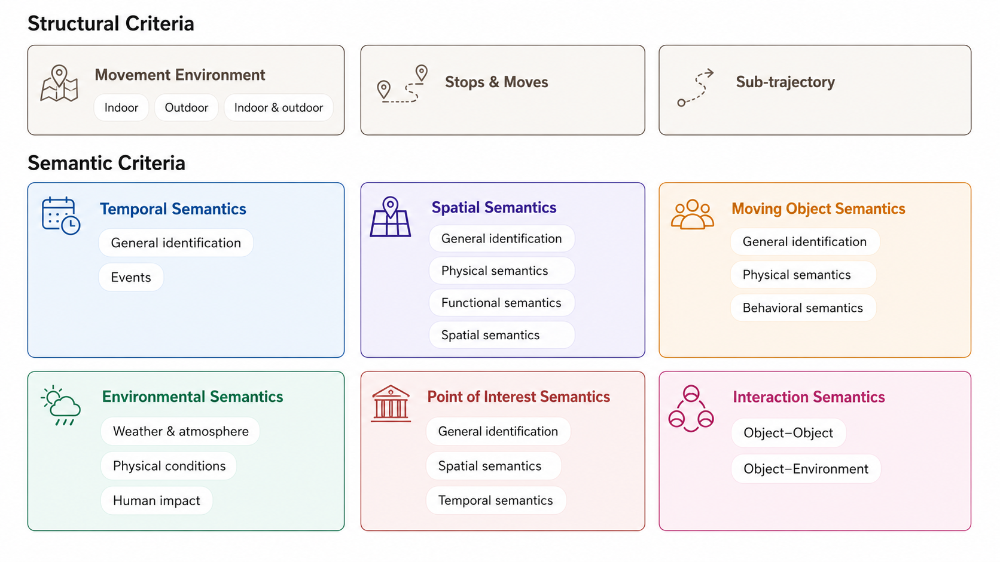

*Figure 1: Categorization of evaluation criteria.*

On the one hand, structural criteria were chosen because they capture the three fundamental dimensions of trajectory representation: (1) the movement environment (indoor, outdoor, or hybrid spaces), (2) the segmentation of trajectories into Stops and Moves, and (3) the support of the sub-trajectory concept. These criteria characterize how trajectories are structured and represented.

On the other hand, semantic criteria are organized into six main classes: Temporal Semantics, Spatial Semantics, Moving Object (MO) Semantics, Point of Interest (POI) Semantics, Environmental Semantics, and Interactions Semantics. They describe the timing and movement patterns, the semantics of visited places, the environmental context, and how moving objects interact with each other or with the surrounding space. Together, these criteria encompass the major sources of semantic information considered in the literature. Our focus will be on these semantic criteria, as they form a core part of our contributions.

The Figure 1 presents the organisation of the structural and semantic criteria as described above.

### 3.1. Structural criteria

In this section, we will describe the three structural criteria that we propose to use: (1) the movement environment, (2) the Stops and Moves concept, and (3) the sub-trajectory.

#### 3.1.1. Movement Environment

The first structural criterion is the movement environment which categorizes semantic trajectory models based on their spatial applicability. This classification is primarily determined by the specific environment they are designed for. The majority of the reviewed models (13 out of 19) are primarily designed for outdoor environments, as data collection in such settings is generally more accessible and manageable compared to indoor environments.

This criterion draws directly on the nature of the space Z in the raw trajectory’s definition in the Comparison Model (Definition 1): an outdoor environment corresponds to a geometric space (𝑍⊂ ℝ2 or ℝ3), while an indoor environment corresponds to a symbolic space (𝑍 = {𝐴1, … , 𝐴𝑝}, functional zones), a distinction aligned with modeling principles from standards such as IndoorGML.

This criterion is particularly important because the technologies used to capture movement differ significantly across environments. The method of space representation also varies depending on whether the model is applied indoors or outdoors, and this has a significant impact on the ability to capture, analyze, and understand movement accurately. The outdoor positioning can often pinpoint a MO’s location with high accuracy, while indoor positioning is generally limited to representing the object’s position within a broader area or as an approximation, reflecting the inherent challenges of indoor localization (e.g., Visitor 1 inside Room 5 of the museum). The values of movement environment criterion are as follows:

- Outdoor Space: Outdoor environments are characterized by their open and expansive nature, where GPS technology operates effectively to capture the precise position of a MO. These environments are particularly suited for models developed to address urban mobility and transportation challenges, such as traffic flow analysis and route optimization (He, Chen, Zheng, Chen, Zhang, Yan and Lin, 2021; Afroz, Nyakwende and Goswami, 2023).
- Indoor Space: This value refers to movement within enclosed environments such as museums, hospitals, and shopping malls. Indoor environments are characterized by complex architectures, which has led to numerous studies on the representation of indoor spaces (Kang and Li, 2017; Li, Zlatanova, Torres-Sospedra, Pérez- Navarro, Laoudias and Moreira, 2019; Ryoo, Kim and Li, 2015). Moreover, traditional GPS sensors are generally ineffective in such settings. For this reason, various sensors and technologies have been developed to capture movement indoors. Indoor Positioning Systems (IPS) rely on technologies such as WiFi, RFID, UWB, and Bluetooth, along with positioning techniques like Angle of Arrival (AoA), Time of Arrival (ToA), and others, to track positions and movements within these complex environments (Deng, Ai, Deng, Gao and Shang, 2022; Mostafa, Harras and Youssef, 2022; Naser, Lam, Qamar and Zaidan, 2023; Sartayeva, Chan, Ho and Chong, 2023).
- Both Spaces: This value includes models that represent movement data by considering both outdoor and indoor environments, since a MO can transition between different types of environments (e.g., exiting a museum to enter a street). The HiOutdoor-Indoor (Noureddine, Ray and Claramunt, 2022) and MAMLSTR (Cayèré et al., 2021) models account for this shift and integrate both environments in their analysis.

#### 3.1.2. Stops & Moves

The second criterion is based on the Stops and Moves concept, which provides a structured way to segment trajectories, distinguishing between stationary phases (Stops) and transition phases (Moves). This concept was introduced by Spaccapietra, Parent, Damiani, de Macedo, Porto and Vangenot (2008), and many models adopt this segmentation because it simplifies the trajectory data and allows for more focused analysis. Additionally, this approach helps define Points of Interest (POIs), which are significant areas that play a crucial role in the movement along a trajectory. These POIs correspond to the Stops in the segmentation process and contribute to a better understanding and analysis of the trajectory.

If we project this onto the proposed Comparison Model, a Stop is defined as a subtrajectory 𝑇 [𝑖∶𝑗] over which the temporal information is interval-based, the spatial position remains invariant around a given location, and the elapsed duration (𝑡𝑒𝑛𝑑 − 𝑡𝑠𝑡𝑎𝑟𝑡) exceeds a minimum threshold 𝜃, reflecting a significant amount of time spent around a location. A Move is defined as a subtrajectory 𝑇 [𝑖 ∶ 𝑗] located between two consecutive stops, over which the spatial position changes and the elapsed duration remains below 𝜃, reflecting a transitional episode. A trajectory is thus decomposed into an alternating sequence of stops and moves, each a specific instance of the subtrajectory defined above.

This criteria allows us to know if the studied model is part or not of Stops and Moves model family; this is important because semantic trajectory models have predominantly focused on outdoor environments, emphasizing the enrichment of GPS data, the identification of Stops and Moves, and the recognition of modes of transport, among other conceptual models. Crucially, however, a moving object neither covers such long distances nor reaches such high speeds indoors—which calls into question the direct applicability of Stops and Moves definitions in their current form to indoor settings. We are therefore interested in questioning the use of the stops-and-moves model in indoor or hybrid contexts.

#### 3.1.3. Semantic subtrajectory

Finally, the third component is the sub-trajectory, which allows for the decomposition of a trajectory into smaller segments. This segmentation can be informed by semantic information, which will be discussed later. Sub-trajectories facilitate a finer-grained analysis and enable a more detailed and context-aware semantic representation of movement.

By a subtrajectory, we refer to any sequence of points that can be extracted from the original trajectory. According to definitions by Noureddine et al. (2022) subtrajectories can be categorized into two main types:

- Subtrajectory - composed of multiple disjoint segments extracted from the trajectory, which are still collectively considered a subtrajectory despite gaps between points.
- Continuous Subtrajectory - a sequence in which all points are consecutive, preserving the original order and continuity of the trajectory.

A semantic subtrajectory means that the decomposition must have a meaningful interpretation. The segments of a given trajectory are defined based on semantic criteria detailed in the next subsection.

This criterion is considered because it reflects a model’s ability to represent trajectories at variable granularity, decomposing a global trajectory into meaningful segments (e.g., rooms, exhibition areas). This capability is particularly relevant for indoor applications, where movement is naturally structured by architectural and thematic boundaries.

In terms of the comparison model, a semantic subtrajectory is defined as a subtrajectory 𝑇 [𝑖∶𝑗] whose boundaries (𝑖, 𝑗) are not arbitrary but determined by a semantic criterion over the attribute-value pairs 𝑆𝑒𝑚𝑘 of the segment, such that the resulting segment corresponds to a coherent, meaningfully interpretable unit.

### 3.2. Semantic criteria

In this section, we introduce the semantic criteria organized in six distinct classes; Figure 1 illustrates this classification, including potential sub-classes for each class.

The six semantic criteria introduced in this section rely on the semantic context 𝑆𝐶 = (𝐶, 𝐾, 𝐷𝑜𝑚, 𝜏) defined in the comparison model: each criterion assesses whether a given model instantiates, within its semantic annotations, at least one semantic attribute 𝑘 ∈ 𝐾 typed to the corresponding category 𝑐 ∈ 𝐶 via 𝜏.

The six classes organising the semantic criteria serve to organize and enhance the representation of attributes and values. It is important to note that this structure is extensible, allowing for the addition or removal of sub-classes, attributes, and values depending on the availability of data and the specific application domain.

#### 3.2.1. Temporal Semantics

Information related to the time of the trajectory forms an important part of the trajectory’s definition. By temporal semantics, we refer to all information associated to time, beyond the simple annotation of the time itself (e.g., day of the week, time of day). Temporal semantics is essential because it transforms raw timestamps into interpretable temporal categories (e.g., time of day, weekday/weekend, seasonality, opening hours), enabling the analysis to explain, compare, and predict movement patterns in relation to their temporal context, rather than treating time as a mere ordering variable. Without an explicit representation of time, models cannot distinguish between these behaviorally distinct situations, even when the underlying spatial path is identical.

This is particularly important in museums context, where knowing that a moving object stopped for a given duration is insufficient to determine, for instance, whether that stop reflects real engagement during a quiet weekday morning or just queuing during a crowded Saturday afternoon, information that is essential to distinguish voluntary interest from context-driven constraint.

We introduce two main types of temporal semantics:

- General Identification of time such as Year, Month, Day of the week, Weekend/weekday, Period of the day.
- Events that encompass attributes related to events associated with specific times, such as: Name, Type, Date, Description. For example: a musical show on May 13th, 2012 (from 8 to 11 p.m.), at Main Square in the city of Madrid, as given in (Bogorny, Renso, de Aquino, de Lucca Siqueira and Alvares, 2014).

*Figure 10 in Appendix C illustrates the hierarchical organization of the temporal semantics.*

#### 3.2.2. Spatial Semantics

Spatial Semantics are essential because they determine how a space itself is described beyond its role as a mere container of coordinates. Raw positional data only indicates where a moving object is, without conveying what that space actually is or represents. Enriching a space with identification information, general characteristics, physical properties, or functional attributes allows the model to characterize the nature of the environment in which movement occurs, rather than treating it as an undifferentiated geometric backdrop.

Such semantic enrichment proves particularly valuable in indoor contexts such as museums: consider two zones in which moving objects exhibit an unusually long passage time. Knowing the congestion attribute of each zone makes it possible to distinguish that the first zone is currently overcrowded, meaning that the extended passage time results from a bottleneck caused by the presence of many other visitors, while the second zone is not congested, meaning that the extended passage time instead reflects a voluntary slowdown driven by genuine interest in its content. Without access to the zone’s functional characteristics, both situations would produce the same spatio-temporal signal, an unusually long duration, despite corresponding to two opposite behavioral causes: a constraint imposed by the environment versus a deliberate choice by the visitor.

We propose four main types of spatial semantics:

- General Identification of space that is composed of various attributes such as: Identifier, Name, Type, Description, Importance.
- General characteristics allowing the description of the space without detailing the physical or functional characteristics. Thus, it includes attributes such as: 𝑥, 𝑦 coordinates, Type, Floor, Building, Geographical area (e.g. city), Spatial relationships with other spaces, Layer (interior or exterior), Location relative to other objects.
- Physical characteristics that is composed of the following attributes: Geometry (form, dimensions), Materials, Color, Area temperature, Zone humidity.
- Functional characteristics that focuses on these attributes: Use (office, corridor, meeting room), Capacity, Equipment (furniture, doors, windows), Accessibility (for people with reduced mobility), Congestion.

An example of the hierarchical organization of spatial semantics is provided in Appendix C in Figure 11.

#### 3.2.3. Moving Object Semantics

Moving Object (MO) Semantics are especially important because a trajectory only conveys a raw sequence of (symbolic) positions unless it is related to the nature of the object producing it. Enriching the moving object with general identification attributes, behavioral characteristics, physical characteristics, or associated devices allows the model to characterize who or what is moving, rather than treating all moving objects as interchangeable sources of the same generic movement.

Moving Object Semantics is relevant in museums context; indeed, consider two visitors who both stop for five minutes in front of the same painting. Knowing the activity attribute of each moving object makes it possible to distinguish that the first visitor’s activity is observing the painting, while the second visitor’s activity is waiting, and knowing the relational information associated with the second visitor, namely a relationship to another moving object still elsewhere in the room, explains why that visitor remains stationary without engaging with the artwork. Without access to these MO characteristics, both stops would be modeled identically, even though one reflects genuine engagement with the exhibited content and the other merely reflects a social dependency on a companion’s movement."

- General Identification that describes intrinsic and relational properties of the MO. It includes attributes such as identifier, name, type, description, age, sex, height, weight, date and place of birth, profession, nationality, and relational information such as relationship to other objects or relative spatial position.
- Behavioral Characteristics that capture cognitive or social dimensions of the MO, including activity, goal, emotional state, and online presence (e.g., social media engagement).
- Physical Characteristics that describe movement-related dynamics such as speed, acceleration, direction, and the transportation means used.
- Devices that includes portable technologies associated with the MO, such as a phone or tablet, which may serve as movement sensors or contextual indicators.

*Figure 12 represents an example of a hierarchical organization of this information.*

#### 3.2.4. Point of Interest (POI) Semantics

The POIs refer to the key points that can be present in a given trajectory (places or notable objects). It is important to note that we are referring to all types of points that may be significant, regardless of their shape, whether they are points, lines, or even regions. For this reason, we have included form and geometry to specify and provide more details about the shape of these points of interest.

Point of Interest (POI) Semantics are essential because the mere identification of a stop, without further enrichment, does not allow the model to reason about the nature of what was visited. Enriching a POI with general identification information, spatial characteristics, temporal characteristics, or interactive characteristics allows the model to characterize what was actually visited, rather than treating every stop as an undifferentiated pause in space. Such semantic enrichment proves particularly valuable in indoor contexts such as museums: for two stops of comparable duration, knowing the category of the corresponding POI, for instance a painting versus an interactive sculpture, makes it possible to attribute different motivations to otherwise identical stops, namely passive contemplation in the former case, and active engagement or manipulation in the latter, a distinction that would remain entirely invisible without access to the POI’s category information.

We introduce four types of POI Semantics as it follows:

- General Identification of POI that include the following attributes: Identifier, Name, Type, Category, Description, Importance, Artist / Creator.
- Spatial characteristics that consider Dimensions, Shape, Type (indoor or outdoor), Location, Geometry, Geographical coordinates, Nearby landmarks, Spatial relationships with other spaces.
- Temporal characteristics that is specific to POI and includes: Access times, Visit duration, Period: start and end dates for temporary POIs, Peak season.
- Interactive characteristics that deals with Reviews and comments (visitor ratings and opinions).

An example of the hierarchical organization is presented in Figure 14 in Appendix C.

#### 3.2.5. Environmental Semantics

These semantics include all contextual information that can be collected and that are related to the external environment, assuming that such information can affect the trajectory’s data and distribution. Environmental Semantics is essential because a moving object’s behavior cannot be fully understood in isolation from the ambient conditions surrounding it. Enriching the environment with weather and atmospheric attributes, physical conditions, or human impact indicators allows the model to characterize the context in which movement takes place, rather than treating all behavior as occurring under uniform conditions.

Such semantic enrichment proves particularly valuable in indoor contexts such as museums: consider two visitors who both pass quickly through the same zone without stopping, but at two different moments in time. Knowing the noise attribute of the zone at each moment makes it possible to distinguish that the first visitor passes through during a period of high noise level, meaning that the fast pace likely reflects an attempt to avoid an uncomfortable environment rather than its disinterest in the content, while the second visitor passes through during a calm period, meaning that the same fast pace, occurring under favorable conditions, more plausibly reflects an actual lack of interest. Without access to the environment’s physical conditions, both situations would produce the same behavioral signal, an unusually fast pace through the zone, despite corresponding to two opposite underlying causes.

We propose 3 types of Environmental Semantics:

- Weather & Atmosphere such as: Outdoor temperature, Outdoor humidity, Gas concentrations, Wind speed.
- Physical Conditions that can include: Noise, General lighting.
- Human impact that can integrate: Traffic density, industrial activity nearby, waste or odor levels.

An example of the hierarchical organization of Environmental Semantics is provided in Appendix C in Figure 13.

#### 3.2.6. Interactions Semantics

Interactions Semantics are essential because a moving object’s behavior cannot be fully understood by considering it in isolation, without accounting for how it relates to other objects or to the surrounding environment. Enriching the movement with object-object interactions or object-environment interactions allows the model to characterize the relational dimension of movement, rather than treating every stop or trajectory segment as a purely autonomous behavior.

This type of information requires specific capture methods and sensors to identify the interactions of the MO. This type of information was considered in (Ceccarelli, Cesta, Cortellessa, De Benedictis, Fracasso, Leopardi, Ligios, Lombardi, Malatesta, Oddi, Pagano, Palombini, Romagna, Sanzari and Schaerf, 2024), where specific cameras with AI techniques were used to identify the position and interactions of a MO in a given exhibition hall of an Italian museum.

Such semantic enrichment proves particularly valuable in indoor contexts such as museums: consider two visitors who both stop for a comparable duration in front of two different artworks. Knowing the object-environment interaction attribute makes it possible to distinguish that the first visitor physically interacts with the artwork, for instance through a touch-based interactive display, reflecting active, exploratory engagement, while the second visitor remains passively in front of the artwork without any physical interaction, reflecting a more contemplative form of engagement. Without access to this interaction information, both stops would appear behaviorally identical based on duration alone, despite corresponding to two distinct modes of engaging with the exhibited content.

We distinguish two types of interactions: the Object-Object interaction, which refers to the interaction between a given MO and another MO occurring in the same place, and the second type Object-Environment interaction, which refers to the relationship between the MO and the environment where it occurs:

- Object-Object: Collisions, Overtaking
- Object-Environment: Interaction with surfaces, Interaction with artworks.

The hierarchical organization for Interactions Semantics is illustrated in the figures in Appendix C In Figures 11, 14, 15, the text enclosed in brackets indicates possible values associated with each attribute.

### 3.3. Structural and Semantic Criteria Assessment

The structural criteria presented in Table 1 are evaluated using binary or categorical values (e.g., Indoor/Outdoor, Yes/No), as they correspond to well-defined structural elements of the comparison model, such as the nature of the spatial domain 𝑍 or the temporal representation of 𝑡𝑘. In contrast, semantic criteria cannot be assessed solely based on their presence or absence, since the semantic context 𝑆𝐶 = (𝐶, 𝐴, 𝐷𝑜𝑚, 𝜏) allows trajectory models to differ considerably not only in whether they instantiate a given semantic category, but also in how richly and formally they represent the corresponding attributes 𝑎 ∈ 𝐴. Therefore, we evaluate semantic criteria according to their semantic expressiveness, defined as the degree to which a model formally represents and exploits the semantic attributes typed by 𝜏 within a given category — encompassing, for instance, the granularity of the attribute domain 𝐷𝑜𝑚(𝑎), or the extent to which the model exploits this information beyond mere annotation.

Rather than measuring the quantity of semantic information, the proposed classification evaluates the level of conceptual formalization adopted by each model. The classification is inspired by the evolution of knowledge representation systems, progressing from simple semantic annotations to fully axiomatized ontologies capable of supporting logical reasoning (Guarino, 1998; Uschold and King, 1996; Berners-Lee, Hendler and Lassila, 2001). To ensure reproducibility, each model is assigned to one of three semantic expressiveness levels according to the objective characteristics summarized in Table 2.

A trajectory model is assigned to the highest semantic expressiveness level satisfying the following rules, defined with respect to the semantic context 𝑆𝐶 = (𝐶, 𝐴, 𝐷𝑜𝑚, 𝜏):

- Low: semantic attributes 𝑎 ∈ 𝐴 are represented solely as attribute–value annotations (𝑎𝑡𝑡𝑟𝑘,𝑗, 𝑣𝑎𝑙𝑢𝑒𝑘,𝑗), with no conceptual organization among them, i.e., no structural relationship is defined over 𝐴.
- Medium: semantic attributes 𝑎 ∈ 𝐴 are organized within one or more hierarchical structures (e.g., taxonomies of POI types or activity categories), thereby introducing structural relations over 𝐴 that go beyond flat annotation, but without relying on a formal ontology or logical axioms.

*Table 1 Values for structural and semantic criteria.*

| Criteria |  | Possible values |
| --- | --- | --- |
| Structural criteria | Movement Environment | Outdoor \| Indoor & Outdoor \| Indoor |
|  | Stops & moves | Yes \| No |
|  | Subtrajectory | Yes \| No |
| Semantic criteria | Temporal characteristics | Low \| Medium \| High |
|  | Spatial characteristics |  |
|  | MO characteristics |  |
|  | Environment |  |
|  | Point of Interest |  |
|  | Interaction |  |

*Table 2 Semantic expressiveness levels used for evaluating semantic characteristics.*

Level Knowledge Characteristics Inference capability representation Low Lexical annotations Semantic information is represented as isolated labels or attributes without conceptual organization or explicit semantic relationships.

No semantic inference. Information is interpreted only through attribute names.

Medium Hierarchical schema Semantic entities are organized into hierarchical categories. However, the model does not define formal ontology axioms or logical constraints.

Limited semantic interpretation based on hierarchical organization. No ontology reasoning.

High Formal ontology Semantic concepts are represented using ontology languages (e.g., OWL/RDF) with formally defined classes, properties, constraints, and logical axioms enabling machine-interpretable semantics.

Supports Description Logic reasoning and automatic knowledge inference.

- High: semantic attributes 𝑎 ∈ 𝐴 are instances of one or more formal ontologies, with explicit classes, properties, and logical constraints defined over 𝐷𝑜𝑚(𝑎), and, in some cases, supporting ontology-based reasoning mechanisms.

For each semantic criterion, the assigned level reflects the expressiveness of the underlying representation of 𝐴 — its degree of formal and conceptual structuring — rather than the amount of semantic information available.

For example, a temporal characteristic represented only by timestamps is classified as Low, while a temporal model describing events or activities belongs to the Medium level. Temporal representations relying on formal temporal ontologies and reasoning mechanisms are classified as High. The same evaluation principle is consistently applied to all semantic dimensions.

## 4. Review of Semantic Trajectory Models

In this section, we present and review prior research contributions in the field of semantic trajectories. Various models have been proposed to represent and analyze semantic trajectory data, each employing distinct definitions, terminology, and conceptual frameworks. These different approaches reflect diverse perspectives on how semantic trajectory data can be understood and utilized. To offer a clear and structured overview of the field’s evolution, we present a timeline (Figure 2) that illustrates the chronological progression of key trajectory models. These models are categorized based on the type of the movement environment (outdoor, indoor, or mixed), and the semantic expressiveness level they provide in describing contextual information. The first models were dedicated to outdoor environments, with a low to moderate level of expressiveness regarding semantic information, except for the model that used an ontology in 2008, where it offered a high level of expressiveness. In 2017, models for indoor environments start being developed, and the semantic information was highly detailed and handled by these models.

We also focused on reformulating these models based on the comparative model, and we provide two detailed examples of the MASTER and SITM models in an Appendix.

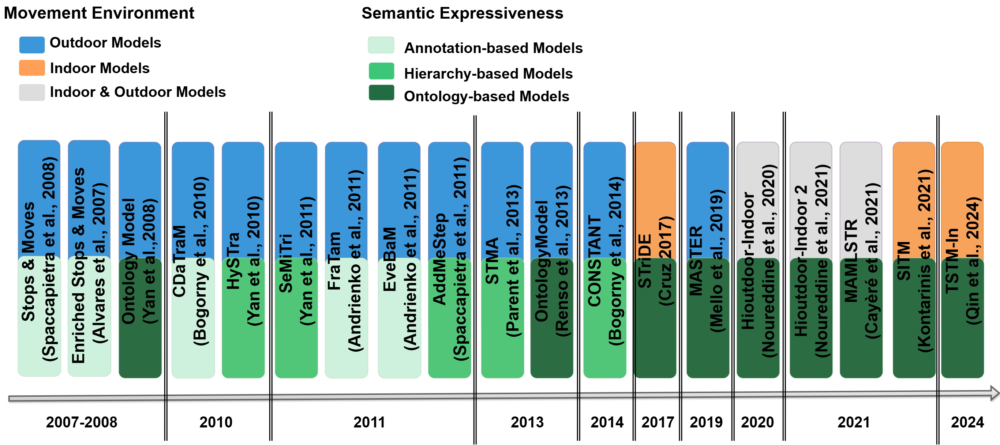

*Figure 2: The evolution of semantic trajectory models.*

### 4.1. Outdoor semantic trajectory models

Since outdoor models represent the majority of the models identified in our study (13 out of 19), we further classify them based on the semantic expressiveness level they integrate. Accordingly, we identify three categories of semantic expressiveness in outdoor trajectory models: (1) Annotation-based models, (2) Hierarchy-based models, and (3) Ontology-based models.

These categories reflect the depth, structure, and richness with which semantic information is incorporated into the model. Annotation-based models refer to models that include only minimal semantic information, typically represented through simple, flat attributes without any structured classification or organization. Hierarchy-based models characterize models that provide some level of structure, such as predefined classes, offering more semantic depth than basic models but still lacking comprehensive organization. Ontology-based models refer to models that include a well-defined and explicit semantic structure, often supporting ontological representations. These models enable more advanced interpretation, reasoning, and querying capabilities, making them well-suited for complex analysis tasks.

#### 4.1.1. Annotation-based models

We first present the outdoor models classified at the annotation-based level of semantic expressiveness, in which semantic information is represented solely as flat attribute–value annotations, without any hierarchical or ontological organization.

Stops and Moves Model (Spaccapietra et al., 2008). The Stops and Moves model was proposed in 2008, and it represents one of the foundational semantic abstractions in semantic trajectory research due to its intuitive segmentation of mobility behavior into meaningful stationary and transition phases. This principle marked an early transition from purely geometric trajectories toward semantically interpretable mobility representations. Its conceptual simplicity facilitates interoperability with multiple application domains and enables efficient semantic summarization of movement patterns.

In terms of the comparison model, a trajectory is segmented into an alternating sequence of stops and moves, each corresponding to a subtrajectory 𝑇 [𝑖 ∶ 𝑗] as defined in our model: a stop is characterized by spatial invariance over a time interval, while a move corresponds to the transition segment between two stops. Semantic enrichment is limited to flat attribute–value annotations attached to these segments (𝑆𝑒𝑚𝑘), placing the model at the annotation-based level of semantic expressiveness.

Thus, semantic enrichment mainly relies on the segmentation of trajectories into stops and moves, while contextual dimensions such as environmental information, interactions, and behavioral characteristics are not explicitly represented. Moreover, the model was designed for outdoor mobility analysis and does not address the particularities of indoor spaces or dynamic spatial structures. Nevertheless, its conceptual simplicity and intuitive interpretation have made it one of the most influential abstractions in semantic trajectory research.

Enriched Stops and Moves Model. At the same period, Alvares et al. (2007) extend the Stops and Moves paradigm through a data preprocessing framework aimed at enriching trajectory data with meaningful contextual information. The integration of candidate stops and semantic geographical information enabled more effective mobility interpretation and facilitated applications such as tourism analysis, mobility behavior understanding, and location recommendation.

In terms of the comparison model, stops correspond to subtrajectories 𝑇 [𝑖 ∶ 𝑗] whose spatial component 𝑧𝑘 is matched against predefined semantic geographical regions, with the resulting label attached as a semantic attribute in 𝑆𝑒𝑚𝑘. As with the previous model, semantic information remains a flat attribute–value annotation, without hierarchical or ontological structuring, placing the model at the annotation-based level.

Thus, although the introduction of semantic geographical information improves the interpretation of mobility behavior, semantic enrichment remains mainly centered on spatial annotations and predefined regions. The model provides limited support for other semantic dimensions, such as environmental context and interactions. In addition, the representation remains largely static and oriented toward outdoor environments.

CDaTram Model (Bogorny, Heuser and Alvares, 2010). Proposed in 2010, CDaTram model extends the Stops and Moves concept by defining the trajectory as finite sequence < 𝐼1, 𝐼2, … , 𝐼𝑛 > where each element 𝐼𝑘 represents either a Stop or a Move that has the spatial and the temporal dimension. The model improves semantic annotation capabilities and facilitates the incorporation of contextual mobility information into trajectory analysis workflows.

In terms of the comparison model, each element 𝐼𝑘 corresponds to a subtrajectory 𝑇 [𝑖 ∶ 𝑗], with the Stop/Move distinction formalized exactly as in our stops-and-moves definition. Semantic content is expressed through attribute– value annotations attached to each 𝐼𝑘, without hierarchical organization, placing the model at the annotation-based level.

Despite these contributions, the model provides only moderate semantic expressiveness and remains relatively dependent on predefined contextual structures. Environmental information and interaction-related semantics are not explicitly considered. Furthermore, the model does not address the specific spatial constraints encountered in indoor environments.

EveBam Model (Andrienko, Andrienko and Heurich, 2011b). In 2011, EveBam model was proposed, which is a model that extends the concept of Stops and Moves. A key innovation in this model is the interpretation of Stops and Moves as spatial events, which are part of a broader set of objects defined within semantic trajectories. These trajectories are grounded in three core dimensions: Space (S), Time (T), and Objects (O). This perspective enables richer behavioral analysis and supports activity-centered semantic reasoning.

In terms of the comparison model, an event can be related to the notion of subtrajectory 𝑇 [𝑖 ∶ 𝑗], with the object dimension 𝑂 introducing an attribute typed as 𝜏(𝑎) = MovingObject within 𝑆𝑒𝑚𝑘. Semantic annotations remain unstructured attribute–value pairs, without hierarchical or ontological grounding, placing the model at the annotationbased level.

The model focuses on the spatio-temporal and object dimensions, while environmental information and interaction semantics remain outside its scope. Moreover, the representation does not consider indoor topology or dynamic spatial structures.

FraTam Model. Andrienko, Andrienko, Bak, Keim, Kisilevich and Wrobel (2011a) conceptualize movement as a function involving three fundamental components: space (S), time (T), and objects (O). It distinguishes between interset relations (e.g., object–space, object–time, and space–time) and intra-set relations (e.g., object–object, time–time), enabling a comprehensive view of spatio-temporal dynamics. This segmentation-oriented perspective facilitates the identification of meaningful movement episodes and supports localized semantic interpretation.

In terms of the comparison model, movement episodes can be related to the notion of subtrajectories 𝑇 [𝑖∶𝑗], and the inter-/intra-set relations are expressed as attribute–value annotations within 𝑆𝑒𝑚𝑘, without conceptual organization beyond flat annotation. This places the model at the annotation-based level of semantic expressiveness.

The model focuses on movement segmentation and the analysis of spatio-temporal relationships. Environmental information, interaction semantics, and indoor-specific spatial characteristics are not explicitly considered.

#### 4.1.2. Hierarchy-based models

These models are more advanced than the previous group, incorporating richer semantic information and providing a more structured representation of that information.

HyStra Model (Yan, Parent, Spaccapietra and Chakraborty, 2010). This is a hybrid model and provides a computing platform designed to transform raw GPS data into semantically enriched trajectories, facilitating a deeper understanding of movement patterns and behaviors. The model demonstrates improved flexibility in representing contextual mobility information and supports more structured semantic descriptions than earlier annotation-based approaches.

According to the comparison model, HyStra explicitly represents temporal, spatial, and moving object semantics, but provides limited support for Point-of-Interest, interaction, and environmental semantics. Furthermore, its trajectory representation remains primarily sequence-based and does not address indoor environments or the dynamic evolution of semantic entities.

However, semantic information remains only partially organized, and some dimensions, such as interactions and environmental conditions, are not explicitly represented. In addition, the model targets outdoor mobility scenarios.

SeMiTri framework (Yan, Chakraborty, Parent, Spaccapietra and Aberer, 2011). SeMiTri framework aims to enrich trajectories with semantic annotations based on external geographic and application data sources. The model supports contextual mobility interpretation and improves the semantic characterization of movement patterns.

The semantic representation remains moderate, and several semantic dimensions, including environmental information and interactions, are only partially represented.

AddMeStep Model (Spaccapietra and Parent, 2011). Proposed in 2011, this model defines a movement as the time-stamped changes in the spatial position of a MO. This MO can either control its movement (e.g., a person, an animal, a vehicle) or be controlled (e.g., a parcel). Authors also define the movement track as the sequence of spatiotemporal positions that contain the evolving position of the object. The model increases semantic flexibility and enables richer contextual integration than earlier geometric trajectory approaches.

In terms of the comparison model, a step can be interpreted as an elementary sub-trajectory 𝑇 [𝑖 ∶ 𝑗], while the movement track corresponds to the complete trajectory 𝑇 . Unlike models supporting explicit hierarchical trajectory decomposition, AddMeStep model treats steps as conceptual building blocks of a movement track without defining formal composition relationships among sub-trajectories. The model explicitly captures temporal, spatial, and moving object semantics but leaves Point-of-Interest, environmental, and interaction semantics outside its core representation. Moreover, it does not consider indoor topology or the dynamic evolution of semantic entities.

However, semantic organization remains relatively flat and weakly structured. Although additional attributes can be integrated, the model lacks advanced semantic hierarchy and ontology-based reasoning mechanisms. As a result, semantic interoperability and semantic scalability remain limited.

STMA Model. Parent, Spaccapietra, Renso, Andrienko, Andrienko, Bogorny, Damiani, Gkoulalas-Divanis, Macedo, Pelekis, Theodoridis and Yan (2013a) proposed a refined definition of raw trajectory from AddMeStep model Spaccapietra and Parent (2011) (trajectoryID, movingObjectID, trace: LISTOF position(instant, point, 𝛿)), where the newly added element 𝛿 represents a possibly empty list of additional raw data (e.g., speed, direction). A refined definition of semantic trajectory was also given:

𝑆𝑒𝑚𝑇𝑟𝑎𝑗𝑒𝑐𝑡𝑜𝑟𝑦 = (𝑡𝑟𝑎𝑗𝑒𝑐𝑡𝑜𝑟𝑦𝐼𝐷, 𝑚𝑜𝑣𝑖𝑛𝑔𝑂𝑏𝑗𝑒𝑐𝑡𝐼𝐷, 𝑡𝑟𝑎𝑗𝑒𝑐𝑡𝑜𝑟𝑦𝐴𝑛𝑛𝑜𝑡𝑎𝑡𝑖𝑜𝑛𝑠, 𝑡𝑟𝑎𝑐𝑒 ∶ LISTOF 𝑝𝑜𝑠𝑖𝑡𝑖𝑜𝑛(𝑖𝑛𝑠𝑡𝑎𝑛𝑡, 𝑝𝑜𝑖𝑛𝑡, 𝛿, 𝑝𝑜𝑠𝑖𝑡𝑖𝑜𝑛𝐴𝑛𝑛𝑜𝑡𝑎𝑡𝑖𝑜𝑛𝑠), 𝑠𝑒𝑚𝑎𝑛𝑡𝑖𝑐𝐺𝑎𝑝𝑠 ∶ LISTOF 𝑔𝑎𝑝(𝑡1, 𝑡2), 𝑠𝑒𝑔𝑚𝑒𝑛𝑡𝑎𝑡𝑖𝑜𝑛𝑠 ∶ SETOF 𝑠𝑒𝑔𝑚𝑒𝑛𝑡𝑎𝑡𝑖𝑜𝑛(𝑠𝑒𝑔𝑚𝑒𝑛𝑡𝑎𝑡𝑖𝑜𝑛𝐼𝐷, 𝑒𝑝𝑖𝑠𝑜𝑑𝑒𝑠 ∶ LISTOF 𝑒𝑝𝑖𝑠𝑜𝑑𝑒(𝑡3, 𝑡4, 𝑑𝑒𝑓𝑖𝑛𝑖𝑛𝑔𝐴𝑛𝑛𝑜𝑡𝑎𝑡𝑖𝑜𝑛, 𝑒𝑝𝑖𝑠𝑜𝑑𝑒𝐴𝑛𝑛𝑜𝑡𝑎𝑡𝑖𝑜𝑛𝑠))

In this definition, more information is added and organized so that we can find 𝛿, which serves the same purpose as in raw trajectory. For the segmentation, we can find definingAnnotation and episodeAnnotations. The former is considered the principal criterion that defines the episode for segmentation, while the latter serves as additional details that enrich the episode with more context. Contextual data can be added from external sources, and the authors refer to a contextual data repository that can be included in the annotation part of the semantic trajectory. A new definition introduced in this article is the sound raw trajectory, which refers to transforming imperfect raw movement data into a trajectory dataset that is correct and manageable from the viewpoint of the targeted application.

The authors discussed basic concepts related to trajectory behaviors, defining a behavior as a set of characteristics that identify a specific pattern of movement for a single MO or a group of MOs. A behavior can be either individual or collective: an individual trajectory behavior is defined as a trajectory behavior whose predicate 𝑝(𝑇 ) applies to a single trajectory 𝑇 , whereas a collective trajectory behavior is one whose predicate 𝑝(𝑆) applies to a nonempty set of trajectories 𝑆.

In terms of the comparison model, STMA model explicitly supports sub-trajectories through segmentations composed of episodes, each episode corresponding to a temporally bounded portion (𝑇 [𝑖 ∶ 𝑗]) defined by a principal annotation. The model also distinguishes trajectory-, position-, and episode-level annotations and represents missing information through semantic gaps. It covers temporal, spatial, and moving-object semantics, while external contextual data can be incorporated through a contextual repository. Collective behavior is considered at the analytical level, but interactions are not modeled as explicit semantic relations. Indoor topology and environmental semantics are not explicitly represented.

CONSTAnT Model (Bogorny et al., 2014). CONSTAnT is a conceptual framework for representing semantic trajectories through the integration of heterogeneous contextual information. It models trajectories as sequences of annotated trajectory segments, allowing multiple semantic interpretations according to different application contexts. The framework distinguishes raw movement data from semantic annotations and supports the incorporation of contextual information from external sources, providing a flexible and extensible representation for semantic trajectory analysis.

In terms of the comparison model, CONSTAnT model explicitly represents semantic sub-trajectories through annotated trajectory segments, enabling multiple semantic interpretations of the same movement. The model captures temporal, spatial, moving object, and contextual semantics while allowing heterogeneous external information to enrich trajectory annotations. However, Point-of-Interest semantics are not explicitly structured as a dedicated semantic dimension, and interactions are not modeled as first-class semantic entities. Furthermore, the framework does not address indoor topology or the dynamic evolution of semantic entities.

#### 4.1.3. Ontology-based models

These models explicitly rely on ontologies (Gruber, 1993; Smith, 2012; Gruber, 2009) or adopt a highly structured approach to semantic representation. In the following, we first present two models that use ontologies for the conceptualization of semantic trajectories.

Ontology Model. The first work was introduced by Yan, Macedo, Parent and Spaccapietra (2008). In this study, the autors argue that semantic trajectory modeling requires the availability of geometric, geographic, and application domain knowledge. To ensure the integration of these data into trajectory representations, they proposed an ontology model that encompasses all relevant aspects. In addition, they introduced a modular ontology model rather than a single all-encompassing ontology which means a sub-ontology of a larger ontology. This modular approach offers key benefits such as extensibility, ease of design, and simplified maintenance. three modules have been proposed which are the geometric trajectory module, the geography module, and the application-domain module, and each module can be composed itself by several dedicated ontologies (e.g., Geometric trajectory Ontology is composed of the Spatial Ontology, Temporal Ontology, Spatiotemporal Ontology, and Trajectory Ontology).

Ontology Model 2. The Athena Framework (Renso, Baglioni, de Macedo, Trasarti and Wachowicz, 2013) facilitates human behavior discovery by transforming measured trajectories (raw spatiotemporal points 𝑝𝑘 = (𝑥𝑘, 𝑦𝑘, 𝑡𝑘)) into structured syntactic trajectories composed of IDs, stops (𝐵.𝐸.𝑆), and moves (𝑀). These are further refined into semantic trajectories by applying enrichment functions 𝜔 and 𝜙 within a specific application context 𝐶. This process labels movement patterns with meaningful annotations, such as identifying "Stops" as significant Points of Interest (POIs). Ultimately, the framework bridges the gap between raw GPS data and high-level behavioral insights by linking spatial movement to human activity.

The ontology-based trajectory models introduced a major conceptual advancement by incorporating formal semantic structures into trajectory representation. Unlike simple annotation-based approaches, the model enables semantic interoperability, hierarchical semantic organization, and ontology-driven reasoning capabilities. This significantly enhances semantic expressiveness and supports advanced contextual interpretation and semantic querying.

Despite their semantic richness, these models target outdoor mobility and provide limited support for the representation of indoor spaces and dynamic spatial changes.

In terms of the comparison model, semantic information is no longer represented as simple attribute–value annotations but as ontology instances linked through semantic relations. In Yan et al., trajectory observations are associated with concepts from the geometric, geographic, and application-domain ontologies, whereas Athena framework additionally instantiates Stops and Moves as semantically meaningful trajectory segments, which naturally correspond to sub-trajectories (T[i]). Semantic annotations are organized into explicit ontological hierarchies, enabling reasoning and semantic inference over trajectory elements. Both models explicitly represent the temporal, spatial, moving object, and Point-of-Interest semantic dimensions, while environmental and interaction semantics can be incorporated through domain ontologies but are not part of the core trajectory model. Furthermore, neither framework explicitly models indoor topology nor the temporal evolution of semantic entities.

MASTER Model (Mello, Bogorny, Alvares, Santana, Ferrero, Frozza, Schreiner and Renso, 2019). MASTER is a conceptual and logical model for representing semantic trajectories through an aspect-oriented paradigm. Rather than associating a single semantic interpretation with a trajectory, the model defines an aspect as a semantic perspective (e.g., stops, transportation, weather, or activities) according to which a trajectory can be segmented and analyzed. Each aspect generates an independent semantic decomposition of the same trajectory, allowing multiple complementary interpretations while preserving the underlying movement data. This design provides a flexible representation capable of integrating heterogeneous semantic information from different application domains.

In terms of the comparison model, each aspect defines a specific partition of a trajectory into semantically meaningful sub-trajectories (𝑇 [𝑖 ∶ 𝑗]), where the segmentation criterion depends on the considered semantic perspective. Semantic information is associated with trajectory segments through aspect-specific annotations rather than a unified semantic structure, enabling multiple concurrent semantic representations of the same trajectory. Consequently, the model explicitly supports temporal, spatial, moving object, Point-of-Interest, environmental, and applicationdependent semantic dimensions. However, semantic relationships between aspects are not formally represented, and the model does not explicitly address indoor topology, interaction semantics, or the temporal evolution of semantic entities.

### 4.2. Indoor semantic trajectory models

In this section, we present semantic trajectory models specifically designed for indoor movement analysis, where the spatial characteristics of the environment differ significantly from those of outdoor.

STriDE Model (Cruz, 2017). STriDE is an ontology-based framework for representing semantic indoor trajectories by integrating indoor topology with semantic trajectory concepts. The model decomposes a trajectory into semantic episodes, each corresponding to a meaningful movement phase associated with semantic and spatial context. Indoor spaces are represented as interconnected topological entities, enabling trajectories to be interpreted with respect to the indoor environment rather than solely as sequences of spatial positions.

In terms of the comparison model, semantic episodes naturally correspond to sub-trajectories (𝑇 [𝑖 ∶ 𝑗]), while episode annotations instantiate temporal, spatial, moving object, and indoor contextual semantics. The explicit integration of indoor topology distinguishes STriDE model from outdoor semantic trajectory models by associating trajectory segments with topological indoor entities and their connectivity relationships. However, Point-of-Interest semantics remain limited, and environmental and interaction semantics are not explicitly modeled. Furthermore, the framework represents successive trajectory episodes but does not address the temporal evolution of semantic entities or the dynamic evolution of the indoor environment.

SITM Model (Kontarinis et al., 2021). The SITM (Semantic Indoor Trajectory Model) (Kontarinis et al., 2021) represents a significant advancement in indoor semantic trajectory modeling through its region-based representation and explicit integration of indoor spatial semantics. Unlike conventional outdoor-oriented models, SITM incorporates IndoorGML spatial structures and semantically meaningful regions, making it well suited to complex indoor environments such as museums, airports, healthcare facilities, and smart buildings. By associating trajectory segments with indoor regions and contextual information, the model enhances the semantic interpretation of movement patterns.

In the comparison model, a trajectory is represented as an ordered sequence of region-based observations, where movements between consecutive regions define semantically meaningful sub-trajectories (𝑇 [𝑖 ∶ 𝑗]). Semantic annotations explicitly capture temporal, spatial, moving object, and indoor contextual semantics, while IndoorGML topological relationships represent spatial connectivity. Point-of-Interest, environmental, and interaction semantics are only partially supported and remain application-dependent.

Despite these strengths, SITM assumes a largely static indoor environment. It does not represent the temporal evolution of indoor spaces, semantic entities, or topological relationships, nor does it account for dynamic environmental changes such as evolving accessibility constraints, temporary obstacles, or adaptive space reconfigurations. Consequently, its applicability is limited in highly dynamic smart indoor environments where spatial and semantic contexts continuously evolve.

TSTM-in Model. Proposed in 2024, the Topological Semantic Trajectory Model (TSTM-in) represents indoor trajectories using a topological semantic framework (Qin, Wang, Wu, Li, Xiang and Zhu, 2024). It models trajectories through semantic relationships among Indoor Regions (IRs), corridors, and key points, where key points correspond to trajectory intersections with indoor scene elements, corridors represent movement paths within a floor, and IRs denote enclosed functional spaces such as rooms or halls.

Despite its explicit indoor representation, TSTM-in assumes a static topological structure and provides limited support for evolving topology or adaptive environmental semantics. Consequently, changes such as temporary obstacles, accessibility modifications, crowd-dependent routing, or smart-building reconfigurations are not explicitly represented.

In terms of the comparison model, a trajectory is formalized as an ordered sequence of IRs, corridors, and key points, with movements between consecutive elements forming semantically meaningful sub-trajectories (𝑇 [𝑖 ∶ 𝑗]). The model explicitly captures temporal, spatial, moving object, and indoor topological semantics. However, Pointof-Interest, environmental, and interaction semantics remain application-dependent, while the absence of temporal support for topological evolution limits its applicability to dynamic indoor environments.

### 4.3. Hybrid indoor-outdoor semantic trajectory models

This section focuses on models that support both types of mobility spaces (indoor and outdoor). The analysis and modeling of trajectory data in these models consider the characteristics of the surrounding environment, allowing for the representation of mobility data whether the MO is situated in a confined indoor or an open outdoor space.

HiOutdoor-Indoor Model. Noureddine, Ray and Claramunt (2020) proposed a model of semantic trajectories designed for both indoor and outdoor spaces, incorporating contextual information. In this model, semantic data is added to each segment of the trajectory and considered at different levels of abstraction. The primary objective of the model is to enhance the understanding of human mobility in urban environments, where the researchers implemented and evaluated their data using a Neo4j graph database and Cypher language, for database storage and query operations, respectively.

Noureddine et al. (2022) proposed an extended work, where they provide further details on the unified spatial model that represents both indoor and outdoor spaces for semantic trajectories. The spatial layer, denoted by 𝕃, is defined as a set of geographical features, such as points, polylines, and polygons, that represent classes of real-world entities at a given level of abstraction.

From this spatial layer, the authors define the indoor space as a set of hierarchically ordered and nested layers, denoted as 𝕀 = ⋃ 𝑖=1,…,|LI| 𝐿𝐼𝑖 where 𝐿𝐼𝑖 represents the 𝑖-th indoor layer. These layers are organized hierarchically such that 𝐿𝐼|LI| ⊂𝐿𝐼|LI|−1 ⊂ ⋯ ⊂𝐿𝐼1. Here, 𝐿𝐼1 corresponds to the coarsest level of abstraction (most general representation), and 𝐿𝐼|LI| corresponds to the finest level of abstraction (most detailed representation). Furthermore, for any element 𝑠′ 𝑖−1 ∈ 𝐿𝐼𝑖−1, there exists an element 𝑠′ 𝑖 ∈ 𝐿𝐼𝑖 such that 𝑠′ 𝑖 ⊂𝑠′ 𝑖−1. This hierarchical relationship indicates that each element in a finer layer (𝐿𝐼𝑖) is included in an element of the coarser layer (𝐿𝐼𝑖−1).

The Hi-Outdoor-Indoor model addresses an important challenge in semantic trajectory research by attempting to bridge indoor and outdoor mobility representations within a unified framework. This hybrid perspective significantly improves interoperability between heterogeneous mobility environments and facilitates the analysis of continuous mobility behaviors across indoor-outdoor transitions.

However, integrating indoor and outdoor semantics introduces substantial representational complexity due to the heterogeneity of spatial abstractions, topology structures, and contextual semantics involved in both environments. Managing semantic consistency across multiple mobility contexts remains difficult, particularly when dealing with dynamic environmental transitions and heterogeneous localization technologies.

MAMLSTR Model. Introduced by Cayèré et al. (2021), the Multi-Level and Multiple Aspect Semantic Trajectory Representation (MAMLSTR) model organizes semantic trajectories into three complementary abstraction levels: the raw data level, which captures the original spatiotemporal observations; the semantic data level, which enriches these observations with contextual and domainspecific semantics; and the interpretation level, which derives higherlevel semantic knowledge by integrating information from the underlying levels. This hierarchical organization promotes semantic modularity, facilitates the integration of heterogeneous contextual information, and supports the representation of complex mobility behaviors involving activities, environmental conditions, and user interactions.

Despite its rich semantic expressiveness, the model primarily emphasizes semantic enrichment rather than structural trajectory representation. The increasing number of semantic aspects introduces additional integration and reasoning complexity, which may reduce scalability in large-scale mobility applications. Moreover, maintaining semantic consistency and interoperability across heterogeneous semantic sources remains a significant challenge.

In terms of the comparison model, a trajectory is represented as an ordered sequence of spatio-temporal observations that are progressively enriched through successive abstraction levels. Semantically annotated trajectory segments are aggregated into meaningful sub-trajectories at the interpretation level, enabling multi-level semantic analysis. The model explicitly supports temporal, spatial, moving object, Point-of-Interest, environmental, and interaction semantics through its multi-aspect annotation framework. However, it does not explicitly represent indoor topological structures, nor does it model the temporal evolution of spatial entities, topological relationships, or semantic annotations, limiting its suitability for dynamic indoor environments.

For readers interested in a deeper understanding, the Appendix provides a more detailed description of several models discussed in this review. It includes extended explanations of their underlying structures, offering additional context and technical insights that complement the overview presented here. Due to lack of space, we couldn’t provide the complete description of all the models, but we chose the more important ones from the 3 categories following the movement environment criteria, and then models were selected to show different semantic expressiveness for the 6 semantic criteria.

## 5. Comparative analysis of semantic trajectory models

For each model, the previous section combined a brief description of its objective and application context, a mapping onto the notation of our comparison model, and a discussion of its semantic expressiveness. In this part, we present a comparative study between these models. We have observed that the comparison of several models, which use different terminologies, techniques, and often pursue different goals, highlights the necessity of a suitable benchmark. Thanks to the comparison model presented in Section 2, we were able to conduct this comparative analysis.

Building on the descriptive presentation of the reviewed models, this section conducts a systematic comparative analysis, presented in Table 3, based on the nine criteria introduced earlier — three structural (movement environment, stops and moves, semantic subtrajectory) and six semantic (Temporal, Spatial, MO, POI, Environmental, and Interactions Semantics). While structural criteria are evaluated using binary or categorical values, semantic criteria are assessed according to their semantic expressiveness, reflecting how formally each model represents and exploits the semantic attributes typed within 𝑆𝐶. This dual analysis allows us to identify convergences, gaps, and trends across the surveyed models, providing a foundation for the discussion in the following section.

The models are chronologically ordered from the oldest to the most recent, allowing us to observe the evolution of modeling approaches over time. This allow us to assess how effectively each model integrates contextual and domainspecific information to enhance the interpretation of movement data.

Moving Stops Sub Temporal Spatial Moving Point Interaction Environment OntologymodelYanetal.(2008) 2008 Outdoor Yes Yes High High Medium High / Medium HyStraYanetal.(2010) 2010 Outdoor Yes Yes / Medium Medium Low / Medium StopsandMoves 2008 Outdoor Yes Yes / Medium Low Medium Low Low CDaTramBogornyetal.(2010) 2010 Outdoor Yes Yes Low Medium Low Medium / / SeMiTriYanetal.(2011) 2010-2013 Outdoor Yes Yes Low Medium Medium Medium / / EnrichedStops&MovesModel 2007 Outdoor Yes Yes / Medium / Medium / / Model Year StructuralCriteria SemanticCriteria Moves Interest Space and trajectory Object of Comparisonofsemantictrajectorymodelsbasedontheproposedcriteria.

*Table3*

Spaccapietraetal.(2008)

Alvaresetal.(2007)

CONSTAnTBogornyetal.(2014) 2014 Outdoor Yes Yes Medium Low Medium Medium / Medium MASTERMelloetal.(2019) 2019 Outdoor No No Medium Medium High Low / Medium HiOutdoor-Indoormodel 2020-2021 In&Outdoor No Yes / High Low High / Medium MAMLSTRCayèréetal.(2021) 2021 In&Outdoor No Yes Low High Medium High / High FraTamAndrienkoetal.(2011a) 2011 Outdoor Yes Yes Medium Low Low Low / Low EveBaMAndrienkoetal.(2011b) 2011 Outdoor Yes Yes Medium Low Low Low / Low Ontologymodel 2013 Outdoor Yes Yes Medium High Medium High / / STMAParentetal.(2013a) 2013 Outdoor Yes Yes Low Medium Medium Medium / / STriDECruz(2017) 2017 Indoor No Yes Low High Low Low / / SITMKontarinisetal.(2021) 2021 Indoor No Yes / High Medium High / / TSTM-inQinetal.(2024) 2024 Indoor No Yes / High Low High / / AddMeStep 2011 Outdoor Yes Yes Medium Medium Medium Medium / / SpaccapietraandParent(2011)

Noureddineetal.(2020,2022)

Rensoetal.(2013)

### 5.1. Analysis of Semantic Trajectory Models through Structural Criteria

Table 3 highlights a clear evolution of semantic trajectory modeling over the last two decades, which can be read through the three structural criteria introduced earlier.

Regarding the movement environment criterion, early approaches were almost exclusively designed for outdoor environments, where trajectories are represented as sequences of geographic positions enriched with semantic information (Alvares et al., 2007; Bogorny et al., 2010; Parent, Spaccapietra, Renso, Andrienko, Andrienko, Bogorny, Damiani, Gkoulalas-Divanis, Macedo, Pelekis, Theodoridis and Yan, 2013b). These models primarily address GPSbased applications such as transportation, logistics, and urban mobility, where movement occurs in continuous geographic space. The emergence of indoor positioning technologies, including Bluetooth Low Energy (BLE), Wi- Fi, RFID, Ultra-Wideband (UWB), and vision-based localization, has progressively shifted research towards indoor semantic trajectory modeling. Unlike outdoor environments, indoor spaces exhibit constrained movement governed by the building topology, accessibility constraints, and semantic regions. Consequently, dedicated indoor models such as STriDE (Cruz, 2017), SITM (Kontarinis et al., 2021), and TSTM-in (Qin et al., 2024) explicitly integrate indoor spatial structures and semantic locations into trajectory representations.

Regarding the stops and moves criterion, most outdoor models adopt the paradigm introduced by Spaccapietra et al. (2008), which partitions a trajectory into stationary episodes (stops) connected by movement episodes (moves). This abstraction significantly reduces trajectory complexity while enabling semantic reasoning on meaningful activities rather than raw positioning data. However, the transferability of this criterion to indoor environments remains limited, as movement in confined spaces rarely reaches the speeds or distances observed outdoor, making the stop/move distinction — typically based on speed or immobility — less discriminative for identifying meaningful episodes indoor (Kontarinis et al., 2021).

Regarding the semantic subtrajectory criterion, more recent approaches further introduce a finer decomposition, allowing trajectories to be partitioned into semantically coherent fragments associated with specific analysis tasks, user behaviors, or contextual situations, rather than relying solely on the stop/move distinction. Such decomposition, grounded in an explicit semantic criterion rather than a purely spatiotemporal one, improves trajectory querying, pattern mining, and behavioral interpretation.

### 5.2. Analysis of semantic trajectory models through semantic criteria

Building on the semantic context 𝑆𝐶 = (𝐶, 𝐴, 𝐷𝑜𝑚, 𝜏) and the associated expressiveness levels introduced in the comparison model, this section examines the surveyed trajectory models through the lens of the six semantic criteria, highlighting how each model represents and exploits semantic knowledge along the Temporal, Spatial, MO, POI, Environmental, and Interaction dimensions.

#### 5.2.1. Temporal Semantics

Ontology-based models (Yan et al., 2008; Renso et al., 2013) correspond to the highest level of semantic expressiveness and excel in representing temporal criteria, as they go beyond simple temporal annotations typically used in trajectory modeling. These models incorporate time through formally structured ontologies, enabling richer and more precise temporal semantics. For instance, the concepts of SimpleTime and ComplexTime are used to express different temporal structures: SimpleTime represents basic temporal elements such as single timestamps or continuous intervals, whereas ComplexTime captures more intricate temporal patterns, including sets of intervals, recurring periods, or temporally labeled segments.

At an intermediate, hierarchy-based level of expressiveness, other models such as CONSTAnT (Bogorny et al., 2014) and EveBam (Andrienko et al., 2011b) adopt the concept of event, which adds semantic depth by linking temporal data with meaningful occurrences organized in a structured manner, without however relying on a formal ontology. This event-based approach enhances the expressiveness of temporal representation compared to flat annotation, while stopping short of ontological grounding.

Finally, at the annotation-based level, models like SeMiTri (Yan et al., 2011) and STriDE (Cruz, 2017) rely on lowlevel temporal attributes (e.g., period of the day), which provide only limited temporal granularity and no conceptual organization. Similarly, several other models do not incorporate supplementary temporal semantics and rely solely on basic time instants or intervals for annotation, such as the Stops and Moves model (Spaccapietra et al., 2008) and the Enriched Stops and Moves model (Alvares et al., 2007), among others — placing them at the same annotation-based level.

#### 5.2.2. Spatial Semantics

Models designed for indoor environments exhibit strong expressiveness regarding spatial characteristics, as an accurate representation of the environment is essential for effectively modeling trajectories. At the ontology-based level, the STriDE model employs an ontology to enrich the spatial details and incorporates the timeslice concept from the continuum model to represent the dynamic evolution of indoor spaces. At the hierarchy-based level, the SITM model (Kontarinis et al., 2021) leverages the IndoorGML framework to hierarchically represent the composition of a museum and the trajectories within it, while HiOutdoor-Indoor (Noureddine et al., 2022) utilizes Neo4j to construct a nested graph structure that captures the connections between indoor and outdoor spaces.

Similarly at the hierarchy-based level, the MALMSTR model (Cayèré et al., 2021) represents spatial relationships through the notion of aspects and classes with defined attributes, while the TSTM-in model (Qin et al., 2024) describes shopping mall environments using polygons corresponding to distinct areas, incorporating hierarchical structures to express different levels within the space.

In contrast, the CONSTAnT model (Bogorny et al., 2014) and EveBam (Andrienko et al., 2011b) remain at the annotation-based level and offer limited spatial assessment. Since they focus primarily on outdoor environments, they typically represent space using points, which may be sufficient for outdoor trajectory modeling but are inadequate for the complexities of indoor settings. Other models fall at the hierarchy-based level of spatial representation, employing class-based structures or modeling Stops and Moves, but without fully capturing the intricacies of indoor spatial organization.

#### 5.2.3. Moving Object Semantics

At the hierarchy-based level, the MASTER model effectively captures the characteristics of MOs by using a classbased structure. It defines a MO class with specific attributes, and supports relationships between objects, allowing for the representation of hierarchical information. Additionally, it introduces the concept of aspects, which serve to organize semantic information into modular and hierarchical dimensions.

Other models also fall at the hierarchy-based level, using class-based representations to describe MOs and their properties; however, they often lack the explicit multi-aspect structure found in MASTER. Some models remain at the annotation-based level, simply annotating trajectories or sub-trajectories with semantic labels without supporting a detailed or hierarchical classification of MO characteristics.

#### 5.2.4. POI Semantics

The representation of POIs is strongly correlated with the spatial representation. Consequently, models that offer a rich and structured depiction of space are typically more effective in capturing and representing POIs. At the hierarchybased level, the SITM model integrates POIs directly into the same graph structure used for spatial representation, embedding them within specific places in the indoor environment. Similarly, the TSTM-in model adopts a 2D spatial representation, where POIs are spatially located within defined areas and are further enriched with additional attributes that provide semantic details such as type, function, or relevance.

At a more advanced, ontology-based level, HiOutdoor-Indoor Noureddine et al. (2022) takes a more formal approach by providing an explicit definition of POIs. In their model, a POI is considered as the union of three spatial elements: regions, lines (such as paths or corridors), and specific points. This formalization allows for a nuanced and hierarchical integration of POIs into the spatial structure, bridging transitions and destinations in a unified graph-based model.

In contrast, at the annotation-based level, models grounded in the Stops and Moves concept often treat stops as implicit POIs. These stops are typically inferred based on spatiotemporal thresholds (e.g., dwell time or speed) and may be annotated with semantic information to enrich their meaning. However, such models generally offer a lower level of spatial granularity and semantic expressiveness compared to those that explicitly integrate POIs into the spatial representation.

#### 5.2.5. Environmental Semantics

The representation of environmental context is often underdeveloped in many trajectory models. In several reviewed models, environmental information is only included through simple annotations—typically as basic attributes attached to Stops and Moves—, placing these models at the annotation-based level. This approach offers limited expressiveness and does not capture the dynamic or hierarchical nature of environmental factors.

At the hierarchy-based level, aspects in the MASTER model allow for a more structured representation of environmental data. They enable the construction of hierarchical relationships among various semantic elements, giving MASTER a medium level of assessment in terms of environmental representation. Building on this concept, the MALSMLR model demonstrates greater expressiveness by more extensively leveraging aspects to encapsulate richer environmental semantics, while remaining at the same hierarchy-based level.

Other models also fall at the hierarchy-based level, relying on class-based structures with attributes to encode environmental information. This approach offers a medium degree of organization compared to simple annotations.

#### 5.2.6. Interactions Semantics

This criterion remains largely unaddressed across the surveyed models, with no model reaching beyond a minimal, annotation-based level of expressiveness. It was only mentioned in Spaccapietra et al. (2008), where the authors highlighted the potential inclusion of interaction-related information in trajectory models, without however formalizing it as a structured or ontology-based representation. To our knowledge, no other model explicitly incorporates or utilizes this type of information. Nevertheless, we argue that interaction data is particularly valuable in indoor environments, as it can provide essential insights into the movement behavior of objects and support the extraction of meaningful patterns and contextual information.

### 5.3. Overview

Stops and Moves concept has been a foundational benchmark for many trajectory models up to 2014. However, its application was primarily limited to outdoor environments. By its nature, the concept implies the segmentation of trajectories into meaningful sub-sequences, which is why all models based on this concept inherently support the sub-trajectory criterion outlined in the Table. Regarding semantic classes, we observe variability in how different models address this criterion. Notably, the most recent models that incorporate the Stops and Moves concept exhibit stronger performance, with the majority of their semantic values categorized as Medium. This suggests an evolution in the granularity and complexity of semantic representation in newer models.

The first appearance of a model supporting indoor spaces was in 2017 in (Cruz, 2017). This work demonstrated strength in representing the semantics of space, as it was specifically dedicated to indoor environments. However, it placed less focus on temporal, MO, and POI characteristics, with a complete absence of values for other semantic aspects. The model supports the segmentation of trajectories into sub-trajectories, a criterion supported by most reviewed semantic trajectory models. In contrast, Mello et al. (2019) viewed trajectory segmentation as an analytical step, so their model does not address this criterion. Instead, their focus was on representing trajectories with semantic information represented as aspects, distinguishing their approach from others.

Later on, SITM model (Kontarinis et al., 2021), dedicated to indoor spaces, does not incorporate semantics for time, relying instead on simple time annotations. However, it excels in indoor spaces, with a high level of semantic representation for space and POI. The MO characteristics, by contrast, is represented at a medium level, reflecting a more limited focus in this area. During the years 2020-2021, new models were introduced to bridge the gap between indoor and outdoor space representation. Among these, HiOutdoor-indoor (Noureddine et al., 2020, 2022) stands out for introducing environmental semantics at a medium level, marking a significant improvement over previous works. This model also introduces a novel concept of representing both indoor and outdoor spaces, expanding its applicability. MAMLSTR model (Cayèré et al., 2021) demonstrate a preference for enhancing temporal semantics, albeit at a low level, while providing medium and high levels of representation for moving objects and environmental semantics, respectively. Their approach relies heavily on the aspect concept first proposed in Mello et al. (2019), allowing for a more structured integration of multiple semantic dimensions. Finally, the most recent model (Qin et al., 2024), introduced in 2024, is explicitly dedicated to indoor spaces. This model exhibits a high level of semantic representation for both spatial and POI characteristics, although its treatment of MO semantics remains at a low level, reflecting a nuanced but selective focus.

Furthermore, the interaction criterion is supported only by the Stops and Moves model, and only at a low level. However, we argue that including it is essential, as it could play a significant role in understanding the trajectories of MOs, especially in the context of museums. This criterion includes two main aspects: the first concerns Object-Object interaction (e.g. interactions between multiple visitors), while the second focuses on the interaction between the MO and its environment. The latter was particularly emphasized in Ceccarelli et al. (2024), where the authors analyzed the trajectories of museum visitors using dedicated sensors and computer vision to identify interactions between MOs and exhibitions. The ultimate goal is to improve the understanding of visit dynamics and optimize the management of exhibition spaces based on visitor habits and preferences.

Another important aspect is the dynamism in semantic trajectory models. Unlike static representations, these models must account for the fact that various components evolve over time and across the entire trajectory. Spatial characteristics, environmental conditions, and even the properties of the MO itself are not fixed but change dynamically. For instance, spatial characteristics such as the topology of an indoor environment or the accessibility of certain regions may shift due to external factors like crowd density, temporary barriers, or environmental changes. To address this dynamic nature, Cruz (2017) employed the timeslice concept, which captures the temporal evolution of entities constituting the trajectory, particularly in relation to space. This approach enables a more accurate representation of changes over time, ensuring that trajectory models remain adaptable to the evolving nature of real-world environments.

Ultimately, we observe that the evolution of semantic spatial characteristics representation has followed an upward trend. This is evident when looking at its moderate presence in early semantic trajectory models and its much higher level in more recent ones. This trend is attributed to advancements in positioning technologies, the need for precise location capture, and the growing necessity to represent detailed indoor environments, all of which contribute to a better understanding and modeling of semantic trajectories. Another key observation is the strong correlation between spatial and POI characteristics, as POIs are inherently space-dependent and frequently appear in trajectory models. Most models share a consistent assessment of these two data types. Regarding MOs, their representation varies across models, ranging from low to medium, with some cases showing high relevance particularly when relationships between MOs are introduced. Similarly, temporal and environmental information exhibits variability, with presence levels shifting between low, medium, and, in some cases, high, depending on the model’s data integration approach.

## 6. Survey on datasets and domain applications

Studies and analysis of data formalized as (semantic) trajectories can be conducted using both controlled datasets and real-world environments. In this section, we present a survey of datasets used in previous studies, with the aim of providing an overview of the types of data commonly leveraged, as well as the application domains associated with each previously discussed model.

In the work of Spaccapietra et al. (2008), two examples have been used to validate their proposed model. The first concerns business traveling among company employees, where the trajectory of a salesperson was tracked. Stops and Moves were identified based on their activity and overall journey. The second application focuses on migrating birds, specifically white storks, whose trajectories were analyzed in relation to their primary goal (searching for food). Several semantic characteristics and contextual information were considered, including attributes related to the MO (the white stork), such as birth location and birth year, as well as environmental factors like wind and temperature and so on.

Alvares et al. (2007) utilized tourist trajectory data enriched with semantic information to analyze the movement patterns of tourists. The dataset included stops at various points of interest, such as hotels, tourist attractions, and other relevant locations, which were annotated with semantic details.

Bogorny et al. (2010) applied also their framework to a tourism use case, where the MOs were tourists, and their trajectories were tracked and analyzed. The dataset included semantic annotations of stops, with detailed temporal information. Specifically, the data structure captured:

- Name: the name of the spatial feature where the MO stayed (e.g., Hotel, IbisHotel)
- NameStart: the name of the stop and the time the object entered (e.g., Hotel[morning], LouvreMuseum[10:00- 12:00])
- NameEnd: the name of the stop and the time the object left (e.g., Hotel[afternoon], Louvre Museum[14:00- 16:00])
- NameStartEnd: the name of the stop with the arrival and departure times (e.g., LouvreMuseum[10:00- 12:00][14:00-16:00])

To evaluate their model, the authors used a semantic trajectory data mining query language implemented in PostGIS and Weka. The data schema included two main relations:

- STOP (Tid, Sid, SFTname, SFid, startT, endT): Captured stops, where SFTname represented the spatial feature type (e.g., Hotel) and SFid identified the specific instance (e.g., Ibis).

*Table 4 Summary of real life GPS trajectory datasets*

Dataset Objects GPS Records Tracking Duration Sampling Frequency Car (Milan) 17 241 2 075 213 1 week Avg 40 sec Bus (Athens) 2 66 095 108 days 30 sec Truck (Athens) 50 112 203 33 days 30 sec Taxi (Lausanne) 2 3 347 036 5 months 1 sec

- MOVE (Tid, Mid, SFT1name, SF1id, SFT2name, SF2id, startT, endT, the_move geometry): Represented moves between stops, with SF1id and SF2id denoting the start and end stops, respectively.

Experiments reported in Yan et al. (2010, 2011) were conducted using real-world GPS data. Table 4 summarizes the datasets used in their experimental analysis, including Lausanne Taxi Dataset which is a GPS records collected from two Lausanne taxis over five months. Milan Car Dataset - Approximately 2 million GPS records from 17 241 vehicles over one week, and Seattle Private Vehicle Dataset - A two-hour GPS recording of a private vehicle in Seattle. In addition to vehicle trajectories, the study also analyzed people trajectories using a dataset provided by the Nokia Research Center in Lausanne. This dataset was collected by distributing Nokia N95 smartphones to students and researchers, capturing various sensor data, including GPS feeds. The dataset comprises 7.3 million GPS records from 185 users, corresponding to 23,188 daily trajectories. A subset of this data, detailing 1,077 daily trajectories from six known users.

Compared to vehicle trajectory datasets, human mobility data presents additional challenges due to:

1. GPS Data Loss Caused by factors such as smartphone power limitations, battery depletion, and indoor signal obstructions. 2. Non-Stationary Sampling Rates Resulting from on-chip power-saving software modules that dynamically adjust sensor activity. 3. Complex Movement Patterns Unlike vehicles, human trajectories include diverse on-road and off-road routes, with users frequently switching between transportation modes (e.g., walking, cycling, buses, and metro).

Andrienko et al. (2011a) utilized a dataset that differs from typical movement data, as it consists of geographically referenced photos from the Flickr photo-sharing website. The dataset leverages metadata from image files, which include the geographical location and timestamp of each photo. These metadata reflect the movements of the photographers(specifically, the Flickr users who published the photos) who are treated as the MOs in this context. The study focused on a subset of the data corresponding to the territory of Switzerland, covering the period from January 1, 2005, to September 30, 2009. In this framework, the trajectory of a MO (photographer) is constructed from the sequence of photo-taking events. Each event is associated with a spatial position, originally specified as a point using geographical coordinates.

To illustrate the applicability of the proposed model in Bogorny et al. (2014), the authors present two distinct case studies: a tourism scenario and a bird migration analysis. The first application it is on tourism trajectory analysis, which involves the movement patterns of tourists in an urban environment, specifically in Rome, Italy. The second application pertains to the study of bird migration. In this example, the tracked subjects are birds equipped with GPS collars containing environmental sensors, including temperature measurements.

Yan et al. (2008) applied an ontology-based approach to a real-world traffic management case study, utilizing GPS trajectory data collected from vehicles. The movement data was stored in a relational database and analyzed to evaluate traffic flows along predefined routes. This approach enables analysts to identify potential traffic congestion issues and optimize urban mobility strategies.

In Renso et al. (2013), the ATHENA system was evaluated in two distinct application domains within the context of behavior inference. The ontology was developed using Protégé-OWL, an ontology editor designed for the creation and management of semantic models (Protégé-OWL editor: http://protege.stanford.edu). The finalized ontology was subsequently uploaded to the Oracle Semantic Data Repository for storage and reasoning purposes.

The first application focused on traffic management, where the behavioral knowledge concepts were derived from interviews with the Milan Mobility Agency in Italy. To conduct this study, trajectory data were collected from 17,000 private vehicles equipped with on-board GPS receivers as part of a specific car insurance contract. The tracking period spanned one week within the urban area of Milan, generating a dataset containing over 2 million observations and 200,000 trajectories. This dataset was provided by Octotelematics for use in the GeoPKDD project. The study aimed to analyze vehicle movement patterns to infer traffic conditions and improve urban mobility strategies.

The second application focused on visitor behavior analysis in a national park in Netherlands. The data used in this analysis were sourced from three distinct information streams: questionnaires, manually filled out by all participants, capturing visitor characteristics, preferences, and motivations for visiting the park. GPS trajectory data, collected from visitors carrying GPS receivers during their movement within the park. Park maps, detailing the path network and access points (e.g., parking lots).

A tourism application was used to evaluate the MASTER model Mello et al. (2019). It is assumed that tourists track their visiting experiences in the city of Paris using smartphones. These data are later enriched with additional information collected from various sources, including social media interactions on platforms such as Foursquare, Facebook, Flickr, and Twitter.

The modelling approach proposed in Noureddine et al. (2022) was validated using real-world environmental crowdsensing data collected in the Paris region, France, as part of the Polluscope project. This project involved multiple data collection campaigns, in which a total of 86 participants were equipped with three environmental sensors to measure ambient air quality parameters, including temperature, humidity, particulate matter (PM2.5, PM10, PM1.0), nitrogen dioxide (𝑁𝑂2), and black carbon. Additionally, each participant carried a tablet with GPS capabilities for geolocation tracking and a self-reporting application to manually annotate activities and pollution-related behaviors. The collected data distinguished between activities and behaviors:

- Activities represented sustained events over a period of time and included transportation modes (e.g., car, bus, metro) as well as indoor (e.g., home, office, restaurant) and outdoor (e.g., park, street) contexts.
- Behaviors referred to short-term actions related to air pollution exposure, such as opening a window, cooking, smoking, or using a fireplace.

All user data were fully anonymized to ensure compliance with privacy regulations. The trajectory data collected in this study primarily consisted of outdoor movement patterns, as they relied on GPS-based tracking via the tablet. However, to address the lack of precise indoor localization, a synthetic indoor spatial environment was generated using the VITA simulator, a validated indoor trajectory simulation tool Li, Lu, Chen, Chen, Chen and Shou (2016). The simulated indoor trajectories were generated based on various random walk models and destination-based movement patterns, incorporating virtual RFID sensors for spatial annotation. These synthetic indoor movement sequences were continuously linked to the corresponding outdoor trajectories, ensuring spatiotemporal coherence and enabling the construction of a comprehensive indoor-outdoor trajectory dataset. This hybrid data fusion approach enhances the continuity of spatiotemporal trajectory analysis.

The dataset used in the SITM model was specifically designed to capture visitor movements within the Louvre Museum. In July 2016, the Louvre introduced its official My Visit to the Louvre smartphone application. This application and by leveraging an extensive Bluetooth Low Energy (BLE) beacon infrastructure in combination with the smartphone’s accelerometer and compass to estimate visitor positions. The application enables users to visualize their position on a locally stored digital map of the museum, enhancing indoor navigation.

The dataset obtained from this system comprises raw geometric position data, which have been spatially aggregated into 52 non-overlapping zones. Each zone corresponds to a distinct polygonal area of the museum, delineated by the museum administration to align with specific exhibition themes (e.g., Italian paintings) while ensuring that each zone remains confined to a single floor. The dataset used in this study consists of 4945 visitor trajectories, recorded continuously between January 19, 2017, and May 29, 2017. Each trajectory comprises a sequence of timestamped zone detections, indicating when a visitor’s smartphone was detected within a particular zone. The dataset captures a broad range of visit durations, varying from 0 seconds (erroneous detections) to 7 hours, 41 minutes, and 37 seconds. Similarly, the duration of a single zone detection ranges from 0 seconds (errors) to 5 hours, 39 minutes, and 20 seconds. The dataset includes 3,228 unique visitors, using both iPhone and Android versions of the application. Among them, 1227 visitors returned for multiple visits, contributing to 1717 second or third visits, though not necessarily on separate days. The dataset comprises a total of 20,245 zone detections and 15300 intra-visit zone transitions, providing a comprehensive foundation for the study of visitor mobility patterns within the Louvre Museum.

The MLSML model Cayèré et al. (2021), was evaluated through an experimental study using a tourism dataset collected in the city of La Rochelle. The dataset was derived from Geoluciole, a large-scale data collection initiative conducted during two distinct periods in the summers of 2019 and 2020. The dataset comprises GPS trajectories from 92 tourists, amounting to a total of 118,951 spatiotemporal positions recorded throughout their visits. To further enrich the dataset and address potential data gaps (e.g., GPS signal loss, white zones), semi-structured interviews were conducted with 15 volunteer tourists at the end of their stays. These interviews provided qualitative insights into the participants’ activities, including restaurant visits, swimming, and other touristic experiences. The transcribed textual data from these interviews served to supplement the recorded trajectories and refine the understanding of the tourists’ mobility patterns. Additionally, contextual data were integrated to enhance the dataset. These included meteorological conditions, tidal information, points of interest, and administrative divisions of La Rochelle. Some of these datasets were collected and stored in a dedicated project database, while others were retrieved in real-time via Open Data platforms through API queries. For the two analytical scenarios presented in this study, specific datasets were utilized, including the city’s administrative district divisions and weather conditions.

The dataset used for experimentation and validation of the TSTM-in model Qin et al. (2024), consists of indoor mobility data collected at Yanghu Tianjie Plaza in Changsha, China. Since the shop center is composed of two main buildings (A1/A2), which includes 265 stores sprawled across six floors and covering a 102,000-square-meter area. The authors used the data gathered from the building A2 of the shopping center. The key aspects of the experimental data are as follows:

- Indoor Scene Data: Detailed layouts of indoor corridors, connectivity facilities, and various indoor regions across three floors of Building A2. This data was gathered to construct an abstraction of the real world.
- Indoor Trajectory Data: Collected on June 6 and June 15, 2022, by six volunteers using a smartphone application to record their location data during two site visits. A total of fifteen trajectories were obtained, each labeled and covering three floors. The data consists of a series of coordinate points with timestamps, including X and Y coordinates, as well as floor information.

The data was organized into semantic attribute tables to facilitate analysis and querying, with indoor trajectory data divided into sub-trajectory and key point tables. Scene data was organized into indoor corridors, connected facilities and indoor regions.

*Table 5 highlights the application domains and provides key details about the data used in previous studies.*

Model DataSource Objects Items Place Period ApplicationDomain Spaccapietraetal.(2008) Animalmigration Hystra GPSrecords Taxis,cars 7millionrecords Multiplecities 2006–2010 Urbanmobility Stops&Moves Simulateddata Salesman,storks Notspecified Notspecified Notspecified Businesstrips EnrichedStops&Moves SemanticGPS Tourists Notspecified Notspecified Notspecified Tourism CDaTram GPStrajectories Tourists Notspecified Paris Notspecified Tourism Yanetal.(2010) pedestrians 23,188trajectories Ontologymodel GPS vehicles 17,000vehicles Milan Notspecified Traffic Summaryofdatasetsusedinsemantictrajectorymodeling.

Alvaresetal.(2007) annotations

*Table5*

Bogornyetal.(2010)

SITM Mobileapp 3,228visitors 4,945trajectories Paris Jan19–May29 Indoormuseum TSTM-in Indoormalldata 6volunteers 15indoor Changsha June6&15 Indoormobility MLSML GPS+ 92tourists 118,951positions LaRochelle Summer Urbantourism Rensoetal.(2013) carinsurancedata 200,000trajectories management Rensoetal.(2013) +parkmap 2006(1week) management HiOutdoor-Indoormodel Polluscope+ 86participants Mixedreal+ île-de-France 2018–2019 Airpollution Ontologymodel GPS+questionnaires Parkvisitors 461visitors Netherlands spring,summer Recreation MASTER GPS+ Tourists Notspecified Paris Notspecified Tourism Qinetal.(2024) trajectories (China) 2022 inmalls Becker,NagelandKolbe(2009) interviews 2019&2020 analysis Kontarinisetal.(2021) 20,245detections (LouvreMuseum) 2017 visits Noureddineetal.(2020,2022) VITAsimulator simulateddata Melloetal.(2019) socialmedia

## 7. Conclusion

In this article, we delve into the details of semantic trajectories, showcasing different types and exploring the wide range of possibilities for applying the concept of trajectories across various domains. We provide an overview of prior studies, which allow us to better understand the semantics of trajectories. Additionally, we detail the experimental phase of these models to offer deeper insights into their implementation and evaluation.

To further enhance our understanding, we proposed a comparison model, which is an exhaustive representation of existing semantic trajectory models. The key advantage of this model is that it supports a wide range of models, whether dedicated to outdoor, indoor, or mixed indoor & outdoor environments. It is important to note that the proposed model does not focus on data storage or redundancy, as its primary objective is not to serve as an analysis tool but rather to establish a standardized vocabulary for translating and defining various semantic trajectory models. This model is crucial for facilitating cross-model comparisons and ensuring greater consistency in the field. In addition to this comparative framework, we defined a set of evaluation criteria that can be used to assess the capabilities and characteristics of any given semantic trajectory model. These criteria are divided into two main dimensions: Structural criteria, which focus on how the trajectory is modeled, and Semantic criteria, which evaluate how meaning is incorporated into the model. Together, these two dimensions consist of nine detailed evaluation criteria, which we argue are essential for thoroughly assessing and comparing semantic trajectory models across different use cases and domains.

By reviewing and comparing previously proposed models, we were able to position the comparison model as a unifying structure that highlights the strengths and limitations of existing approaches. This work not only provides a comprehensive summary of the state-of-the-art in semantic trajectory modeling but also sets the stage for the development of more robust models. The comparison model paves the way for integrating the advantages of each existing model, eventually leading to a more powerful and adaptable system that can be used for both analysis and real-world applications.

Ultimately, the comparison model serves as a foundation for future advancements, offering a flexible framework that can evolve with emerging technologies and new data types, since it is an extensible proposition in terms of semantic data.

### A. Appendix A

Since this article serves as a review of existing work, we provide in this appendix additional details and clarifications that were not included in the main text for the sake of conciseness. These supplementary elements aim to support a deeper understanding of the models discussed and to offer further insights for readers seeking more comprehensive information.

### A.1. Outdoor semantic trajectory models

Stops and Moves Model Spaccapietra et al. (2008) provides a structured way to incorporate semantic information into raw trajectory data. These stops are not merely pauses in movement, they are often associated with meaningful spatial contexts such as locations where specific activities occur, services are accessed, or decisions are made. As such, stops serve as anchors for assigning domain-relevant semantics, enabling the identification of POIs. Thus, this model effectively captures both the spatial semantics and the characteristics of points of interest.

This approach marked a significant shift from purely geometric modeling towards a semantically enriched model. This transition was accomplished through two approaches: one based on design patterns and the other on dedicated data types. A design pattern is understood as a generic schema that can be implemented in the application database. It can be modified and adapted by the designer to meet the specific requirements of the application domain. In contrast, in trajectories based on the Data Type model, the focus is on creating a generic model that encapsulates essential trajectory components: the start and end points, stops, moves, sample points, and interpolation functions. In their proposed model (Figure 3), authors define a class named B.E.S, which encapsulates objects representing the Begin, End, and Stop points of a trajectory. Each object within this class has a life cycle associated with it, grouping these key trajectory elements. Additionally, the model defines an object type called Move, which represents the motion between stops. The life-cycle of a Move is represented as a time-varying attribute. The B.E.S and Move object types are connected through two relationship types, From and To, which describe the transitions between these objects. The model also includes an object type called TravelingOT, which represents the traveling objects that follow these trajectories. Furthermore, Begin, End, and Stop (B.E.S) objects can be linked to a spatial object type, SpatialOT1,

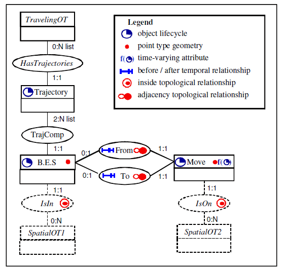

*Figure 3: A proposed design pattern model for trajectory data Spaccapietra et al. (2008)*

which specifies the corresponding locations in geographical terms. Through this, the model demonstrates its capability to incorporate various types of semantic information, not only related to the MO but also to the environment, thus supporting a more comprehensive definition of a semantic trajectory.

This generic model addresses common requirements across all types of trajectories, regardless of their specific semantics. However, more semantic details must be defined separately by the database designer, tailored to the application’s needs. The data type approach is structured into two parts: the first focuses on storing geometric components (sample points, interpolation, and basic trajectory information), while the second handles applicationspecific features through object attributes and relationships. This dual approach allows for flexible, customizable trajectory modeling.

HyStra Model Yan et al. (2010). The second part of the contribution in this model focuses on the trajectory computing platform, which is a multi-level framework designed to exploit and construct trajectory instances of the models at each level described above. The platform consists of four layers, beginning with the Data Preprocessing Layer, responsible for cleaning and preparing raw data using various techniques to produce sequences of tuples (𝑥, 𝑦, 𝑡). The Trajectory Identification Layer then processes these cleaned tuples, dividing them into significant subsequences by leveraging temporal and spatial gaps in the underlying data. Next, the Trajectory Structure Layer computes episodes from these subsequences to generate structured trajectories str. Finally, the Semantic Enrichment Layer annotates the structured trajectories with semantic data to produce semantic trajectories sem. This layer integrates episodes with relevant semantic information sourced from third-party datasets and employs specialized algorithms for this integration. The authors designed three distinct algorithms to integrate heterogeneous spatial data (land-use, road networks and POIs) into structured trajectory episodes, each addressing a specific semantic layer. Landuse data is integrated using spatial join with semantic regions for computing 𝑇 (𝑟𝑒𝑔𝑖𝑜𝑛)

𝑠𝑒𝑚 ; Map-matching algorithm is used with semantic lines (road networks) for computing 𝑇 (𝑙𝑖𝑛𝑒)

𝑠𝑒𝑚 and hidden Markov model (HMM) is used with semantic points (e.g. points of interests) for computing 𝑇 (𝑝𝑜𝑖𝑛𝑡)

𝑠𝑒𝑚 .This indicates that spatial characteristics and POI characteristics are explicitly taken into account with regard to our classification of the semantic information that can be integrated into a given semantic trajectory.

SeMiTri Yan et al. (2011). Trajectory annotation is based on three core design principles: Stop/Move Computation: The first layer performs data preprocessing on raw GPS records, including removing outliers, smoothing errors, identifying raw trajectories from the GPS data stream, and segmenting them into episodes categorized as stop and move. Stop episodes are annotated with POIs, while move episodes are integrated with road networks (lines of interest, LOIs). In the next phase, Semantic Annotation, the authors define semantic places using three subsets: region, line, and point. The Semantic Region Annotation Layer identifies regions traversed by the trajectory using a join algorithm. The Semantic Line Annotation Layer processes move episodes, mapping them to road networks and inferring transportation modes based on geometric properties (e.g., velocity, acceleration) and semantic context (e.g., road type). Stop episodes are handled by the Semantic Point Annotation Layer to estimate the purpose behind each stop. The outputs of these layers are combined into the annotated trajectory ( ), with the results stored in the Semantic Trajectory Store. This data can be accessed through the Web Interface they developed, which is a part of the framework’s Application Interface Layer and supports user-friendly queries and visualizations of all types of trajectories.

The proposed by Yan, Chakraborty, Parent, Spaccapietra and Aberer (2013) is holistic representation and an extended work of the SeMiTri model.

EveBam Model Andrienko et al. (2011b). argues that trajectories are fundamentally grounded in three core dimensions: Space (S), Time (T), and Objects (O). Based on these dimensions, they define the following types of objects:

- Spatial Object: An entity with a defined position in space.
- Temporal Object (Event): An entity associated with a specific position in time, whether as a single moment or a sequence of intervals.
- Spatial Event (Spatio-Temporal Object): An entity with positions defined in both space and time, integrating spatial and temporal dimensions.
- Static Spatial Object: A spatial object whose position remains constant over the analyzed time period.
- Moving Object or mover : A spatial object whose position changes over time.
- Moving Event: A moving object existing over a sequence of time units, with spatial positions that evolve dynamically.

The aim of this work is to explore methods for incorporating contextual information into trajectory analysis. The authors propose that a trajectory is composed of three fundamental elements: S (space), T (time) and O (moving object). The elements can have attributes represented as semantic data. Among these attributes, thematic attributes are defined as special properties that do not involve space or time. These attributes can either be static (unchanging over time) or dynamic (changing over time). On this basis, semantic information is taken into account on this model, though only at a low level, as it is limited to the use of descriptive attributes assigned to the objects.

the authors further generalize their approach by introducing the concept of movement events, which can represent both elementary and composite spatial events in a trajectory. They propose that a sequence of temporally consecutive events, such as (𝑡1, 𝑠1, 𝑎1), (𝑡2, 𝑠2, 𝑎2), … , (𝑡𝑘, 𝑠𝑘, 𝑎𝑘) can be regarded as single composite event when there is constancy in spatial location 𝑠1 = 𝑠2 = ... = 𝑠𝑘 and/or in attributes 𝑎1 = 𝑎2 = ... = 𝑎𝑘.

For simplicity, both elementary and composite movement events are represented using the notations (𝑡, 𝑠) or (𝑡, 𝑠, 𝑎). Here, 𝑡 may denote either a single time unit (𝑡 ∈ 𝑇 ) or a continuous subset of time (𝑡⊂𝑇 ), while 𝑠 and 𝑎 represent the corresponding sets of spatial locations (𝑠⊂𝑆) and attribute values (𝑎⊂𝐴, 𝐴 = 𝐴1, 𝐴2, ..., 𝐴𝑛). The authors emphasize the dependence of 𝑠 and 𝑎 on 𝑡 by expressing events as (𝑡, 𝑠(𝑡), 𝑎(𝑡)). To relate a specific MO to a movement event, the notation (𝑜, 𝑡, 𝑠, 𝑎) is used.

The authors propose a context-aware analysis of movement data, focusing on the relationships between movement events and contextual elements. They numerically represent spatial and temporal distances (e.g., in meters or seconds)

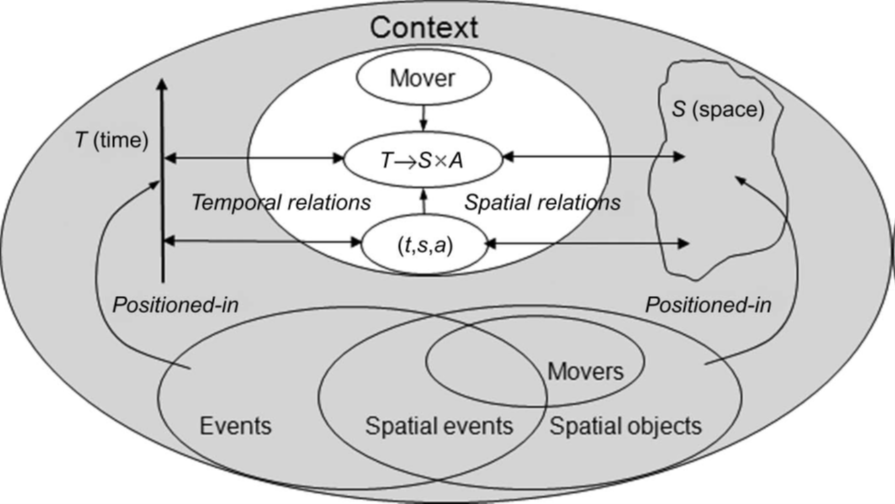

*Figure 4: A schema reflecting the relation of the moving object with the spatio-temporal context Andrienko et al. (2011b)*

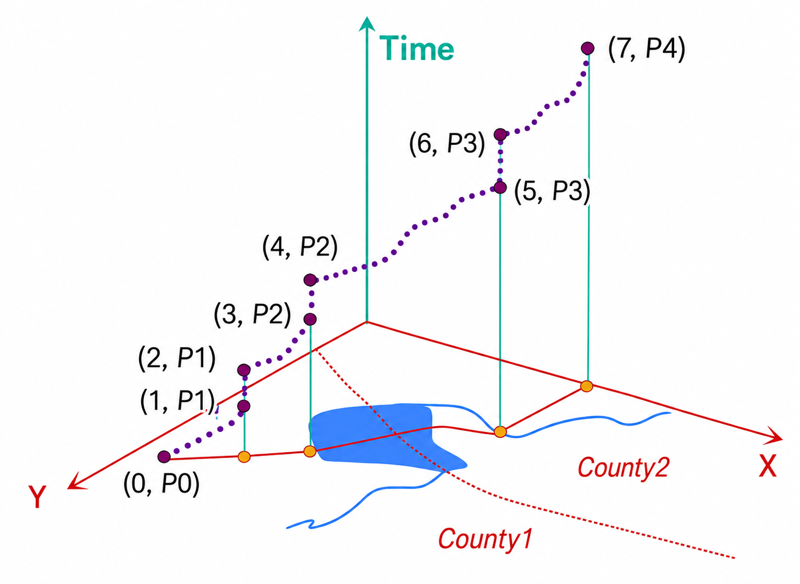

*Figure 5: The representation of a movement track in a 3D landmark uses two axes (X and Y) to represent spatial coordinates, while the third axis represents time Spaccapietra and Parent (2011).*

and suggest that these relationships can also be expressed qualitatively using predicates such as "near," "far," or "north." These predicates can be represented as Boolean-valued functions, 𝑃 ×𝑄 → 𝑡𝑟𝑢𝑒, 𝑓𝑎𝑙𝑠𝑒 or as numeric-valued functions, 𝑃 × 𝑄 → [0, ∞]. Furthermore, they introduce a framework in which spatial, temporal, and thematic attributes can be analyzed through relationships defined either by predicates or numeric ranges.

Movement events, defined as combinations of time, space, and attributes (𝑡, 𝑠, 𝑎), are linked to contextual elements 𝑐 by relations 𝑅, such that 𝑅(𝑚, 𝑐) = true. This representation allows for the extraction of interesting events based on constraints involving movement, context, or relations. For instance, queries like (?, 𝑐, 𝑅), (𝑚, ?, 𝑅), and (𝑚, 𝑐, ?) identify specific movement events, their associated context, or the relations between them.

AddMeStep Model Spaccapietra and Parent (2011) In this model, information about the movement of the object may be missing. These gaps are classified as either holes or semantic gaps, depending on their cause. Holes occur accidentally and can sometimes be "filled" using techniques like linear interpolation algorithms to compute the missing positions. In contrast, semantic gaps are intentionally left unrecorded and should not be filled, as their absence is deliberate.

CONSTAnT. Behavior, goal, and transportation means are semantic attributes used to enrich the trajectory. The goal defines the reason behind the movement of the object and is associated with the entire trajectory, though it may

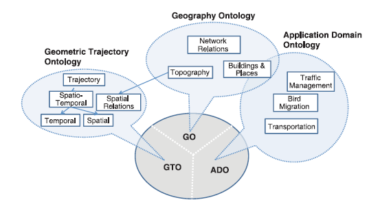

*Figure 6: Modular ontology proposed in Yan et al. (2008) to represent trajectory data*

also be part of a semantic sub-trajectory. The goal 𝑔 is represented as a tuple (𝑖𝑑, 𝑛𝑎𝑚𝑒, 𝑎𝑐𝑡𝑖𝑣𝑖𝑡𝑦). Transportation means refer to the mode of movement used by the object during its trajectory.

These three characteristics (goals, transportation means, and behaviors) can be classified as MO characteristics in relation to our classification of semantic information, since they describe the intentions, modalities, and actions of the MO that generates the trajectory. Finally, a semantic point 𝑝⊂𝑠 is a tuple (𝑝𝑖𝑑, 𝑥, 𝑦, 𝑡, 𝑉, 𝐿, 𝑠𝑖𝑑), where 𝑥 and 𝑦 are the geographic coordinates collected at time 𝑡, 𝑉 is the set of environmental information related to the point, 𝐿 is the set of places where the point is located, and 𝑠𝑖𝑑 is the semantic subtrajectory identifier that contain the point. Hence, this model also integrates spatial characteristics and environmental information.

A trajectory’s behavior encompasses a set of characteristics that define the unique movement pattern of a single object or a group of objects. This behavior can be associated with an individual trajectory, in which case it is referred to as a single behavior, or it can be associated with a group of trajectories, termed collective behavior. Notably, behavior is typically related to a semantic sub-trajectory, not the entire trajectory.

In the case of collective behavior, the authors classify it into two categories: aware behavior and non-aware behavior. The key distinction between these two is that in aware behavior, at least one moving object is aware of the presence of other moving objects. In other words, the behavior of the trajectory is influenced by the movements of other trajectories, and the collective movement is not merely coincidental.

Ontology Model. Figure 6 presents the three modules that have been proposed in the ontology model Yan et al. (2008), which are the the geometric trajectory module, the geography module, and the application-domain module.

The Geometric Trajectory Ontology is a module that provides generic concepts for describing the geometric components of a trajectory. It is composed of four sub-ontologies: the Spatial Ontology, Temporal Ontology, Spatiotemporal Ontology, and Trajectory Ontology. Each sub-ontology focuses on a specific domain required for a comprehensive description of application data, by regarding this we have a high level of presentation of the semantic information in temporal, spatial, and POI characteristics . The Spatiotemporal Ontology builds on the Temporal and Spatial Ontologies to represent phenomena that change with respect to both time and geometry. For example, it can track the movement of a car, where the car’s geometry (i.e., its spatial extent) is described using the concept of time-varying points-points whose (x, y) positions change over time. Temporal and spatial features are defined through dedicated ontologies to ensure they are described accurately and comprehensively. The Trajectory Ontology adopts the stops and moves model. It includes concepts that support the description of movement as a set of structured trajectories.

The second module, the Geography Ontology, encompasses concepts related to the geographical environment. These include descriptions of land topography, natural networks (e.g., hydrological systems), artificial networks (e.g., routes, trains, facilities), buildings, landmarks, vegetation, and other elements relevant to the application. It is linked to the geometric trajectory module to associate each element with its spatial extent and to the application domain module to enrich these concepts with specific thematic information.

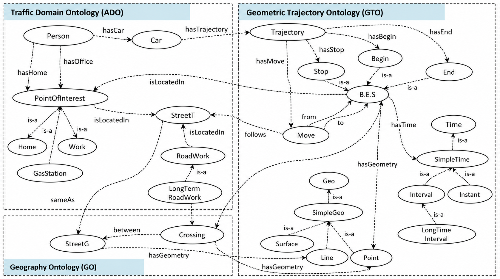

*Figure 7: An example of semantic trajectory ontology for traffic management application Yan et al. (2008)*

The last module is the Application Domain Ontology, which gathers all application-dependent concepts. It defines the concepts relevant to a specific domain and supports multiple applications within that domain. For instance, in traffic management, it includes examples like the Ontologies of Transportation Networks (OTN), and SPIRIT, which address domain-specific needs such as transportation networks, urban planning, and spatially aware information retrieval. The authors combined the three ontology modules to create the Semantic Trajectory Ontology, which provides a comprehensive semantic description of application-relevant trajectories. Their case study focused on traffic management, where they developed an ontology including only the most essential concepts and links for clarity, as illustrated in 7.

MASTER Model leads to the definition of three categories of aspects:

- The volatile aspect (VA) refers to a dynamic attribute that frequently changes and is tied to a specific point along a trajectory.
- The long-term aspect (LTA) remains consistent over the entire duration of a trajectory.
- The permanent aspect (PA) is a property of the MO, persisting unchanged throughout its lifetime.

Using this conceptualization, the multiple aspect trajectory is defined as mat = (P, S_LTA, mo, desc), where P = ⟨𝑝1, 𝑝2, … , 𝑝𝑛⟩ is a sequence of points representing the trajectory of a mo. A point 𝑝𝑖 = (𝑥𝑖, 𝑦𝑖, 𝑡𝑖, SVA), where 𝑥 and 𝑦 denote the spatial position of mo at time instant t, and SVA = {sm1, sm2, … , sm𝑞} is a (possibly empty) set of volatile aspects associated with 𝑝𝑖. Additionally, S_LTA = {sm1, sm2, … , sm𝑝} is a set of long-term aspects, and desc provides a description of the trajectory.

The moving object mo = (motype, desc, SPA) is defined as an entity capable of moving in space and time, characterized by a description desc, a set of (possibly empty) permanent aspects SPA = {sm1, sm2, … , sm𝑟}, and a type motype that categorizes the object. In this way, a high-level assessment of the moving object’s characteristics becomes possible in the context of semantic information classification, enabling a more structured interpretation of its identity and behavior on the basis of its categorical type and specific semantic features. The authors also introduce the concept of a special semantic relationship, the mor, which captures the relationship between MOs. This relationship is defined as mor = (mo1, mo2, S_RA), where mo1 and mo2 are two moving objects, and S_RA = {sm1, sm2, … , sm𝑠} is a (possibly empty) set of semantic meanings describing the relationship. This type of information can be considered part of the MO characteristics, as it reflects semantic interactions or contextual links involving the MO.

On the other hand, the MASTER model defines a logical model based on the Resource Description Framework (RDF), which is used to represent aspects, trajectories, points, and MOs in compliance with the Semantic Web standards established by the World Wide Web Consortium (W3C). This approach enables trajectory data to be made publicly accessible through existing Semantic Web tools. RDF represents data as triples, where the relationship between two resources (the subject and object) is expressed as a directed predicate edge between them in a graph. The mapping rules for converting the conceptual model into an RDF schema are as follows: an entity is converted into a node; an attribute of an entity (or relationship) is converted into a node, with an edge connecting the attribute node to the entity node; and a relationship between entities is either represented as a direct edge between them or as an intermediate node connecting the entities.

To store data based on the logical model, the authors employed the Rendezvous solution Santana and Mello (2017), a triple-store system based on NoSQL databases designed to efficiently query large RDF datasets. This choice addresses the highly heterogeneous and multidimensional nature of the data represented by multiple aspect trajectories. Finally, the authors instantiated the MASTER model through its application in a tourism scenario, demonstrating its practical applicability.

### A.2. Indoor semantic trajectory models

SITM Model Kontarinis et al. (2021). Based on the example of a visitor to the Louvre Museum, the authors evaluate two pattern mining approaches after instantiating their model: Multi-Dimensional Sequential (MDS) pattern mining and Temporally Annotated Sequential (TAS) pattern mining. The MDS approach is applied to retrieve frequent visiting patterns for specific types of visitors, rather than aggregating all visitor data, by leveraging the semantic information added to 𝐴traj. This approach enables the integration of dynamic annotations, such as audio or text content accessed by visitors, into trajectory records. Each interval of presence in a spatial area combines with its annotations to form a multidimensional item. However, one key limitation of MDS is its lack of temporal awareness, as it only considers semantic information in sequential patterns, neglecting the temporal aspect of trajectories.

In contrast, TAS pattern mining incorporates temporal annotations into the sequence analysis. It accounts for typical transition times between events by representing sequences as (𝑆, 𝐴), where 𝑆 = ⟨𝑠0, 𝑠1, … , 𝑠𝑛⟩ is the sequence of discrete elements, and 𝐴 = ⟨𝛼1, 𝛼2, … , 𝛼𝑛⟩ represents the corresponding temporal annotations for transitions between consecutive elements.

The MiSTA algorithm implements TAS pattern mining but introduces certain constraints. To adapt this algorithm for SITM-based trajectories, the authors make several adjustments:

- Restriction to item sequences: MiSTA operates on sequences of itemsets, but SITM assumes that a MO cannot be present in multiple symbolic spatial entities simultaneously. Consequently, the input data for MiSTA is restricted to sequences of individual items, limiting its execution to extension projections without enlargement projections. This adjustment does not alter the MiSTA algorithm itself.
- Reinterpreting temporal annotations: Instead of attributing temporal annotations to transitions between consecutive items, they are associated with the duration of stay in the first item (the spatial entity of departure). This reinterpretation aligns the temporal semantics of TAS with SITM trajectories.

These modifications necessitate preprocessing to convert SITM-based trajectory data into a format compatible with TAS. Recognizing the limitations of both approaches, the authors propose a hybrid algorithm that combines MDS pattern mining with TAS pattern mining. They discuss the respective constraints of each method and explore strategies to overcome them, aiming to improve the overall analysis of multidimensional and temporally annotated trajectories.

TSTM-in Model. Each used matrix in this model is assigned a value of ∅, 0, or 1, based on whether an intersection exists between the sub-trajectory and the indoor region. If the sub-trajectory part does not exist (e.g., for a nonexistent pre- or post-sub-trajectory), the corresponding element is marked as ∅. A value of 1 indicates an intersection between the sub-trajectory part and the indoor region, while a value of 0 signifies no intersection. For a key point, the intersection value depends on the presence of a post-sub-trajectory. If the post-sub-trajectory is non-empty, the key point is considered to intersect with the interior of the region. If it is empty, the intersection is considered to occur with the sub-trajectory itself. This topological framework provides a sophisticated method for analyzing indoor trajectories. By capturing the interactions between sub-trajectory segments and various spatial elements of indoor environments, it offers valuable insights into the movement behaviors of objects in these spaces. The matrices enable the representation of not only spatial relationships but also the semantic behaviors associated with those relationships, ultimately enhancing our understanding of how people and objects navigate complex indoor environments. To represent behavioral semantics within indoor trajectories, a character-based encoding approach was proposed. In this scheme, lowercase letters e, b, and i are assigned to denote the exterior, boundary, and interior intersections, respectively. Distinct nodes, such as b1 and b2, are introduced to differentiate intersection directions. For instance, the letter i represents a sub-trajectory’s movement from b1 to b2, while −𝑖 indicates movement in the opposite direction. If a sub-trajectory lacks a corresponding topological segment, the label ∅ is used, signifying either the starting or ending point of the trajectory. For encoding sub-trajectories within indoor regions, capital letters E, B, and I are used to represent the exterior, boundary, and interior of a region, respectively. To distinguish between different intersections within a region’s interior, the notations I1 and I2 are employed, with I1 indicating the front interior and I2 representing the back interior. Topological parts that contain a non-null value ¬∅ are labeled as I1, I2, B, or E, while those without such values are marked with ∅. This encoding system facilitates the construction of indoor semantic trajectories, which are represented as chronological semantic combinations. The reassembled semantic trajectories take the form:

[𝑇𝑐𝑜𝑑𝑒@𝑄∕𝐹 ∗ 𝑊 + ⋯ + 𝑇𝑐𝑜𝑑𝑒@𝑄∕𝐹 ∗ 𝑊 ]

⎡ ⎢ ⎢ ⎢ ⎢ ⎢ ⎢ ⎢⎣ ↓ [𝑇𝑐𝑜𝑑𝑒@𝑄∕𝐹 ∗ 𝑊 + ⋯ + 𝑇𝑐𝑜𝑑𝑒@𝑄∕𝐹 ∗ 𝑊 ]

𝑇 = ↓ ⋮ ↓ [𝑇𝑐𝑜𝑑𝑒@𝑄∕𝐹 ∗ 𝑊 + ⋯ + 𝑇𝑐𝑜𝑑𝑒@𝑄∕𝐹 ∗ 𝑊 ]

In this structure:

- The connection symbol @ links semantic codes to specific scenes.
- Q denotes the unique identifier for an indoor scene.
- The symbol / acts as a concatenation operator.
- F represents the floor number where a topological relationship shifts.
- * is another concatenation operator.

⎤ ⎥ ⎥ ⎥ ⎥ ⎥ ⎥ ⎥⎦ (1)

- Tcode signifies the semantic code of sub-trajectories associated with indoor scene elements (e.g., corridors or regions).
- W specifies the mobility mode of the object within the scene.

The symbol + is used to link diverse semantics of a sub-trajectory that spans multiple indoor scene elements. However, trajectories involving transitions between floors, such as moving upstairs or downstairs, are excluded from consideration in this study. This framework enables the systematic encoding and reconstruction of indoor semantic trajectories, providing a structured approach to analyze movement behaviors within indoor environments. Overall, the TSTM model provides a comprehensive framework for analyzing indoor trajectories. By combining spatial, temporal, and semantic dimensions, it offers a detailed understanding of movement behaviors within complex indoor environments, making it a powerful tool for applications such as indoor navigation, behavior analysis, and facility management.

### A.3. Hybrid indoor-outdoor semantic trajectory models

HiOutdoor-Indoor Model. By addressing both indoor and outdoor spaces in Noureddine et al. (2020), the authors provide a multidimensional representation of human trajectories, enabling a detailed understanding of space and the integration of contextual information.

The authors introduce the concepts of subtrajectory and continuous subtrajectory, highlighting the distinction between these two notions. A subtrajectory is defined as a subset of an original trajectory where the points are part of the original trajectory but do not need to be consecutive. Formally, let trajid represent a trajectory as:

trajid = {𝑝(𝑡𝑛, 𝑡𝑛+1), 𝑝(𝑡𝑛+2, 𝑡𝑛+3), … , 𝑝(𝑡𝑚−1, 𝑡𝑚)} where [𝑡𝑛, 𝑡𝑚] is the overall time interval and 𝑝 are the trajectory points. A trajectory traj′ id = {𝑝′(𝑡′ 𝑛, 𝑡′ 𝑛+1), 𝑝′(𝑡′ 𝑛+2, 𝑡′ 𝑛+3), … , 𝑝′(𝑡′ 𝑚−1, 𝑡′ 𝑚)} is considered a subtrajectory of trajid, denoted traj′ id are part of the original trajectory’s points 𝑝, preserving their temporal order. Importantly, these points do not need to be consecutive.

On the other hand, a continuous subtrajectory is a stricter version of a subtrajectory where all points within the specified time interval must appear consecutively in the original trajectory. Specifically, traj′ id is called a continuous subtrajectory of trajid, denoted traj′ 𝑛, 𝑡′ 𝑚] are consecutive in trajid. This ensures that no points are skipped within the interval. In summary, while a subtrajectory allows non-consecutive points from the original trajectory, a continuous subtrajectory strictly requires all points to appear consecutively without any gaps.

CSid = {𝑣(𝑡𝑛, 𝑡𝑛+1), 𝑣(𝑡𝑛+2, 𝑡𝑛+3), … , 𝑣(𝑡𝑚−1, 𝑡𝑚)} CS′ id = {𝑣′(𝑡′ 𝑛, 𝑡′ 𝑛+1), 𝑣′(𝑡′ 𝑛+2, 𝑡′ 𝑛+3), … , 𝑣′(𝑡′ 𝑚−1, 𝑡′ 𝑚)} where 𝑐𝑖 ∈ 𝐶 and two time intervals [𝑡𝑛, 𝑡𝑚] and [𝑡′ 𝑛, 𝑡′ id is a subsequence of CSid, denoted CS′ 𝑚] ⊆ [𝑡𝑛, 𝑡𝑚] and the values of 𝑣′ are a subset of 𝑣 in the same temporal order. The authors further refine this to define a contextual continuous subsequence, which imposes stricter conditions on continuity. Formally, a contextual sequence CS′ id ⊆ CSid, if [𝑡′ 𝑛, 𝑡′ id ⊑ CSid, if and only if CS′ id ⊆ CSid and all values 𝑣(𝑡𝑖, 𝑡𝑖+1) within the time interval [𝑡′ Concerning the semantic trajectory in the extended work presented in Noureddine et al. (2022) considers the continuous movement of an individual while integrating contextual information semantics of the indoor and outdoor environments, it keeps the same representation as a graph defined as 𝐺𝑆𝑇 = (𝑉𝑆𝑇 , 𝐸𝑆𝑇 ), where 𝑛 ⋃ 𝑚 ⋃ 𝑉 _TI𝑖 ∪ 𝑉 _C𝑖 𝑉𝑆𝑇 = 𝑉 ∪ 𝑖=1 𝑖=1 Here, 𝑉 represents the spatial entities, while ⋃𝑛 𝑖=1 𝑉 _C𝑖 denote the vertices representing the contextual semantic values. The edges are defined as follows:

𝑘 ⋃ ⋃𝑗 𝐻𝐴𝑆_𝑉𝐴𝐿𝑈𝐸𝑖 𝐸𝑆𝑇 = 𝐸 ∪ 𝑁𝐸𝑋𝑇𝑖 ∪ 𝑖=1 𝑖=1 id ⊆ trajid, if the time interval [𝑡′ 𝑛, 𝑡′ 𝑚] is within [𝑡𝑛, 𝑡𝑚], and all points 𝑝′ in traj′ id ⊑ trajid, if it is already a subtrajectory of trajid, and all the points 𝑝(𝑡𝑖, 𝑡𝑖+1) within the time interval [𝑡′ The notion of a contextual sequence is defined as a time series closely tied to the trajectory of a MO. Formally, each value 𝑣(𝑡𝑘, 𝑡𝑘+1) in a contextual sequence denotes a valid semantic value 𝑐𝑖 over the time interval [𝑡𝑘, 𝑡𝑘+1], where 𝑡𝑛 ≤ 𝑡𝑘 ≤ 𝑡𝑚. The authors further define a contextual subsequence, which represents a subset of a contextual sequence. Formally, given two contextual sequences:

𝑚], we say that CS′ id is a continuous subsequence of CSid, denoted CS′ 𝑛, 𝑡′ 𝑚] appear consecutively in CSid without any omissions. Less formally, this means that no elements are missing between 𝑡′ 𝑛 and 𝑡′ 𝑚. So, the model demonstrates that it is possible to decompose trajectories into semantic sub-trajectories, using different semantic classes, presented earlier.

𝑖=1 𝑉 _TI𝑖 are the vertices that represent the time intervals, and ⋃𝑚

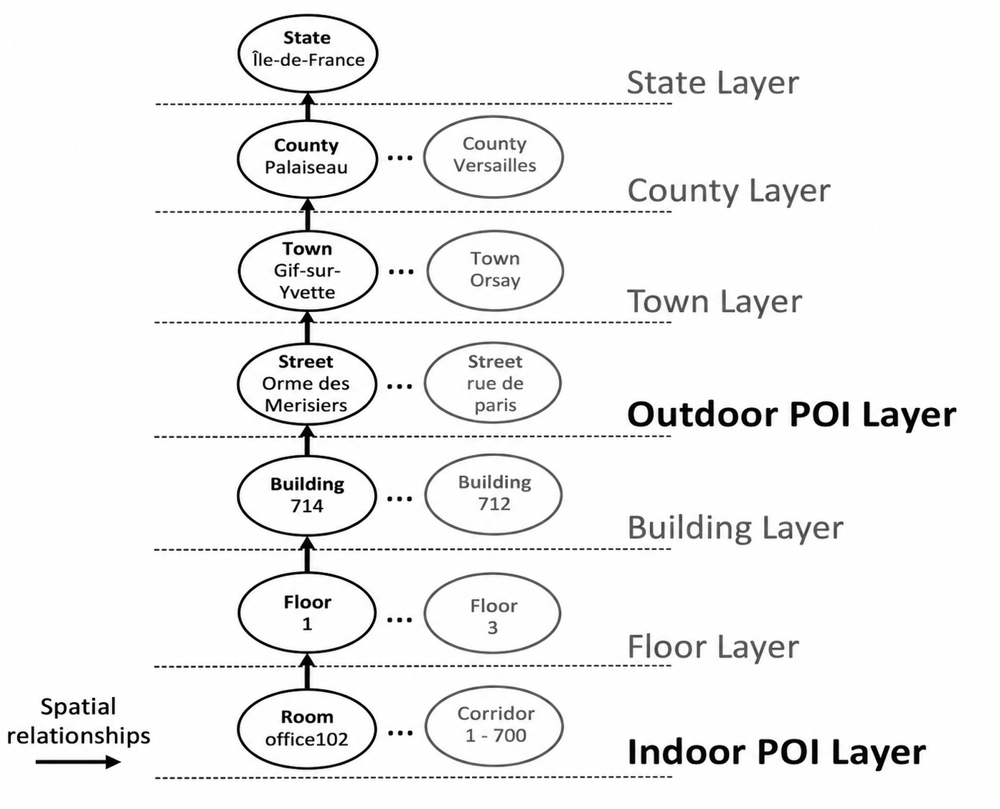

*Figure 8: An example provided in Noureddine et al. (2020) illustrating the hierarchical layers of the MO’s office room. The office room is defined as a POI, with its hierarchical relationships to other places and POIs shown.*

𝐸 represents the spatial hierarchical relations, ⋃𝑘 𝑖=1 NEXT𝑖 denotes the ordered links between the time intervals, and ⋃𝑗 𝑖=1 HAS_VALUE𝑖 denotes the links between time intervals and specific semantic values. These links are annotated by the specific contextual value they are connected to. The evaluation of their model was conducted in two main categories: graph queries and graph analytics. Graph queries focus on retrieving or extracting explicit data and patterns from graph components or their properties using procedural query languages. In contrast, graph analytics analyze emerging trends and patterns by leveraging graph structures, statistical properties, and computational metrics. The NEXT edge indicates a moving object transitioning to a new state due to a change in at least one dimension (spatial or contextual). The Generalized Semantic Trajectory (GST) can be decomposed into two graphs: one corresponding to the spatial dimension (upper graph) of the semantic trajectory, and the other corresponding to the contextual and temporal dimensions (lower graph).

MAMLSTR Model. The details of each level in this model are as follows: Block C, the raw data level, consists of three main classes. The first is the Mobile Object class, which represents and defines the moving object. This class includes inherited sub-classes that allow for the categorization of the moving object based on its type or characteristics, thereby evidencing a high degree of semantic organization and granular detail within the MO characteristics. The second class is Position, which describes a specific point in the mobile object’s trajectory. A sequence of Position instances can represent the entire captured movement of the mobile object. There may be several types of positions, such as IndoorPosition (e.g., for visitor positions in museums) and OutdoorPosition (e.g., for positions collected with Geoluciole), each with unique attributes but all inheriting from the generic Position class. evidencing a granular specification of spatial semantics, by allowing for the distinction and precise definition of various types of spatial locations.

The third class is Trajectory, which represents a subset of the mobility track that is relevant to the application. A trajectory can be constructed based on temporal, spatial, or spatio-temporal criteria.

The semantic data level includes classes (Aspect, AspectType, AspectAttribute and Value) to represent enriched data, building on the MASTER model. AspectType defines categories (e.g., "touristic activity" or "point of interest") with specific attributes (e.g., name, location, type). An Aspect (e.g., "Lantern Tower") is linked to an AspectType, with attributes instantiated via the Value class. The isSubTypeOf relationship enables hierarchical structuring, allowing detailed categorization (e.g., refining "touristic activities").

The intermediate level of the model links raw trajectory data (Position) to semantic enrichment (Aspect), based on spatial, temporal, or spatio-temporal attributes. This link can be computed (e.g., inferring locomotion mode from speed) or manually defined (e.g., tourist activities). A sequence of Positions enriched with the same Aspect forms an Episode, which can be recursively composed of sub-episodes (isComposedOf ), creating a multi-level structure. A Trajectory can have multiple Interpretations, each representing a sequence of Episodes (e.g., weather conditions or touristic activities). The Pattern class groups trajectories with shared spatial, temporal, or semantic characteristics (e.g., similar activities or routes). Finally, the MobileObjectCategory class classifies mobile objects based on their attributes or behavior. This level enables flexible, multi-perspective analysis of enriched trajectory data.

### B. Appendix B

### B.1. Instantiating the comparison Model

This section focuses on instantiating the comparison model introduced in Section 2 through examples drawn from the reviewed literature. Specifically, we have selected one model designed for outdoor environments, and one tailored for indoor environments. This experimental analysis highlights the robustness of our proposed model and demonstrates its adaptability when applied in examples proposed by established models.

B.1.1. Outdoor Model In this section, we selected the MASTER model Mello et al. (2019) due to its remarkable flexibility and richness in representing semantic information. The example presented in this model involves the trajectory of two individuals, John and his sister, during their visit to Paris in France. The model demonstrates the capability to incorporate various types of semantic information, including the social relationship between these two moving objects, specifically their sibling relationship. We successfully instantiated this information within our comparison model, showcasing its ability to capture and represent complex semantic aspects of trajectories. This example is depicted in Figure 9.

In this example, the RDF instantiation illustrates two trajectories representing a subset of movements by John and his sister Mary, showcasing the capability of the MASTER model to define relationships between moving objects, as discussed by authors. The visualization employs colors to distinguish Persistent Aspects (PAs, represented as gray nodes), Long-Term Aspects (LTAs, pink nodes), and Volatile Aspects (VAs, blue nodes). Mary’s trajectory (MAT1) features two Volatile Aspect types associated with her points p11 and p12: Mood and Transportation. These aspects convey that Mary was traveling by train and experienced happiness at point p11. Additionally, her trajectory incorporates a Long-Term Aspect (Occupation), signifying that she was retired throughout the entire movement sequence.

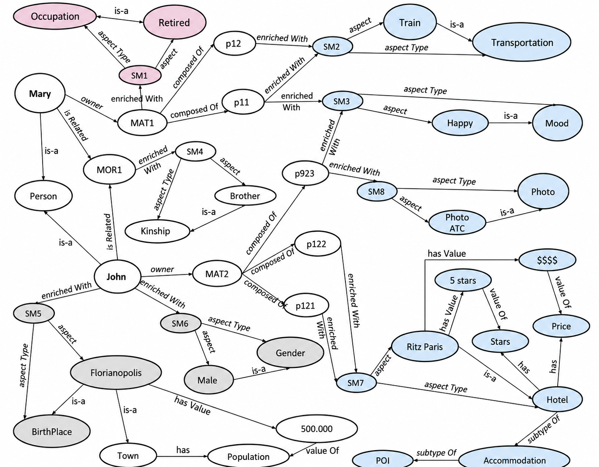

*Figure 9: An example instantiation of the MASTER model Mello et al. (2019).*

Trajectory 1 Episode 1 (Trajectory 1)

Moving Object:

⎛ ⎜ ⎜ ⎜ ⎜ ⎜ ⎜ ⎜ ⎜ ⎜ ⎜ ⎜ ⎜ ⎜ ⎜ ⎜ ⎜ ⎜⎝ ⎧ ⎪ ⎪ ⎪ ⎪ ⎪ ⎪ ⎪ ⎪ ⎨ ⎪ ⎪ ⎪ ⎪ ⎪ ⎪ ⎪ ⎪⎩ Identification:

Name: "Mary", Type: "Person"

Profession: "Retired" Behavioral Characteristics:

> 𝑒𝑠 𝑡1, 𝑧1 = "point", 𝑆1 = 1 = Emotions: "Happy"

Physical characteristics:

Transportation mode: "Train"

Space:

Identification:

Identifier: "P11"

⎫ ⎪ ⎪ ⎪ ⎪ ⎪ ⎪ ⎪ ⎪ ⎬ ⎪ ⎪ ⎪ ⎪ ⎪ ⎪ ⎪ ⎪⎭ ⎞ ⎟ ⎟ ⎟ ⎟ ⎟ ⎟ ⎟ ⎟ ⎟ ⎟ ⎟ ⎟ ⎟ ⎟ ⎟ ⎟ ⎟⎠ Relationship with another object: "John is Brother"

Episode 2 (Trajectory 1)

⎛ ⎜ ⎜ ⎜ ⎜ ⎜ ⎜ ⎜ ⎜ ⎜ ⎜ ⎜ ⎜ ⎜ ⎜ ⎜⎝ ⎧ ⎪ ⎪ ⎪ ⎪ ⎪ ⎪ ⎪ ⎨ ⎪ ⎪ ⎪ ⎪ ⎪ ⎪ ⎪⎩ Moving Object:

Identification:

Name: "Mary", Type: "Person"

Profession: "Retired" Physical characteristics:

𝑒𝑠 𝑡2, 𝑧2 = "point", 𝑆2 = 2 = Transportation mode: "Train"

Space:

Identification:

Identifier: "P12"

The instantiation of the comparison model is as follows: Trajectory 1, which represents Mary’s semantic trajectory 𝑇 𝑀𝑎𝑟𝑦,𝑠 1 (denoted as 𝑇 𝑠 Trajectory 2 Episode 1 (Trajectory 2)

Moving Object:

⎛ ⎜ ⎜ ⎜ ⎜ ⎜ ⎜ ⎜ ⎜ ⎜ ⎜ ⎜ ⎜ ⎜ ⎜ ⎜ ⎜ ⎜⎝ ⎧ ⎪ ⎪ ⎪ ⎪ ⎪ ⎪ ⎪ ⎪ ⎨ ⎪ ⎪ ⎪ ⎪ ⎪ ⎪ ⎪ ⎪⎩ Identification:

Name: "John", Type: "Person"

Place of birth: "Florianopolis"

Gender: "Male"

𝑒𝑠 𝑡1, 𝑧1 = "point", 𝑆1 = 1 = Behavioral Characteristics:

Emotions: "Happy" Social Media: "Share photo"

Space:

Identification:

Identifier: "P923"

⎫ ⎪ ⎪ ⎪ ⎪ ⎪ ⎪ ⎪ ⎬ ⎪ ⎪ ⎪ ⎪ ⎪ ⎪ ⎪⎭ ⎞ ⎟ ⎟ ⎟ ⎟ ⎟ ⎟ ⎟ ⎟ ⎟ ⎟ ⎟ ⎟ ⎟ ⎟ ⎟⎠ Relationship with another object: "John is Brother"

1 ), is decomposed into semantic episodes 𝑒𝑠 1 and 𝑒𝑠 2. Each semantic episode contains 𝑡 and 𝑧, corresponding to the temporal and spatial information, respectively, while the semantic information is represented by key–value pairs for each episode.

⎫ ⎪ ⎪ ⎪ ⎪ ⎪ ⎪ ⎪ ⎪ ⎬ ⎪ ⎪ ⎪ ⎪ ⎪ ⎪ ⎪ ⎪⎭ ⎞ ⎟ ⎟ ⎟ ⎟ ⎟ ⎟ ⎟ ⎟ ⎟ ⎟ ⎟ ⎟ ⎟ ⎟ ⎟ ⎟ ⎟⎠ Relationship with another object: "Mary is Sister"

Episode 2 (Trajectory 2)

⎛ ⎜ ⎜ ⎜ ⎜ ⎜ ⎜ ⎜ ⎜ ⎜ ⎜ ⎜ ⎜ ⎜ ⎜ ⎜ ⎜ ⎜ ⎜ ⎜ ⎜ ⎜ ⎜ ⎜ ⎜ ⎜⎝ ⎧ ⎪ ⎪ ⎪ ⎪ ⎪ ⎪ ⎪ ⎪ ⎪ ⎪ ⎪ ⎪ ⎨ ⎪ ⎪ ⎪ ⎪ ⎪ ⎪ ⎪ ⎪ ⎪ ⎪ ⎪ ⎪⎩ Moving Object:

Identification:

Name: "John", Type: "Person"

Place of birth: "Florianopolis"

Gender: "Male"

Space:

Identification:

𝑒𝑠 𝑡2, 𝑧2 = "point", 𝑆2 = 2 = Identifier: "P121"

Type: "Hotel"

Name: "Ritz Paris"

Description: "5 stars, price: *"

Point of Interest:

Identification:

Type: "Accommodation"

Name: "POI"

Episode 3 (Trajectory 2)

⎛ ⎜ ⎜ ⎜ ⎜ ⎜ ⎜ ⎜ ⎜ ⎜ ⎜ ⎜ ⎜ ⎜ ⎜ ⎜ ⎜ ⎜ ⎜ ⎜ ⎜ ⎜ ⎜ ⎜ ⎜ ⎜⎝ ⎧ ⎪ ⎪ ⎪ ⎪ ⎪ ⎪ ⎪ ⎪ ⎪ ⎪ ⎪ ⎪ ⎨ ⎪ ⎪ ⎪ ⎪ ⎪ ⎪ ⎪ ⎪ ⎪ ⎪ ⎪ ⎪⎩ Moving Object:

Identification:

Name: "John", Type: "Person"

Place of birth: "Florianopolis"

Gender: "Male"

Space:

Identification:

𝑒𝑠 𝑡3, 𝑧3 = "point", 𝑆3 = 3 = Identifier: "P122"

Type: "Hotel"

Name: "Ritz Paris"

Description: "5 stars, price: **"

Point of Interest:

Identification:

Type: "Accommodation"

Name: "POI"

The trajectory 2 concern the second MO, hence another definition of trajectory is given 𝑇 𝑠 ⎫ ⎪ ⎪ ⎪ ⎪ ⎪ ⎪ ⎪ ⎪ ⎪ ⎪ ⎪ ⎪ ⎬ ⎪ ⎪ ⎪ ⎪ ⎪ ⎪ ⎪ ⎪ ⎪ ⎪ ⎪ ⎪⎭ ⎞ ⎟ ⎟ ⎟ ⎟ ⎟ ⎟ ⎟ ⎟ ⎟ ⎟ ⎟ ⎟ ⎟ ⎟ ⎟ ⎟ ⎟ ⎟ ⎟ ⎟ ⎟ ⎟ ⎟ ⎟ ⎟⎠ Relationship with another object: "Mary is Sister"

⎫ ⎪ ⎪ ⎪ ⎪ ⎪ ⎪ ⎪ ⎪ ⎪ ⎪ ⎪ ⎪ ⎬ ⎪ ⎪ ⎪ ⎪ ⎪ ⎪ ⎪ ⎪ ⎪ ⎪ ⎪ ⎪⎭ ⎞ ⎟ ⎟ ⎟ ⎟ ⎟ ⎟ ⎟ ⎟ ⎟ ⎟ ⎟ ⎟ ⎟ ⎟ ⎟ ⎟ ⎟ ⎟ ⎟ ⎟ ⎟ ⎟ ⎟ ⎟ ⎟⎠ Relationship with another object: "Mary is Sister"

2 .

### Total vectors

Trajectory 1 Trajectory 1 = (𝑒𝑠 1, 𝑒𝑠 2)

Trajectory 2 Trajectory 2 = {𝑒𝑠 1, 𝑒𝑠 2, 𝑒𝑠 3} B.1.2. Indoor Model For the indoor model, we have chosen the SITM model Kontarinis et al. (2021), which provides an example of a visitor in the Louvre Museum. In this part, we consider the visitor’s trace over a 30-minute period. The trace is given by the following representation:

𝑇vis0043,13∶00∶00,13∶33∶00 = (tracevis0043,13∶00∶00,13∶33∶00, {goals ∶ ["visit_temporary_exhibition"]})

where ⎛ ⎜ ⎜⎝ ⎞ ⎟ ⎟⎠ (entrance01, ε𝑃𝐻ε, 13 ∶00 ∶00, 13 ∶02 ∶00, ∅), (opening02, ε𝑀𝑆ε, 13 ∶04 ∶00, 13 ∶28 ∶30, {activity ∶ ["shopping"]}), (opening01, ε𝐼𝑃𝐻ε, 13 ∶28 ∶30, 13 ∶33 ∶00, ∅)

tracevis0043,13∶00∶00,13∶33∶00 = Episode 1

- Time (𝑡1): [13:00:00, 13:02:00]
- Space (𝑧1): region
- Semantic (𝑆1):

– Moving Object:

∗ Behavioral Characteristics:

- Goal: visit_Temporary_exhibition – Space:

∗ Identification:

- Identifier: PH · Name: Pyramide hall ∗ Spatial Characteristics: Relation spatial Relationships with other spaces: entrance01

Episode 2

- Time (𝑡2): [13:04:00, 13:28:30]
- Space (𝑧2): region
- Semantic (𝑆2):

– Moving Object:

∗ Behavioral Characteristics:

- Goal: visit_Temporary_exhibition · Activity: shopping – Space:

∗ Identification:

- Identifier: MS · Name: Museum Shop ∗ Spatial Characteristics:
- Relation spatial Relationships with other spaces: opening02

Episode 3

- Time (𝑡3): [13:28:30, 13:33:30]
- Space (𝑧3): region
- Semantic (𝑆3):

– Moving Object:

∗ Behavioral Characteristics:

- Goal: visit_Temporary_exhibition – Space:

∗ Identification:

- Identifier: IPH · Name: Inverse Pyramide Hall ∗ Spatial Characteristics:
- Relation spatial Relationships with other spaces: opening01

### Episodes vectors

𝑒𝑠 1 = (𝑡1 = [13∶00∶00, 13∶02∶00], 𝑧1 = region, ⎧ ⎪ ⎪ ⎪ ⎨ ⎪ ⎪ ⎪⎩ Moving Object: General Identification: identifier: vis0043, Behavioral Characteristics: Goal: visit_Temporary_exhibition, 𝑆1 = Space: Identification: Identifier:PH, Name:Pyramide hall, Spatial Relationships with other spaces:entrance01 𝑒𝑠 2 = (𝑡2 = [13∶04∶00, 13∶28∶30], 𝑧2 = region, ⎧ ⎪ ⎪ ⎪ ⎪ ⎨ ⎪ ⎪ ⎪ ⎪⎩ Moving Object: General Identification: identifier: vis0043, Behavioral Characteristics: Goal: visit_Temporary_exhibition, Activity: shopping, 𝑆2 = Space: Identification: Identifier:MS, Name:Museum Shop, Spatial Relationships with other spaces:opening02 𝑒𝑠 3 = (𝑡3 = [13∶28∶30, 13∶33∶30], 𝑧3 = region, ⎧ ⎪ ⎪ ⎪ ⎨ ⎪ ⎪ ⎪⎩ Moving Object: General Identification: identifier: vis0043, Behavioral Characteristics: Goal: visit_Temporary_exhibition, 𝑆3 = Space: Identification: Identifier: IPH, Name:Inverse Pyramide Hall, Spatial Relationships with other spaces: opening01 ⎫ ⎪ ⎪ ⎪ ⎬ ⎪ ⎪ ⎪⎭ )

⎫ ⎪ ⎪ ⎪ ⎪ ⎬ ⎪ ⎪ ⎪ ⎪⎭ )

⎫ ⎪ ⎪ ⎪ ⎬ ⎪ ⎪ ⎪⎭ )

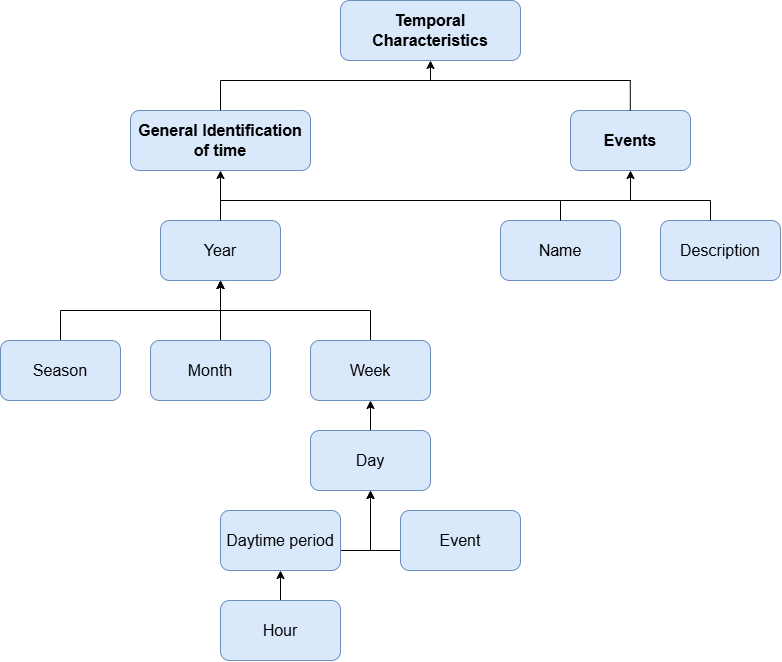

*Figure 10: An evolving hierarchical structure of the Temporal semantic characteristics.*

### Complete trajectory

The complete trajectory is defined as the succession of episodes:

Trajectory = (𝑒𝑠 1, 𝑒𝑠 2, 𝑒𝑠 3)

B.1.3. Hybrid Model As we have already instantiated our model for outdoor and indoor spaces in earlier stages, this section focuses on avoiding redundancy by not re-instantiating the same scenarios here. Instead, we highlight that our model can effectively represent both types of environments.

## C. Appendix C

In this appendix, we present illustrative examples of hierarchical semantic structuring, as previously introduced in Section 3.2. These structures serve as extended representations that can be flexibly adapted according to the availability of data and the specific requirements of the target application domain.

### References

Afroz, M., Nyakwende, E., Goswami, B., 2023. A hybrid deep learning approach for accurate network intrusion detection using traffic flow analysis in iomt domain, in: International Conference on Advances in Data-driven Computing and Intelligent Systems, Springer. pp. 369–385. Alvares, L.O., Bogorny, V., Kuijpers, B., de Macedo, J.A.F., Moelans, B., Vaisman, A., 2007. A model for enriching trajectories with semantic geographical information, in: Proceedings of the 15th Annual ACM International Symposium on Advances in Geographic Information Systems, Association for Computing Machinery, New York, NY, USA. pp. 1–8. URL: https://doi.org/10.1145/1341012.1341041, doi:10.1145/1341012.1341041.

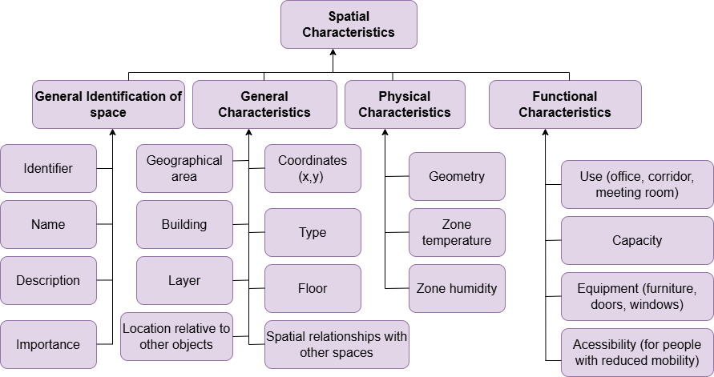

*Figure 11: An evolving hierarchical structure for spatial semantic characteristics.*

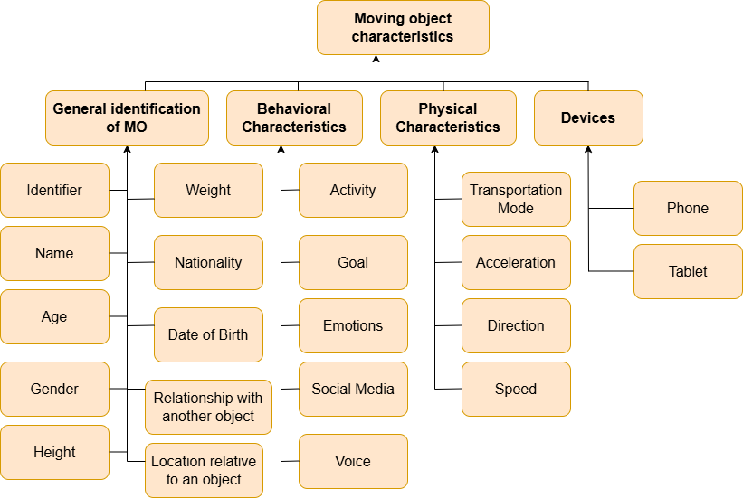

*Figure 12: An evolving hierarchical structure of the MO semantic information.*

Andrienko, G., Andrienko, N., Bak, P., Keim, D., Kisilevich, S., Wrobel, S., 2011a. A conceptual framework and taxonomy of techniques for analyzing movement. J. Vis. Lang. Comput. 22, 213–232. URL: https://doi.org/10.1016/j.jvlc.2011.02.003, doi:10.1016/j. jvlc.2011.02.003. Andrienko, G., Andrienko, N., Heurich, M., 2011b. An event-based conceptual model for context-aware movement analysis. Int. J. Geogr. Inf. Sci.

25, 1347–1370. URL: https://doi.org/10.1080/13658816.2011.556120, doi:10.1080/13658816.2011.556120. Becker, T., Nagel, C., Kolbe, T.H., 2009. A multilayered space-event model for navigation in indoor spaces, in: Lee, J., Zlatanova, S. (Eds.), 3D Geo- Information Sciences. Springer Berlin Heidelberg, Berlin, Heidelberg, pp. 61–77. URL: https://doi.org/10.1007/978-3-540-87395-2_ 5, doi:10.1007/978-3-540-87395-2_5. Berners-Lee, T., Hendler, J., Lassila, O., 2001. The semantic web. Scientific American 284, 29–37.

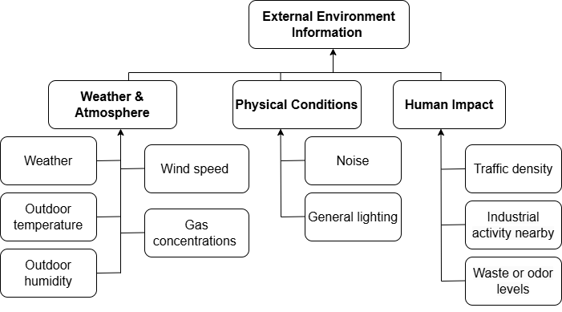

*Figure 13: An evolving hierarchical structure for External environment semantic information.*

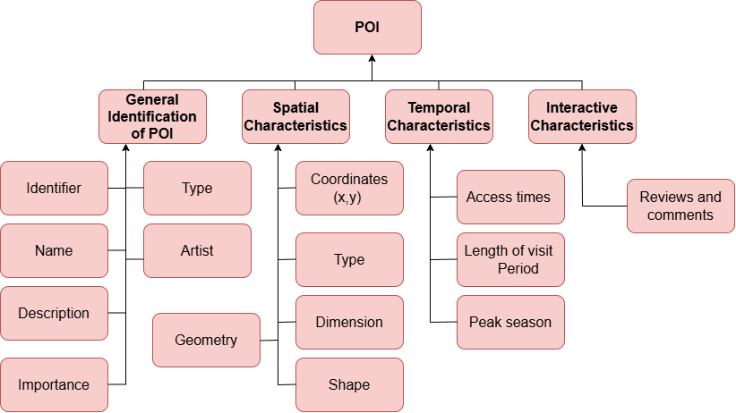

*Figure 14: An evolving hierarchical structure for POI characteristics.*

Bogorny, V., Heuser, C.A., Alvares, L.O., 2010. A conceptual data model for trajectory data mining, in: Proceedings of the 6th International Conference on Geographic Information Science, Springer-Verlag, Berlin, Heidelberg. p. 1–15. Bogorny, V., Renso, C., de Aquino, A.R., de Lucca Siqueira, F., Alvares, L.O., 2014. Constant – a conceptual data model for semantic trajectories of moving objects. Transactions in GIS 18, 66–88. URL: https://onlinelibrary.wiley.com/doi/abs/10.1111/tgis.12011, doi:https: //doi.org/10.1111/tgis.12011, arXiv:https://onlinelibrary.wiley.com/doi/pdf/10.1111/tgis.12011. Cayèré, C., Sallaberry, C., Faucher, C., Bessagnet, M.N., Roose, P., Masson, M., Richard, J., 2021. Multi-level and multiple aspect semantic trajectory model: Application to the tourism domain. ISPRS International Journal of Geo-Information 10. URL: https://www.mdpi.com/ 2220-9964/10/9/592, doi:10.3390/ijgi10090592. Ceccarelli, S., Cesta, A., Cortellessa, G., De Benedictis, R., Fracasso, F., Leopardi, L., Ligios, L., Lombardi, E., Malatesta, S.G., Oddi, A., Pagano, A., Palombini, A., Romagna, G., Sanzari, M., Schaerf, M., 2024. Evaluating visitors’ experience in museum: Comparing artificial intelligence and multi-partitioned analysis. Digital Applications in Archaeology and Cultural Heritage 33, e00340. URL: https://www.sciencedirect. com/science/article/pii/S2212054824000250, doi:https://doi.org/10.1016/j.daach.2024.e00340. Cruz, C., 2017. Semantic trajectory modeling for dynamic built environments, in: Special Session on Environmental and Geo-spatial Data Analytics (EnGeoData 2017), The 4th IEEE International Conference on Data Science and Advanced Analytics, Tokyo, Japan. pp. 1–8. URL: https://hal.science/hal-01677073.

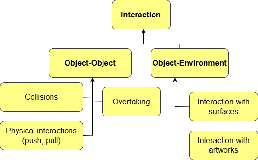

*Figure 15: An evolving hierarchical structure for Interaction semantic information.*

Damiani, M.L., 2021. Semantic trajectories data models, in: Handbook of Big Geospatial Data. none ed.. Springer. volume None of Springer Books. chapter 0, pp. 185–197. URL: https://ideas.repec.org/h/spr/sprchp/978-3-030-55462-0_8.html, doi:10.1007/ 978-3-030-55462-0_8. Deng, Y., Ai, H., Deng, Z., Gao, W., Shang, J., 2022. An overview of indoor positioning and mapping technology standards. Standards 2, 157–183.

URL: https://www.mdpi.com/2305-6703/2/2/12, doi:10.3390/standards2020012. Dimitroulopoulou, S., Dudzińska, M.R., Gunnarsen, L., Hägerhed, L., Maula, H., Singh, R., Toyinbo, O., Haverinen-Shaughnessy, U., 2023.

Indoor air quality guidelines from across the world: An appraisal considering energy saving, health, productivity, and comfort. Environment International 178, 108127. URL: https://www.sciencedirect.com/science/article/pii/S0160412023004002, doi:https://doi. org/10.1016/j.envint.2023.108127. Garani, G., Adam, G.K., 2020. A semantic trajectory data warehouse for improving nursing productivity. Health Information Science and Systems 8, 25. Gruber, T., 2009. Ontology, in: LIU, L., ÖZSU, M.T. (Eds.), Encyclopedia of Database Systems. Springer US, Boston, MA, pp. 1963–1965. URL:

based on cellular automata. Computers, Environment and Urban Systems 87, 101622. URL: https://www.sciencedirect.com/science/ article/pii/S0198971521000296, doi:https://doi.org/10.1016/j.compenvurbsys.2021.101622. Kang, H.K., Li, K.J., 2017. A standard indoor spatial data model—ogc indoorgml and implementation approaches. ISPRS International Journal of Geo-Information 6. URL: https://www.mdpi.com/2220-9964/6/4/116, doi:10.3390/ijgi6040116. Kontarinis, A., Zeitouni, K., Marinica, C., Vodislav, D., Kotzinos, D., 2021. Towards a semantic indoor trajectory model: application to museum visits. Geoinformatica 25, 311–352. URL: https://doi.org/10.1007/s10707-020-00430-x, doi:10.1007/s10707-020-00430-x. Li, H., Lu, H., Chen, X., Chen, G., Chen, K., Shou, L., 2016. Vita: a versatile toolkit for generating indoor mobility data for real-world buildings.

Proc. VLDB Endow. 9, 1453–1456. URL: https://doi.org/10.14778/3007263.3007282, doi:10.14778/3007263.3007282. Li, K.J., Zlatanova, S., Torres-Sospedra, J., Pérez-Navarro, A., Laoudias, C., Moreira, A., 2019. Survey on indoor map standards and formats, in:

2019 International Conference on Indoor Positioning and Indoor Navigation (IPIN), IEEE. pp. 1–8. Mello, R.d.S., Bogorny, V., Alvares, L.O., Santana, L.H.Z., Ferrero, C.A., Frozza, A.A., Schreiner, G.A., Renso, C., 2019. Master: A multiple aspect view on trajectories. Transactions in GIS 23, 805–822. URL: https://onlinelibrary.wiley.com/doi/abs/10.1111/tgis.12526, doi:https://doi.org/10.1111/tgis.12526, arXiv:https://onlinelibrary.wiley.com/doi/pdf/10.1111/tgis.12526. Mostafa, S., Harras, K., Youssef, M., 2022. A survey of indoor localization systems in multi-floor environments. TechRxiv 2022. URL: https://www.techrxiv.org/doi/abs/10.36227/techrxiv.20439648.v1, doi:10.36227/techrxiv.20439648.v1, arXiv:https://www.techrxiv.org/doi/pdf/10.36227/techrxiv.20439648.v1. Naser, R.S., Lam, M.C., Qamar, F., Zaidan, B.B., 2023. Smartphone-based indoor localization systems: A systematic literature review. Electronics 12. URL: https://www.mdpi.com/2079-9292/12/8/1814, doi:10.3390/electronics12081814. Noureddine, H., Ray, C., Claramunt, C., 2020. Semantic trajectory modelling in indoor and outdoor spaces, in: 2020 21st IEEE International Conference on Mobile Data Management (MDM), pp. 131–136. doi:10.1109/MDM48529.2020.00035. Noureddine, H., Ray, C., Claramunt, C., 2022. A hierarchical indoor and outdoor model for semantic trajectories. Transactions in GIS 26, 214–235. URL: https://onlinelibrary.wiley.com/doi/abs/10.1111/tgis.12841, doi:https://doi.org/10.1111/tgis. 12841, arXiv:https://onlinelibrary.wiley.com/doi/pdf/10.1111/tgis.12841. Parent, C., Spaccapietra, S., Renso, C., Andrienko, G., Andrienko, N., Bogorny, V., Damiani, M.L., Gkoulalas-Divanis, A., Macedo, J., Pelekis, N., Theodoridis, Y., Yan, Z., 2013a. Semantic trajectories modeling and analysis. ACM Comput. Surv. 45. URL: https://doi.org/10.1145/ 2501654.2501656, doi:10.1145/2501654.2501656.

Parent, C., Spaccapietra, S., Renso, C., Andrienko, G., Andrienko, N., Bogorny, V., Damiani, M.L., Gkoulalas-Divanis, A., Macedo, J., Pelekis, N., Theodoridis, Y., Yan, Z., 2013b. Semantic trajectories modeling and analysis. ACM Comput. Surv. 45. URL: https://doi.org/10.1145/ 2501654.2501656, doi:10.1145/2501654.2501656. Qin, J., Wang, L., Wu, T., Li, Y., Xiang, L., Zhu, Y., 2024. Indoor mobility data encoding with tstm-in: A topological-semantic trajectory model. Computers, Environment and Urban Systems 110, 102114. URL: https://www.sciencedirect.com/science/article/pii/ S0198971524000437, doi:https://doi.org/10.1016/j.compenvurbsys.2024.102114. Renso, C., Baglioni, M., de Macedo, J.A.F., Trasarti, R., Wachowicz, M., 2013. How you move reveals who you are: understanding human behavior by analyzing trajectory data. Knowledge and information systems 37, 331–362. Ryoo, H.G., Kim, T., Li, K.J., 2015. Comparison between two ogc standards for indoor space: Citygml and indoorgml, in: Proceedings of the Seventh ACM SIGSPATIAL International Workshop on Indoor Spatial Awareness, Association for Computing Machinery, New York, NY, USA. pp. 1–8. URL: https://doi.org/10.1145/2834812.2834813, doi:10.1145/2834812.2834813. Santana, L.H., Mello, R., 2017. Workload-aware rdf partitioning and sparql query caching for massive rdf graphs stored in nosql databases, in:

Anais do XXXII Simpósio Brasileiro de Bancos de Dados, SBC, Porto Alegre, RS, Brasil. pp. 184–195. URL: https://sol.sbc.org.br/ index.php/sbbd/article/view/24285, doi:10.5753/sbbd.2017.170758. Sartayeva, Y., Chan, H.C., Ho, Y.H., Chong, P.H., 2023. A survey of indoor positioning systems based on a six-layer model. Comput. Netw. 237.

URL: https://doi.org/10.1016/j.comnet.2023.110042, doi:10.1016/j.comnet.2023.110042. Smith, B., 2012. Ontology, in: Hurtado, G., Nudler, O. (Eds.), The Furniture of the World: Essays in Ontology and Metaphysics. Editions Rodopi, pp. 47–68. Spaccapietra, S., Parent, C., 2011. Adding meaning to your steps (keynote paper), in: Jeusfeld, M., Delcambre, L., Ling, T.W. (Eds.), Conceptual Modeling – ER 2011, Springer Berlin Heidelberg, Berlin, Heidelberg. pp. 13–31. Spaccapietra, S., Parent, C., Damiani, M.L., de Macedo, J.A., Porto, F., Vangenot, C., 2008. A conceptual view on trajectories. Data Knowl. Eng.

65, 126–146. URL: https://doi.org/10.1016/j.datak.2007.10.008, doi:10.1016/j.datak.2007.10.008. Uschold, M., King, M., 1996. Ontologies: Principles, methods and applications. Knowledge Engineering Review 11, 93–136. Yan, Z., Chakraborty, D., Parent, C., Spaccapietra, S., Aberer, K., 2011. Semitri: a framework for semantic annotation of heterogeneous trajectories, in: Proceedings of the 14th International Conference on Extending Database Technology, Association for Computing Machinery, New York, NY, USA. p. 259–270. URL: https://doi.org/10.1145/1951365.1951398, doi:10.1145/1951365.1951398. Yan, Z., Chakraborty, D., Parent, C., Spaccapietra, S., Aberer, K., 2013. Semantic trajectories: Mobility data computation and annotation. ACM Trans. Intell. Syst. Technol. 4. URL: https://doi.org/10.1145/2483669.2483682, doi:10.1145/2483669.2483682. Yan, Z., Macedo, J., Parent, C., Spaccapietra, S., 2008. Trajectory ontologies and queries. Transactions in GIS 12, 75–91. URL: https://onlinelibrary.wiley.com/doi/abs/10.1111/j.1467-9671.2008.01137.x, doi:https://doi.org/10.1111/j. 1467-9671.2008.01137.x, arXiv:https://onlinelibrary.wiley.com/doi/pdf/10.1111/j.1467-9671.2008.01137.x. Yan, Z., Parent, C., Spaccapietra, S., Chakraborty, D., 2010. A hybrid model and computing platform for spatio-semantic trajectories, in: Proceedings of the 7th International Conference on The Semantic Web: Research and Applications - Volume Part I, Springer-Verlag, Berlin, Heidelberg. p. 60–75. URL: https://doi.org/10.1007/978-3-642-13486-9_5, doi:10.1007/978-3-642-13486-9_5. Yao, C., Wei, Z., 2022. Blood pressure trajectory and its influencing factors in chinese adults: a cohort study with long-term follow-up. Medical Science Monitor: International Medical Journal of Experimental and Clinical Research 28, e934886–1.

Alaa Eddine Siouane is a PhD candidate in Computer Science at the University of Nantes, France. He holds a Master’s degree in Computer Science from the University of Algiers, Algeria. His research interests specializing in the modeling and analysis of indoor semantic trajectories. His research focuses on understanding human movement within complex indoor environments— particularly museums—by integrating spatial, temporal, and semantic dimensions. His interests include IndoorGML-based space representation, qualitative and quantitative spatial reasoning, and graph-based modeling of indoor environments. In addition to his work in spatial analysis, he has explored the application of emerging technologies such as quantum computing in geospatial contexts, co-authoring research on Quantum Recurrent Neural Networks for soil profile prediction. Alaa’s work aims to develop innovative frameworks for capturing and analyzing indoor mobility patterns, contributing to the fields of spatio-temporal data management and semantic trajectory modeling.

Claudia Marinica is currently Assistant Professor at Polytech Nantes (computer science department), University of Nantes, and Laboratoire des Sciences du Numérique de Nantes (LS2N) research laboratory, Data User Knowledge (DUKe) team (starting with September 2020). Previously, she was Assistant Professor at CY Cergy Paris University, IUT of Cergy- Pontoise, Métiers du Multimédia et de l’Internet department, and Equipes Traitement de l’Information et Systèmes research laboratory (ETIS), MIDI team (2011-2020). She has joined the CY Cergy Paris University in 2011, after defending her PhD in 2010 in the LS2N Lab, Data DUKe team, Polytech Nantes, University of Nantes. She is board member in charge with the winter school of the French-speaking “Extraction et Gestion des Connaissances (EGC)” Association, and she has also been involved in the steering committee of the annual EGC French-speaking Conference since 2001. She is/has been involved in the program committees of main international conferences like ESWC, CIKM, WWW, ISWC. In 2018, she initiated the working group DAHLIA: DigitAl Humanities and cuLtural herItAge: management and analysis of data and knowledge attached to the EGC Association. She is carrying a fundamental and applied research activity, positioned in the field of Artificial Intelligence (AI); she is interested in proposing new algorithms, models and methods, but also, in applied and validating them on real data in order to answer concrete problems. The contributions that she brings to the fundamental research are then applied to real data in order to solve concrete problems. She is working in collaboration with Cultural Institutions and thus her contributions are applied on cultural heritage data. Moreover, she collaborate with Social Sciences colleagues and her contributions are applied on Digital Humanities, and social data.

Fabien Picarougne is an Associate Professor in the Computer Science department at Polytech Nantes, part of Nantes Université, and a member of the “Data User Knowledge” team (DUKe) in the Laboratoire des Sciences du Numérique de Nantes (LS2N, UMR 6004). Holding an engineering degree and a Ph.D., his research focuses on machine learning (including the use of deep learning models for event prediction on time series), the design of bio-inspired algorithms, and the interactive visualization of complex data using 2D, 3D, and virtual reality approaches. Author of numerous scientific publications in these areas, he also serves as the Treasurer of the French Association for Knowledge Extraction and Management (EGC).

Fabrice Guillet is a full professor in Computer Science at Polytech Nantes, the graduate engineering school of University of Nantes, and a member of the “Data User Knowledge” team (DUKe) in the LS2N (CNRS UMR 6004) laboratory. He is member of the executive board and of the steering committee of the French-speaking “Extraction et Gestion des Connaissances (EGC) Association. He has been head of 2 research oriented MSc in computer science (M2R-ECD, EM- DMKM) in Polytech Nantes. He received a PhD degree in Computer Sciences in 1995 from the "Ecole Nationale Supérieure des Telecommunications de Bretagne" (IMT), and his Habilitation (HdR) in Computer Science in 2006 from the University of Nantes. He is vice-Treasurer, and a founding member of the French-speaking “Extraction et Gestion des Connaissances (EGC)” Association, president from 2015 to 2019, and he has also been involved in the steering committee of the annual EGC French-speaking Conference since 2001. His research interests include frequent pattern based and unsupervised machine learning in the frameworks of Data and Knowledge Science, with a focus on graph learning, ontology and knowledge graphs learning form text, postprocessing and validation (visualization and quality), knowledge graphs and ontology modeling. He is/has been involved in the program committees of the main international conferences on Data Mining (ACM/IEEE DSAA, ACM KDD, IEEE ICDM, ACM CIKM, SIAM SDM). Author of more than 60 research papers in international conferences and journals, co-editor of 10 international refereed books, he has co-edited two refereed books of chapter entitled “Quality Measures in Data Mining” and “Statistical Implicative Analysis – Theory and Applications” published by Springer in 2007 and 2008. He has recently participated to workshop organization as co-chair (AI-TECH@CSONET 2025, AMI@PAKDD 2026).

Prof. Georgios Papaioannou is a leading scholar in Museology and Digital Cultural Heritage, specializing in the GLAM sector. With an interdisciplinary background in archaeology, classics, cultural heritage, and information technology, he has authored publications, delivered invited lectures and 40 internationally funded research projects across the Mediterranean and Arab world. He is the founder of the International Conference of Museum Big Data (MBD). Educated in Greece, the United Kingdom, and Spain, with further training in the United States, he has taught globally and received awards for teaching excellence. He currently directs the Museology Research Laboratory at the Ionian University, Greece, and contributes actively to international professional organizations, including ICOM, the European Museum Academy, and Europeana.

