# Analyse de trajectoires sémantiques dans un musée

Rapport de stage de quatrième année Hamza Berrada Polytech Nantes Informatique LS2N UMR 6004 Nantes Université Du 22 juin au 25 septembre 2026 Tutrice de stage : Claudia Marinica Enseignante référente : Rebiha Souadih Co-stagiaires : El Maghraoui Yassine, Levy Bryan Sommaire Introduction..................................................................................................................................2 1 Cadre du stage et objectifs......................................................................................................3 2 Appropriation de G-SITM......................................................................................................... 5 3 Recherche bibliographique et choix de BIRD........................................................................7 4 Première expérimentation avec STTP et TinyBERT............................................................ 11 5 Enrichissement sémantique des œuvres de BIRD..............................................................16 6 Préparation des trajectoires pour la prochaine œuvre.......................................................23 7 Construction du modèle à graphes et apprentissage contrastif....................................... 27 8 Protocole expérimental et analyse des résultats................................................................ 31 9 Gestion du projet et organisation du travail........................................................................ 36 10 Bilan personnel et regard critique...................................................................................... 38 Conclusion................................................................................................................................. 39 Mobilan : empreinte carbone....................................................................................................40 Références bibliographiques................................................................................................... 40

## Introduction

Comprendre un parcours de visite dans un musée suppose de considérer plusieurs informations à la fois. L’ordre des déplacements renseigne sur la progression du visiteur, les temps d’observation donnent des indications sur son comportement et les caractéristiques des œuvres décrivent le contenu rencontré. Une trajectoire peut ainsi être étudiée comme une suite de positions, mais aussi comme une succession d’interactions avec un environnement culturel. Cette seconde lecture constitue le point de départ de mon stage au Laboratoire des Sciences du Numérique de Nantes, le LS2N.

J’ai réalisé ce stage du 22 juin au 25 septembre 2026, dans le cadre de ma quatrième année en informatique à Polytech Nantes. Encadré par Claudia Marinica, je me suis intéressé à l’analyse de trajectoires sémantiques en environnement intérieur et à leur représentation sous forme de graphes. Le sujet s’inscrivait dans les travaux du laboratoire sur G-SITM. La mission initiale associait préparation de données, enrichissement par des modèles de langage et expérimentation de méthodes d’apprentissage profond [1].

Le travail a progressivement pris la forme d’une question expérimentale : dans quelle mesure les informations temporelles, spatiales et sémantiques disponibles dans un musée permettent-elles de prédire la suite d’une visite ? Pour l’étudier, j’ai retenu BIRD, un jeu de données consacré au musée des Beaux-Arts de Nancy, découvert lors de ma recherche bibliographique [3]. L’article STKG-PLM a ensuite fourni un cadre méthodologique important, en rapprochant graphes de connaissances, apprentissage contrastif et description textuelle des trajectoires [2].

Deux étapes de prédiction ont été développées. La première utilisait des descriptions de trajectoires sous forme de prompts et un modèle TinyBERT adapté pour prédire la prochaine salle observée. La seconde portait sur la prochaine œuvre et associait un graphe de transitions, des informations temporelles, un réseau récurrent et des objectifs contrastifs. Entre ces deux étapes, une partie importante du stage a été consacrée à l’enrichissement de BIRD : extraction d’informations textuelles, regroupement des sujets, recherche d’images et annotation visuelle assistée par un modèle de langage multimodal.

Dans les expériences finales, le modèle limité aux nœuds d’œuvres obtient le meilleur MRR parmi les configurations comparées, tandis qu’une chaîne de Markov d’ordre deux conserve la meilleure précision au premier rang. L’ajout des sujets et des salles n’améliore pas les résultats dans le protocole retenu. Cette observation permet de discuter les conditions d’exploitation de la sémantique.

Ce rapport présente chronologiquement le cadre d’accueil, l’étude des modèles, les essais STTP, l’enrichissement sémantique et la prédiction par graphes. Il expose ensuite les résultats, la gestion du projet et mon bilan personnel.

## 1 Cadre du stage et objectifs

### 1.1 Le laboratoire et le contexte scientifique

Le LS2N est une unité mixte de recherche, UMR 6004, placée sous les tutelles de Nantes Université, du CNRS, de Centrale Nantes et d’IMT Atlantique. Ses activités couvrent plusieurs domaines des sciences du numérique, dont la science des données et de la décision, le logiciel, les systèmes, la robotique, les signaux et les langues. Le stage s’est déroulé sur le site de la Houssinière à Nantes, conformément à la convention.

Claudia Marinica, ma tutrice, est maîtresse de conférences au département informatique de Polytech Nantes et membre du LS2N. Ses recherches rapprochent analyse de données et représentation des connaissances, notamment pour des données de trajectoires ou de graphes, avec des applications au patrimoine culturel. Ce contexte explique la place occupée par les trajectoires sémantiques et les musées dans le sujet proposé.

Mon environnement de travail scientifique était celui de l’équipe DuKE impliquée dans le modèle G-SITM. J’ai commencé par étudier ce modèle afin de comprendre les objets manipulés par le laboratoire et les questions auxquelles ils répondent. Cette appropriation était nécessaire avant de choisir un algorithme de prédiction : une salle, une œuvre, une observation et une trajectoire sont des entités différentes, qui ne portent pas la même information et n’évoluent pas de la même manière.

### 1.2 Une mission de recherche appliquée

L’intitulé de la convention était « Analyse de trajectoires sémantiques en environnements fermés modélisées sous forme de graphes. Application aux musées grecs » . Les travaux réalisés dans ce rapport utilisent principalement BIRD, collecté à Nancy. Le cadre initial et le terrain expérimental doivent être distingués : le premier définit le domaine d’application, le second fournit les données effectivement exploitées pendant le stage.

La mission comportait trois objectifs complémentaires. Le premier était de préparer des données séquentielles utilisables pour l’apprentissage, en clarifiant les unités d’observation et les règles de transformation. Le deuxième consistait à enrichir leur contenu sémantique à l’aide de modèles de langage. Le troisième était d’expérimenter des modèles d’apprentissage profond, notamment fondés sur des graphes, puis de comparer leurs résultats à des méthodes de référence.

Cette mission avait une dimension exploratoire. Les choix de représentation, de cible et d’architecture n’étaient pas entièrement fixés au début. Il fallait identifier ce qui pouvait être étudié avec les données disponibles, produire un premier système fonctionnel, puis comprendre les effets des changements apportés. Le résultat attendu n’était donc pas uniquement un programme capable de calculer des prédictions, mais un ensemble de données préparées, de méthodes explicites et d’observations interprétables.

Le tableau 1 récapitule les missions telles qu’elles ont été mises en œuvre. Leur ordre correspond à la progression générale du stage, même si certaines activités, comme la lecture d’articles ou l’analyse des données, se sont poursuivies pendant plusieurs phases.

Tableau 1 Missions et réalisations du stage

| Mission | Objectif | Réalisation principale |
| --- | --- | --- |
| Appropriation scientifique | Comprendre la représentation des trajectoires | Étude de SITM et G-SITM et présentations de synthèse |
| Recherche bibliographique | Choisir une approche et un terrain expérimental | Étude de STKG-PLM et sélection de BIRD |
| Première expérimentation | Tester une représentation textuelle du parcours | Prompts STTP et classification de salles avec TinyBERT |
| Enrichissement des données | Compléter la description des œuvres | Sujets issus du texte puis des images et fichiers de provenance |
| Modélisation et évaluation | Prédire la prochaine œuvre et comparer les variantes | Modèle CLL, graphes hétérogènes, références et ablations |

### 1.3 Périmètre du travail présenté

Le rapport porte sur une chaîne de recherche expérimentale, depuis les données sources jusqu’aux résultats de prédiction. Les composants développés ne constituent pas une application de recommandation déployée auprès des visiteurs. Ils permettent d’étudier, hors ligne, la capacité de différents modèles à retrouver l’élément réellement observé après un historique donné.

Cette distinction est importante pour interpréter les scores. Prédire une œuvre observée ne signifie pas démontrer que cette œuvre serait la meilleure recommandation pour la personne. Les traces traduisent les décisions prises dans une visite réelle, avec ses contraintes spatiales et temporelles. Elles ne décrivent pas toutes les alternatives envisagées, la satisfaction associée à chaque choix ou les effets d’une recommandation présentée au visiteur.

Le périmètre final comprend un catalogue connu de 359 œuvres et des visiteurs séparés entre apprentissage, validation et test. Il permet d’étudier la généralisation à d’autres visiteurs dans ce musée. Il ne démontre pas une généralisation à un nouvel établissement, à une nouvelle collection ou à des œuvres absentes du catalogue d’entraînement. Ces autres situations nécessiteraient un protocole distinct.

## 2 Appropriation de G-SITM

### 2.1 De la trajectoire brute à la trajectoire sémantique

Au début du stage, je me suis intéressé au modèle G-SITM. Cette phase m’a permis de relier des notions connues en informatique, comme les graphes et les séquences, aux particularités d’un environnement intérieur .

Une trajectoire brute est une succession de positions associées à des instants. Cette représentation décrit un déplacement, mais elle ne suffit pas à en exprimer la signification.

Une trajectoire sémantique ajoute donc des informations aux positions et aux intervalles temporels. Ces informations peuvent concerner l’espace, l’objet mobile ou les points d’intérêt. Une étape peut, par exemple, être décrite par la salle visitée, les œuvres observées et la durée associée. Des annotations plus interprétatives peuvent porter sur une activité ou un objectif. Leur présence dans un modèle de représentation n’implique cependant pas qu’elles soient toutes disponibles ou directement mesurables dans un jeu de données.

Cette distinction a guidé la suite du stage. BIRD permet de reconstruire des observations d’œuvres et des séquences de salles, mais il ne faut pas attribuer automatiquement une intention psychologique à chaque arrêt. Une durée longue peut provenir d’un intérêt pour une œuvre, d’une lecture de cartel ou d’autres circonstances. Dans les modèles développés, le temps reste une variable observée ou estimée, et non une preuve directe de préférence.

### 2.2 G-SITM

G-SITM (Graph-based Semantic Indoor Trajectory Model) représente l’environnement intérieur sous la forme d’un graphe évolutif G = (V,E,T), où désigne l’ensemble des nœuds représentant 𝑉 les entités du musée, l’ensemble des relations entre ces entités, et la dimension temporelle 𝐸 𝑇 permettant de décrire leur évolution au cours du temps. Cette représentation permet de modéliser conjointement la structure spatiale, les informations sémantiques et les trajectoires des visiteurs [1].

Cette historisation permet notamment d'éviter le problème présenté en figure 1. Une trajectoire enregistrée en 2021 est cohérente avec la configuration du musée de 2021. Si un passage est ensuite condamné lors d’une rénovation, analyser cette même trajectoire directement sur le plan de 2023 ferait artificiellement traverser un mur au visiteur : c’est le phénomène de trajectoire fantôme (ghost trajectory). G-SITM conserve donc la configuration spatiale dans laquelle chaque trajectoire était valide plutôt que de l’interpréter uniquement à partir de l’état actuel du musée.

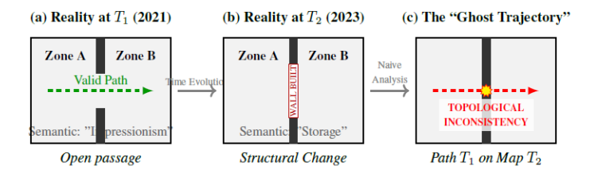

*Figure 1: Le problème des trajectoires fantôme [1]*

Pour représenter cette évolution sans dupliquer entièrement le graphe à chaque changement, G-SITM distingue trois types de nœuds :

● : représente l’identité persistante d’une entité, par exemple une salle ; 𝑉𝑏𝑎𝑠𝑒 ● : représente un état de cette entité valide pendant une période donnée, notamment 𝑉𝑠𝑒𝑞 lorsqu’un changement structurel intervient ;

● : représente une modification ponctuelle d’attribut, sans créer une nouvelle version 𝑉𝑑𝑖𝑓𝑓 complète de l’entité.

Ainsi, une modification importante de la topologie, comme la division d’une salle, crée de nouveaux états , tandis qu’une modification plus légère, comme le changement de 𝑉𝑠𝑒𝑞 description d’une œuvre, peut être représentée uniquement par un nœud . 𝑉𝑑𝑖𝑓𝑓 Les nœuds sont reliés par plusieurs types de relations. Les arêtes d’évolution conservent la 𝐸𝑒𝑣𝑜𝑙 filiation entre les états successifs d’une entité, tandis que les arêtes relationnelles décrivent 𝐸𝑟𝑒𝑙 les relations spatiales ou sémantiques valides à un instant donné. G-SITM peut ainsi reconstruire à la fois l’état du musée à une date donnée et l’historique de transformation de ses entités [1].

Dans le cas du musée, cette représentation (figure 2) est organisée autour de trois dimensions complémentaires : décrit les salles et leur topologie, les points d’intérêt tels que les 𝐺𝑠𝑝𝑎𝑐𝑒 𝐺𝑝𝑜𝑖 œuvres, et les objets mobiles, ici les visiteurs et leurs trajectoires. Des relations entre ces 𝐺𝑚𝑜 dimensions permettent par exemple d’indiquer qu’une œuvre se trouve dans une salle ou qu’un visiteur interagit avec une œuvre à un instant donné.

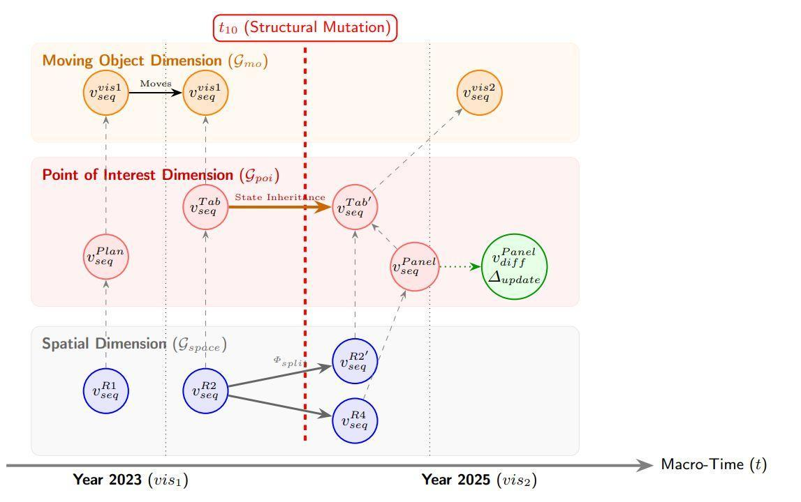

*Figure 2 Les dimensions spatiale, sémantique et mobile de G-SITM [1]*

### 2.3 Ce que cette première phase a apporté au stage

L’étude de G-SITM a fourni un vocabulaire et une manière d’organiser les informations. J’en ai retenu la distinction entre espace, points d’intérêt et visiteurs, ainsi que l’importance de dater les informations. Elle a également orienté ma recherche bibliographique vers des modèles capables d’exploiter plusieurs types de relations et de combiner structure et temporalité.

Le modèle prédictif final ne constitue toutefois pas une implémentation complète de G-SITM. Il utilise un graphe construit à partir d’un catalogue et de transitions d’entraînement, sans reproduire l’ensemble des mécanismes d’états et de différences du modèle de représentation. Le lien entre les deux travaux réside dans les questions posées et dans certaines distinctions conceptuelles, plutôt que dans une identité d’architecture.

Après avoir étudié comment représenter une trajectoire sémantique, j’ai cherché comment apprendre à partir de cette représentation. Cette transition a conduit à l’état de l’art présenté dans le chapitre suivant.

## 3 Recherche bibliographique et choix de BIRD

### 3.1 Une recherche orientée par la sémantique des données

J’ai utilisé Google Scholar pour identifier des travaux proches des problématiques étudiées au G-SITM. La recherche a d’abord été menée à partir de requêtes générales telles que Temporal Graph Networks, semantic indoor trajectory, dynamic spatio-temporal graph ou encore semantic dynamic graph neural network. Une recherche avancée a ensuite permis d’affiner les résultats en combinant des termes liés aux graphes temporels, à la sémantique, aux graphes hétérogènes et aux environnements dynamiques, tout en excluant certains domaines éloignés du sujet, comme les graphes moléculaires, protéiques, routiers ou liés au trafic. La période de publication a également été limitée aux années 2020 à 2026 afin de privilégier les travaux récents. Enfin, un Google Sheet partagé a été utilisé pour centraliser les articles retenus et éviter que plusieurs membres du projet analysent les mêmes publications.

Afin de structurer cette revue de littérature et de comparer les articles de manière homogène, une classification automatisée par batch a ensuite été mise en place en connectant l’API de GPT-5.6. Chaque article a été analysé par le modèle puis classé selon un ensemble de catégories (15 au total) définies en amont : prise en compte de la dynamique temporelle, utilisation de graphes hétérogènes, intégration d’informations sémantiques, modélisation de trajectoires, recommandation du prochain POI, mécanismes d’attention, apprentissage contrastif et prise en compte de contraintes topologiques. Au total, 34 articles scientifiques ont ainsi été recensés et synthétisés. Cette cartographie permet de situer G-SITM et les travaux réalisés pendant le stage par rapport à l’état de l’art, tout en mettant en évidence que peu d’approches combinent simultanément évolution temporelle, structure spatiale, sémantique et trajectoires dans un contexte indoor. Elle a également servi à identifier les méthodes les plus pertinentes pour orienter les modèles étudiés dans la suite du stage.

Parmi les pistes étudiées figuraient TESA, HTGNN et des travaux sur la réécriture de graphes. Ces lectures ont élargi ma compréhension de l’hétérogénéité et de la dynamique des graphes.

### 3.2 Les approches étudiées et leur rôle

Les travaux présentés autour de TESA [7] abordaient conjointement l’hétérogénéité, l’évolution temporelle et la conservation d’informations sur plusieurs échelles. HTGNN [8] mettait en évidence l’intérêt de distinguer l’agrégation au sein d’une relation, entre relations et au cours du temps.

Ces lectures n’ont pas toutes conduit à une implémentation. Leur utilité a été de fournir des critères de comparaison et d’éviter de réduire la question à un choix de couche neuronale. Par exemple, traiter toutes les arêtes de manière identique effacerait la différence entre « est située dans une salle » et « est observée après une autre œuvre ». De même, la temporalité peut désigner une évolution de structure, une durée d’observation ou l’ordre d’une séquence : ces trois notions ne sont pas équivalentes.

Le tableau 2 synthétise le rôle de ces références dans mon raisonnement. Il décrit les éléments retenus pour le stage, sans présenter les modèles comme des variantes directement comparées sur BIRD.

| Approche | Question retenue | Place dans le stage |
| --- | --- | --- |
| SITM et G-SITM | Comment représenter espace, temps et sémantique ? | Cadre initial et vocabulaire du problème |
| TESA et HTGNN | Comment distinguer types de relations et temporalité ? | Élargissement de l’état de l’art |

| Approche | Question retenue | Place dans le stage |
| --- | --- | --- |
| STKG-PLM | Comment combiner trajectoire, connaissances et langage ? | Référence principale pour structurer les expériences |

Tableau 2 Rôle des principales approches étudiées

### 3.3 Le rôle structurant de STKG-PLM

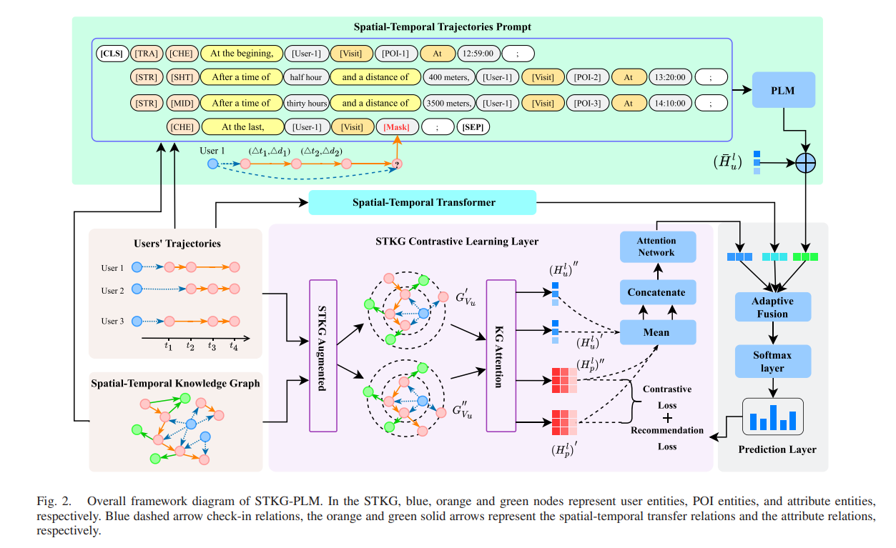

*Figure 3 - Le module de prédiction STKG PLM de Chen et ses coauteurs*

L’article de Chen et ses coauteurs [2], publié en 2025, propose une méthode de recommandation du prochain point d’intérêt associant un graphe spatio-temporel de connaissances, de l’apprentissage contrastif et des prompts de trajectoire. Sa lecture a beaucoup structuré la suite du stage, car elle reliait plusieurs dimensions déjà rencontrées séparément dans l’état de l’art.

L’architecture étudiée comporte plusieurs branches. Une représentation de la trajectoire traite les interactions séquentielles ; une branche de graphe exploite des relations et des informations auxiliaires ; une branche textuelle transforme le parcours en une description exploitable par un modèle de langage préentraîné. Les représentations sont ensuite combinées pour la prédiction. L’apprentissage contrastif vise à produire des représentations cohérentes entre différentes vues des mêmes données.

Pour mon travail, deux idées étaient particulièrement intéressantes. La première consistait à exprimer une trajectoire sous une forme textuelle structurée, afin d’y intégrer des informations temporelles et sémantiques. La seconde était d’apprendre des représentations d’éléments à partir d’un graphe enrichi, puis de les utiliser dans une prédiction séquentielle. Ces deux pistes pouvaient être étudiées séparément avant d’envisager une combinaison plus complexe.

L’adaptation à un musée demandait cependant de redéfinir les unités utilisées. Les points d’intérêt devenaient des œuvres ou des salles. La localisation reposait sur un environnement intérieur structuré. Les informations sémantiques provenaient d’un catalogue culturel, dont la couverture et la qualité devaient être examinées. Enfin, BIRD offrait beaucoup moins de visiteurs que les grands ensembles de traces habituellement associés à la recommandation de lieux.

Le travail réalisé doit donc être présenté comme une adaptation inspirée de STKG-PLM. Je n’ai pas reproduit intégralement son architecture, ses jeux de données ou son protocole. Le premier prototype étudiait la branche textuelle sur les salles ; le modèle final étudiait une combinaison graphe, temps, séquence et contraste sur les œuvres. La fusion complète avec un modèle de langage ne fait pas partie des résultats finaux présentés ici.

### 3.4 La sélection du jeu de données BIRD

La recherche bibliographique m’a également permis de découvrir BIRD [3], pour Behavioral and Identity-Related Dataset. Ce jeu de données concerne des visites du musée des Beaux-Arts de Nancy. Il rassemble des informations sur les déplacements, les observations d’œuvres, le musée et les visiteurs. Les données de visite ont été collectées en 2019 ; la publication de présentation du jeu de données est référencée dans les actes complémentaires d’UMAP 2025.

Pour le stage, son intérêt venait de la possibilité de relier des événements de visite à des œuvres identifiables et à des salles. Il permettait de construire des séquences tout en conservant des informations de contexte. Le périmètre effectivement exploité comprend 51 visiteurs, 7 204 débuts d’observation et un catalogue de 359 œuvres.

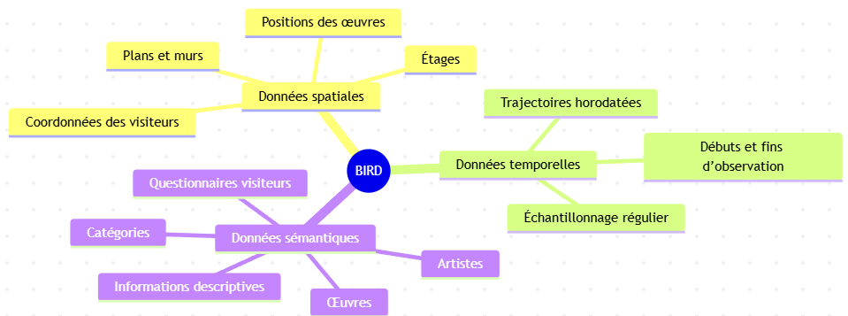

*Figure 4 – Organisation des données spatiales, temporelles et sémantiques disponibles dans BIRD.*

La figure ci-dessus synthétise la structure des informations disponibles dans BIRD. Le jeu de données s’organise autour de trois grandes dimensions complémentaires. Les données spatiales décrivent l’environnement du musée à travers les plans, les étages, la position des œuvres et les coordonnées des visiteurs. Les données temporelles décrivent le déroulement des visites au moyen des trajectoires horodatées ainsi que des débuts et fins d’observation des œuvres. Enfin, les données sémantiques regroupent les informations relatives aux œuvres, aux artistes, aux catégories et aux descriptions, auxquelles s’ajoutent les questionnaires renseignés par les visiteurs.

La disponibilité d’un catalogue ne rendait pas les données immédiatement prêtes pour l’apprentissage. Il fallait vérifier les identifiants, rapprocher les débuts et les fins d’observation, choisir une granularité, traiter les informations absentes et définir une séparation entre visiteurs.

Le choix de BIRD a finalement permis de transformer une question générale sur les trajectoires sémantiques en un ensemble d’expériences concrètes. La première a porté sur la prochaine salle observée, à partir d’une description textuelle du parcours. Elle est présentée dans le chapitre suivant.

## 4 Première expérimentation avec STTP et TinyBERT

### 4.1 Objectif de la première chaîne expérimentale

La première expérimentation cherchait à répondre à une question précise : peut-on traduire une trajectoire intérieure et sa sémantique en langage naturel, puis adapter un modèle préentraîné pour prédire la prochaine salle observée ? Cette étape reprenait l’idée des prompts spatio-temporels de trajectoire, désignés par STTP, dans STKG-PLM, en la transposant au contexte de BIRD.

Le choix d’une cible au niveau des salles permettait d’étudier une première représentation du parcours. Il réduisait le catalogue de sortie à 37 classes, tout en conservant la possibilité de décrire les œuvres rencontrées à l’intérieur de chaque étape. La cible correspondait à la prochaine salle distincte dans la séquence des observations. Une salle traversée sans observation d’œuvre pouvait donc être absente de cette séquence.

Cette précision délimite le problème traité. Le modèle ne reconstruit pas nécessairement chaque franchissement physique d’une salle. Il prédit la prochaine salle représentée dans les événements d’observation.

La chaîne développée comportait la préparation des événements, leur regroupement éventuel en épisodes, la génération de prompts, la tokenisation et l’entraînement d’un classifieur. Cette séparation rendait les transformations inspectables : un exemple pouvait être suivi depuis ses observations d’origine jusqu’à sa cible et à son texte d’entrée.

### 4.2 Des observations aux épisodes de salle

La première préparation conservait une unité par observation d’œuvre. Avec 7 204 observations réparties entre 51 visiteurs et un historique minimal de deux observations, elle produisait 7 102 exemples. Ce total s’explique par la génération d’une cible à chaque position admissible : les deux premières observations de chaque visite servent à constituer l’historique initial et ne deviennent pas elles-mêmes des cibles dans cette configuration.

Les prompts sont construits en cascade. À mesure que la visite avance, le contexte contient les observations déjà disponibles. L’historique grandit jusqu’à la longueur maximale autorisée, puis une fenêtre glissante conserve les éléments les plus récents. La figure 5 illustre ce mécanisme sur une séquence fictive. Les lettres représentent des œuvres ; elles ne correspondent pas à une visite réelle du jeu de données.

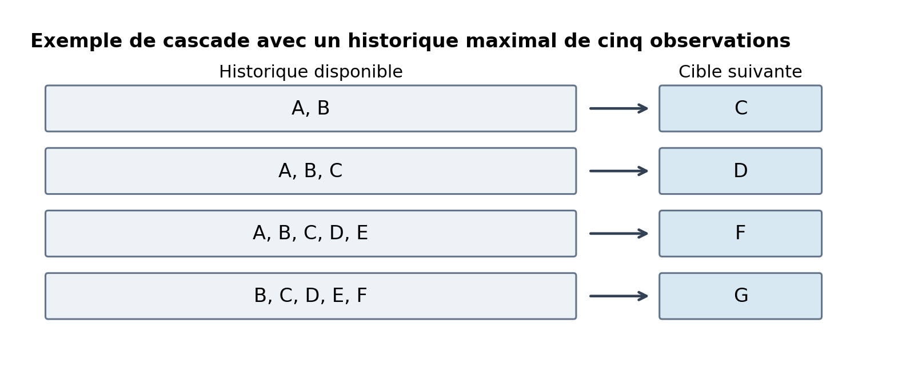

*Figure 5 Construction des exemples en cascade avec un historique maximal de cinq observations.*

Dans l’expérimentation sur les salles, les observations consécutives appartenant à une même salle sont regroupées en épisodes. Une suite d’œuvres situées dans la salle A ne produit alors qu’un épisode A ; le passage à une œuvre de la salle B ouvre un nouvel épisode. Un retour ultérieur dans A reste un nouvel épisode, car il fait partie de la progression du parcours.

Ce regroupement produit 1 628 épisodes de salle. La génération en cascade après cinq épisodes d’historique conduit à 1 374 prompts dans l’expérience présentée. Le recomptage des séquences permet de retrouver ce total en sommant, pour chaque visite, le nombre d’épisodes au-delà des cinq premiers, sans conserver de valeur négative pour les visites trop courtes.

Les 7 102 exemples et les 1 374 prompts correspondent donc à deux niveaux de préparation. Leur différence ne traduit pas une perte inexpliquée de données. Elle vient de l’unité retenue et de la longueur d’historique nécessaire. Le tableau 3 rassemble ces étapes pour rendre cette évolution explicite.

| Étape | Unité | Volume | Interprétation |
| --- | --- | --- | --- |
| Données utilisées | Début d’observation d’une œuvre | 7 204 | Événements répartis entre 51 visiteurs |
| Première cascade | Exemple au niveau des observations | 7 102 | Historique minimal de deux observations |
| Regroupement | Épisode de salle | 1 628 | Fusion des observations consécutives dans une salle |

| Étape | Unité | Volume | Interprétation |
| --- | --- | --- | --- |
| Expérience présentée | Prompt au niveau des épisodes | 1 374 | Cible après cinq épisodes d’historique |
| Sortie du modèle | Salle candidate | 37 | Prochaine salle distincte observée |

Tableau 3 Unités et volumes de la préparation STTP

### 4.3 La mise en texte du parcours

Les prompts décrivent les étapes du parcours en anglais afin de les transmettre au modèle choisi. Ils rassemblent des informations sur les salles, les étages, les temps et les œuvres observées. Les titres, artistes et caractéristiques disponibles du catalogue apportent un contenu sémantique à la séquence, au-delà d’une simple liste d’identifiants.

Des marqueurs spécifiques structurent le texte. Les tokens [TRA], [CHE] et [STR] signalent différents éléments de l’organisation du prompt. Les marqueurs [SHT], [MID] et [LNG] expriment des catégories temporelles ; les seuils décrits dans la préparation distinguent notamment les durées courtes jusqu’à 30 secondes et intermédiaires jusqu’à 120 secondes. Le prompt se termine par un emplacement [MASK] associé à la salle à prédire.

Un exemple de formulation abrégée serait : “[TRA] [CHE] At the beginning, the visitor explored room 5 on floor 0 for 6 seconds and observed 1 distinct artwork, including “L'enfance de Jupiter” by Ker-Xavier Roussel, a oil on canvas dated 1940. [STR] [SHT] After 29 seconds, the visitor explored room 7 on floor 0 for 33 seconds and observed 3 distinct artworks… [CHE] At last, the next distinct room visited is [MASK]."

Le niveau de détail introduit une contrainte de longueur. Le modèle accepte au maximum 512 tokens ; décrire trop d’œuvres ou conserver un historique trop long peut provoquer une troncature. La construction du prompt doit donc préserver les éléments utiles et la présence du marqueur de prédiction. Une représentation textuelle donne accès à une sémantique riche, mais elle impose aussi des choix sur ce qui entre dans le budget de tokens.

### 4.4 Adaptation de TinyBERT à la classification

TinyBERT est un modèle compact issu de travaux sur la distillation de BERT [4]. L’expérimentation repose sur le modèle « huawei-noah/TinyBERT_General_4L_312D », composé de quatre couches Transformer et dont les représentations cachées ont une dimension de 312. Pour l’adapter aux prompts STTP, les tokens spécifiques à cette représentation sont d’abord ajoutés au tokenizer, ce qui nécessite également d’agrandir la matrice d’embeddings du modèle. Les prompts sont ensuite tokenisés et associés à un masque d’attention permettant de distinguer les tokens réellement présents du padding. La position du token [MASK] est également enregistrée pour chaque exemple.

Lors du passage d’un prompt dans TinyBERT, le modèle produit un vecteur de 312 valeurs pour chaque token de la séquence. Grâce au mécanisme d’attention du Transformer, la représentation obtenue à la position de [MASK] est construite à partir du contexte de la trajectoire décrit dans le prompt, notamment les salles déjà visitées, les durées et les œuvres observées. Le vecteur correspondant à [MASK] est alors extrait et utilisé comme représentation d’entrée pour la tête de classification. Cela comprend une normalisation, un dropout puis une projection linéaire permettant de passer des 312 dimensions de la représentation à 37 scores, soit un score pour chacune des salles candidates. La salle associée au score le plus élevé constitue la prédiction du modèle.

Le rôle de [MASK] diffère donc de celui qu’il possède dans un modèle de langage masqué classique. TinyBERT ne cherche pas ici à retrouver un mot manquant ou à générer une chaîne de caractères telle que « Room_10 ». Le token [MASK] sert uniquement à identifier la position dont la représentation contextuelle est extraite. La prédiction de la prochaine salle est ainsi formulée comme une classification supervisée à 37 classes. Pendant l’entraînement, une entropie croisée compare les 37 scores produits par le classifieur à l’identifiant de la salle réellement visitée ensuite.

### 4.5 Entraînement et séparation des visiteurs

La séparation est effectuée par visiteur. Tous les prompts d’une même visite restent dans le même sous-ensemble. Cette règle est particulièrement importante pour une construction en cascade : deux prompts successifs partagent une grande partie de leur historique. Une séparation aléatoire de ces prompts entre apprentissage et test donnerait au modèle accès à des fragments presque identiques de la même visite.

Le compte rendu présente 1 091 exemples d’entraînement, 143 de validation et 140 de test, soit 1 374 au total. Le rôle de la validation est de suivre la progression du modèle et de sélectionner le point d’entraînement conservé. Le test sert à mesurer les performances du modèle retenu sur des visiteurs non utilisés pour ajuster ses paramètres.

L’entraînement présenté a été effectué sur CPU pendant dix époques. La taille physique du lot était de deux prompts, avec accumulation des gradients sur huit lots, soit un lot effectif d’environ seize prompts. Le taux d’apprentissage était fixé à 2 × 10⁻⁵, la décroissance des poids à 0,01 et le seuil de limitation de la norme des gradients à 1,0. Ces paramètres décrivent l’expérience rapportée, et non toutes les options possibles du code.

L’accumulation des gradients permettait de limiter la mémoire nécessaire à chaque passage. Plusieurs petits lots contribuent au gradient avant une mise à jour des paramètres. Elle ne transforme pas chaque prompt en un nouvel exemple et ne modifie pas les effectifs des ensembles ; elle concerne uniquement la manière d’organiser l’optimisation.

La figure 6 reprend les courbes présentées pendant le stage. Les pertes diminuent au fil des époques et le meilleur point de validation est atteint à l’époque 9, avec une précision au premier rang de 20,28 %. La courbe de validation reste irrégulière, ce qui est cohérent avec la taille limitée de cet ensemble. La diminution de la perte d’entraînement doit donc être interprétée avec le suivi de la validation.

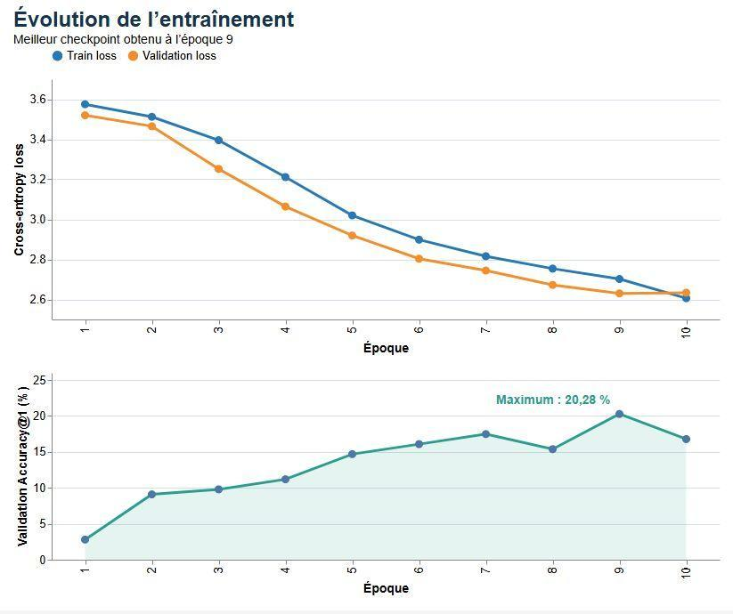

*Figure 6 Évolution de l’entraînement de TinyBERT.*

### 4.6 Résultats et enseignements de cette étape

Sur les 140 exemples de test, la précision au premier rang atteint 23,57 %. La vraie salle figure parmi les cinq premières propositions dans 72,14 % des cas et parmi les dix premières dans 93,57 % des cas. La figure 7 reprend ces résultats et la comparaison au classement uniforme parmi 37 classes.

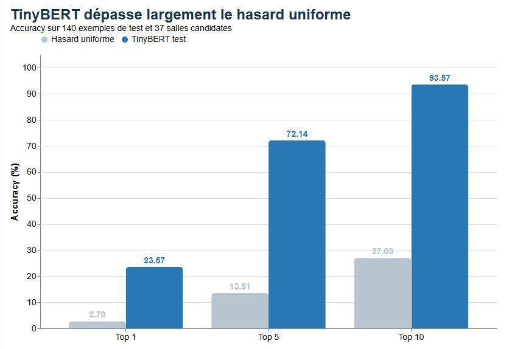

*Figure 7 Résultats de TinyBERT pour la prochaine salle distincte observée.*

Le classement uniforme fournit des valeurs théoriques de 1/37, 5/37 et 10/37, soit environ 2,70 %, 13,51 % et 27,03 %. Le modèle dépasse ces références, ce qui indique qu’il exploite une structure présente dans les entrées. Ce résultat valide l’intérêt d’un premier prototype, sans suffire à établir sa supériorité sur des références adaptées au problème, telles qu’une transition de salle ou une chaîne de Markov.

Le Hit@10 doit également être lu en tenant compte du catalogue de 37 salles. Proposer dix salles représente une part importante des classes possibles. Une valeur élevée montre que la cible est souvent conservée dans une liste assez large, mais elle ne signifie pas que la prochaine salle est correctement identifiée dans la majorité des cas au premier rang.

Cette étape a surtout apporté une chaîne opérationnelle allant des observations aux métriques. Elle a rendu concrètes les questions de granularité, de fuite entre visiteurs et de longueur des historiques. Elle a aussi montré que la richesse du texte dépendait de celle des champs disponibles dans BIRD. Ce dernier constat a motivé un travail plus approfondi sur la sémantique des œuvres.

## 5 Enrichissement sémantique des œuvres de BIRD

### 5.1 Pourquoi enrichir le catalogue

Les premières explorations ont montré que certains champs du catalogue distinguaient peu les œuvres dans notre objectif. Le type matériel est informatif pour décrire un objet culturel, mais une catégorie très dominante peut apporter peu de diversité au modèle. Dans BIRD, 244 œuvres sur 359 sont classées comme huiles sur toile, soit 68,0 %, et 56 comme huiles sur bois, soit 15,6 %. (figure 8)

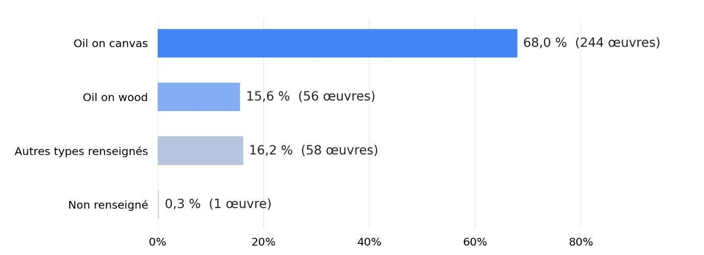

*Figure 8 Répartition des types d’œuvres dans le catalogue de 359 œuvres.*

L’objectif de l’enrichissement était de disposer d’une sémantique plus homogène et mieux couverte. Il fallait conserver suffisamment de diversité pour distinguer des contenus, tout en évitant des centaines de libellés presque uniques. J’ai donc travaillé sur des macro-sujets communs, avant de compléter les informations textuelles par une analyse des images.

Ce travail de données est distinct de l’entraînement prédictif. Une annotation sémantique peut être cohérente avec l’œuvre sans améliorer la prochaine prédiction. Son utilité dépend de la cible, de la manière dont elle est encodée et de la relation entre le contenu des œuvres et les comportements observés. L’enrichissement devait être évalué à ces deux niveaux : couverture descriptive et effet dans le modèle.

### 5.2 Une première annotation à partir du texte

Le catalogue fournit une description en français pour 205 œuvres sur 359, soit environ 57,1 %. Ces descriptions constituent la principale source d’information utilisée pour identifier le sujet représenté. Lorsqu’une description était absente, le titre de l’œuvre était utilisé lorsqu’il apportait une information suffisamment explicite. En l’absence d’éléments permettant une classification fiable, la valeur était conservée sous la forme NA.

L’attribution des sujets a été automatisée à l’aide de l’API OpenAI et du modèle GPT-5.6 Sol. Pour chaque œuvre, le modèle recevait les informations textuelles disponibles, en priorité la description et, lorsque celle-ci était absente ou insuffisante, le titre. À partir de ces informations, il devait attribuer l’œuvre à l’un des neuf macro-sujets définis au préalable : Architecture, Culture, Histoire, Mythologie, Nature, Objet, Personnage, Quotidien et Religion.

La démarche peut être illustrée avec les œuvres Les bouleaux de Charles Peccatte et Cathédrale de Rouen de Pierre Dumont. Dans le premier cas, la description évoque des arbres et conduit à associer l’œuvre à la catégorie Nature. Dans le second, en l’absence de description française, le titre constitue un indice suffisamment explicite pour rattacher l’œuvre à Architecture.

Le regroupement en neuf macro-sujets permet de limiter la dispersion des libellés. Des notions proches, comme les fleurs, les arbres ou les paysages, sont ainsi regroupées sous Nature. De la même manière, différents types de représentations humaines peuvent être rattachés à Personnage.

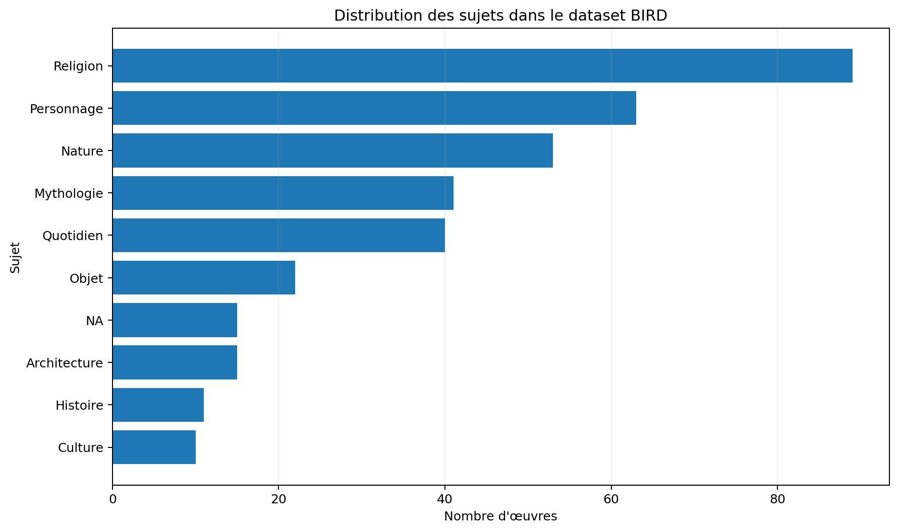

*Figure 9 : la distribution des sujets par gpt 5.6 Sol avec comme contexte la description ou le titre*

La figure 9 montre que le regroupement en macro-sujets apporte une information sémantique nettement plus diversifiée que le type d’œuvre fourni initialement par BIRD, largement dominé par quelques catégories comme l’huile sur toile. La distribution obtenue fait apparaître plusieurs thématiques telles que Religion, Personnage, Nature, Mythologie ou Quotidien, et permet ainsi de mieux différencier le contenu des œuvres.

L’étape suivante ne visait cependant pas seulement à compléter les quelques valeurs NA, mais surtout à vérifier la pertinence des sujets attribués à partir des informations textuelles. Lorsqu’une description était disponible, celle-ci fournissait généralement des éléments précis sur le contenu de l’œuvre. En revanche, lorsqu’elle était absente, l’attribution reposait principalement sur le titre, qui pouvait conduire à une interprétation différente du contenu réellement représenté. Une seconde chaîne fondée sur l’analyse directe des images par un LLM multimodal a donc été développée afin de confronter la classification textuelle au contenu visuel de l’œuvre.

### 5.3 Une chaîne de collecte et de contrôle des images

Le module d’imagerie part de l’identifiant de l’œuvre, du titre, de l’artiste et des sources disponibles. Il cherche des images candidates dans les pages accessibles, puis tente d’établir une correspondance entre l’image et l’œuvre attendue. Une fois une image retenue, une étape distincte produit l’annotation visuelle. La figure 10 résume cette organisation.

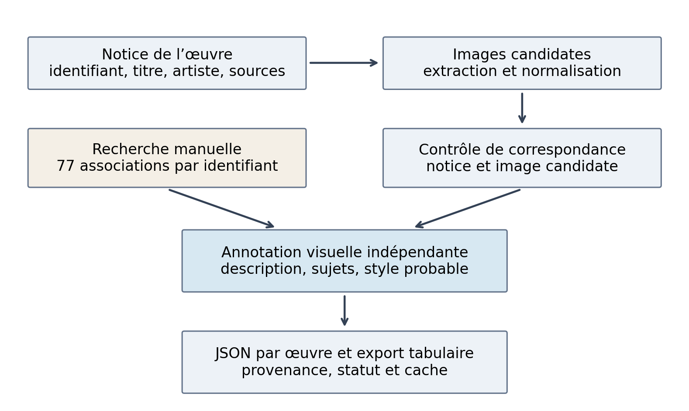

*Figure 10 Organisation de la chaîne d’enrichissement visuel.*

L’extraction examine différents emplacements possibles dans une page : métadonnées d’image, données structurées et balises HTML. Les fichiers téléchargés sont normalisés pour être lisibles par la chaîne d’analyse. Des aperçus de taille limitée peuvent être utilisés pour les appels au modèle, tandis que les images conservées restent associées à l’identifiant BIRD.

Le contrôle d’identité et l’annotation du contenu répondent à deux questions différentes. Le premier vérifie si l’image candidate correspond vraisemblablement à l’œuvre recherchée, en utilisant notamment sa notice et les informations d’identification. La seconde décrit ce qui est visible. Mélanger ces deux étapes risquerait de produire une description cohérente d’une image qui n’est pas la bonne œuvre.

### 5.4 Une annotation visuelle séparée des anciennes étiquettes

Pour l’annotation, le modèle reçoit l’image et une consigne structurée. Le sujet textuel antérieur n’est pas fourni au LLM. Ce choix vise à obtenir une description du contenu visuel qui puisse ensuite être comparée à l’annotation issue du texte.

La sortie contient une description visuelle, un sujet principal, des sujets secondaires et des informations de style probable. Des champs décrivent également la figuration, les couleurs ou la composition selon le schéma utilisé. Le format JSON impose une structure commune et facilite l’export vers un tableau.

Le sujet principal permet de résumer l’œuvre par une catégorie dominante. Les sujets secondaires conservent certaines dimensions complémentaires.

Le terme « style probable » évite de confondre une description visuelle automatisée et une attribution d’histoire de l’art. Une image peut suggérer des contours accentués, des couleurs saturées ou une composition particulière. Déduire un courant artistique exact demande un contexte que l’image seule ne fournit pas toujours. Ces informations sont conservées comme annotations, sans être toutes intégrées au modèle prédictif final.

### 5.5 Complément manuel et reprise des traitements

La collecte automatique n’a pas permis d’extraire toutes les images nécessaires. J’ai complété manuellement 77 œuvres sur les 359 du catalogue, en recherchant les images puis en les associant aux identifiants attendus. Cette étape représente une part concrète du travail réalisé : elle montre les limites d’une automatisation confrontée à des sources culturelles hétérogènes.

Dans le mode local, le nom du fichier permet d’établir l’association avec l’identifiant de l’œuvre. La provenance indique alors qu’il s’agit d’une association fournie par l’utilisateur. Ce mécanisme permet de traiter les images manquantes avec le même schéma d’annotation.

La chaîne conserve un fichier de résultat par œuvre, un cache des appels et des informations d’usage. Elle peut reprendre un traitement sans recommencer systématiquement les œuvres déjà annotées. Des empreintes de fichiers et de paramètres aident à identifier les entrées utilisées. L’archivage des sorties antérieures limite aussi le risque d’écraser une version qui pourrait servir à comprendre une différence d’annotation.

Ces mécanismes répondent à des difficultés pratiques : interruptions, erreurs de téléchargement et réponses invalides.

### 5.6 Couverture et exemples de désaccord

L’audit des données finales retrouve 359 lignes sémantiques pour les 359 œuvres du catalogue. Deux œuvres n’ont pas de sujet principal connu. Le fichier de provenance distingue 282 identités retenues automatiquement et 77 associations fournies manuellement. Ces effectifs décrivent la couverture et le mode d’obtention des données ; ils ne mesurent pas un taux de justesse.

L’exemple « Figure masque allongé » illustre un changement d’interprétation. Le module textuel avait retenu Objet à partir du titre, tandis que le module visuel retient Personnage en décrivant un visage stylisé. La figure 11 reprend l’image montrée dans la présentation. Le désaccord est compréhensible : un masque peut être considéré comme un objet, alors que la représentation du visage devient dominante dans la lecture visuelle.

*Figure 11 Exemple de l’œuvre « Figure masque allongé » utilisé pour discuter le désaccord Objet et Personnage.*

Un autre exemple, « Les baigneuses », aboutit à Personnage avec les deux modalités. Les accords et désaccords sont tous deux utiles.

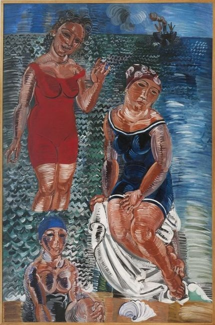

*Figure 12: Exemple de l’œuvre « Les baigneuses » utilisé pour discuter l’accord des deux modules textuel et d’imagerie.*

La figure 13 présente la répartition des sujets principaux. Personnage est la catégorie la plus fréquente, avec 138 œuvres, soit 38,4 % du catalogue. Religion vient ensuite avec 54 œuvres. Les autres catégories ont des effectifs plus faibles. Le regroupement apporte une diversité plus directement liée au contenu représenté que le seul type matériel.

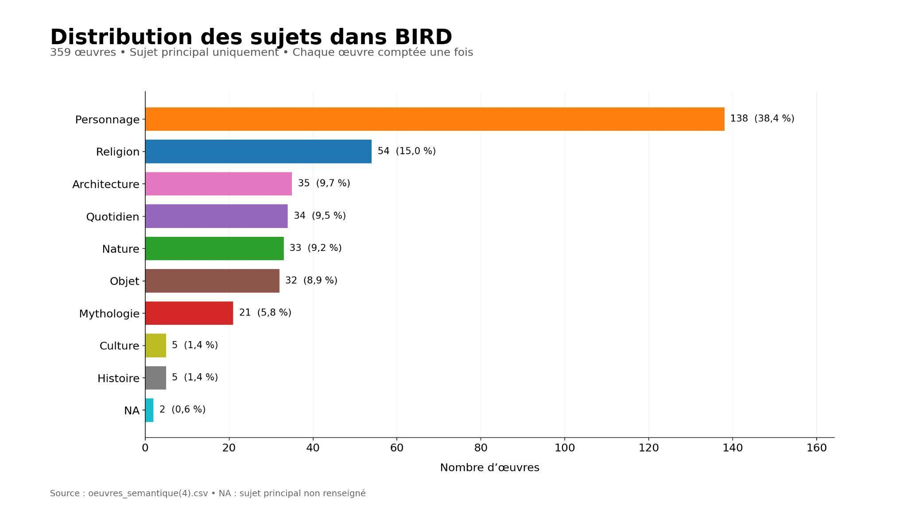

*Figure 13 Distribution des sujets principaux après enrichissement.*

### 5.7 La relation entre sujets et salles

La figure 14 montre la composition des salles selon les sujets principaux. Elle permet de constater que la sémantique et la localisation ne sont pas des dimensions indépendantes. Une organisation muséographique peut rapprocher des œuvres présentant des caractéristiques communes. Un modèle qui connaît déjà les transitions entre œuvres peut donc disposer indirectement d’une partie de cette structure.

Ce constat prépare l’analyse des expériences finales. Si les catégories sémantiques recouvrent en partie des groupes déjà identifiables par les parcours, leur ajout peut apporter peu d’information nouvelle. À l’inverse, une catégorie très large comme Personnage relie des œuvres qui peuvent appartenir à des contextes visuels, historiques ou spatiaux différents. Une relation sémantique supplémentaire peut donc être informative, redondante ou trop générale selon la situation.

L’enrichissement produit néanmoins un actif réutilisable. Les descriptions, sujets et informations de provenance permettent d’étudier d’autres tâches que la seule prochaine œuvre : inspection du catalogue, regroupements, analyse de parcours ou préparation de nouvelles représentations. Le modèle final n’exploite directement que les sujets principal et secondaires. Les titres, artistes, descriptions visuelles et styles ne sont pas transformés en embeddings textuels dans les expériences rapportées.

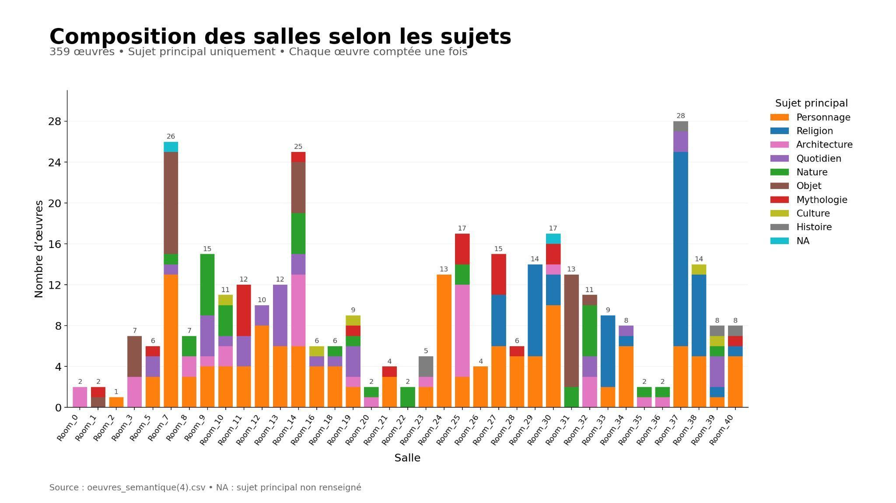

*Figure 14 Composition des salles selon les sujets principaux des œuvres.*

## 6 Préparation des trajectoires pour la prochaine œuvre

### 6.1 Une nouvelle cible expérimentale

La seconde partie du stage porte sur la prédiction de la prochaine œuvre observée. Elle utilise les observations individuelles, avec leurs répétitions, au lieu des épisodes de salle. Le changement de cible augmente la finesse de l’analyse et permet de relier directement la prédiction aux annotations produites pour chaque œuvre.

Le modèle reçoit un préfixe de la visite, terminé par l’observation courante, et attribue un score à chacune des 359 œuvres du catalogue. L’œuvre observée ensuite constitue la cible. Les œuvres déjà présentes dans l’historique restent candidates : un visiteur peut revenir sur une œuvre, et des observations consécutives peuvent partager le même identifiant.

Le protocole final génère une cible après chaque observation disposant d’un successeur. Le nombre total d’exemples est donc égal à 7 204 moins 51, soit 7 153. Ce total diffère des préparations STTP : une seule observation suffit ici à créer un premier historique, et les séquences ne sont pas regroupées par salle. La longueur conservée est ensuite limitée aux 32 observations les plus récentes.

### 6.2 Rapprocher les débuts et les fins sans supprimer les événements

La préparation temporelle est une difficulté importante de BIRD. Les fichiers exploités contiennent 7 204 débuts d’observation et 5 635 lignes de fin. L’audit final associe 5 631 fins à un début et conserve 1 573 débuts sans fin appariée. Parmi les autres lignes de fin, une valeur temporelle invalide et trois fins valides non appariées sont signalées.

L’appariement recherche une fin portant le même identifiant d’œuvre dans l’intervalle associé au début considéré, avant le début suivant. Les fins déjà utilisées ne sont pas réaffectées à un autre événement. Lorsqu’il existe plusieurs candidats, la règle de sélection et le cas ambigu sont consignés. Cette procédure limite les associations incohérentes, notamment lorsqu’une œuvre apparaît plusieurs fois dans la même visite.

La version finale conserve les débuts dépourvus de fin. Supprimer ces événements modifierait l’ordre des transitions observées : deux œuvres séparées par un événement incomplet deviendraient artificiellement consécutives. La conservation de l’événement et le traitement séparé de sa durée permettent de préserver la séquence tout en signalant l’incertitude temporelle.

Le tableau 4 résume les principaux contrôles de données. Ces valeurs servent à comprendre ce qui est disponible et ce qui doit être estimé. Elles évitent d’assimiler une donnée préparée à une mesure directement observée.

| Élément contrôlé | Effectif | Conséquence pour le traitement |
| --- | --- | --- |
| Visiteurs | 51 | Unité de séparation des ensembles |
| Débuts d’observation | 7 204 | Tous conservés dans les trajectoires finales |
| Fins appariées | 5 631 | Durées observées disponibles sous condition temporelle |
| Débuts sans fin appariée | 1 573 | Durée manquante ou estimée causalement |
| Œuvres du catalogue | 359 | Ensemble des candidats à la prédiction |

Tableau 4 Bilan de la préparation des observations

### 6.3 Respecter la disponibilité temporelle des informations

Une donnée présente dans un fichier complet n’est pas nécessairement disponible au moment d’une prédiction. Par exemple, la durée totale de l’observation courante n’est pas connue à son début. Utiliser cette durée pour prédire ce qui vient ensuite donnerait au modèle une information issue du futur. Le code final définit donc explicitement les durées accessibles pour chaque préfixe.

Pour une observation antérieure, une durée mesurée peut être utilisée si sa fin est connue au début de l’observation courante. Une durée manquante peut être estimée après l’arrivée du début suivant, en utilisant uniquement des durées fiables plus anciennes, déjà disponibles à cet instant. Si aucune information passée suffisante n’existe, la durée reste indisponible. La durée de l’observation courante, encore inconnue, est encodée par zéro avant normalisation, avec des indicateurs signalant son indisponibilité.

L’estimation causale utilise l’écart entre deux débuts et la moyenne des durées fiables précédentes. Elle est plafonnée par cet écart afin de ne pas dépasser le début de l’observation suivante.

Pour deux observations consécutives A et B, la durée estimée de A, notée , est calculée 𝑑𝐴 comme suit :

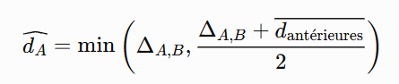

Avec :

● : l’écart entre les débuts d’observation de A et de B ; ∆𝐴,𝐵 ● : la moyenne des durées mesurées strictement positives avant A, dont la fin 𝑑𝑎𝑛𝑡é𝑟𝑖𝑒𝑢𝑟𝑒𝑠 est connue au début de B.

Il s’agit d’une règle de préparation explicite, et non d’une durée réellement mesurée.

Les données préparées conservent également une estimation rétrospective, utile pour l’inspection hors ligne. Celle-ci peut utiliser des informations à l’échelle de la visite complète. Les entrées du modèle final sont reconstruites par les fonctions causales ; cette estimation rétrospective n’est pas utilisée comme caractéristique prédictive. La distinction entre les deux versions de la durée est essentielle pour éviter une fuite temporelle.

Un exemple fictif permet de comprendre cette règle. Au début d’une observation C, la fin de A peut être connue et celle de B absente. Le modèle peut utiliser la durée mesurée de A. Il peut estimer B à partir du délai entre B et C et des durées fiables antérieures, si elles existent. Il ne peut pas utiliser la future durée de C pour anticiper D. La question n’est donc pas seulement de savoir si une valeur existe dans le fichier, mais quand elle devient disponible.

### 6.4 Caractéristiques temporelles et normalisation

Chaque observation de l’historique est représentée par cinq caractéristiques temporelles, présentées dans le tableau suivant :

| Caractéristique | Signification |
| --- | --- |
| Écart au début précédent | Temps écoulé entre le début de l’observation précédente et celui de l’observation considérée |
| Durée disponible | Durée mesurée ou estimée selon les règles de la section 6.3 |
| Indicateur de durée observée | Vaut 1 si une durée mesurée est disponible, sinon 0 |
| Indicateur d’estimation causale | Vaut 1 si la durée a été estimée causalement, sinon 0 |
| Temps écoulé depuis le début de la visite | Écart entre le début de la première observation et celui de l’observation considérée |

Tableau 5 Caractéristiques temporelles associées à chaque observation de l’historique.

Les trois grandeurs temporelles (l’écart au début précédent, la durée disponible et le temps écoulé depuis la première observation) sont transformées par la fonction log(1+x), afin de réduire l’amplitude des grandes valeurs tout en conservant une valeur définie pour zéro.

Les indicateurs sont nécessaires car zéro ne signifie pas toujours une durée réellement nulle. Ils distinguent une information connue, une valeur estimée et une indisponibilité. Le modèle peut ainsi apprendre à traiter différemment une mesure fiable et une approximation, au lieu de recevoir uniquement un nombre sans contexte.

Les trois caractéristiques continues ainsi transformées sont standardisées à partir des préfixes d’entraînement afin de les ramener à des échelles comparables. Les paramètres de normalisation sont ensuite réutilisés pour la validation et le test. Cette règle empêche les distributions des visiteurs de test d’intervenir dans le calcul des moyennes et écarts-types. Les lignes d’historique apparaissant dans plusieurs préfixes contribuent plusieurs fois à cet ajustement, conformément au générateur d’exemples.

Deux échelles temporelles coexistent dans le système. Le graphe résume des statistiques calculées sur les transitions des visiteurs d’entraînement. Les caractéristiques du préfixe décrivent, elles, la visite actuellement traitée. Le modèle peut ainsi combiner une régularité collective et le contexte temporel propre à l’historique, sans les confondre.

### 6.5 Séparation des données et traçabilité

La séparation finale utilise la graine 2022 et répartit les 51 visiteurs en 35 pour l’entraînement, 8 pour la validation et 8 pour le test. Ces groupes produisent respectivement 5 082, 988 et 1 083 exemples. Les listes de visiteurs sont enregistrées et contrôlées pour détecter les doublons, les recouvrements ou les identifiants absents.

Le graphe comportemental est construit uniquement à partir des 35 visiteurs d’entraînement. Les annotations du catalogue et la structure du musée sont considérées comme des connaissances statiques disponibles. Les séquences des visiteurs de validation et de test ne servent pas à calculer les fréquences des transitions ou leurs statistiques temporelles.

## 7 Construction du modèle à graphes et apprentissage contrastif

### 7.1 Organisation du graphe hétérogène

Le modèle final combine un graphe d’œuvres, un encodeur séquentiel et des objectifs contrastifs. Je le désigne ici par CLL. Sa version complète repose sur trois types de nœuds : 359 œuvres, 41 salles et 9 sujets. Les relations décrivent des transitions observées, des localisations, des associations sémantiques et des voisinages entre salles.

Le nombre de 41 salles correspond au référentiel spatial utilisé par le graphe. Il ne doit pas être confondu avec les 37 classes de la première expérience STTP. Le référentiel de plan et l’ensemble des salles représentées dans la tâche de classification ne décrivent pas exactement le même périmètre.

La figure 15 reprend une vue simplifiée du graphe. Les nœuds d’œuvres peuvent être reliés par les transitions des visiteurs et partager une salle ou un sujet. Les relations inverses permettent également de ramener vers une œuvre les informations agrégées par un nœud de salle ou de sujet.

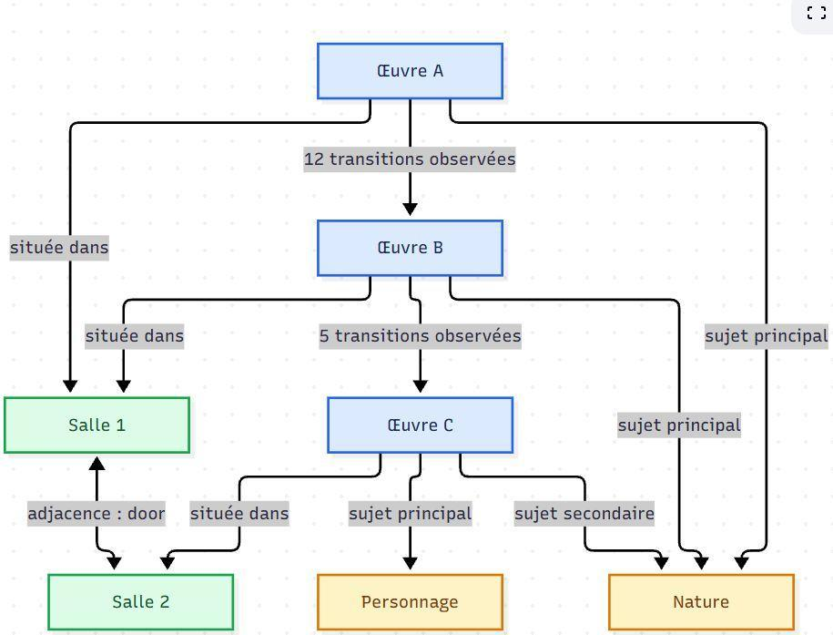

*Figure 15 Vue simplifiée du graphe enrichi reliant œuvres, salles et sujets.*

Les 5 082 transitions d’entraînement produisent 2 218 arêtes comportementales dirigées distinctes. Une arête agrège donc potentiellement plusieurs occurrences. Le tableau 6 présente les relations de la version complète, qui compte 5 302 arêtes au total. Les sujets secondaires peuvent créer plusieurs relations pour une même œuvre, ce qui explique un effectif supérieur au nombre d’œuvres.

| Relation dirigée | Nombre | Origine de l’information |
| --- | --- | --- |
| Œuvre vers œuvre suivante | 2 218 | Transitions des visiteurs d’entraînement |
| Œuvre vers salle | 359 | Catalogue et référentiel spatial |
| Salle vers œuvre | 359 | Relation inverse de localisation |
| Œuvre vers sujet principal | 357 | Annotation sémantique |
| Sujet principal vers œuvre | 357 | Relation inverse |
| Œuvre vers sujet secondaire | 776 | Annotation sémantique multiple |
| Sujet secondaire vers œuvre | 776 | Relation inverse |
| Salle vers salle par bordure | 96 | Adjacence spatiale déclarée |
| Salle vers salle par porte | 4 | Adjacence spatiale déclarée |
| Total | 5 302 | Graphe de la configuration complète |

Tableau 6 Relations du graphe complet

### 7.2 Pondération des transitions comportementales

Une même transition entre deux œuvres peut apparaître plusieurs fois dans les visites d’entraînement. Ces occurrences sont regroupées dans une arête dirigée A → B, qui conserve leur nombre et trois statistiques temporelles : la moyenne des écarts entre débuts après transformation logarithmique, la moyenne des durées disponibles de A après cette même transformation, et la proportion d’occurrences disposant d’une durée. La transformation utilisée est log(1+x), et les durées suivent les règles de disponibilité définies en section 6.3.

Ces informations permettent d’ajuster l’influence de chaque transition lors de la propagation dans le graphe. Le poids est calculé comme suit :

Avec :

● : nombre de transitions observées de A vers B. 𝑛𝐴,𝐵 ● : vecteur des trois statistiques temporelles standardisées. 𝑡𝐴,𝐵 ● Linear : couche linéaire apprise produisant un scalaire. ● : fonction sigmoïde. σ Le premier facteur limite la domination des transitions très fréquentes. Le second permet au modèle d’augmenter ou de diminuer leur poids selon leurs caractéristiques temporelles. Initialisé à 1, ce facteur laisse initialement le poids dépendre uniquement du nombre d’occurrences.

Ces poids interviennent dans le calcul des moyennes pondérées des représentations voisines. Les voisins correspondant aux transitions entrantes et sortantes sont traités séparément afin de conserver le sens des parcours.

### 7.3 Deux couches de propagation relationnelle

Le réseau de neurones sur graphe, ou GNN, utilise deux couches de propagation par moyennes relationnelles. Pour chaque nœud, une transformation de sa propre représentation est combinée à des messages issus de ses voisins. Les projections sont partagées selon le type du nœud source et modulées par des paramètres propres aux relations. Le résultat passe par une normalisation LayerNorm, une activation GELU et un dropout.

LayerNorm stabilise l’échelle de la représentation au niveau du vecteur. GELU introduit une non-linéarité, afin que l’enchaînement des transformations ne se réduise pas à une unique opération linéaire. Le dropout masque certaines composantes pendant l’entraînement pour limiter la dépendance à un petit ensemble de dimensions. Ces opérations interviennent sur des vecteurs de dimension 64 dans la configuration finale.

La première couche calcule des représentations pour les différents types de nœuds. La seconde produit les représentations finales des œuvres, qui sont les éléments utilisés dans la séquence. Les mises à jour sont synchrones : à une couche donnée, les messages sont calculés à partir des représentations de la couche précédente, et non à partir de voisins déjà mis à jour dans le même passage.

Chaque couche de propagation permet à l’information de franchir une relation du graphe. Avec deux couches, la représentation d’une œuvre peut ainsi intégrer des informations provenant d’autres œuvres partageant la même salle ou le même sujet. Ces échanges passent par un nœud intermédiaire : la salle ou le sujet commun. Elle peut également intégrer des informations sur une salle voisine, transmises par sa propre salle.

### 7.4 Combinaison avec le contexte temporel et le GRU

Après la propagation dans le graphe, chaque œuvre possède une représentation de dimension 64. Pour un exemple donné, le système sélectionne les vecteurs des œuvres de l’historique dans leur ordre réel. Les cinq caractéristiques temporelles de chaque observation sont projetées vers la même dimension, passées dans une fonction tanh, puis ajoutées au vecteur de l’œuvre.

Cette addition combine une représentation collective de l’œuvre et un contexte propre à l’occurrence. Deux observations de la même œuvre partagent la même représentation issue du graphe, mais peuvent différer par le temps écoulé, la durée disponible ou la position dans la visite. Le réseau récurrent reçoit ainsi une séquence de vecteurs contextualisés.

Un GRU lit cette séquence. Son état caché évolue au fil des observations et résume les éléments utiles pour la prédiction. Le code conserve l’état correspondant à la dernière position réelle de l’historique, en tenant compte des longueurs et du remplissage des lots. Une LayerNorm est appliquée avant la tête de sortie.

La tête finale est une couche linéaire de dimension 64 vers 359. Elle produit un score pour chaque œuvre du catalogue. Le classement de ces scores fournit les candidats et permet de calculer le rang de l’œuvre suivante.

### 7.5 Création de deux vues pour le contraste

L’apprentissage contrastif repose sur deux passages stochastiques du même exemple. Les différences entre les vues proviennent du retrait aléatoire d’arêtes comportementales et du dropout des représentations. Les relations statiques, telles que la localisation ou les sujets, sont conservées dans ces augmentations.

Le taux de retrait des arêtes de transition est de 0,1. Pour une vue donnée, le même masque d’arêtes est utilisé dans les deux couches du GNN. Il ne s’agit donc pas de supprimer indépendamment 10 % des arêtes à chaque couche. Les tirages aléatoires sont effectués indépendamment pour chacune des deux vues. Le dropout des représentations et celui de l’entrée séquentielle sont fixés à 0,2.

La figure 16 reprend l’organisation de l’apprentissage contrastif. Une branche compare les représentations des historiques après le GRU. Une autre compare les représentations des œuvres sélectionnées dans le lot. Des projecteurs transforment ces vecteurs avant le calcul de la similarité utilisée dans la perte.

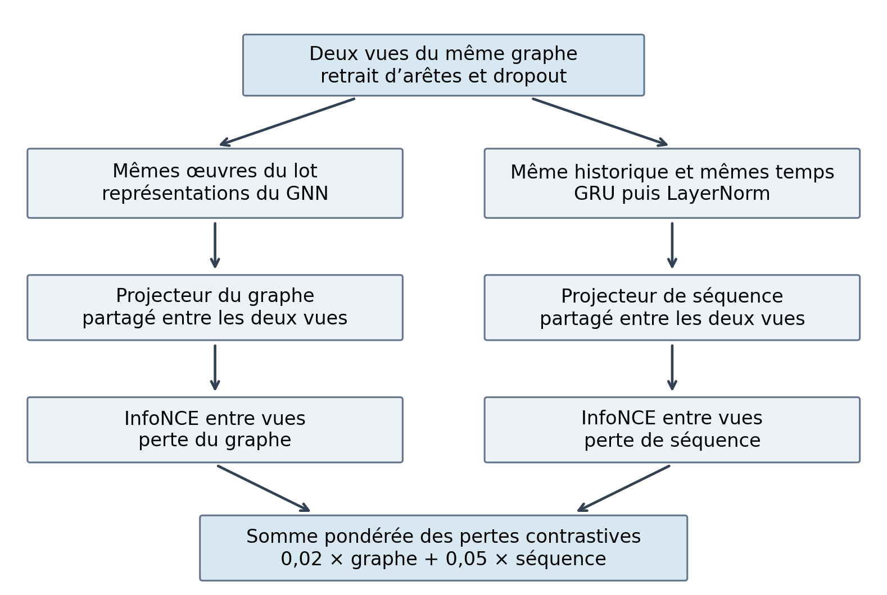

*Figure 16 Organisation des objectifs contrastifs sur le graphe et les séquences.*

### 7.6 Objectif d’apprentissage et précautions sur les négatifs

L’apprentissage supervisé consiste à retrouver l’œuvre réellement observée après chaque historique. Cette œuvre constitue la classe cible parmi les 359 œuvres du catalogue. Pour chacune des deux vues, une perte d’entropie croisée compare les scores produits par le modèle à cette cible et pénalise une faible probabilité attribuée à la bonne œuvre.

La fonction de perte totale est définie par :

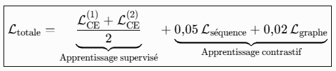

Avec :

(1) 𝐿𝐶𝐸 (2)

● et : pertes d’entropie croisée calculées pour chacune des deux vues. 𝐿𝐶𝐸 ● et : pertes contrastives portant respectivement sur les historiques et les 𝐿𝑠é𝑞𝑢𝑒𝑛𝑐𝑒 𝐿𝑔𝑟𝑎𝑝ℎ𝑒 œuvres.

La température utilisée dans les deux pertes contrastives est fixée à . τ = 0, 2 Les deux objectifs contrastifs utilisent une perte de type InfoNCE [10]. Pour les séquences, elle rapproche les représentations d’un même historique obtenues dans les deux vues ; pour le graphe, elle rapproche celles d’une même œuvre. Chaque représentation est comparée aux représentations de l’autre vue, le même élément constituant la paire positive et les autres éléments servant de négatifs. Le calcul est effectué dans les deux sens, puis les pertes sont moyennées.

Certaines précautions évitent de considérer des exemples identiques comme des négatifs. Pour les séquences, deux exemples ne sont pas considérés comme des négatifs s’ils possèdent le même historique d’œuvres ou la même œuvre cible. Pour le graphe, chaque œuvre n’est retenue qu’une seule fois dans le lot avant le calcul contrastif, et les positions de remplissage sont ignorées.

## 8 Protocole expérimental et analyse des résultats

### 8.1 Mesurer plusieurs aspects du classement

L’évaluation utilise quatre métriques. Acc@1, équivalente à Hit@1 dans cette tâche à une seule cible, mesure la proportion d’exemples pour lesquels l’œuvre suivante reçoit le meilleur score. Hit@5 et Hit@10 indiquent si elle figure parmi les cinq ou dix premières propositions. Le MRR est la moyenne de l’inverse de son rang : une cible classée première contribue pour 1, deuxième pour 1/2 et dixième pour 1/10.

Ces métriques répondent à des questions différentes. Acc@1 évalue le choix unique placé en tête. Hit@10 décrit la capacité à conserver la cible dans une liste plus large. Le MRR tient compte du rang et favorise les positions proches du début du classement. Un modèle peut donc améliorer Hit@10 tout en dégradant Acc@1 ou le MRR.

Les scores micro donnent le même poids à chaque exemple. Les visites longues contribuent davantage à cette moyenne puisqu’elles produisent plus de préfixes. Les scores macro par visiteur calculent d’abord une métrique pour chaque personne, puis moyennent ces valeurs avec un poids identique. Présenter les deux lectures permet de vérifier si la tendance globale dépend fortement de quelques longues visites.

### 8.2 Méthodes de référence

La popularité fournit une première référence qui ignore l’historique du visiteur. Elle classe les œuvres à partir des fréquences des cibles d’entraînement. Son intérêt est de vérifier si le modèle fait davantage que proposer les œuvres globalement les plus présentes dans les données.

Une chaîne de Markov d’ordre 1 utilise l’œuvre courante pour estimer la suivante. Une chaîne d’ordre 2 ajoute l’œuvre précédente à ce contexte. L’implémentation retenue construit ses comptes sur l’entraînement et prévoit un repli vers un ordre inférieur, puis vers la popularité, lorsqu’un contexte n’est pas suffisamment renseigné.

Ces méthodes sont particulièrement importantes dans un musée : l’ordre local des observations peut être fortement structuré par l’emplacement des œuvres et l’organisation du parcours. Une architecture complexe doit donc être comparée à une méthode capable d’exploiter cette structure locale, et pas uniquement à un tirage uniforme.

Les références neuronales comprennent des adaptations de GRU4Rec [5] et SASRec [6]. Le premier représente une séquence avec un réseau récurrent ; le second s’appuie sur l’auto-attention. La synthèse chiffrée ci-dessous reprend les modèles de la présentation finale, pour lesquels les résultats retenus sont explicitement identifiés.

Les implémentations de référence ont été adaptées au protocole de préfixes et à une classification sur le catalogue BIRD.

### 8.3 Configurations et sélection des modèles

Les variantes CLL partagent la séparation des visiteurs, la graine 2022, des représentations de dimension 64, un historique maximal de 32 et des lots de 64 exemples. L’optimiseur AdamW utilise un taux d’apprentissage de 0,001 et une décroissance des poids de 5 × 10⁻⁵. La norme des gradients est limitée à 1. Le checkpoint est sélectionné sur le MRR micro de validation.

Trois compositions du graphe sont comparées. La version complète utilise œuvres, salles et sujets. La variante POI et sujets retire les salles et leurs relations. La variante POI uniquement conserve le graphe comportemental entre œuvres. Cette dernière reste un modèle associant propagation, temps, GRU et contraste ; son nom ne signifie pas qu’elle se limite à une simple table d’embeddings.

Le tableau 7 précise les budgets d’entraînement.

| Variante | Maximum | Patience | Époques réalisées | Époque retenue |
| --- | --- | --- | --- | --- |
| Graphe complet | 100 | 15 | 38 | 23 |
| POI et sujets | 30 | 5 | 30 | 25 |
| POI uniquement | 30 | 5 | 27 | 22 |

Tableau 7 Entraînements retenus pour les variantes CLL L’arrêt anticipé explique pourquoi fixer un maximum de 100 époques ne conduit pas nécessairement à les exécuter toutes. L’entraînement s’arrête lorsque le critère de validation ne progresse plus pendant la durée prévue. Le checkpoint retenu peut également précéder la dernière époque calculée.

Le code sépare l’entraînement de la commande d’évaluation finale. Cette organisation évite d’utiliser le score de test pour sélectionner une époque à l’intérieur d’une exécution.

### 8.4 Résultats de la prédiction de la prochaine œuvre

Le tableau 8 présente les scores sur les 1 083 exemples des huit visiteurs de test.

| Modèle | Acc@1 | Hit@5 | Hit@10 | MRR |
| --- | --- | --- | --- | --- |
| Popularité | 0,92 % | 4,80 % | 8,13 % | 0,0396 |
| Markov ordre 1 | 31,58 % | 68,70 % | 76,55 % | 0,4693 |
| Markov ordre 2 | 36,01 % | 68,14 % | 76,45 % | 0,4931 |
| GRU4Rec adapté | 32,87 % | 67,31 % | 79,87 % | 0,4839 |
| SASRec adapté | 19,30 % | 69,25 % | 86,06 % | 0,4032 |
| CLL graphe complet | 33,24 % | 68,79 % | 81,16 % | 0,4921 |
| CLL POI et sujets | 33,98 % | 68,33 % | 80,89 % | 0,4927 |
| CLL POI uniquement | 35,27 % | 69,71 % | 80,70 % | 0,5088 |

Tableau 8 Comparaison finale sur la prochaine œuvre La popularité obtient des scores faibles. La prise en compte du contexte séquentiel apporte un écart important, comme le montrent déjà les chaînes de Markov. L’ordre deux atteint la meilleure précision au premier rang, avec 36,01 %. Ce résultat souligne le poids des transitions locales dans ce jeu de données.

La variante CLL POI uniquement obtient le meilleur MRR observé, à 0,5088, et le meilleur Hit@5, à 69,71 %. Son Acc@1 reste légèrement inférieure à celle de Markov d’ordre deux, tandis que son Hit@10 est supérieur. Il n’y a donc pas un modèle dominant toutes les métriques dans ce tableau.

SASRec présente un profil différent : son Hit@10 atteint 86,06 %, mais son Acc@1 reste à 19,30 % et son MRR à 0,4032. La vraie œuvre apparaît fréquemment dans les dix premières propositions, sans être aussi souvent placée en tête. Cette différence confirme l’intérêt de conserver plusieurs métriques, au lieu de résumer la qualité à la valeur la plus favorable.

La figure 17 facilite la comparaison du MRR. Elle met en évidence la proximité entre plusieurs méthodes : Markov d’ordre deux, le graphe complet et la variante POI et sujets se situent autour de 0,49. L’écart de la variante POI uniquement avec Markov d’ordre deux est d’environ 0,0157 en valeur absolue. Sa portée doit être appréciée avec les limites du protocole.

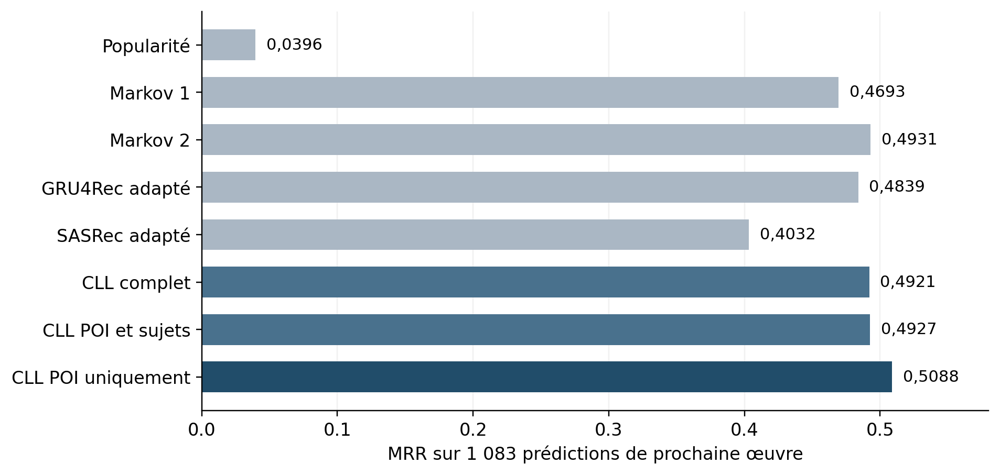

*Figure 17 MRR des modèles sur la prochaine œuvre.*

### 8.5 Que montre la comparaison des graphes

Les comparaisons mettent en évidence le rôle central des enchaînements d’œuvres dans la prédiction sur BIRD. Les performances des chaînes de Markov et de la variante CLL limitée aux œuvres montrent que les régularités présentes dans les parcours constituent une source d’information particulièrement utile. Dans les configurations évaluées, l’ajout des sujets et des salles n’améliore pas la précision au premier rang ni le MRR.

La taille limitée du jeu de données, qui comprend 51 visiteurs, me semble être une explication plausible de ce résultat. Le nombre et la diversité des parcours pourraient être insuffisants pour permettre au modèle d’exploiter pleinement les relations supplémentaires introduites dans le graphe. Cette hypothèse reste cependant à vérifier : les expériences réalisées ne permettent pas de distinguer l’effet de la quantité de données de celui des choix de représentation et d’architecture.

Ces observations restent donc liées à BIRD et au protocole retenu. Des essais sur d’autres jeux de données, notamment plus volumineux et présentant des parcours plus variés, permettraient de mieux évaluer dans quelles conditions l’enrichissement sémantique contribue à la prédiction. Les résultats actuels ne suffisent pas à conclure sur son utilité générale ni sur la qualité des annotations produites.

Enfin, l’intérêt de cet enrichissement dépasse la prédiction de la prochaine œuvre observée. Les sujets et les descriptions obtenus constituent une ressource réutilisable pour des travaux de recommandation, par exemple pour proposer des œuvres correspondant aux centres d’intérêt d’un visiteur ou diversifier un parcours sur le plan thématique. L’absence de gain prédictif dans cette expérience ne remet donc pas en cause l’intérêt du travail d’enrichissement, dont d’autres usages restent à explorer.

### 8.6 Perspectives de recherche

Une première perspective serait de développer un module de recommandation de parcours au sein du musée. Les entretiens réalisés avant la visite dans BIRD pourraient servir à construire des profils décrivant les attentes et les centres d’intérêt des visiteurs. Ces profils seraient ensuite rapprochés des caractéristiques des œuvres pour proposer un parcours personnalisé, en tenant également compte de contraintes comme la durée disponible et les déplacements entre salles. Une méthode d’aide à la décision multicritère, telle que TOPSIS, pourrait être étudiée pour classer les œuvres candidates, puis être associée à une méthode de construction d’itinéraire.

Une deuxième piste concernerait l’enrichissement synthétique de BIRD, notamment par la génération de trajectoires supplémentaires. L’objectif serait d’explorer des parcours plus diversifiés tout en respectant les contraintes spatiales et temporelles du musée. Il faudrait vérifier la plausibilité des données générées et mesurer leur apport en conservant une évaluation sur des visites réelles indépendantes. Cette démarche permettrait d’étudier si l’augmentation des données facilite l’apprentissage, sans considérer les trajectoires synthétiques comme un remplacement de nouvelles observations.

La recherche d’autres jeux de données de trajectoires en intérieur constituerait également un prolongement important. Ces données pourraient provenir d’autres musées ou d’environnements différents. Elles permettraient d’évaluer la méthode dans des contextes présentant d’autres volumes de données, organisations spatiales et comportements de déplacement, afin de mieux distinguer les résultats propres à BIRD de ceux qui pourraient se généraliser.

Enfin, une collaboration avec un spécialiste de l’art permettrait de valider et d’améliorer l’enrichissement sémantique réalisé avec les modèles de langage. Cette expertise pourrait porter sur la justesse des descriptions, l’attribution des sujets et la pertinence des catégories retenues. Elle apporterait une évaluation de la qualité des annotations indépendante des performances prédictives et renforcerait leur intérêt pour de futurs travaux de recommandation et de médiation culturelle.

## 9 Gestion du projet et organisation du travail

### 9.1 Une progression itérative de recherche

Mon travail a progressé par étapes : appropriation du domaine, choix d’une approche, premier prototype, enrichissement des données, évolution du modèle et comparaison des résultats.

Cette progression se décrit comme une démarche itérative de recherche et de développement. Une lecture ou une première expérience faisait apparaître une question, qui orientait la préparation suivante. Par exemple, la représentation textuelle a conduit à examiner la couverture sémantique du catalogue ; l’enrichissement a ensuite permis de construire des relations entre œuvres et sujets ; les résultats ont motivé des comparaisons avec des graphes réduits.

Une réunion hebdomadaire permettait de faire le point sur le travail réalisé, de discuter des résultats et des difficultés rencontrées, puis de définir les objectifs de la semaine suivante. Ces échanges ont accompagné les ajustements successifs du projet et orienté la suite des expérimentations.

### 9.2 Encadrement et supports de communication

Les échanges se déroulaient en présentiel, puis en visioconférence pendant la fermeture des locaux en août. Les réunions hebdomadaires réunissaient les encadrants Claudia Marinica, Fabien Picarougne et Fabrice Guillet, ainsi qu’Alaa Eddine Siouane, doctorant ayant réalisé G-SITM, et les autres stagiaires, Yassine El Maghraoui et Bryan Levy.

Des présentations servaient de support pour partager l’avancement, expliquer les choix méthodologiques et discuter des résultats.

### 9.3 Diagramme de Gantt du stage

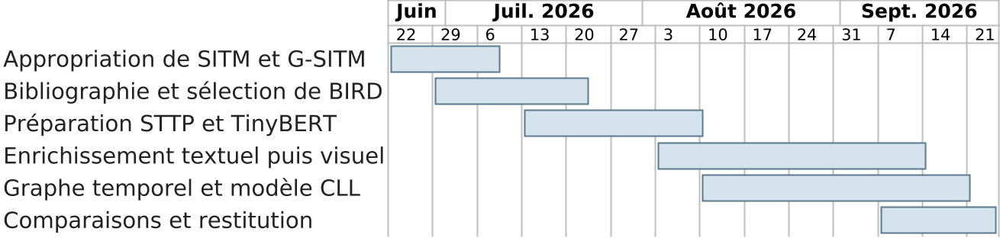

*Figure 18 Gantt indicatif du stage du 22 juin au 25 septembre 2026.*

### 9.4 Outils et technologies utilisés

Les trois modules ont été développés en Python. Le tableau 9 présente leurs principales bibliothèques.

| Module | Bibliothèques principales |
| --- | --- |
| STTP: Prédiction de la prochaine salle | PyTorch, Hugging Face Transformers, pandas, NumPy, scikit-learn, tqdm et safetensors |
| Imagerie: Enrichissement sémantique de BIRD | SDK OpenAI (openai), Requests, beautiful Soup (beautifulsoup4), Pillow et python-dotenv |
| CLL : Prédiction de la prochaine œuvre | PyTorch et NumPy |

Tableau 9 Technologies et bibliothèques des modules développés Les modules standard de Python, notamment csv, json et pathlib, complètent ces bibliothèques pour la lecture des données, l’enregistrement des résultats et la gestion des fichiers dans les modules d’imagerie et CLL.

### 9.5 Difficultés et arbitrages

La première difficulté a été de rapprocher un modèle conceptuel riche comme G-SITM et un jeu de données concret. Toutes les dimensions prévues par une représentation sémantique ne sont pas disponibles dans BIRD. J’ai dû préciser les unités réellement exploitables et éviter de transformer une absence de mesure en information certaine.

La seconde difficulté concernait l’hétérogénéité des sources. Les descriptions françaises étaient incomplètes, les images n’étaient pas toutes accessibles par le même mécanisme et certaines associations demandaient une recherche manuelle. La stratégie de reprise et la conservation de la provenance ont permis de poursuivre ce travail sans considérer chaque exécution comme un traitement entièrement nouveau.

Une troisième difficulté a été de bien comprendre les principes de l’apprentissage supervisé et contrastif, ainsi que leur complémentarité. Il m’a fallu approfondir le rôle de chaque approche et comprendre comment les associer pour la prédiction de trajectoires.

## 10 Bilan personnel et regard critique

### 10.1 Compétences scientifiques développées

Ce stage m’a permis de pratiquer une démarche de recherche depuis la compréhension d’un sujet jusqu’à l’analyse d’expériences. La lecture de SITM [9] et G-SITM m’a appris à examiner la signification des objets d’un modèle avant d’en étudier l’implémentation. La recherche sur Google Scholar m’a ensuite conduit à comparer des approches selon leurs hypothèses, leurs entrées et leurs tâches, plutôt qu’à partir de leurs seuls résultats annoncés.

J’ai également progressé dans la formulation d’un problème d’apprentissage. Choisir entre une salle et une œuvre modifie la cible, le nombre d’exemples et le sens des métriques. Cette expérience m’a montré qu’une grande partie de la rigueur se construit avant l’entraînement, au moment de définir ce qui est prédit et quelles informations sont disponibles.

L’analyse des résultats a renforcé mon regard critique. Une architecture plus riche n’a pas nécessairement obtenu de meilleurs scores. Les chaînes de Markov ont fourni des références compétitives, et les variantes réduites ont permis d’interroger l’apport des nouvelles relations. J’ai ainsi appris à considérer un résultat défavorable à l’hypothèse initiale comme une information exploitable.

### 10.2 Compétences techniques et méthodologiques

Sur le plan technique, le stage a associé préparation de données, graphes, modèles de langage, réseaux récurrents et apprentissage contrastif. J’ai travaillé sur des formats d’entrée et de sortie, des règles d’appariement temporel, la construction de caractéristiques et l’organisation d’un entraînement. La chaîne d’images a ajouté des questions de collecte, de format structuré, de reprise et de provenance.

Le traitement des durées a constitué un apprentissage méthodologique important. Une valeur calculable à partir d’une visite complète peut être interdite dans une prédiction effectuée au cours de cette visite. Vérifier la disponibilité temporelle d’une information est donc aussi nécessaire que vérifier son type ou sa plage de valeurs.

La séparation par visiteur m’a également permis de mieux comprendre la dépendance entre exemples. Les préfixes d’une même séquence partagent leur contexte. Les traiter comme des observations entièrement indépendantes aurait donné une image trop favorable de la généralisation. Cette réflexion s’étend au choix des moyennes et au rééchantillonnage des résultats.

### 10.3 Apport du stage dans ma formation

Pour un stage de quatrième année, l’apport principal réside dans la confrontation entre des méthodes étudiées en formation et les contraintes d’un projet de recherche. Il ne suffisait pas de connaître une architecture ou une bibliothèque. Il fallait comprendre des données imparfaites, choisir un protocole, documenter des transformations et défendre une interprétation mesurée des résultats.

Le stage a mobilisé l’autonomie dans la lecture, le développement et l’exploration, tout en s’inscrivant dans un cadre d’encadrement scientifique. Il m’a donné une expérience concrète du passage entre état de l’art, prototype et restitution. Cette continuité représente un acquis que je pourrai réutiliser dans d’autres projets de données et d’intelligence artificielle.

## Conclusion

Ce stage au LS2N m’a conduit à étudier l’analyse de trajectoires sémantiques en environnement intérieur, puis à construire plusieurs expériences sur BIRD. Le travail a commencé par l’appropriation de SITM et G-SITM. La recherche bibliographique a ensuite fait émerger STKG-PLM comme référence structurante, en reliant description textuelle, graphes de connaissances et apprentissage contrastif.

La première chaîne expérimentale a transformé les observations en prompts STTP et utilisé TinyBERT pour prédire la prochaine salle distincte observée. Elle a permis de mettre en place une préparation en cascade, une séparation par visiteur et une évaluation supervisée. Les résultats dépassaient le classement uniforme, tout en laissant ouverte la comparaison avec des méthodes séquentielles adaptées à cette cible.

Une partie importante du stage a ensuite porté sur les données. Les descriptions textuelles ne couvraient qu’une partie du catalogue et le type matériel était très déséquilibré. L’enrichissement par sujets, puis par analyse d’images, a produit une base sémantique associée aux 359 œuvres. La recherche manuelle de 77 images, les fichiers de provenance et les mécanismes de reprise ont complété l’automatisation.

Le modèle final prédit la prochaine œuvre à partir d’un graphe, de caractéristiques temporelles disponibles causalement et d’un GRU, avec deux objectifs contrastifs. Les comparaisons montrent que la variante limitée aux œuvres obtient le meilleur MRR observé, à 0,5088, tandis que Markov d’ordre deux conserve la meilleure précision au premier rang, à 36,01 %. Les graphes enrichis par les sujets et les salles n’améliorent pas ces résultats dans les configurations testées.

Cette observation constitue un enseignement central du stage. Elle invite à étudier la complémentarité réelle des informations et leur mode d’intégration, sans supposer qu’une structure plus riche doit être plus performante.

Les réalisations fournissent une base concrète pour la suite : données préparées, annotations, graphes, modèles et résultats inspectables. Les perspectives les plus directes concernent la consolidation du protocole et l’analyse séparée des contributions temporelles et sémantiques. Sur le plan personnel, ce stage a renforcé ma capacité à relier développement et raisonnement scientifique, en accordant autant d’attention à la validité de l’expérience qu’à la complexité du modèle.

## Mobilan : empreinte carbone

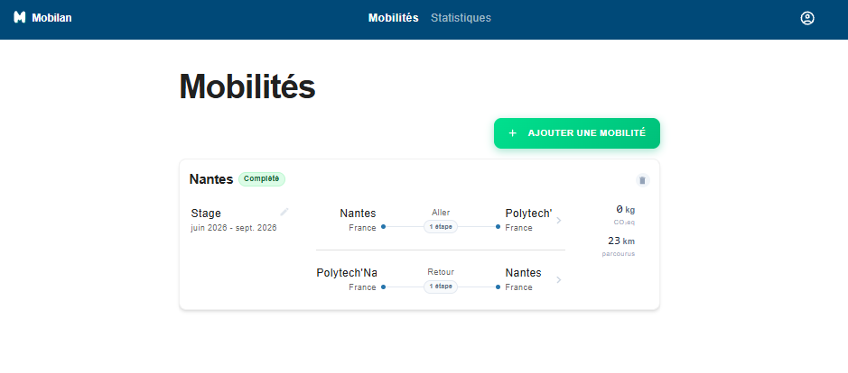

*Figure 19 Déclaration des déplacements sur Mobilan*

## Références bibliographiques

[1] Siouane, A. E., Marinica, C., Picarougne, F., Guillet, F. et Papioannou, G. G-SITM:

Modelling Semantics and Dynamics in Indoor Trajectories Using a Graph-based Approach: Application to Museums.

[2] Chen, W., Huang, H., Zhang, Z., Wang, T., Lin, Y., Chang, L. et Wan, H. « Next-POI Recommendation via Spatial-Temporal Knowledge Graph Contrastive Learning and Trajectory Prompt ». IEEE Transactions on Knowledge and Data Engineering, vol. 37, n° 6, juin 2025. DOI : 10.1109/TKDE.2025.3545958.

[3] Worm, A., Marchal, F. et Castagnos, S. « BIRD: A Museum Open Dataset Combining Behavior Patterns and Identity Types to Better Model Visitors’ Experience ». UMAP Adjunct 2025. Présentation du jeu de données : https://mbanv2.loria.fr/index.html. Version d’auteur accessible sur https://arxiv.org/abs/2602.11160.

[4] Jiao, X., Yin, Y., Shang, L., Jiang, X., Chen, X., Li, L., Wang, F. et Liu, Q. « TinyBERT:

Distilling BERT for Natural Language Understanding ». Findings of EMNLP, 2020. https://arxiv.org/abs/1909.10351 [5] Hidasi, B., Karatzoglou, A., Baltrunas, L. et Tikk, D. « Session-based Recommendations with Recurrent Neural Networks ». ICLR, 2016. https://arxiv.org/abs/1511.06939 [6] Kang, W.-C. et McAuley, J. « Self-Attentive Sequential Recommendation ». IEEE ICDM, 2018. https://arxiv.org/abs/1808.09781 [7] Xin Wang, Jiawei Jiang, Xiao Yan et Qiang Huang. « TESA: A Trajectory and Semantic-aware Dynamic Heterogeneous Graph Neural Network ». Proceedings of the ACM on Web Conference 2025, p. 1305–1315, 2025.

[8] Yujie Fan, Mingxuan Ju, Chuxu Zhang et Yanfang Ye. « Heterogeneous Temporal Graph Neural Network ». Proceedings of the 2022 SIAM International Conference on Data Mining (SDM), p. 657–665, 2022.

[9] Alexandros Kontarinis, Karine Zeitouni, Claudia Marinica, Dan Vodislav et Dimitris Kotzinos. « Towards a semantic indoor trajectory model: application to museum visits ». GeoInformatica, vol. 25, p. 311–352, 2021.

[10 ] Aaron van den Oord, Yazhe Li et Oriol Vinyals. « Representation Learning with Contrastive Predictive Coding ». arXiv, arXiv:1807.03748, 2018.
