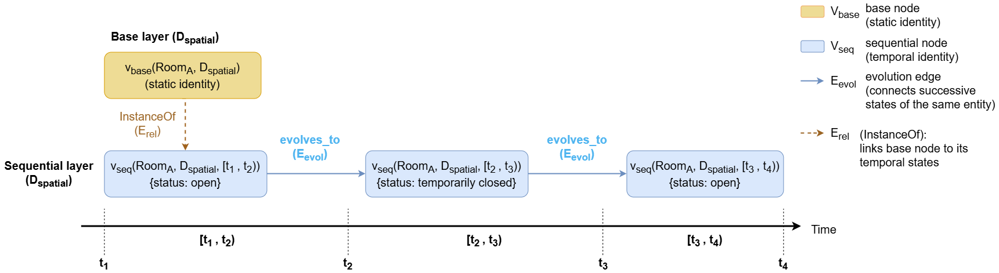
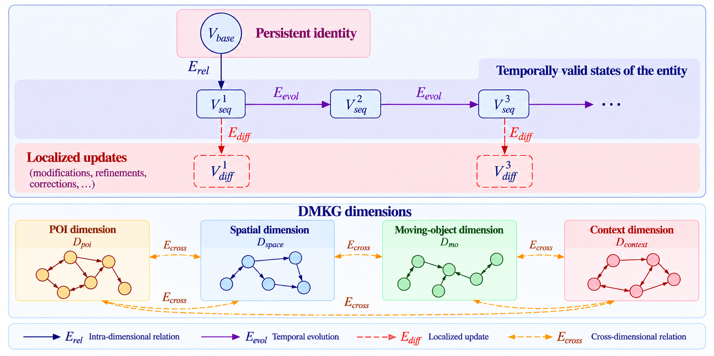
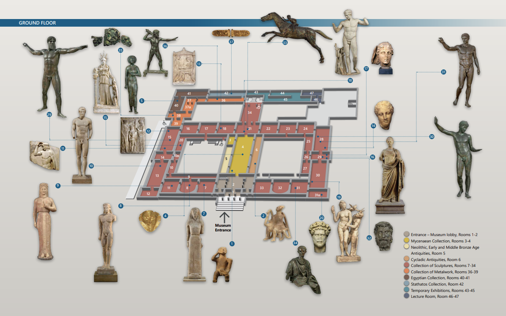
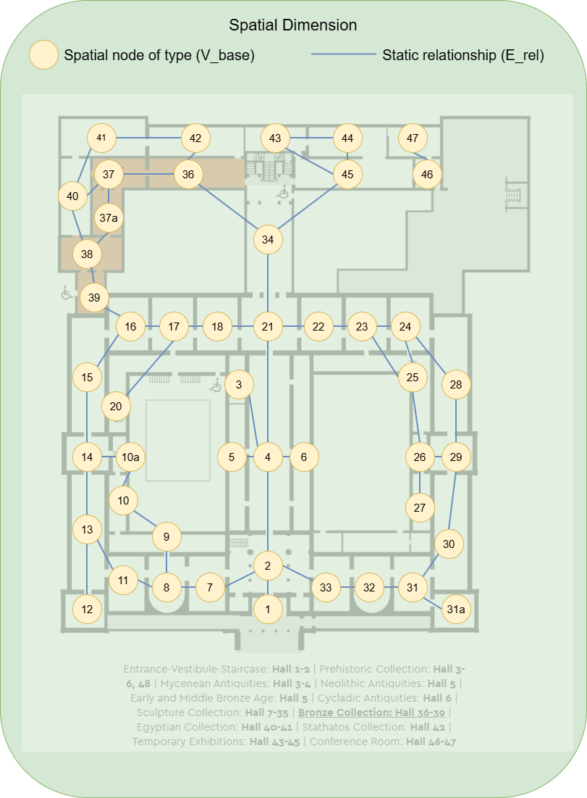
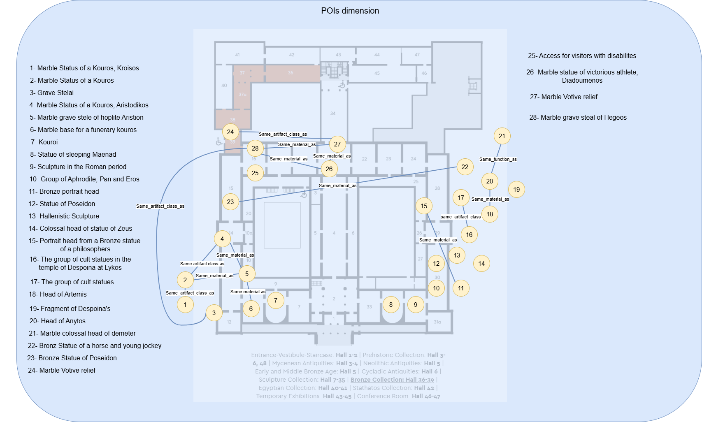
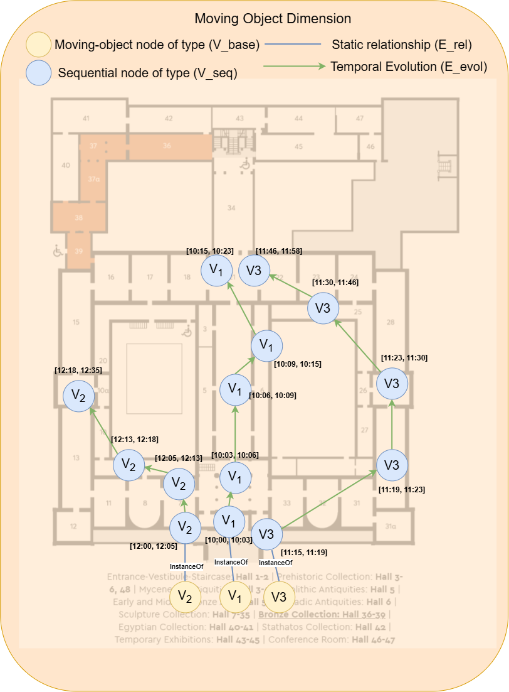
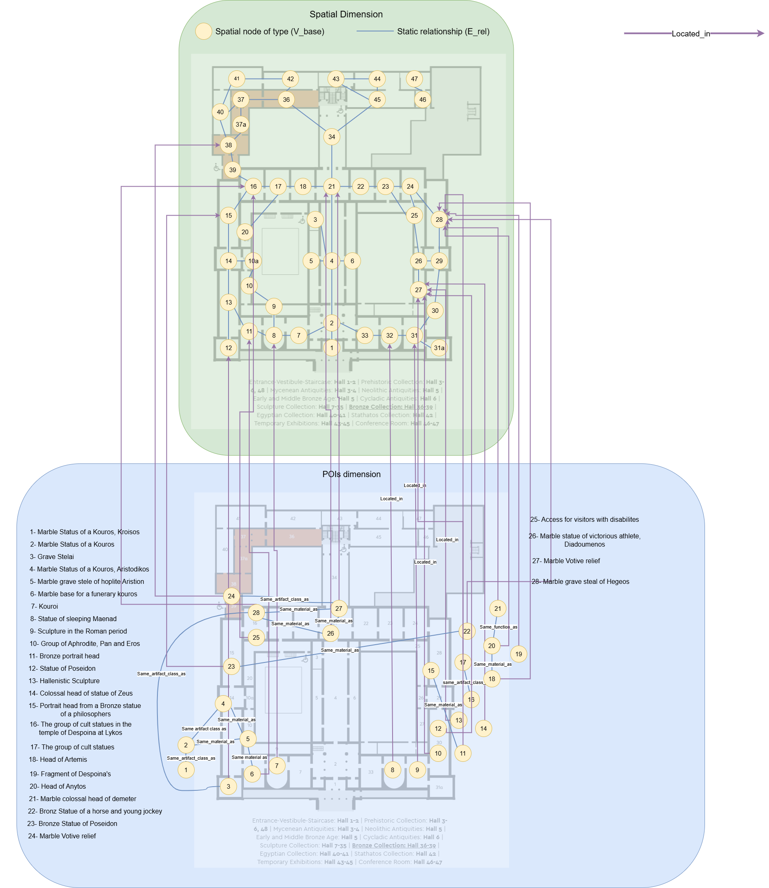

# Dynamic Museum Knowledge Graphs: A Semantic and Temporal Representation of Evolving Museums and Visitor Trajectories

Alaa Eddine Siouane1,*,†, Claudia Marinica1,†, Fabien Picarougne1,†, Fabrice Guillet1,† and Georgios Papaioannou2,† 1Nantes University, Nantes, 44300, France 2Ionian University, Corfu, 49100, Greece

### Abstract

Museums are dynamic indoor environments in which collections, spatial configurations, visitor movements, and contextual information evolve over time. Existing approaches typically address these dimensions separately, making it difficult to jointly represent museum evolution and interpret visitor trajectories within the configuration valid when they occurred. This paper introduces the Dynamic Museum Knowledge Graph (DMKG), a museumspecific specialization of the Graph-based Semantic Indoor Trajectory Model (G-SITM). Building on G-SITM’s multidimensional and temporal representation mechanisms, the DMKG jointly represents museum spaces, cultural objects, visitor trajectories, contextual information, and their evolution while preserving persistent entity identities and temporally valid states. This enables visitor trajectories to be interpreted according to the spatial, cultural, and contextual museum configuration valid at the time of the visit.

The DMKG is instantiated for the National Archaeological Museum of Athens using museum spatial and cultural data and synthetic visitor trajectories. A scenario-based representational validation using competency questions considers artwork relocation, temporary room closure, and temporary exhibition. The results show that the DMKG can represent evolving museum configurations while preserving their temporal context and relating visitor trajectories to the corresponding museum states.

Keywords Museum Big Data, Cultural Heritage, Knowledge Graphs, Dynamic Environments, IndoorGML, Semantic Trajectories, Dynamic Museum Knowledge Graph, Museum Visitor Trajectories

## 1. Introduction

Museums are evolving indoor environments in which spatial configurations, artwork locations, room accessibility, visitor movements, contextual conditions, and operational events change over time. Their information is distributed across heterogeneous sources, including collection management systems, indoor spatial models, visitor-tracking technologies, environmental sensors, and curatorial records. Consequently, interpreting visitor trajectories requires considering the museum configuration that was valid when the visit occurred. For example, an artwork relocation, a temporary room closure, or a temporary exhibition modifies the spatial and semantic context against which contemporaneous trajectories must be interpreted.

Existing representations address complementary parts of this problem. Knowledge graphs support the integration of heterogeneous entities and semantic relationships [1, 2], while CIDOC CRM provides a reference model for cultural objects, actors, events, provenance, and historical information [3, 4]. IndoorGML describes indoor spatial structure and connectivity [5, 6], semantic trajectory models associate movement observations with places, activities, and points of interest, and temporal knowledge graphs Museum Big Data 2026, November 12–14, 2026, Sofia, Bulgaria *Corresponding author. †These authors contributed equally. $ alaa-eddine.siouane@univ-nantes.fr (A. E. Siouane); claudia.marinica@univ-nantes.fr (C. Marinica); fabien.picarougne@univ-nantes.fr (F. Picarougne); fabrice.guillet@univ-nantes.fr (F. Guillet); gpapaioa@ionio.gr (G. Papaioannou)  0009-0000-4001-1765 (A. E. Siouane)

© 2026 Copyright for this paper by its authors. Use permitted under Creative Commons License Attribution 4.0 International (CC BY 4.0).

provide mechanisms for representing temporally qualified facts and relations [7]. These approaches provide complementary representations, but do not directly provide a unified museum-specific model that jointly relates indoor topology, cultural entities, visitor trajectories, contextual information, and museum evolution over time. In particular, visitor trajectories need to be interpreted with respect to the spatial, cultural, and contextual museum configuration that was valid when they occurred.

Representing an evolving museum therefore requires a model that: (i) integrates heterogeneous spatial, cultural, trajectory, and information; (ii) represents semantic relations within and across these dimensions; (iii) captures the temporal evolution of museum entities, states, and relations; (iv) preserves the identity and history of evolving museum entities; and (v) supports the reconstruction of temporally valid museum configurations for trajectory interpretation.

To address these requirements, this paper introduces the Dynamic Museum Knowledge Graph (DMKG), a model for jointly representing evolving museum configurations and visitor trajectories. The DMKG integrates museum spaces, cultural objects, visitors and their trajectories, contextual observations, and museum events within a common multidimensional and temporal representation, thereby supporting the representation of the museum context associated with a visitor trajectory.

The DMKG is defined as a museum-specific specialization of the Graph-based Semantic Indoor Trajectory Model (G-SITM) [8], a generic multidimensional graph model for jointly representing indoor spaces, points of interest, moving objects and their semantic trajectories, contextual information, and their evolution over time. G-SITM provides the generic modeling mechanisms on which the DMKG builds: it distinguishes persistent entities, temporally valid states, and localized updates, and supports semantic relations within and across dimensions. The specialization maps these generic concepts and mechanisms to the museum domain.

The main contributions of this paper are: (1) the DMKG, a museum-specific specialization of G-SITM for jointly representing evolving museum configurations and visitor trajectories; (2) an instantiation of the DMKG for the National Archaeological Museum of Athens; and (3) a scenario-based representational validation using competency questions to assess the model’s ability to represent museum evolution and temporally contextualize visitor trajectories.

The remainder of this article is organized as follows. Section 2 reviews cultural heritage and museum knowledge representations, indoor spatial models, semantic trajectory models, and temporal and spatio-temporal knowledge graphs. Section 3 summarizes the G-SITM concepts required for the museum specialization. Section 4 introduces the Dynamic Museum Knowledge Graph and defines its specialization from G-SITM. Section 5 presents its instantiation for the National Archaeological Museum of Athens and describes the proof of concept and representational assessment. Section 6 discusses the contribution and its limitations, and Section 7 concludes the paper.

## 2. Related Work

The proposed work lies at the intersection of semantic trajectory modeling, museum knowledge representation, visitor trajectory analysis, and temporal knowledge graphs. These research areas provide complementary foundations for representing museum entities and visitor movement, but address different aspects of their evolution and integration.

Semantic Trajectory and Indoor Mobility Models. Semantic trajectory models enrich movement observations with information about places, activities, objects, and contextual conditions. The Stopsand-Moves model distinguishes meaningful stops from movement segments [9], while ontology-based approaches represent trajectories, locations, activities, and contextual annotations as connected semantic entities [10, 11]. MASTER further associates multiple semantic aspects with the same trajectory [12].

Indoor approaches additionally account for building-related spatial constraints. STriDE combines indoor topology with semantic trajectory concepts [13], SITM integrates IndoorGML and the Multi- Layered Space Model to represent indoor spaces, POIs, and museum visitor trajectories [14], and TSTMin provides a topological-semantic representation of indoor mobility data [15]. Hybrid approaches further support semantic trajectories across indoor and outdoor environments [16, 17, 18]. These models provide rich representations of movement and its semantic context. However, the coordinated evolution of the entities against which trajectories are interpreted—including indoor spaces, POIs, accessibility conditions, and contextual information—is generally not their primary representational focus.

Cultural Heritage and Museum Knowledge Graphs. Cultural heritage knowledge graphs integrate descriptions of cultural objects, actors, places, events, and collections. CIDOC CRM provides a conceptual reference model for aligning heterogeneous cultural heritage information [3, 4], while the Europeana Data Model supports the aggregation and publication of cultural heritage metadata [19].

Recent work has also investigated knowledge graphs specifically designed for museum collections. MuseKG integrates structured and unstructured museum collection data within a typed graph connecting objects, people, organizations, and semantic information extracted from textual and visual resources [20]. Von Mering et al. describe an evolving Museum Knowledge Graph based on Linked Open Data and Wikidata, connecting collection objects with people, places, publications, institutional structures, and historical events [21]. While these approaches enrich and interconnect museum collection knowledge, they do not focus on the joint representation of visitor trajectories and the evolving indoor configuration in which these trajectories occur.

These approaches provide rich representations for integrating and contextualizing museum and collection knowledge. Their primary focus, however, differs from the trajectory-centered perspective considered here: they do not directly organize all together indoor topology, evolving museum configurations, and visitor trajectories.

Museum Visitor Trajectory Analysis. Museum visitor studies analyze movement traces through measures such as dwell time, transitions, route structure, revisitation, and exhibit visitation. Sequential analysis, trajectory clustering, and related methods have been used to characterize recurring movement patterns and navigation strategies [22, 23, 24]. Movement data may also be combined with complementary visitor information; for example, the BIRD dataset integrates spatio-temporal trajectories with gaze and visitor-related information [25]. These approaches characterize visitor movement relative to a museum configuration. Comparing or interpreting trajectories collected at different times may additionally require knowledge of the museum configuration under which each trajectory was produced.

Temporal and Spatio-Temporal Knowledge Graphs. Temporal knowledge graphs associate facts and relations with temporal information such as timestamps or validity intervals [1, 7]. Different strategies can be used to represent evolving knowledge, ranging from temporally qualified facts to graph versioning and snapshot-based representations.

Temporal representation has also been specifically investigated in the cultural heritage domain. Bruns et al. evaluate several approaches for representing temporal knowledge in cultural heritage knowledge graphs, including RDF, temporal RDF, Named Graphs, Singleton Properties, N-ary Relations, and 4D Fluents, showing that different strategies address different temporal modeling requirements [26].

Spatio-temporal knowledge graphs further integrate spatial information with temporal validity [27]. These approaches provide generic mechanisms for representing entities and relations that evolve across space and time. However, their generic nature leaves open how museum-specific spatial, cultural, visitor trajectory, and contextual information should be organized and interconnected to support the interpretation of trajectories within evolving museum configurations.

Limitations of Existing Approaches. Existing approaches provide complementary foundations: cultural heritage and museum knowledge graphs represent cultural objects, collections, actors, and events; indoor and semantic trajectory models represent spatial structure and visitor movement; and temporal and spatio-temporal knowledge graphs provide mechanisms for representing evolving facts and relations. However, these approaches address different aspects of the problem and do not directly provide a museum-specific model for jointly representing visitor trajectories and evolving museum configurations.

The DMKG addresses this gap by specializing G-SITM to the museum domain. It defines how museum spaces, cultural objects, visitors and their trajectories, contextual information, and museum evolution are represented and interconnected within a common multidimensional and temporal graph.

The contribution therefore lies in integrating these complementary dimensions while preserving the evolving museum context in which visitor trajectories are produced.

## 3. G-SITM: Generic Modeling Foundation

The Graph-based Semantic Indoor Trajectory Model (G-SITM) [8] provides the generic modeling foundation used in this work. G-SITM is designed to jointly represent indoor spaces, points of interest, moving objects and their semantic trajectories, contextual information, and their evolution over time. Its complete definition, formalization, and evaluation are presented in [8]. Therefore, this section only summarizes the concepts required to understand its specialization to the museum domain and the resulting Dynamic Museum Knowledge Graph (DMKG).

### 3.1. Multidimensional Representation

A G-SITM graph is defined as 𝐺 = (𝑉, 𝐸, 𝐷, 𝑇 ), where 𝑉 is the set of nodes, 𝐸 the set of typed edges, 𝐷 the set of semantic dimensions, and 𝑇 the temporal domain.

G-SITM organizes heterogeneous information into four generic semantic dimensions:

𝐷 = {𝐷space, 𝐷poi, 𝐷mo, 𝐷context} These dimensions respectively capture the structure of the environment, entities of interest within this environment, moving entities and their trajectories, and contextual information associated with them. Their precise semantics depend on the application domain and are defined when G-SITM is specialized to a particular domain.

Each dimension forms a semantic subgraph and may be associated with a domain ontology. Relations may connect entities within the same dimension or across different dimensions, allowing heterogeneous information to remain semantically structured within a common graph.

### 3.2. Graph Structure and Temporal Evolution

Within these semantic dimensions, G-SITM structures information through typed nodes and edges, while incorporating temporal mechanisms to represent the evolution of entities and relations.

G-SITM distinguishes three complementary node categories:

𝑉 = 𝑉base ∪ 𝑉seq ∪ 𝑉diff.

A base node 𝑉base represents the persistent identity of an entity independently of its states. A sequential node 𝑉seq represents a temporally valid state of this entity over an interval [𝑡𝑠, 𝑡𝑒). Several sequential nodes can therefore represent successive states of the same persistent entity while maintaining a stable reference to that entity. Figure 1 illustrates the distinction between persistent entity identity and successive temporally valid states.

A differential node 𝑉diff represents a localized update affecting an existing state over a given temporal interval. It allows local or temporary changes to be represented without materializing a complete new state of the entity.

G-SITM further distinguishes four categories of edges:

𝐸 = 𝐸rel ∪ 𝐸cross ∪ 𝐸evol ∪ 𝐸diff.

𝐸rel represents semantic or topological relations within a dimension, whereas 𝐸cross connects entities belonging to different dimensions. 𝐸evol represents temporal or structural evolution, and 𝐸diff links

*Figure 1: Temporal evolution of a persistent entity through successive states connected by 𝐸evol.*

localized updates to the states they affect. Relations may also be temporally qualified when their validity changes over time.

Together, these mechanisms allow G-SITM to represent the evolution of entities, relations, and graph structure while preserving persistent entity identity and avoiding the systematic materialization of complete graph snapshots.

### 3.3. From G-SITM to a Domain-Specific Model

G-SITM provides generic semantic dimensions and temporal graph mechanisms but does not prescribe the entities, relations, vocabularies, or evolution events of a particular application domain. Using G-SITM in a specific domain therefore requires its generic concepts to be mapped to the semantics and requirements of that domain.

In this work, this mapping consists in identifying the domain entities represented in each G-SITM dimension, defining the relevant intra- and cross-dimensional relations, associating entities and relations with existing domain semantics where appropriate, and determining how domain-specific evolution events are represented using G-SITM temporal mechanisms. The following section applies this process to the museum domain, resulting in the Dynamic Museum Knowledge Graph (DMKG).

## 4. The Dynamic Museum Knowledge Graph

The Dynamic Museum Knowledge Graph (DMKG) is defined as a museum-specific specialization of G-SITM model. It inherits the generic multidimensional and temporal graph structures of G-SITM while defining their semantics for the museum domain. More specifically, the DMKG defines how museum spaces, cultural objects, visitors and their trajectories, contextual information, and museum evolution are represented and interconnected within a common temporal knowledge graph.

Accordingly, a DMKG is defined as 𝐺DMKG = (𝑉DMKG, 𝐸DMKG, 𝐷museum, 𝑇 ), where 𝑉DMKG and 𝐸DMKG denote the museum-specific nodes and relations, 𝐷museum the museum semantic dimensions, and 𝑇 the temporal domain.

Museum Semantic Dimensions. The DMKG specializes the four generic G-SITM dimensions as 𝐷museum = {𝐷space, 𝐷poi, 𝐷mo, 𝐷context} The spatial dimension, 𝐷space, represents the physical and navigable structure of the museum. It includes persistent spatial entities such as rooms, galleries, corridors, and access points, together with their temporally valid configurations and topological relations. This distinction allows a museum space to preserve its identity while properties such as accessibility, function, or connectivity evolve over time.

The POI dimension, 𝐷poi, represents cultural and exhibition-related entities, including artworks, archaeological objects, exhibits, and temporary exhibitions. Cultural objects preserve their identity independently of their location, while temporally qualified relations associate them with the museum spaces in which they are displayed. This separation makes it possible to represent relocations without creating new identities for the corresponding objects.

The moving-object dimension, 𝐷mo, represents visitors and their semantic trajectories. A visitor is represented as a persistent entity, while temporally ordered observations describe successive positions or stops during a visit. These observations can be connected to the museum spaces and cultural objects relevant at the observation time.

The context dimension, 𝐷context, represents observations and conditions that contribute to the interpretation of a visit, such as environmental, accessibility, occupancy, or operational information. Contextual information may be associated with particular museum entities and validity intervals, allowing the conditions affecting a trajectory to be recovered retrospectively.

Museum Entities, States, and Relations The DMKG inherits the three node categories and four edge categories defined by G-SITM and assigns them museum-specific semantics.

Persistent museum entities are represented by 𝑉base nodes. These include museum spaces, cultural objects, exhibitions, and visitors. A base node preserves the identity of an entity independently of the changes affecting it over time.

Temporally valid states of these entities are represented by 𝑉seq nodes. For example, successive states may describe the configuration or accessibility of a room, the display location of an artwork, or temporally ordered observations composing a visitor trajectory. For museum entities, changes in temporally varying relations may induce the creation of successive states. For instance, a change in the displayed_in relation of an artwork creates a new sequential state representing its new display location while preserving the identity of the artwork.

Finally, 𝑉diff nodes represent localized or temporary changes that do not require the creation of a complete new state, such as temporary contextual or operational conditions.

*Table 1 DMKG entities and relations based on G-SITM constructs.*

DMKG element Museum example G-SITM construct Persistent museum entity Room, artwork, visitor 𝑉base Temporally valid museum state or observation Room state, trajectory observation 𝑉seq Localized or temporary museum change Contextual or operational condition 𝑉diff Intra-dimensional museum relation Connectivity between rooms 𝐸rel Cross-dimensional museum relation Artwork displayed_in room 𝐸cross Evolution between museum states Successive states of a room 𝐸evol Localized update relation Temporary condition affecting a room state 𝐸diff The DMKG also inherits the four generic G-SITM edge categories. Within a semantic dimension, 𝐸rel represents museum-specific semantic or topological relations, such as connectivity between museum spaces. Cross-dimensional relations 𝐸cross connect entities belonging to different museum dimensions, for example an artwork to its display location or a visitor observation to the room in which it occurs.

Temporal evolution between successive states is represented by 𝐸evol, while 𝐸diff connects localized updates to the states they affect. Relations whose semantics change over time, such as the display location of an artwork or the accessibility of a space, are temporally qualified.

*Table 1 summarizes the mapping between DMKG elements and the corresponding G-SITM constructs, together with representative museum examples.*

*Figure 2: Overview of the DMKG multidimensional and temporal structure.*

Cross-Dimensional Museum Representation. A key aspect of the DMKG is the explicit connection between its semantic dimensions. Museum entities are not represented as independent collections of spatial, cultural, trajectory, and contextual data. Instead, cross-dimensional relations provide the links required to interpret these elements jointly.

A cultural object can be associated with the museum space in which it is displayed through a temporally qualified relation. Similarly, each visitor observation can be linked to the spatial entity in which it occurs and, when interaction or proximity information is available, to the corresponding cultural objects. Contextual observations can in turn be associated with the spaces, objects, or trajectory observations they concern. These relations provide the semantic connections required to move from a geometric visitor path to a museum trajectory enriched with the cultural, spatial, and contextual information valid at the time of the visit.

*Figure 2 summarizes the multidimensional and temporal structure of the DMKG and the main G-SITM constructs on which it relies.*

Standards and Semantic Alignment. The museum specialization combines complementary standards and domain models. CIDOC CRM supports the description of cultural entities, actors, creation events, provenance, and collection-related information [3, 4]. IndoorGML supports the description of indoor spaces and their navigable connectivity [5, 6]. The IndoorGML POI extension supports the association of points of interest with indoor spaces [28]. RDF and OWL provide the semantic representation and ontology implementation mechanisms. These standards serve complementary purposes. IndoorGML does not provide a complete cultural heritage ontology, whereas CIDOC CRM does not define an indoor navigation graph. Their concepts are therefore aligned through cross-dimensional relations rather than merged into an undifferentiated schema.

Museum Evolution and Historization. A central characteristic of the DMKG is the historization of museum entities and their relations. The overall construction of the DMKG according to the G-SITM model is described in Algorithm 1 (Appendix A). Museum entities preserve a persistent identity while their states and relations may evolve over time, allowing the DMKG to represent not only the current museum configuration but also the history of its elements.

For example, an artwork preserves the same identity when it is relocated, while its successive display locations are temporally qualified. Similarly, a room preserves its identity while its accessibility or configuration may change, and temporary exhibitions may exist only during specific validity intervals. By preserving the temporal validity of states and relations, the DMKG supports the reconstruction of the museum configuration valid at a given time.

Temporal Contextualization of Visitor Trajectories. The historization of museum entities and relations enables visitor trajectories to be interpreted with respect to the museum configuration that was valid when the trajectory occurred. Each trajectory observation can be related to the temporally valid states and relations of the corresponding museum spaces, cultural objects, and contextual information.

Consequently, the same spatial trajectory may have different semantic interpretations at different times. For example, a visitor passing through the same sequence of rooms may encounter different cultural objects after an artwork relocation, may be affected by a temporary room closure, or may visit during a temporary exhibition. The DMKG therefore preserves the temporal context required to relate visitor trajectories to the evolving museum in which they were produced.

## 5. Proof-of-Concept and Representational Validation

The proof of concept examines whether the proposed DMKG can jointly represent heterogeneous museum entities, their evolution, and visitor trajectories within a unified multidimensional and temporal graph. The evaluation concerns the representational capacity of the DMKG rather than predictive performance or actual visitor behavior.

### 5.1. Case Study and Data Sources

The DMKG is instantiated for the National Archaeological Museum of Athens, which contains more than 11,000 exhibits distributed across documented exhibition spaces and collections [29, 30]. Three data categories are considered. First, the museum floor plan [31] provides the rooms and topological connections required by the spatial dimension. Second, museum descriptions of artifacts and collections provide the cultural entities represented in the POI dimension. Third, synthetic visitor trajectories instantiate the moving-object dimension because real visitor-tracking data are not available for this case study. The synthetic trajectories are used only to verify whether visitor movements can be represented and interpreted according to the museum configuration valid during each visit. They do not reproduce observed visitor behavior and are not used to derive behavioral conclusions. Detailed data mappings and enlarged graph visualizations are provided in Appendix B.

### 5.2. DMKG Instantiation

The proof of concept instantiates the spatial, POI, and moving-object dimensions of G-SITM. Museum rooms and connectivity relations form the spatial subgraph, cultural entities form the POI subgraph, and synthetic visitor observations form the moving-object subgraph. Persistent entities are represented by 𝑉𝑏𝑎𝑠𝑒 nodes, temporal states and observations by 𝑉𝑠𝑒𝑞 nodes, and localized updates by 𝑉𝑑𝑖𝑓𝑓 nodes. The three dimensions are integrated through temporally qualified 𝐸𝑐𝑟𝑜𝑠𝑠 relations. Detailed mappings and enlarged graph visualizations are provided in Appendix B. In the proof of concept, visitor–POI observed relations are synthetically instantiated to illustrate how interaction information can be represented when such evidence is available. They should not be interpreted as measurements of visual attention or actual visitor engagement.

### 5.3. Prototype Implementation

To operationalize the proof of concept, we implemented an interactive DMKG demonstrator that instantiates and visualizes the museum knowledge graph. The prototype is implemented in Python using Dash and Plotly and loads the graph entities, relations, and controlled dynamic scenarios from structured data files. The interface supports filtering by semantic dimension, node category (𝑉𝑏𝑎𝑠𝑒, 𝑉𝑠𝑒𝑞, and 𝑉𝑑𝑖𝑓𝑓), and edge category (𝐸𝑟𝑒𝑙, 𝐸𝑐𝑟𝑜𝑠𝑠, 𝐸𝑒𝑣𝑜𝑙, and 𝐸𝑑𝑖𝑓𝑓). It further provides two complementary temporal views. The complete temporal representation exposes the states and evolution encoded in the graph, whereas the selected-time view reconstructs the museum configuration valid at a time 𝑡 according to the validity condition 𝑡𝑠 ≤ 𝑡< 𝑡𝑒. For moving objects, the selected-time visualization retains trajectory observations whose starting time precedes or equals 𝑡, thereby reconstructing the visitor trajectory history up to the selected time. This is distinguished from the validity semantics used to reconstruct museum states and relations.

The prototype also associates the three controlled scenarios with their corresponding competency questions and reports the graph elements supporting each answer. It therefore provides an executable representational demonstrator of the DMKG and its temporal mechanisms, rather than a performance benchmark of the underlying graph representation. The source code and scenario definitions are available in the accompanying repository [32].

### 5.4. Validation Protocol

The evaluation considers three representative museum scenarios: artwork relocation, temporary room closure, and temporary exhibition. A scenario is considered successfully represented by the DMKG when the graph (i) preserves the persistent identity of each affected entity, (ii) captures its relevant states before, during, and/or after the event, (iii) specifies the temporal validity of the affected relations, (iv) represents the relationships affected across semantic dimensions, and (v) provides the information required to answer the associated competency questions. For each scenario, the validation is performed in three steps: (i) the graph configuration is reconstructed immediately before the event, during its validity interval, and after the event; (ii) the affected nodes and relations are inspected to verify identity preservation, temporal validity, and cross-dimensional consistency; and (iii) the resulting configurations are evaluated against the associated competency questions. The interactive prototype performs this temporal filtering and exposes the corresponding graph elements. This protocol assesses whether the graph provides the information necessary to reconstruct and compare temporally valid museum configurations. It does not evaluate query-execution time, scalability, storage cost, or predictive accuracy.

### 5.5. Dynamic Scenarios and Validation Results

The representational validation is guided by six competency questions covering temporal, spatial, and cross-dimensional information needs in evolving museum environments:

- CQ1: Which cultural objects were displayed in a given room during a specified interval? • CQ2: Which visitor trajectories occurred in the previous and new locations of a relocated artwork? • CQ3: Which rooms and connectivity relations were inaccessible during a specified interval? • CQ4: Which trajectories crossed or avoided the affected area during a room closure? • CQ5: Which temporary exhibitions and POIs were active during a visitor trajectory? • CQ6: How did the valid museum configuration differ before and after a dynamic event?

Three controlled scenarios—artwork relocation, temporary room closure, and temporary exhibition— are used to validate these capabilities under different forms of museum evolution. Table 2 summarizes the DMKG features and constructs involved in each scenario and the competency questions validated. Detailed temporal instantiations are provided in Appendix C.

The three scenarios were successfully represented by the prototype according to their temporal validity intervals. In the artwork relocation scenario, the persistent identity of 𝑝1 is preserved while the valid displayed_in relation changes from 𝑟3 to 𝑟7. During the temporary room closure, the valid accessibility configuration excludes 𝑟5 and the affected connectivity relations for the closure interval. During the temporary exhibition, the active state of 𝑒1 and the temporally qualified semantic and spatial relations involving the POI set {𝑝4, 𝑝5, 𝑝6} are valid only while the exhibition is active, while their persistent identities are preserved.

*Table 2 Representational validation of the DMKG through controlled museum scenarios.*

Scenario DMKG features tested DMKG constructs CQs validated Entity historization Identity preservation Changing display location Artwork relocation Temporary update Accessibility change Temporal representation Temporary room closure Temporal validity Semantic relations Temporary POIs Temporary exhibition

## 6. Discussion

## 7. Conclusion and Future Work

𝑉𝑏𝑎𝑠𝑒, 𝑉𝑠𝑒𝑞, 𝐸𝑒𝑣𝑜𝑙, 𝐸𝑐𝑟𝑜𝑠𝑠 CQ1–CQ2 𝑉𝑏𝑎𝑠𝑒, 𝑉𝑠𝑒𝑞, 𝑉𝑑𝑖𝑓𝑓, 𝐸𝑑𝑖𝑓𝑓, 𝐸𝑟𝑒𝑙 CQ3–CQ4 𝑉𝑏𝑎𝑠𝑒, 𝑉𝑠𝑒𝑞, 𝐸𝑟𝑒𝑙, 𝐸𝑐𝑟𝑜𝑠𝑠 CQ5–CQ6 The proof of concept shows that the DMKG can jointly represent museum spaces, cultural entities, visitor trajectories, and dynamic museum events within a common multidimensional and temporal graph. Using the temporal mechanisms inherited from G-SITM, the DMKG preserves persistent entity identities while representing successive valid states, localized updates, and evolving relations. The three scenarios illustrate these mechanisms through artwork relocation, temporary room closure, and temporary exhibitions.

Beyond individual changes, the multidimensional organization of the DMKG makes their effects explicit across museum dimensions. For example, relocating an artwork changes its temporally valid spatial relation while preserving its identity, whereas a room closure affects the spatial configuration against which contemporaneous trajectories are interpreted. Museum evolution is therefore not independent from visitor movement: changes in spaces, cultural objects, or their relations modify the semantic context of trajectories.

This temporal contextualization is an important property of the DMKG. A geometric trajectory identifies where a visitor moved, but not necessarily the museum configuration experienced. By preserving the histories of museum entities and relations, the DMKG relates a trajectory to the configuration valid when it occurred. Consequently, similar spatial paths at different times may be associated with different cultural objects, exhibitions, accessibility conditions, or other museum contexts.

The evaluation nevertheless remains limited in several respects. First, synthetic trajectories do not support conclusions about actual visitor behavior. Second, although the contextual dimension is part of the DMKG, it is not instantiated with environmental or operational sensor data. Third, the competency questions are evaluated through temporal reconstruction and inspection rather than declarative queries over an RDF or graph-database backend. Finally, the evaluation addresses representational feasibility rather than query-processing performance, scalability, storage efficiency, or reasoning completeness. These aspects constitute directions for future evaluation.

This paper introduced the Dynamic Museum Knowledge Graph (DMKG), a museum-specific specialization of G-SITM for jointly representing museum spaces, cultural entities, visitor trajectories, contextual information, and their evolution over time. By specializing the multidimensional and temporal mechanisms of G-SITM to the museum domain, the DMKG preserves persistent entity identities while representing temporally valid states, localized updates, and evolving relations. This enables visitor trajectories to be related to the museum configuration that was valid when they occurred.

A proof of concept based on the National Archaeological Museum of Athens examined artwork relocation, temporary room closure, and temporary exhibition scenarios. The study showed that the DMKG provides the entity identities, temporal qualifications, and cross-dimensional relations required to reconstruct the museum configurations and answer the associated competency questions.

Future work will integrate real visitor-tracking datasets and environmental observations, implement the DMKG in an RDF-compatible storage system, and evaluate temporal query execution and scalability. Additional work will investigate reasoning mechanisms for state reconstruction, accessibility changes, and visitor–POI interactions. The DMKG will also be explored as a representation layer for museum analytics, recommendation, and digital-twin applications while maintaining a clear separation between knowledge representation and predictive behavioral modeling.

## Declaration on Generative AI

During the preparation of this work, the authors used ChatGPT (OpenAI) to assist with language editing, grammatical correction, and the improvement of clarity and presentation of selected passages. The authors reviewed and revised all AI-assisted content and take full responsibility for the scientific content, methodology, results, and conclusions presented in this work.

## References

[1] Y. Cai, Q. Liu, Y. Gan, C. Li, X. Liu, R. Lin, D. Luo, J. Yang, Predicting the unpredictable: Uncertaintyaware reasoning over temporal knowledge graphs via diffusion process, in: Findings of the Association for Computational Linguistics: ACL 2024, Association for Computational Linguistics, 2024, pp. 5766–5778. [2] L. Zhu, S. A. Rahman, H. Timan, Knowledge graph applications in cultural heritage: A roses-based systematic review, Information 17 (2026) 269. [3] M. Doerr, The cidoc crm, an ontological approach to schema heterogeneity, Schloss Dagstuhl– Leibniz-Zentrum für Informatik, 2005. [4] G. Faraj, A. Micsik, Representing and validating cultural heritage knowledge graphs in cidoc-crm ontology, Future Internet 13 (2021) 277. [5] J. Lee, K.-J. Li, S. Zlatanova, T. H. Kolbe, C. Nagel, T. Becker, H.-Y. Kang, OGC IndoorGML 1.1, OGC Implementation Standard 19-011r4, Open Geospatial Consortium, 2020. [6] OGC IndoorGML 2.0 Part 1 – Conceptual Model, OGC Standard 22-045r5, Open Geospatial Consortium, 2025. [7] J. Zhang, M. Sun, Q. Huang, L. Tian, Pleasing: Exploring the historical and potential events for temporal knowledge graph reasoning, Neural Networks 179 (2024) 106516. [8] A. E. Siouane, C. Marinica, F. Picarougne, F. Guillet, G. Papaioannou, Towards a new graph-based model for semantic indoor trajectories with historization, in: Proceedings of the STMA4KD: Spatio-Temporal Data Management and Analysis for Knowledge Discovery Workshop at the 35th ACM International Conference on Information and Knowledge Management (CIKM 2026), 2026. To appear. [9] S. Spaccapietra, C. Parent, M. L. Damiani, J. A. de Macedo, F. Porto, C. Vangenot, A conceptual view on trajectories, Data & knowledge engineering 65 (2008) 126–146. [10] Z. Yan, J. Macedo, C. Parent, S. Spaccapietra, Trajectory ontologies and queries, Transactions in GIS 12 (2008) 75–91. [11] C. Renso, M. Baglioni, J. A. F. de Macedo, R. Trasarti, M. Wachowicz, How you move reveals who you are: understanding human behavior by analyzing trajectory data, Knowledge and information systems 37 (2013) 331–362. [12] R. d. S. Mello, V. Bogorny, L. O. Alvares, L. H. Z. Santana, C. A. Ferrero, A. A. Frozza, G. A. Schreiner, C. Renso, Master: A multiple aspect view on trajectories, Transactions in GIS 23 (2019) 805–822. [13] C. Cruz, Semantic trajectory modeling for dynamic built environments, in: 2017 IEEE International Conference on Data Science and Advanced Analytics (DSAA), IEEE, 2017, pp. 468–476.

[14] A. Kontarinis, K. Zeitouni, C. Marinica, D. Vodislav, D. Kotzinos, Towards a semantic indoor trajectory model: application to museum visits, GeoInformatica 25 (2021) 311–352. [15] J. Qin, L. Wang, T. Wu, Y. Li, L. Xiang, Y. Zhu, Indoor mobility data encoding with tstm-in: A topological-semantic trajectory model, Computers, Environment and Urban Systems 110 (2024) 102114. [16] H. Noureddine, C. Ray, C. Claramunt, Semantic trajectory modelling in indoor and outdoor spaces, in: 2020 21st IEEE International Conference on Mobile Data Management (MDM), IEEE, 2020, pp. 131–136. [17] H. Noureddine, C. Ray, C. Claramunt, A hierarchical indoor and outdoor model for semantic trajectories, Transactions in GIS 26 (2021) 214–235. doi:10.1111/tgis.12841. [18] C. Cayèré, C. Sallaberry, C. Faucher, M.-N. Bessagnet, P. Roose, M. Masson, J. Richard, Multilevel and multiple aspect semantic trajectory model: application to the tourism domain, ISPRS International Journal of Geo-Information 10 (2021) 592. [19] A. L. Silva, A. L. Terra, Cultural heritage on the semantic web: The europeana data model, IFLA journal 50 (2024) 93–107. [20] J. Li, J. Qi, S. C. Han, E.-J. Holden, Musekg: A knowledge graph over museum collections, arXiv preprint arXiv:2511.16014 (2025). [21] S. von Mering, Towards a museum knowledge graph: Measuring the impact of linked open collection data for the museum für naturkunde berlin, Biodiversity Information Science and Standards 9 (2025) e181567. URL: https://biss.pensoft.net/article/181567/. doi:10.3897/biss.9. 181567. [22] C.-H. Chuan, et al., Discovering museum visitor mobility patterns using sequential analysis, Journal of Ambient Intelligence and Humanized Computing (2019). [23] A. Basiri, P. Amirian, A. Winstanley, T. Moore, Making tourist guidance systems more intelligent, adaptive and personalised using crowd sourced movement data, Journal of Ambient Intelligence and Humanized Computing 9 (2018) 413–427. doi:10.1007/s12652-017-0550-0. [24] Y. Huang, et al., Behavioral pattern analysis of museum visitors based on indoor trajectory clustering, Heritage Science (2022). [25] D. Worm, P. Marchal, S. Castagnos, et al., Bird: A multimodal museum visitor dataset for behavioral analysis, UMAP Adjunct (2025). doi:10.1145/3708319.3733686. [26] O. Bruns, J. Waitelonis, J. Z. Pan, H. Sack, Temporal modelling in cultural heritage knowledge graphs: Use cases, requirements, evaluation, and decision support, Transactions on Graph Data and Knowledge (TGDK) 4 (2026) 2:1–2:46. URL: https://doi.org/10.4230/TGDK.4.1.2. doi:10.4230/ TGDK.4.1.2. [27] H. Hao, G. Si, L. Lu, Q. Liu, F. Zhou, From data fusion to dynamic reasoning: A survey on spatio-temporal knowledge graph construction and embedding methods, Neurocomputing (2025) 131590. [28] T. Kim, K. S. Kim, J. Lee, K.-J. Li, How to extend indoorgml for points of interest, in: Web and Wireless Geographical Information Systems (W2GIS 2020), volume 12473 of Lecture Notes in Computer Science, Springer, 2020, pp. 3–13. doi:10.1007/978-3-030-60952-8_1. [29] National Archaeological Museum, Official website of the national archaeological museum, 2026.

URL: https://www.namuseum.gr/en/, accessed: 2026-09-02. [30] National Archaeological Museum, Collections of the national archaeological museum, 2026. URL:

en/episkepsi/, accessed: 2026-09-02. [32] A. E. Siouane, C. Marinica, F. Picarougne, F. Guillet, G. Papaioannou, Dynamic museum knowledge graph visualizer, 2026. URL: https://github.com/alaaeddine29/gsitm-dmkg-visualizer.git, research prototype for Dynamic Museum Knowledge Graph proof of concept. [33] National Archaeological Museum, National archaeological museum brochure, 2022. URL: https:

//www.namuseum.gr/wp-content/uploads/2022/03/nam-brochure-ÎŢÎİ-low.pdf, accessed: 2026- 09-02.

## A. DMKG Instantiation Procedure

*Algorithm 1: Instantiation procedure for a Dynamic Museum Knowledge Graph*

Input: Museum ontology 𝒪𝑚𝑢𝑠𝑒𝑢𝑚; museum dimensions 𝐷museum; museum entities 𝒳 ; source relations ℛ; chronologically ordered events ℋ Output: Dynamic Museum Knowledge Graph 𝐺DMKG 1 Initialize 𝑉base, 𝑉seq, 𝑉diff ←∅;

2 Initialize 𝐸rel, 𝐸cross, 𝐸evol, 𝐸diff ←∅;

// Semantic mapping and persistent identities 3 foreach museum entity 𝑥 ∈𝒳 do 4 map 𝑥 to a DMKG concept and semantic dimension using 𝒪𝑚𝑢𝑠𝑒𝑢𝑚;

5 create persistent identity 𝑣base(𝑥);

6 if 𝑥 has temporally varying properties or relations then 7 create initial valid state 𝑣0 seq(𝑥, [𝑡0, 𝑡𝑒));

8 connect 𝑣base(𝑥) to 𝑣0 seq(𝑥) through 𝐸rel;

// Museum relations 9 foreach source relation 𝑟(𝑥𝑖, 𝑥𝑗, 𝐼) ∈ℛ do 10 map 𝑟 to its museum semantics using 𝒪𝑚𝑢𝑠𝑒𝑢𝑚;

11 if 𝑑𝑖𝑚(𝑥𝑖) = 𝑑𝑖𝑚(𝑥𝑗) then 12 add the temporally qualified relation to 𝐸rel;

13 else 14 add the temporally qualified relation to 𝐸cross;

// Museum evolution and historization 15 Sort ℋ chronologically;

16 foreach event ℎ ∈ℋ do 17 identify the affected entity 𝑥;

18 identify its active state 𝑣𝑖 seq at 𝜏ℎ;

19 if ℎ modifies a temporally varying property or relation then 20 close the validity interval of 𝑣𝑖 seq at 𝜏ℎ;

21 create successor state 𝑣𝑖+1 seq (𝑥, [𝜏ℎ, 𝑡𝑒));

22 connect 𝑣𝑖 seq to 𝑣𝑖+1 seq through 𝐸evol;

23 update the affected temporally qualified 𝐸rel and/or 𝐸cross relations;

24 else 25 create localized update 𝑣diff(𝑥, 𝜏ℎ, ∆ℎ);

26 connect 𝑣𝑖 seq to 𝑣diff through 𝐸diff;

27 𝑉 ← 𝑉base ∪ 𝑉seq ∪ 𝑉diff;

28 𝐸 ← 𝐸rel ∪ 𝐸cross ∪ 𝐸evol ∪ 𝐸diff;

29 return 𝐺DMKG = (𝑉, 𝐸, 𝐷museum, 𝑇 );

## B. Detailed DMKG Instantiation

This appendix details the instantiation of the DMKG used in the proof of concept. Three semantic dimensions are instantiated: the spatial dimension (𝐷space), the Points of Interest dimension (𝐷poi), and the Moving Object dimension (𝐷mo). The context dimension (𝐷context) is part of the DMKG model but is not instantiated in the present proof of concept. Figure 3 presents the museum ground-floor plan used to instantiate the spatial dimension.

*Figure 3: Ground-floor plan of the archaeological museum of Athens [33].*

### B.1. Spatial Dimension

The spatial dimension (𝐷space), illustrated in Figure 4, is instantiated using the indoor topological concepts defined by IndoorGML [6]. It represents galleries, exhibition rooms, halls, and their spatial connectivity through topological relations, including contains, covers, adjacent_to, and connected_to. In this work, connected_to relations, represented through 𝐸𝑟𝑒𝑙 edges in the graph, define the topological connectivity graph from which the temporally valid accessibility configuration can be derived.

### B.2. Points of Interest Dimension

The Points of Interest dimension (𝐷𝑝𝑜𝑖) represents the cultural entities exhibited in the museum, including artifacts, collections, and exhibition objects. Each POI is modeled as a 𝑉𝑏𝑎𝑠𝑒 vertex describing a persistent museum entity independently of its temporal evolution.

*Figure 5 illustrates the instantiation of the POI dimension using representative artifacts from the National Archaeological Museum of Athens. Each POI is associated with its hosting indoor space through a cross-dimensional relation. Since the IndoorGML extension for Points of Interest specifies the association between POIs and indoor spaces but does not define a normative vocabulary for semantic relations among POIs, intra-POI relations are modeled at the application level of the proposed DMKG [28].*

In this proof of concept, relation types such as same_artifact_class_as, same_material_as, and same_function_as are instantiated as representative semantic annotations to illustrate intradimensional semantic relations (thus 𝐸𝑟𝑒𝑙 edges) in the DMKG. These relations should therefore be interpreted as proof-of-concept annotations rather than as authoritative assertions extracted from the museum’s collection management system.

### B.3. Moving Object Dimension

The Moving Object dimension (𝐷𝑚𝑜) represents museum visitors and their indoor trajectories. Each visitor is modeled as a persistent moving object (𝑉𝑏𝑎𝑠𝑒), while successive observations along the trajectory are represented by temporal vertices (𝑉𝑠𝑒𝑞) connected through evolution edges (𝐸𝑒𝑣𝑜𝑙). In this proof of concept, visitor trajectories are synthetically generated to validate the graph representation of visitor movements and interactions with museum entities rather than to reproduce real visitor behavior. Figure

*Figure 4: Instantiation of the museum spatial dimension using IndoorGML concepts [5].*

6 illustrates trajectory segments of three synthetic visitors, showing their successive temporal states as they move through the museum

### B.4. Cross-Dimensional Integration

Cross-dimensional relations (𝐸𝑐𝑟𝑜𝑠𝑠) connect the spatial and Points of Interest dimensions by associating each cultural entity with its hosting indoor space. Following the IndoorGML Point of Interest extension, each POI may be linked to its hosting exhibition space through a located_in relation, which may be temporally qualified when the POI location changes, while the inverse relation contains associates each indoor space with the POIs it hosts. These relations integrate cultural heritage entities with the indoor topology and enable spatial reasoning, navigation, and location-aware visitor analysis. Figure 7 depicts the integration of the spatial and Points of Interest dimensions through cross-dimensional

*Figure 5: Instantiation of the Points of Interest dimension (𝐷𝑝𝑜𝑖).*

edges (𝐸𝑐𝑟𝑜𝑠𝑠), which associate each POI with its hosting indoor space.

## C. Detailed Dynamic Scenarios

This appendix provides the complete temporal instantiations of the three scenarios summarized in Table 2.

### C.1. Scenario 1: Artwork Relocation

Let 𝑝1 be an artwork displayed in room 𝑟3 during the interval [𝑡0, 𝑡1). At time 𝑡1, it is relocated to room 𝑟7.

The base node 𝑣𝑏𝑎𝑠𝑒(𝑝1) is preserved. The first location state is valid during [𝑡0, 𝑡1) and the second during [𝑡1, 𝑡2). The corresponding relations are: 𝑑𝑖𝑠𝑝𝑙𝑎𝑦𝑒𝑑_𝑖𝑛(𝑝1, 𝑟3, [𝑡0, 𝑡1)) and 𝑑𝑖𝑠𝑝𝑙𝑎𝑦𝑒𝑑_𝑖𝑛(𝑝1, 𝑟7, [𝑡1, 𝑡2)).

An evolution edge connects the successive states of the artwork. This structure supports the retrieval of its location at a given time and the identification of visitor trajectories that occurred before or after its relocation.

The relocation may affect several dimensions. It changes the cross-dimensional relation between the artwork and the spatial dimension and modifies the set of POIs available in the trajectory units associated with rooms 𝑟3 and 𝑟7.

C.2. Scenario 2: Temporary Room Closure.

Let room 𝑟5 be connected to room 𝑟4 in the spatial accessibility graph. Room 𝑟5 is temporarily closed during [𝑡2, 𝑡3).

The persistent identity of 𝑟5 is preserved by its base node 𝑣base(𝑟5, 𝐷space), while its temporally valid state is represented by a sequential node. The temporary closure is represented as an interval-based

*Figure 6: Moving-object dimension instantiated with three synthetic visitor trajectories.*

differential update 𝑣diff(𝑟5, 𝐷space, [𝑡2, 𝑡3), ∆[𝑡2,𝑡3)), where ∆[𝑡2,𝑡3) = {accessibility : closed}.

This differential node is linked through 𝐸diff to the sequential state of 𝑟5 affected by the update. Consequently, the connectivity relations providing access to 𝑟5 are not valid during [𝑡2, 𝑡3). After 𝑡3, the temporary closure ceases to be valid and the accessibility relations of 𝑟5 are restored according to the museum configuration valid after the event, while the persistent identity of the room is preserved throughout.

### C.3. Scenario 3: Temporary Exhibition

Let 𝑒1 be a temporary exhibition installed in room 𝑟8 during [𝑡4, 𝑡5). The exhibition introduces the temporary POI set: 𝑃𝑡𝑒𝑚𝑝 = {𝑝4, 𝑝5, 𝑝6}.

*Figure 7: Cross-dimensional integration of the spatial (𝐷𝑠𝑝𝑎𝑐𝑒) and Points of Interest (𝐷𝑝𝑜𝑖) dimensions.*

Each POI is linked to the exhibition and its hosting room through temporally valid relations: 𝑝𝑎𝑟𝑡_𝑜𝑓(𝑝𝑖, 𝑒1, [𝑡4, 𝑡5)) and 𝑑𝑖𝑠𝑝𝑙𝑎𝑦𝑒𝑑_𝑖𝑛(𝑝𝑖, 𝑟8, [𝑡4, 𝑡5)).

This scenario changes the semantic content of the museum without necessarily changing its physical topology. It tests whether the graph can preserve the persistent identities of the represented cultural entities while distinguishing their temporally valid states and relations, reconstruct the museum configuration during the exhibition period, and determine whether a trajectory passed through the temporary exhibition area while it was active.
