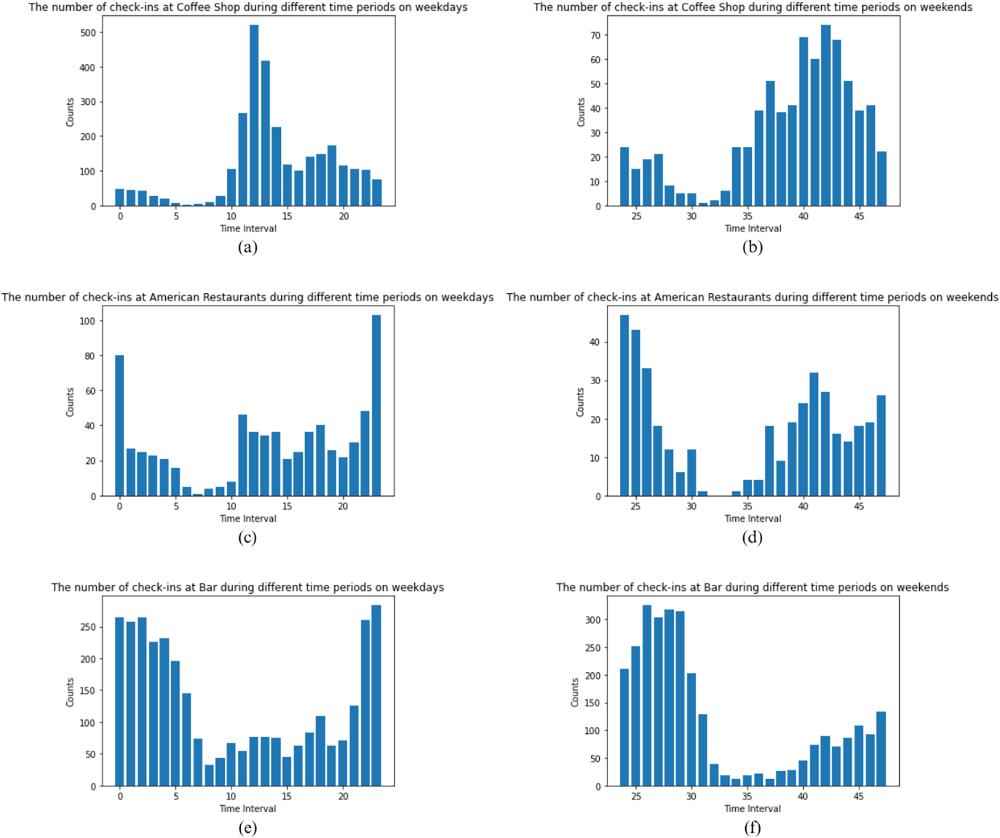
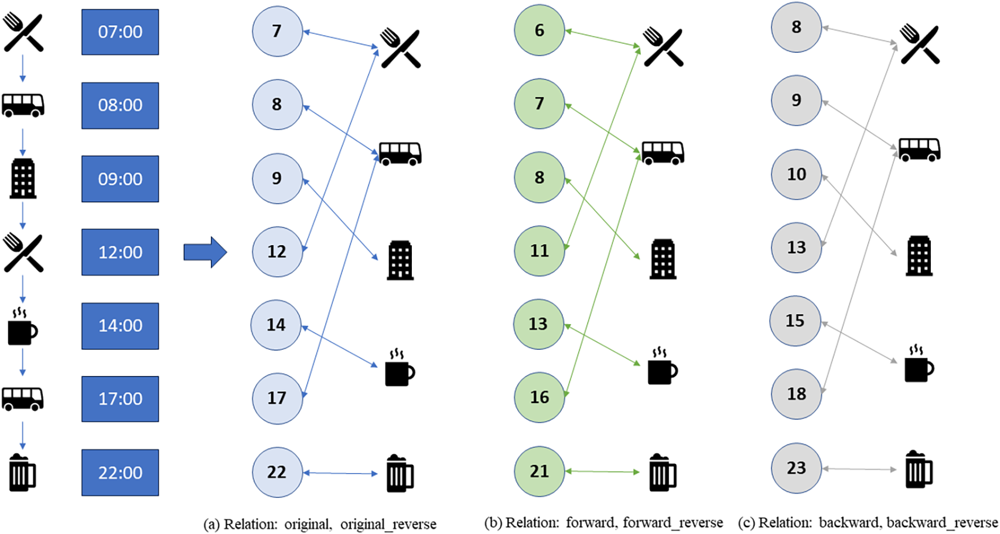
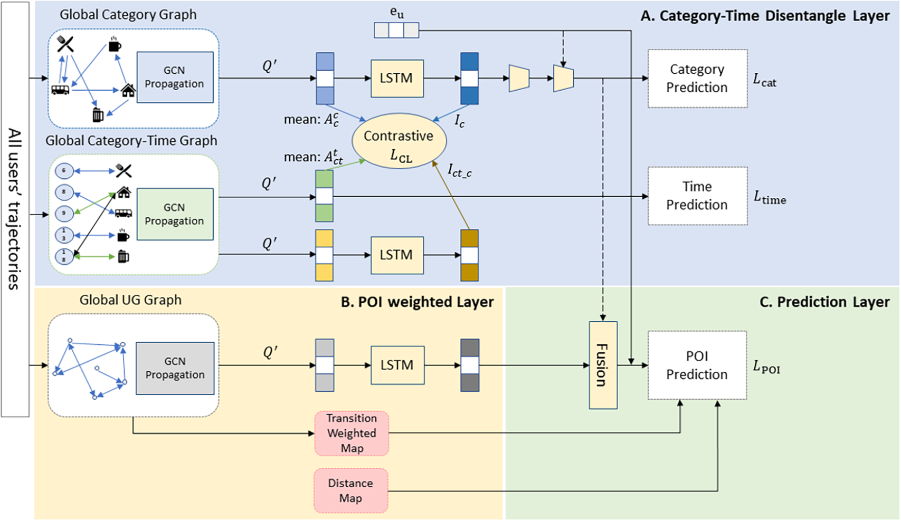
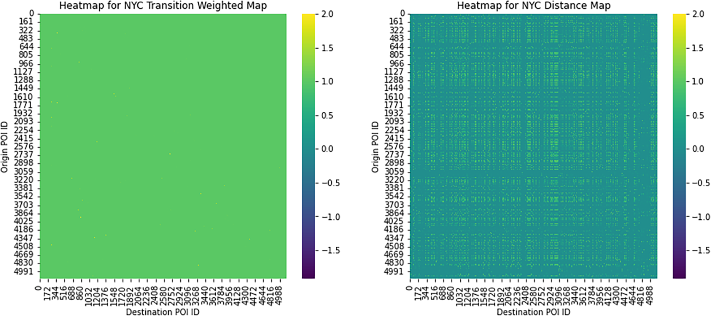
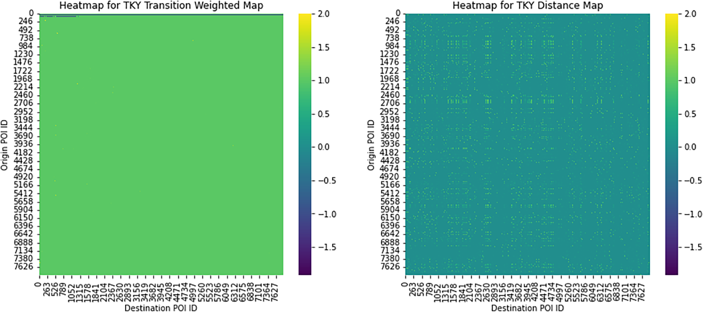
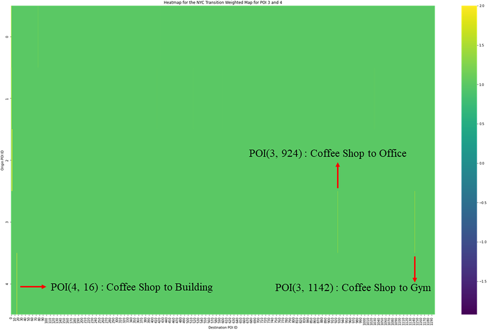
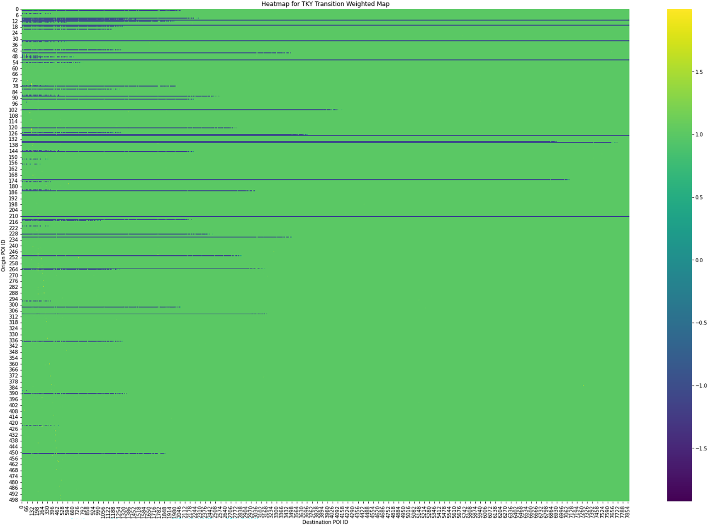
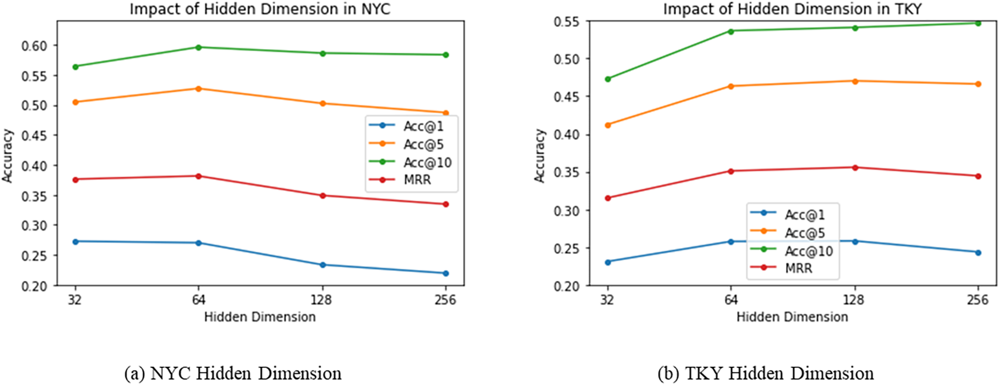
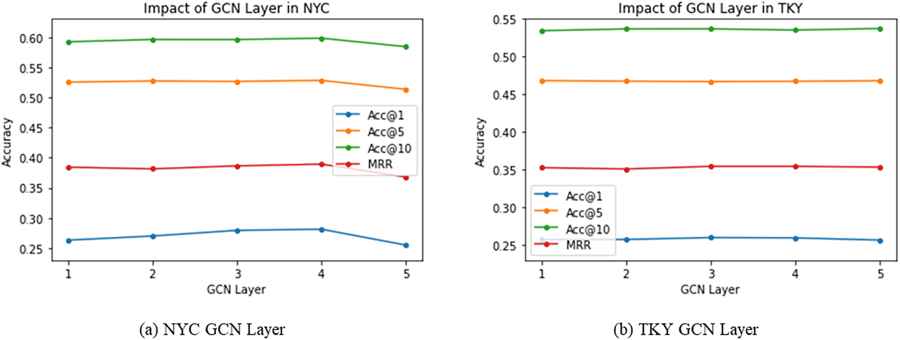

# Enhancing POI Recommendation through Global Graph Disentanglement with POI Weighted Module

PEI-XUAN LI, CHENG-RU CHOU, and WEI-YUN LIANG, Department of Electrical Engineering, National Cheng Kung University, Tainan, Taiwan FANDEL LIN, University of Southern California, Los Angeles, California, USA HSUN-PING HSIEH, Department of Electrical Engineering, National Cheng Kung University, Tainan, Taiwan, Academy of Innovative Semiconductor and Sustainable Manufacturing, National Cheng Kung University, Tainan, Taiwan, and Institute of Communications Engineering, National Cheng Kung University, Tainan, Taiwan Next Point of Interest (POI) recommendation primarily predicts future activities based on users’ past checkin data and current status, providing significant value to users and service providers. We observed that the popular check-in times for different POI categories vary. For example, coffee shops are crowded in the afternoon because people like to have coffee to refresh after meals, while bars are busy late at night. However, existing methods rarely explore the relationship between POI categories and time, which may result in the model being unable to fully learn users’ tendencies to visit certain POI categories at different times. Additionally, existing methods for modeling time information often convert it into time embeddings or calculate the time interval and incorporate it into the model, making it difficult to capture the continuity of time. Finally, during POI prediction, various weighting information is often ignored, such as the popularity of each POI, the transition relationships between POIs, and the distances between POIs, leading to suboptimal performance. To address these issues, this article proposes a novel next POI recommendation framework called Graph Disentangler with POI Weighted Module (GDPW). This framework aims to jointly consider POI category information and multiple POI weighting factors. Specifically, the proposed GDPW learns category and time representations through the Global Category Graph and the Global Category-Time Graph. Then, we disentangle category and time information through contrastive learning. After prediction, the final POI recommendation for users is obtained by weighting the prediction results based on the transition weights and distance relationships between POIs. We conducted experiments on two real-world datasets, and the results demonstrate that the proposed GDPW outperforms other existing models, improving performance by 3% to 11%.

CCS Concepts: • Information systems → Data mining; • Computing methodologies → Artificial intelligence;

This work was partially supported by National Science and Technology Council (NSTC) of Taiwan under Grants 114-2628-E-006-005-MY3 and 112-2221-E-006-150-MY3. Authors’ Contact Information: Pei-Xuan Li, Department of Electrical Engineering, National Cheng Kung University, Tainan, Taiwan; e-mail: n28121107@gs.ncku.edu.tw; Cheng-Ru Chou, Department of Electrical Engineering, National Cheng Kung University, Tainan, Taiwan; e-mail: n26140870@gs.ncku.edu.tw; Wei-Yun Liang, Department of Electrical Engineering, National Cheng Kung University, Tainan, Taiwan; e-mail: n26110647@gs.ncku.edu.tw; Fandel Lin, University of Southern California, Los Angeles, California, USA; e-mail: fandel.lin@usc.edu; Hsun-Ping Hsieh (corresponding author), Department of Electrical Engineering, National Cheng Kung University, Tainan, Taiwan, Academy of Innovative Semiconductor and Sustainable Manufacturing, National Cheng Kung University, Tainan, Taiwan, and Institute of Communications Engineering, National Cheng Kung University, Tainan, Taiwan; e-mail: hphsieh@mail.ncku.edu.tw.

This work is licensed under Creative Commons Attribution International 4.0.

© 2026 Copyright held by the owner/author(s). ACM 2157-6912/2026/4-ART70 https://doi.org/10.1145/3795517 70:2 P.-X. Li et al.

Additional Key Words and Phrases: Point-of-Interest, Graph Neural Networks, Disentangler, Recommender System ACM Reference format: Pei-Xuan Li, Cheng-Ru Chou, Wei-Yun Liang, Fandel Lin, and Hsun-Ping Hsieh. 2026. Enhancing POI Recommendation through Global Graph Disentanglement with POI Weighted Module. ACM Trans. Intell. Syst. Technol. 17, 3, Article 70 (April 2026), 24 pages. https://doi.org/10.1145/3795517

## 1 Introduction

Location-Based Services have advanced significantly due to the proliferation of GPS systems and ride-sharing applications. Apps like Gowalla, Yelp, and Foursquare enable users to share experiences at Points of Interest (POIs), generating large amounts of spatio-temporal data. These kinds of data can be leveraged to create the next POI recommendation system [6], which predicts a user’s destination based on their check-in history. Such a system can assist users in exploring new places and enhancing their overall experience.

Traditional methods [12, 24] capture the transition relationships between POIs. Later on, Recurrent Neural Networks (RNNs) and attention-based models emerged. The former approaches, including Long Short-Term Memory (LSTM) and Gated Recurrent Unit, have memory mechanisms that retain both long-term and short-term information while integrating temporal and spatial information. The latter approaches use Transformer [29] extensively to learn the connection between check-ins [36, 39]. Along with utilizing sequential models to capture information, graph-based methods can take into account the geographic relationships between POIs and use Graph Neural Networks (GNNs) to learn POI representations. Given the superior performance of graph-based methods in existing research, this article centers on employing a graph-based approach. Although previous graph-based methods have achieved promising results, they still suffer from limitations that may lead to suboptimal performance. One notable limitation is their tendency to overlook the relationship between POI categories and time.

Firstly, POI categories and time are strongly correlated. For instance, Figure 1 analyzes the number of check-ins for three different categories across various time periods, with separate calculations for weekdays and weekends. Figure 1(a) and (b) shows the “Coffee Shop” category, where check-ins are concentrated around midday and afternoon, indicating that people might habitually drink coffee to stay alert after lunch or meet friends at coffee shops. Figure 1(c) and (d) shows the “American Restaurants” category, with check-ins peaking during dinner hours. Figure 1(e) and (f) shows the “Bar” category, with check-ins concentrated in the late-night hours. The data analysis results indicate that behavioral patterns can vary significantly across different times of the day. However, existing methods [36, 39, 43, 45] rarely study the relationship between POI categories and time, which may result in models failing to learn the temporal dependencies of user behaviors. Although category and time are correlated, modeling them as a single combined feature may lead to overly specific patterns that lack generalization. Traditional time-aware sequential models (e.g., RNN or attention-based architectures) typically encode time and category information within a shared latent space, which can cause entanglement—dominant categories may distort the temporal patterns of less frequent ones. To address this, our model disentangles the learning of time and category representations and aligns them via contrastive learning, preserving category-specific temporal dynamics while maintaining inter-category correlations.

Secondly, temporal information is primarily incorporated by converting POI check-in times into 24 or 48 time slots, or by calculating the time intervals between check-ins and integrating them into Enhancing POI Recommendation through Global Graph Disentanglement 70:3

*Fig. 1. Analysis of check-in numbers for POI categories at different time slots.*

the model [37, 39]. Although these methods capture temporal information, they only consider the current time context and overlook temporal continuity. Previous research [21] constructed graphs using time information and connected adjacent time nodes, using Graph Convolutional Networks (GCNs) [11] to propagate information between categories and time. This method of connecting each time node to adjacent time points may cause the model to process unnecessary temporal information, leading to suboptimal performance. Finally, POIs contain a wealth of information, such as the popularity of each POI, the transition weights (i.e., sequential information) between POIs, and the distances between them. Previous methods [36, 39] have not fully leveraged these information, often incorporating only the count of paired check-ins into the model, without considering the inherent popularity of each POI. Besides, Xu et al. [36] use the inverse of the distance between POIs as the edge weight in a geographical graph, but they overlook the significant impact of the last check-in location on predicting the next potential POI. To address this, we proposed a POI weighted layer to model these information.

In this study, we propose the Graph Disentangler with POI Weighted Module (GDPW) to tackle these challenges. The model consists of three main components: (1) the Category-Time Disentangle Layer, (2) the POI Weighted Layer, and (3) the Prediction Layer. Firstly, to effectively obtain accurate category and time representations and to disentangle the complex category and time information in the original data, we propose the Category-Disentangle Layer. We learn category 70:4 P.-X. Li et al.

and time representations by constructing a Global Category Graph and a Global Category-Time Graph. Next, we disentangle category and time information to help the model learn the user’s time dependencies. To consider the rich information of POIs, such as the popularity of POIs, transition weights, and the distance between POIs, we add a module, POI Weighted Layer, to the model. The module incorporates the popularity of POIs when constructing the Global Universal Gravity (UG) Graph, while the Transition Weighted Map (TM) calculates the transition weights between POIs to summarize the sequence information of the user’s movement between POIs. In addition, Distance Map (DM) calculates the distance between them. Finally, the Prediction Layer makes predictions and applies weighting using the DM and TM to the predicted results to summarize all the information.

Our key contributions are summarized as follows:

—We propose GDPW, a novel model that integrates POI categories and temporal information into a single graph, enabling category embeddings to capture temporal dependencies more effectively. —GDPW employs disentanglement techniques to separate and enhance the learning of both POI category and temporal information, improving the model’s ability to capture distinct influences on user mobility patterns. —We introduce a POI weighting mechanism that considers POI popularity, transition weights, and distances, allowing the model to prioritize locations with higher check-ins and those closer to the user, thereby refining recommendation accuracy. —Extensive experiments on two real-world datasets demonstrate that GDPW outperforms existing methods, achieving an overall improvement of 3%–11% in both evaluation metrics.

The rest of this article is structured as follows: Section 2 provides a brief overview of related work. In Section 3, we define the next POI recommendation problem and present the notations used. Section 4 introduces the proposed GDPW model, detailing the design and functionality of each module. Section 5 presents extensive experiments to assess the effectiveness of GDPW, followed by conclusions and future directions in Section 6.

## 2 Related Works

### 2.1 Next POI Recommendation

Next POI recommendation task involves predicting the most likely location a user will visit next by analyzing their recent or past movement patterns. Early research primarily utilized non-deep learning methods such as Markov chains [2, 3, 26], Collaborative Filtering [8, 41], and Matrix Factorization (MF) [12, 15, 18, 27]. However, these methods have significant deficiencies. They rely on local information, fail to capture overall trends and high-order patterns, and often suffer from sparsity and cold-start problems.

Nowadays, researchers utilize deep learning models, especially RNNs and LSTMs, to address the next POI recommendation problem, capturing higher-level sequential correlations [17, 28, 33, 34, 46]. For instance, ST-RNN [17] utilizes time and distance-specific transition matrices to more effectively capture spatio-temporal contexts. DeepMove [5] utilizes RNNs to learn long-term relationships while employing a historical attention module to identify which historical activities are more important. STAN [19] uses self-attention layers and a spatio-temporal relation matrix to learn POI correlations, demonstrating the importance of non-adjacent POIs for recommendation results. However, these approaches rely solely on sequential models for the next POI recommendation, overlooking the need to learn movement patterns and POI distributions from a global perspective.

In terms of research on POI categories, previous studies [45] directly transformed POI categories into embeddings integrated into the model without incorporating time-related information. Some Enhancing POI Recommendation through Global Graph Disentanglement 70:5 methods [36, 39, 43] convert POI categories and time into separate embeddings, but this approach fails to fully capture the temporal dependencies of user behavior. Additionally, some methods use personalized approaches [21] to handle the correlation between POI categories and time; however, they consume significant computational resources.

Recent studies also have explored using Large Language Models (LLMs) to perform next POI recommendation in a zero-shot or prompt-based manner. For example, LLMmove [7] and LLM4POI [14] demonstrate that foundation LLMs can capture user mobility patterns and produce competitive next-location predictions without additional training. These approaches highlight the strong generalization and reasoning capabilities of LLMs when modeling sequential human behavior. However, LLM-based POI recommendations typically require substantial computational resources due to long natural-language prompts and large model sizes, making them less practical for deployment in resource-constrained or latency-sensitive settings such as mobile or urban-sensing applications. In contrast, our model is specifically designed for structured check-in sequences and focuses on efficiently disentangling category and temporal signals through graph-based modeling. This provides a more controllable and computationally manageable solution, while remaining complementary to LLM-based reasoning approaches.

### 2.2 Graph-Based POI Recommendation

In recent years, graph-based models have achieved promising results, including Geographical- Temporal Influence Aware Graph (GTAG) [44], GE [35], GSTN [31], STP-UDGAT [16], GETNext [39], and MobGT [36]. Yuan et al. [44] proposed the GTAG, composed of user, session, and POI nodes. However, a large number of nodes can make the graph too large, resulting in low processing efficiency. Unlike GTAG, Xie et al. [35] constructed four bipartite graphs, including POI-Region, POI-POI, POI-Time, and POI-Word, to learn geographical, sequential, temporal, and semantic information, respectively. GSTN [31] uses transition-based and distance-based graphs to capture spatial information and designs a Time-LSTM to learn temporal information. STP-UDGAT [16] constructs spatial, temporal, and preference graphs, but using the reciprocal of time as the edge weight may not effectively capture temporal information. GETNext [39] uses check-in data from all users to construct POI transition graphs and employs a Transformer to learn the relationships between sequences. MobGT [36] integrates distinct spatial and temporal graph encoders to capture unique features and global user-location relationships. It also includes a graph-based transformer mobility encoder to extract high-order relationships between POIs. While the above graph-based methods have achieved promising results, none of them simultaneously consider both the popularity and distance of POIs within the graph, and few take temporal continuity into account.

### 2.3 Disentangle Representation Learning

Disentangle Representation Learning [1] seeks to extract distinct explanatory representations from intertwined latent factors. For example, MacridVAE [20] employs Variational Auto-Encoders (VAEs) to encode items via disentangled prototypes, aiming to decompose user interactions from both macro and micro levels to capture user preferences regarding different intentions. CLSR [47] uses disentanglement techniques to separate long-term and short-term interests. DRAN [30] constructs graphs based on distance and transition, and uses the proposed DGCN to model different aspects of POIs while learning POI representations. DisenPOI [23] posits that the Geographical Graph and Sequential Graph contain intertwined information, and aims to use disentanglement techniques to aid in learning. CLSPRec [4] captures both long-term and short-term behavior sequences of users, ensuring simplicity while capturing consistent features across different time periods. DCHL [13] disentangles user preferences across collaborative, transitional, and geographical aspects using hypergraph structures, while leveraging cross-view contrastive learning to 70:6 P.-X. Li et al.

model cooperative associations. SD-CEM [10] improves POI category embedding by leveraging hierarchical category structures and disentangled mobility sequences, using an attention-based hierarchy-enhanced embedding method and pretext tasks. CDLRec [40] leverages contrastive learning and structure causal models to disentangle causal and confounding representations, using uniform data as a supervision signal to enhance unbiased user and item representations, improving debiased recommendation performance. DIG [22] proposed a disentangled representation learning approach to separate user interest and geographical factors, leveraging a geo-constrained negative sampling strategy and a geo-enhanced soft-weighted loss function to improve performance. Different from prior research, we constructed category graphs and category-time graphs, leveraging disentanglement to learn representations of category and time.

## 3 Preliminaries

### 3.1 Problem Formulation

Let 푈 = {u1, u2, . . . , u|푈 |} be a set of |푈 | users, 푃 = {p1, p2, . . . , p|푃|} be a set of |푃| POIs, and 퐶 = {c1, c2, . . . , c|퐶|} be a set of |퐶| categories. Each location 푝 ∈ 푃 is represented as a tuple 푝 = ⟨lat, lon, cat⟩ of latitude, longitude, and category. Furthermore, let푇 = {푡1,푡2, . . . ,푡|푇 |} represent the check-in times.

—A check-in can be represented as a tuple 푠 = ⟨푢, 푝,푡⟩∈ 푆푈 , indicating that user 푢 visited POI 푝 at timestamp 푡. —Given a user 푢 ∈ 푈 , all check-in activities can form a check-in sequence 푆푢 = (푠푢 1,푠푢 2,푠푢 3, . . . ), where 푆푢 is ordered by timestamp 푡, and 푠푢 푖 is the 푖th check-in record. —Denote the check-in sequence of all users as 푆푈 = {푠푢1,푠푢2, . . . ,푠푢|푈| }. In the realm of data processing, we isolate consecutive check-in records that surpass a specified time interval (e.g., 24 hours) in the check-in sequence 푆푢 of any user 푢 into a set of consecutive trajectories, where 푆푢 = {푄푢 1,푄푢 2, . . . }. —The goal of the next POI recommendation is to predict the next POI that a user 푢 might visit by learning from their current trajectory and the historical check-in records of all users. It provides a list of recommended POIs. To be more specific with math, given all users’ historical trajectories {푄푢 푖 } where 푖 ∈ N and 푢 ∈ 푈 , and a current trajectory 푄′ = (푠1,푠2, . . . ,푠푘) of a specific user 푢 ∈ 푈 , output the top-푛 POIs {푠1 (푘+1), . . . ,푠푛 (푘+1)} that the user 푢 is most likely to visit next.

(푘+1),푠2

### 3.2 Construction of Three Global Graphs

To better learn POI representations, we construct three graphs: Global Category Graph, Global Category-Time Graph, and Global UG Graph, to learn information about category, time, and spatial aspects. All graphs are constructed with a global view.

3.2.1 Global Category Graph. We use global category graph to describe the relationships of POI categories. The directed category-category graph 퐺푐 = {푉푐, 퐸푐,퐴푐} is built upon the category of POIs, denoted as 퐶. A directed edge 푒푐 = (푐푖,푐푗) ∈ 퐸푐 indicates that there is a check-in from category 푐푖 to category 푐푗. We connect each directed category pair based on all users’ trajectories 푄푈 . The edge weight matrix 퐴푐 (푖, 푗) between each pair represents the frequency of category pair occurrences.

3.2.2 Global Category-Time Graph. To capture the relationship between category and time patterns, we propose a Global Category-Time Graph, which is constructed as a heterogeneous graph to record the visiting time for different categories across users. First, we need to convert continuous time to discrete intervals. We discretize check-in times into 48 intervals to differentiate Enhancing POI Recommendation through Global Graph Disentanglement 70:7 activities in weekdays and weekends: 0–23 for weekdays, and 24–47 for weekends, respectively. The set of time slots is denoted by 푇48. The Global Category-Time Graph is denoted as 퐺푐푡.

In the Global Category-Time Graph, categories and times are represented by category nodes 푐 ∈ 퐶 and time nodes 푡 ∈ 푇48. Here, 퐶 is the category node set, and 푇48 is the time node set. These two types of nodes are connected by six relations of weighted directed edges: 퐸푐푡표, 퐸푡푐표, 퐸푐푡푓 , 퐸푡푐푓 , 퐸푐푡푏, and 퐸푡푐푏, where 퐸(푋,푌,푅) denotes the sets of edges from nodes in set 푋 to nodes in set 푌, and 푅 denotes the relationship between 푋 and 푌. Here, 표 stands for “original,” 푓 stands for “forward,” and 푏 stands for “backward” in relation 푅.

Next, we will explain how the edge weights are set in the Global Category-Time Graph and the rationale behind this design. To enable the model to learn the concept of continuous time, we divided the edges in the Global Category-Time Graph into three types: original (representing the current time point), forward (representing the previous time point), and backward (representing the next time point).

—Weights of Edges in the Original Relation: The relationship that “original” aims to capture is the category of the check-in and their corresponding time slots. An edge 푒푐푡표 = (푐푖,푡푖) ∈ 퐸푐푡표 indicates that there is a check-in of category 푐푖 at time 푡푖. The edge weight between category and time is the frequency of category-time pair occurrences. The adjacency matrix for this relationship is denoted as 퐴표 푐푡. —Weights of Edges in the Forward Relation: The “forward” relationship aims to record the checkin category and the preceding time slot of the check-in. An edge 푒푐푡푓 = (푐푖,푡푖) ∈ 퐸푐푡푓 indicates that the check-in category 푐푖 occurred at the forward time 푡푖. The edge weight between category and time is the frequency of category-time pair occurrences. The adjacency matrix for this relationship is denoted as 퐴푓 푐푡. —Weights of Edges in the Backward Relation: The “backward” relationship aims to record the check-in category and the subsequent time slot of the check-in. An edge 푒푐푡푏 = (푐푖,푡푖) ∈ 퐸푐푡푏 indicates that the check-in category 푐푖 occurred at the backward time 푡푖. The edge weight between category and time is the frequency of category-time pair occurrences. The adjacency matrix for this relationship is denoted as 퐴푏 푐푡.

The remaining three types of edges are reverse edges, all pointing from time to category. By connecting the current time slot, the previous time slot, and the next time slot, the category can learn the continuity of time. Figure 2 illustrates how the Global Category-Time Graph is constructed. For example, when a user visits a restaurant at 7 AM, the original and original_reverse relations will create an edge between the category “Restaurant” and the time slot “7” in the Global Category-Time Graph. The forward and forward_reverse relations will connect the category “Restaurant” with the previous time slot “6,” while the backward and backward_reverse relations will link the category “Restaurant” to the next time slot “8.”

3.2.3 Global UG Graph. Based on our findings, users tend to prefer POIs that are closer rather than those that are farther away. Additionally, most POIs have fewer than 50 check-ins, indicating that check-ins are concentrated at specific POIs. For example, in the Foursquare New York City dataset, check-ins are focused on landmarks such as Madison Square Park, John F. Kennedy International Airport, Union Square Park, and Times Square. In contrast, in the Foursquare Tokyo dataset, check-ins are concentrated at major train stations like Ikebukuro Train Station, Tokyo Train Station, and Shinjuku Train Station.

To simultaneously consider these two pieces of information, we propose the Global UG Graph 퐺푢푔 = {푉푢푔, 퐸푢푔,퐴푢푔}, where the set of nodes 푉푢푔 (POIs) is represented by 푃. An undirected edge between 푝푖 and 푝푗 indicates a record transmitted from 푝푖 to 푝푗. The edge weight matrix 퐴푢푔(푖, 푗)

70:8 P.-X. Li et al.

*Fig. 2. Global Category-Time Graph.*

represents the value of Newton’s law of universal gravitation calculated between 푝푖 and 푝푗. The formula is as follows:

퐴푢푔(푖, 푗) = 퐺푀푚 푟2 + 휖 , (1)

where:

—퐺: Frequency of a POI pair (푝푖, 푝푗) across all trajectories. —푀: 푝푖’s check-in counts in all trajectories. —푚: 푝푗’s check-in counts in all trajectories. —푟2: Haversine distance [32] between 푝푖 and 푝푗. —휖: A constant added to avoid a zero denominator, which we set to 1.

## 4 Framework

### 4.1 Overview

In Figure 3, we present the overall architecture of GDPW, which can be divided into three main parts: (1) Category-Time Disentangle Layer primarily focuses on disentangling category and time representations; (2) The POI Weighted Layer learns representations about POIs and constructs the TM and DM to calculate transition weights and the distances between POIs, converting the rich information in POIs into embeddings; (3) The Prediction Layer conducts predictions and weights the results using the TM and DM to integrate all the information.

### 4.2 Category-Time Disentangle Layer

In this section, we introduce how data propagates on the Global Category Graph and Global Category-Time Graph by GCNs, and disentangle category representations and time representations through contrastive learning.

4.2.1 Global Category Graph Propagations. In this part, we use GCNs [11] to obtain the POI category representations. Given the Global Category Graph 퐺푐, where the nodes consist of POI Enhancing POI Recommendation through Global Graph Disentanglement 70:9

*Fig. 3. The architecture of GDPW framework.*

categories and the edge weights are defined by the frequency of category transitions across all users, the subsequent step is to learn the representation of categories. To accomplish this, we employ a GCN to learn POI representations, which is also the predominant method used for learning in most graph-based POI recommendation models. We first compute the Random Walk normalized Laplacian as:

퐿˜ = 퐼 − 퐷−1 where 퐴푐 is the adjacency matrix, and 퐷푐 is the degree matrix of 퐺푐. Next, let 퐻 (0) = 푋푐 be the input node feature matrix of the GCN, where 푋푐 denotes features about the total number of data entries for this category and the total number of stores for this category. The following formula is the GCN propagation method:

퐻 (푙+1) = 휎  where 퐻 (푙) is the embedding of the 푙th layer, 푊 (푙)

ℎ(푙+1)

h 푟푑푠푡 = dst 푑푠푡 = AGG푟∈푅 푐 퐴푐, (2)

퐿퐻˜ (푙)푊 (푙)

푐 + 푏(푙)

 , (3)

푐 푐 is the learnable weight matrix of layer 푙, 푏(푙)

푐 is the bias term of layer 푙, and 휎 is the activation function ELU. After passing through an 퐿-layer GCN, we then obtain output category representations as 푒푐. Therefore, for each category in each trajectory 푄′, it is represented by a list of representations 퐸푐   ′푐 1 , . . . ,푒 ′푐 푘 푒 .

푐 = 4.2.2 Global Category-Time Graph Propagations. The Global Category-Time Graph is a heterogeneous graph with six relations of edges, including original, forward, backward, original_reverse, forward_reverse, and backward_reverse. For each relation, we utilize GCN for learning and processing each type of relationship using the Random Walk Laplacian. We allow messages from source nodes to propagate along different relationships to destination nodes and aggregating information from different relationships to update features for the same target node. The formula is as follows:

푔푟,ℎ(푙)

푟푠푟푐,ℎ(푙)

  i 푓푟 , (4)

푟푑푠푡 70:10 P.-X. Li et al.

where dst is the destination node, 푓푟 is the GCN function applied to each relationship as detailed in Equation (3), and AGG is the aggregation function applied at the destination node. After passing through the GCN, we obtain the category representations 푒푐푡푐 and time representations 푒푐푡푡 . For each trajectory푄′, we obtain category representations 퐸푐 ′ (푐푡푡 ) 1 , . . . ,푒 ′ (푐푡푡 ) 푘   퐸푡 푒 .

푐푡 = Inspired by previous work on self-supervised disentanglement learning [21, 23, 47], we use contrastive learning methods to perform disentanglement operations. Contrastive learning is a self-supervised learning technique where a model learns to differentiate between similar and dissimilar data points. The core idea is to bring similar samples (positive pairs) closer in the learned representation space while pushing dissimilar samples (negative pairs) apart.

푐 = 1 푎푐 푘 푘 Õ 푐푡 =1 푎푡 푘 푖=1 where 푎푐 푐 carries category transition information, while 푎푡 푐푡 carries category information related to time.

Regarding the two sets of representations to be learned, we don’t directly disentangle them. Instead, they first go through two different sets of LSTM to learn the temporal relationships and get hidden states ℎ푐 푛 and ℎ(푐푡푐)

푛 as follows:

 ℎ푐 ′푐 푖 ,ℎ푐 푒 푛 = LSTM (푖−1)

′ (푐푡푐) 푖 ,ℎ(푐푡푐)

ℎ(푐푡푐)

 푒 푛 = LSTM (푖−1)

After obtaining hidden states, we project the hidden states and proxies into another dimension according to previous work [21, 23] to reduce noise, as follows:

퐼푐 = 푊1ℎ푐 퐼(푐푡푐) = 푊2ℎ(푐푡푐)

퐴푐 푐 = 푊3푎푐 퐴푡 푐푡 = 푊4푎푡 ′ (푐푡푐) 1 , . . . ,푒 ′ (푐푡푐) 푘   푒 and time representations 푐푡 = 4.2.3 Category-Time Disentangler. Both category representations 푒푐 from the Global Category Graph and 푒푐푡푐 from the Global Category-Time Graph are associated with category transitions and time. To enable the model to learn the relationships between different POI categories and time, we use a disentangling method to aid in the learning process.

The Category-Time Disentangler is illustrated as the upper half of Figure 3. We generate proxies from the graph, with each proxy carrying information about its corresponding category or time features from the graph. Two proxies are generated by averaging 퐸푐 푐푡 and 퐸푡 푐푡 as follows:

푘 Õ ′푐 푖 , (5)

푒 푖=1 ′ (푐푡푡 ) 푖 , (6)

푒  , 푖 ∈{1, 2, . . . ,푘}, (7)

 , 푖 ∈{1, 2, . . . ,푘}, (8)

푛, (9)

푛 , (10)

푐, (11)

푐푡, (12)

where 푊1, 푊2, 푊3, and 푊4 are linear transformations with trainable parameters.

We use contrastive learning to disentangle the information between proxies and given representations. In other words, we treat representations from the same graph as positive samples and representations from different graphs as negative samples [21, 23]. Then, we employ contrastive Enhancing POI Recommendation through Global Graph Disentanglement 70:11 learning loss with the following formulation:

퐿퐶퐿 = 퐹 (퐴푐 푐, 퐼푐, 퐼(푐푡푐)) + 퐹 (퐴푡 where ⊙ denotes the inner product and 퐹 (·) denotes the Bayesian Personalized Ranking loss [21, 23, 25, 47]. The formula is as follows:

As mentioned previously, we expect the the global category graph representation to be similar to its proxy vectors as well as dissimilar to global category-time graph representation, and vice versa.

4.2.4 Auxiliary Prediction. To help the model learning more effectively, we use the above information to predict category and time as auxiliary task after learning and disentangling the category and time representations. To capture each user’s behavior, we also consider user identification by projecting the information into a low-dimensional vector to obtain user embeddings 푒푢.

For the category prediction part, we concatenate hidden states obtained from LSTM ℎ푐 푛 and user embeddings 푒푢. Then, we adopt multilayer perceptron models as the prediction layer to predict the POI category. The formulas are as follows:

 ℎ푐 푒cat = 푊fuse1 where 푊fuse1, 푊cat and 푏fuse1, 푏cat are learnable weight and bias, respectively. In the time prediction aspect, we use the time representations from the Global Category-Time Graph 퐸푡 푐푡 to perform the prediction. Additionally, since users’ behavior may vary throughout the day, we encode the day of the week into week embeddings 푒푤 and perform time prediction. The prediction formula is as follows:

퐸푡 푦ˆtime = 푊time where 푊time and 푏time are learnable weight and bias.

### 4.3 POI Weighted Layer

To make the most of the wealth of information in POI data, we learn the POI representations using the Global UG Graph, and then we utilize the TM and DM to weight the results.

4.3.1 Global UG Graph Propagations. Once the category and time information have been disentangled, we move on to capturing the correlations between POIs using GCN [11]. Given the undirected Global UG Graph 퐺푢푔, with edge weight defined by Newton’s law of universal gravitation, we can compute the normalized Laplacian matrix as follows:

퐿˜ = 퐼 − 퐷−1/2 where 퐴푢푔 represents the adjacency matrix and 퐷푢푔 represents the degree matrix of 퐺푢푔.

퐻 (푙+1) = 휎  where 퐻 (푙) is the information of the 푙th layer, 푊 (푙)

푢푔 is the bias term of layer 푙, and 휎 is the activation function ELU. After going through 퐿-layer GCN, we obtain UG representations 푒푢푔. For each trajectory 푄′, we obtain POI representations 퐸푝 푐푡, 퐼(푐푡푐), 퐼푐), (13)

퐹 (pro, pos, neg) = Softplus (⟨pro ⊙ neg⟩−⟨pro ⊙ pos⟩). (14)

푛, ℎ(푐푡푐)

푛∥ℎ(푐푡푐)

 + 푏fuse1, (15)

푛 푦ˆcat = 푊cat (푒cat∥푒푢) + 푏cat, (16)

 + 푏time, (17)

푐푡 ∥푒week 푢푔 퐴푢푔퐷−1/2 푢푔 , (18)

Let 퐻 (0) = 푋푢푔 be the input node feature matrix for the GCN, where 푋푢푔 consists of latitude, longitude, category, and frequency. The following is the GCN propagation method:

퐿퐻˜ (푙)푊 (푙)

푢푔 + 푏(푙)

 , (19)

푢푔 푢푔 is the weight matrix of layer 푙, 푏(푙)

푒푝 1, . . . ,푒푝 푘   .

푝 = 70:12 P.-X. Li et al.

ℎ푝 푒푝 푖 ,ℎ푝  푛 = LSTM (푖−1)

where ℎ푝 푛 is the hidden state of 퐸푝 푝 obtained from LSTM.

푇푀 = (휑1 × 1푇 + 1 × 휑푇 where 푊푡푝1 and 푊푡푝2 are two transformation matrices, 푎1 and 푎2 are learnable vectors, 1 is an all-ones vector, 퐽푁 is the matrix of ones, and ⊙ denotes element-wise multiplication.

[0, 1].

The DM 퐷푀(푖, 푗) is defined as:

−푑푖푠(푖,푗)2  2휎2  ( exp 퐷푀(푖, 푗) = where 푑푖푠(푖, 푗) is the distance between POIs 푝푖 and 푝푗, 휎 is the bandwidth parameter of the Gaussian kernel function, which is set to 1. This parameter controls the spread or smoothness of the Gaussian kernel function. A smaller value of 휎 leads to faster decay, meaning that only POIs that are close together will exhibit significant affinity.

### 4.4 Prediction Layer

4.4.1 POI Prediction. After obtaining the POI hidden states ℎ푝 The attention weights for category representations are computed as:

푛 = softmax(푒푐푎푡)푖 = exp(푒푐푎푡)푖 Í푘 푊 푐 The same approach applies to both the Global Category Graph and the Global Category-Time Graph. After propagation, we utilize an LSTM to learn the temporal relationships of 퐸푝 푝:

 , 푖 ∈{1, 2, . . . ,푘}, (20)

4.3.2 TM. While the Global UG Graph can learn POI representations, we have observed that the previous POI visited significantly influences the selection of the next POI. This sequential dependency plays a crucial role in user movement patterns and should be considered in the model. To incorporate this dependency, we employ the Transition Attention Map from GETNext [39]. In GETNext, the authors argue that using a graph alone can only capture potential user movement information, so they introduced the Transition Attention Map to enhance this information. Similarly, we aim to use this module to calculate the transition weight between POIs. Given the input node features 푋푢푔 and 퐺푢푔, we compute the TM as follows:

휑1 = (푋푢푔 ×푊푡푝1) × 푎1 ∈ R|푃|×1, (21)

휑2 = (푋푢푔 ×푊푡푝2) × 푎2 ∈ R|푃|×1, (22)

2 ) ⊙( ˜퐿 + 퐽푁 ) ∈ R|푃|×|푃|, (23)

4.3.3 DM. Based on our observations, we found that the spatial interval between two POI transitions is often within a certain range. Although we have a Global UG Graph and a TM to learn POI spatial information, these methods do not effectively narrow the prediction scope. To address this issue, we propose the DM, which is a statistical method that calculates the actual distance using the Haversine formula and applies a Gaussian kernel function to limit the value to the range , 0 < 푑푖푠(푖, 푗) < Δ푑 (24)

0, otherwise, 푛 and category representations 푒푐푎푡, we employ attention mechanisms to dynamically learn the weights of these two representations, allowing us to capture information more effectively. The formulas are as follows.

. (25)

푗=1 exp(푒푐푎푡)푗 Enhancing POI Recommendation through Global Graph Disentanglement 70:13 The attention weights for POI representations are computed as:

푊 푝표푖 푛 = softmax(ℎ푝 In the POI prediction part, we fuse POI representations 푒푝표푖 and user embeddings 푒푢 to get the POI prediction as follows:

where 푊푝표푖 is learnable weights and 푏푝표푖 is the bias term. The POI representation 푒푝표푖 is obtained by adding 푟푐 and 푟푝표푖 as follows:

푘 Õ 푊 푐 푟푐 = 푖=1 푘 Õ 푟푝표푖 = 푖=1 Additionally, we combine this POI recommendation result with the TM and DM. By applying these maps to the weighting of the results, we account for the transition weight and distance relationships between POIs. Therefore, the final result is:

푌ˆ(푝표푖,푖) = 푦(푝표푖,푖) + 푇푀(푝푘)

where 푇푀(푝푘) is the 푝푘th row of the TM and 퐷푀(푝푘) is the 푝푘th row of the DM. Here, 푝푘 stands for the POI of check-in 푠푘.

4.4.2 Loss Functions. We employ cross-entropy as the loss function for POI prediction 퐿푝표푖 and category prediction 퐿푐푎푡. For time prediction, inspired by [39], we use Mean Squared Error as the loss function. The total loss is obtained by summing up these losses with the contrastive learning loss 퐿퐶퐿 obtained from Equation (13). The calculations for POI loss, category loss, time loss, and the total loss are as follows:

푃 Õ 퐿푝표푖 = − 푖=1 퐶 Õ 퐿푐푎푡 = − 푖=1 푛 Õ 퐿푡푖푚푒 = 1 푛 푖=1

## 5 Experimental Results

푖 ) = exp(ℎ푝 푖 ) Í푘 . (26)

푗=1 exp(ℎ푝 푗 )

푦ˆ푝표푖 = 푊푝표푖 (푒푝표푖 ∥푒푢) + 푏푝표푖, (27)

푒푝표푖 = 푟푐 + 푟푝표푖, (28)

푖 푒푐푎푡, (29)

푊 푝표푖 푖 ℎ푝 푖 . (30)

푖 + 퐷푀(푝푘)

푖 , (31)

푌푝표푖 log(푌푝표푖), (32)

푦푐푎푡 log(푦 ˆ푐푎푡), (33)

(푦 ˆ푡푖푚푒 − 푦푡푖푚푒)2, (34)

퐿 = 퐿푝표푖+퐿푐푎푡 + 퐿푡푖푚푒 + 퐿퐶퐿, (35)

where 푌ˆ푝표푖, 푦ˆ푐푎푡, and 푦ˆ푡푖푚푒 represent the predicted values of POI, category, and time, respectively, while 푌푝표푖, 푦푐푎푡, and 푦푡푖푚푒 represent the ground truth values of POI, category, and time.

### 5.1 Experiments Setup

5.1.1 Dataset. In our experiments, we utilized two real-world datasets, Foursquare-NYC [38] and Foursquare-TKY [38], to evaluate the effectiveness of our approach. These datasets encompass 70:14 P.-X. Li et al.

*Table 1. The Statistics of the*

Foursquare Dataset NYC TKY # User 1,083 2,293 # POI 5,130 7,870 # Category 208 190 # Check-In 104,877 361,346 # Trajectory 15,992 50,680 check-ins recorded in New York City (NYC) and Tokyo (TKY) during the period from 12 April 2012 to 16 February 2013. Each entry in these datasets comprises User identification, POI identification, category identification, timestamp, latitude, and longitude.

We preprocessed the datasets according to the settings of previous related work, GETNext [39]. We excluded POIs with fewer than 10 check-in records and users with fewer than 10 check-ins from both datasets. Subsequently, within each user’s check-in sequence, we segmented the sequence at consecutive check-ins separated by time intervals exceeding 24 hours, thereby creating the user’s check-in trajectories. Trajectories with a check-in length of less than 3 were excluded from the dataset. We partitioned the dataset into training, validation, and testing sets. The first 80% of the trajectories were allocated to the training set, the middle 10% to the validation set, and the remaining 10% to the testing set.

The Global Category Graph and Global Category-Time Graph are generated from the training set, while the Global UG Graph is created using all POIs. They are preconstructed before training and remain static during inference. As a result, they do not introduce additional computational overhead at inference time. All graph-based operations rely on sparse structures and batch-friendly matrix computations, ensuring efficiency in both training and deployment stages.

The detailed statistics of the two datasets are presented in Table 1.

5.1.2 Baselines. We employ the following baselines for comparison with GDPW:

—MF [12] is a classical method that decomposes a matrix and learns the latent representations of users and POIs. —LSTM [9] is a variant model based on RNNs, capable of simultaneously handling long and short-term dependencies. —STGCN [42] enhances the conventional LSTM by incorporating spatial gates and temporal gates, while also employing coupled input and forget gates for improved efficiency. —PLSPL [34] utilizes an attention mechanism to learn long-term interests and employs LSTM to capture short-term interests. These are then combined using personalized weights. —GSTN [31] is a graph-based recommendation model that learn the spatial-temporal similarities between POIs. —STAN [19] uses an attention mechanism to leverage spatio-temporal information from check-in sequences, capturing the interactions between non-adjacent POIs. —CLSPRec [4] uses the same Transformer model for both long and short-term modeling and utilizes contrastive learning to distinguish different users’ travel preferences. —GETNext [39] employs a global trajectory flow map with a Transformer to predict the next POI while simultaneously addressing the cold start problem.

Enhancing POI Recommendation through Global Graph Disentanglement 70:15 5.1.3 Evaluation Metrics. Following GETNext [39], we utilize Accuracy@k (Acc@k) and Mean Reciprocal Rank (MRR) to evaluate the model. Acc@k measures the proportion of correctly predicted items among the top-푘 recommended items. To gain a better understanding of the position of the correct label, we also adopt MRR, which measures the quality of recommendations by considering the reciprocal of the rank of the first relevant item in the list.

Given a dataset with 푚 samples, define Acc@k and MRR as:

푚 Õ Acc@k = 1 (1 if rank ≤ 푘 else 0), (36)

푚 푖=1 푚 Õ MRR = 1 1 rank. (37)

푚 푖=1 Both evaluation metrics indicate that a higher score represents better model performance.

5.1.4 Experiments Settings. The key hyper-parameter settings in our model are listed below: We employ Adam as the optimizer with a learning rate of lr = 0.0002. The dimensions of all embeddings are set to 푑 = 64, and the number of GCN layers 푙 is set to 2. We set Δ푑 in the DM to 5 km. For baseline reproduction, we follow the official implementation and default configurations provided by each method. In particular, the GETNext baseline was reimplemented using the released code and carefully tuned.

### 5.2 Performance Comparison

Tables 2 and 3 show the comparison between GDPW and baseline models on two datasets. The results show that our model shows improvements on both datasets compared to the baselines. In the NYC dataset, Acc@1 increased by roughly 6% and MRR by around 3% compared to the best baseline, GETNext. In the TKY dataset, Acc@1 saw an improvement of about 11%, with MRR rising by approximately 6% compared to GETNext. To validate the reliability of our performance improvements, we conducted a paired t-test comparing our proposed GDPW and the main baseline GETNext. The results show that GDPW obtains statistically significant improvements on most key metrics: Acc@1, Acc@5, and MRR. Acc@10 shows no significant difference on either dataset, indicating comparable performance when the ranking window is widened. These results confirm that GDPW provides substantial and statistically reliable gains particularly for the top-ranked predictions, which are the most critical for practical next-POI recommendation.

We also observe that GDPW demonstrates larger improvements on NYC than TKY dataset. This may be because the distribution of data in TKY makes it difficult to capture user mobility characteristics, as check-ins are concentrated in specific categories (e.g., Train Station). Nevertheless, GDPW consistently outperforms all baselines across both datasets, highlighting its robustness in different data distributions.

Furthermore, GDPW achieves more pronounced gains in Acc@1 and MRR compared to other metrics. This is because our model applies significant weighting to POIs, which confines them within a certain range. When the target POI falls outside this range, our model finds it more challenging to make accurate predictions.

Nonetheless, GDPW outperforms the best baseline models on all datasets. It is challenging for MF to learn the complex transitions between check-ins. Models such as STGCN, PLSPL, STAN, and CLSPRec, which are based on LSTM or attention mechanisms, struggle to learn spatial dependencies. On the other hand, GSTN only learns time, space, and transition information, making it difficult to capture high-level contextual information. Among the baseline models, GETNext is the best performer. Compared to GETNext, GDPW accounts for the continuity of time and uses 70:16 P.-X. Li et al.

*Table 2. Performance Comparison on NYC Dataset*

Dataset NYC Model Acc@1 Acc@5 Acc@10 MRR MF 0.0352 ± 0.0137 0.0954 ± 0.0195 0.1499 ± 0.0183 0.0665 ± 0.0133 LSTM 0.1037 ± 0.0284 0.2076 ± 0.0310 0.2531 ± 0.0298 0.1563 ± 0.0276 GSTN 0.1490 ± 0.0411 0.2913 ± 0.0335 0.3602 ± 0.0367 0.2171 ± 0.0403 STGCN 0.1843 ± 0.0022 0.3839 ± 0.0032 0.4472 ± 0.0039 0.2741 ± 0.0022 PLSPL 0.1959 ± 0.0032 0.4513 ± 0.0014 0.5394 ± 0.0027 0.2939 ± 0.0022 STAN 0.1842 ± 0.0092 0.4680 ± 0.0128 0.5846 ± 0.0099 0.3101 ± 0.0087 CLSPRec 0.1884 ± 0.0176 0.4376 ± 0.0253 0.5529 ± 0.0319 0.2981 ± 0.0208 GETNext 0.2482 ± 0.0018 0.5031 ± 0.0049 0.5905 ± 0.0031 0.3618 ± 0.0015 GDPW 0.2634 ± 0.0027** 0.5172 ± 0.0047* 0.5910 ± 0.0026 0.3747 ± 0.0025** p-value 0.001185 0.004484 0.824352 0.00136 *p < 0.05, **p < 0.01 (paired t-test GDPW vs. GETNext). The best results are highlighted in bold, and the secondbest results are underlined.

*Table 3. Performance Comparison on TKY Datasets*

Dataset TKY Model Acc@1 Acc@5 Acc@10 MRR MF 0.0239 ± 0.0148 0.0652 ± 0.0158 0.1289 ± 0.0169 0.0503 ± 0.0141 LSTM 0.1045 ± 0.0312 0.2167 ± 0.0298 0.2682 ± 0.0287 0.1616 ± 0.0310 GSTN 0.1432 ± 0.0426 0.3045 ± 0.0392 0.3562 ± 0.0413 0.2234 ± 0.0422 STGCN 0.1579 ± 0.0023 0.3313 ± 0.0046 0.3965 ± 0.0067 0.2390 ± 0.0019 PLSPL 0.1812 ± 0.0050 0.3885 ± 0.0035 0.4763 ± 0.0054 0.2745 ± 0.0038 STAN 0.1720 ± 0.0087 0.3420 ± 0.0072 0.4201 ± 0.0069 0.2423 ± 0.0085 CLSPRec 0.1773 ± 0.0196 0.4292 ± 0.0321 0.5316 ± 0.0248 0.3061 ± 0.0199 GETNext 0.2254 ± 0.0079 0.4417 ± 0.0049 0.5287 ± 0.0043 0.3267 ± 0.0067 GDPW 0.2511 ± 0.0044* 0.4671 ± 0.0052** 0.5304 ± 0.0037 0.3468 ± 0.0045* p-value 0.018518 0.006369 0.644649 0.025196 *p < 0.05, **p < 0.01 (paired t-test GDPW vs. GETNext). The best results are highlighted in bold, and the second-best results are underlined.

disentanglement to help learn category and time information. Additionally, it applies weighting based on POI popularity, transition weight, and distance relationships.

### 5.3 Ablation Study

We conduct an ablation study to demonstrate the impact of each component in our model on the overall prediction performance for the NYC and TKY datasets. The study consists of eight experimental configurations, as follows:

—w/o Category Graph: We remove the Global Category Graph and replace it with category embeddings. —w/o Category-Time Graph: We remove the Global Category-Time Graph and replace it with time embeddings. —w/o UG Graph: We remove the Global UG Graph and replace it with POI embeddings.

Enhancing POI Recommendation through Global Graph Disentanglement 70:17

*Table 4. Results of Ablation Study*

Dataset NYC TKY Model Acc@1 Acc@5 Acc@10 MRR Acc@1 Acc@5 Acc@10 MRR w/o Category Graph 0.2488 0.5160 0.5835 0.3646 0.2477 0.4567 0.5259 0.3424 w/o Cat.-Time Graph 0.2591 0.5141 0.5875 0.3714 0.2503 0.4667 0.5287 0.3459 w/o UG Graph 0.2423 0.4936 0.5679 0.3518 0.2285 0.4228 0.4875 0.3173 w/o Contrastive 0.2502 0.5145 0.5829 0.3653 0.2491 0.4584 0.5282 0.3443 w/o Disentangle Layer 0.2442 0.4801 0.5530 0.3499 0.2314 0.4296 0.4994 0.3233 w/o TM 0.2407 0.5025 0.5759 0.3546 0.2328 0.4447 0.5132 0.3284 w/o DM 0.2349 0.5040 0.5805 0.3523 0.2315 0.4436 0.5117 0.3265 Change UG Graph 0.2545 0.5143 0.5889 0.3678 0.2503 0.4631 0.5302 0.3466 w/o Category Prediction 0.2468 0.5062 0.5813 0.3603 0.2482 0.4609 0.5300 0.3438 w/o Time Prediction 0.2501 0.5076 0.5834 0.3623 0.2478 0.4537 0.5210 0.3413 GDPW 0.2634 0.5172 0.5910 0.3747 0.2511 0.4671 0.5304 0.3468 The best results are highlighted in bold.

—w/o Contrastive: The model that removed contrastive learning and 퐿CL. —w/o Disentangle Layer: Without the whole Category-Time Disentangle Layer. —w/o TM: Without the TM. —w/o DM: Without the DM. —Change UG Graph: Change the definition of Global UG graph edge weight from Newton’s universal gravitation to the reciprocal distance. —w/o Category Prediction: Without the Category Prediction part and 퐿cat. —w/o Time Prediction: Without the Time Prediction part and 퐿time. —The full GDPW .

The results are shown in Table 4. Overall, the most critical component is the Disentangle Layer, followed by the Global UG Graph, with the DM and TM playing supporting roles. These modules together form the POI Weighted Layer (UG, DM and TM), which complements the disentanglement process. Specifically, removing the three global graphs respectively leads to a performance drop, with the most significant decrease observed when the Global UG Graph is omitted. This is because the Global UG Graph provides crucial information about the importance of each POI and learns the distance relationships between them. In contrast, removing the Global Category Graph and the Global Category-Time Graph had a minor impact, as these two graphs primarily provide auxiliary information. Additionally, the absence of contrastive learning and 퐿cat has a relatively minor impact on the model. The w/o TM and w/o DM scenarios demonstrate that weighting the POI transition weight and the distances between POIs can help improve performance, though their impact is less significant than that of the disentanglement module or UG graph. We also modified the edge weight definition in the UG graph and observed a slight performance drop. This indicates that using Newton’s law of universal gravitation to weight POI activities helps the model learn better. The w/o Category Prediction and w/o Time Prediction scenarios further demonstrate that Auxiliary Prediction benefits the model.

### 5.4 Map Visualization

TM and DM each apply different weightings: one focuses on the transition weights between POIs, and the other on the distances between them. To illustrate how these maps weight different types of POIs, we use heatmaps to visualize the values in each map. As shown in Figures 4 and 5, the 70:18 P.-X. Li et al.

*Fig. 4. NYC TM and DM visualization.*

*Fig. 5. NYC TM and DM visualization.*

y-axis represents the starting POI ID, and the x-axis represents the destination POI ID. Each cell in the heatmap represents the transition weight or distance weight between any two POIs. We can observe that the TM generally has a darker overall color, with only a few points being significantly more prominent. This is because the TM applies weights to individual POIs. However, not all POIs have strong relationships, and only certain cells are weighted. In contrast, the DM calculates the distances between POIs, resulting in a more evenly distributed color.

Due to the excessive number of cells in the figure, it is difficult to easily observe the POIs weighted in the Transition Map (TM). Therefore, we enlarge the TM heatmap for analysis. The enlarged images of the NYC TM and TKY TM are shown in Figures 6 and 7, respectively. In NYC, we take POI 3 (Food Truck) and POI 4 (Coffee Shop) as examples. For POI 3, the points with a transition weight greater than 1 are POI 924 (Office) and POI 1142 (Gym). For POI 4, the prominent transition behavior is to POI 16 (Building), indicating that the NYC TM mainly captures everyday activities. However, in the Tokyo TM, we find that certain POIs have smaller weight values than other POIs. These points correspond to POI 11 (Ikebukuro Train Station), POI 16 (Tokyo Train Station), POI Enhancing POI Recommendation through Global Graph Disentanglement 70:19

*Fig. 6. Heatmap for NYC TM for POI 3 and POI 4.*

32 (Shinjuku Train Station), POI 51 (Shibuya Train Station), POI 128 (Akihabara Train Station), and POI 210 (Shinagawa Train Station). Taking POI 16 as an example, we find that the POI pairs with a transition weight greater than 1 are (16, 11), (16, 32), and (16, 128). These pairs indicate that weighting is applied between major stations. This suggests that check-ins between major stations far exceed check-ins between major stations and other POIs, resulting in a lower relative weight for major stations to other POIs.

### 5.5 Hyper-Parameter Study

To ensure the stability of our model, we perform hyper-parameter experiments. We set the dimensions of the hidden layers 푑 in the model to [32, 64, 128, 256] and test the impact of different hidden layer dimensions on the model’s performance. As shown in Figure 8, in NYC, the best performance is achieved when the hidden dimension is set to 64. In TKY, the performance is comparable when the hidden dimension is 64 or 128. Considering runtime efficiency, we set the hidden dimension 푑 = 64. We also test the number of attention layers 푙 in the model, as shown in Figure 9. We found that the number of GCN layers has little impact on performance. Considering computational efficiency, we set the number of GCN layers to 2.

## 6 Conclusions and Future Work

### 6.1 Conclusions

This article proposes a novel next POI recommendation model, GDPW, which emphasizes disentangling spatial and temporal category signals through a carefully designed Disentangle Layer and a POI Weighted Layer. Specifically, we incorporate three global graphs: the Global UG Graph, the Global Category Graph, and the Global Category-Time Graph. While the UG graph captures spatial 70:20 P.-X. Li et al.

*Fig. 7. Heatmap for TKY TM.*

*Fig. 8. Impact of hidden dimensions.*

influence based on POI popularity and distance, the other two graphs serve as auxiliary signals that aid in category-time disentanglement and learning robustness. Additionally, we propose a POI Weighted Layer that integrates the number of check-ins, POI transition patterns, and spatial distance to better guide the prediction. Experiments on real-world datasets demonstrate that GDPW significantly outperforms existing methods, validating the effectiveness of both disentanglement and POI-level weighting strategies.

Enhancing POI Recommendation through Global Graph Disentanglement 70:21

*Fig. 9. Impact of GCN layers.*

Although recent LLM-based recommendation frameworks have shown strong performance in text-rich environments, spatio-temporal mobility data typically lack extensive textual descriptions. Our model focuses on structured signals—including time, category, and spatial relations—offering a complementary perspective that does not rely on textual input or large-scale language pretraining. This highlights the value of tailored architectures for mobility prediction tasks, particularly in text-sparse scenarios.

### 6.2 Future Work

In future work, we plan to use different GNN models for each graph to better learn the representations within each graph. Additionally, GDPW currently uses concatenation or summation for fusion, but the fusion method can significantly impact performance. We believe that exploring different methods for fusing these various representations will be another direction worth investigating.

An additional direction involves exploring how GDPW can benefit from or interact with LLMbased representations. While LLMs are effective when text descriptions are available, integrating structured spatio-temporal signals with text-aware embeddings, a unified framework utilizing both modalities can be achieved. We believe such multimodal integration represents a promising avenue for advancing next-POI recommendation.

References [1] Yoshua Bengio, Aaron Courville, and Pascal Vincent. 2013. Representation learning: A review and new perspectives.

IEEE Transactions on Pattern Analysis and Machine Intelligence 35, 8 (Aug. 2013), 1798–1828. DOI: https://doi.org/10. 1109/TPAMI.2013.50 [2] Chen Cheng, Haiqin Yang, Michael R. Lyu, and Irwin King. 2013. Where you like to go next: Successive point-ofinterest recommendation. In Proceedings of the 23rd International Joint Conference on Artificial Intelligence (IJCAI ’13). AAAI Press, 2605–2611. [3] Hong Cheng, Jihang Ye, and Zhe Zhu. 2013. What’s your next move: User activity prediction in location-based social networks. In Proceedings of the 13th SIAM International Conference on Data Mining (SDM). Retrieved from https://api.semanticscholar.org/CorpusID:12099053 [4] Chenghua Duan, Wei Fan, Wei Zhou, Hu Liu, and Junhao Wen. 2023. CLSPRec: Contrastive learning of long and shortterm preferences for next POI recommendation. In Proceedings of the 32nd ACM International Conference on Information and Knowledge Management (CIKM ’23). ACM, New York, NY, 473–482. DOI: https://doi.org/10.1145/3583780.3614813 [5] Jie Feng, Yong Li, Chao Zhang, Funing Sun, Fanchao Meng, Ang Guo, and Depeng Jin. 2018. DeepMove: Predicting human mobility with attentional recurrent networks. In Proceedings of the 2018 World Wide Web Conference (WWW ’18). International World Wide Web Conferences Steering Committee, Republic and Canton of Geneva, 1459–1468. DOI: https://doi.org/10.1145/3178876.3186058 70:22 P.-X. Li et al.

[6] Shanshan Feng, Xutao Li, Yifeng Zeng, Gao Cong, Yeow Meng Chee, and Quan Yuan. 2015. Personalized ranking metric embedding for next new POI recommendation. In Proceedings of the 24th International Conference on Artificial Intelligence (IJCAI ’15). AAAI Press, 2069–2075. [7] Shanshan Feng, Haoming Lyu, Fan Li, Zhu Sun, and Caishun Chen. 2024. Where to move next: Zero-shot generalization of LLMs for next poi recommendation. In Proceedings of the 2024 IEEE Conference on Artificial Intelligence (CAI). IEEE, 1530–1535. [8] Rong Gao, Jing Li, Xuefei Li, Chengfang Song, and Yifei Zhou. 2018. A personalized point-of-interest recommendation model via fusion of geo-social information. Neurocomputing 273 (2018), 159–170. DOI: https://doi.org/10.1016/j. neucom.2017.08.020 [9] Sepp Hochreiter and Jürgen Schmidhuber. 1997. Long short-term memory. Neural Computation 9, 8 (Nov. 1997), 1735–1780. DOI: https://doi.org/10.1162/neco.1997.9.8.1735 [10] Hongwei Jia, Meng Chen, Weiming Huang, Kai Zhao, and Yongshun Gong. 2024. Learning hierarchy-enhanced POI category representations using disentangled mobility sequences. In Proceedings of the 33rd International Joint Conference on Artificial Intelligence, 2090–2098. [11] Thomas N. Kipf and Max Welling. 2016. Semi-supervised classification with graph convolutional networks.

Computer 42, 8 (2009), 30–37. DOI: https://doi.org/10.1109/MC.2009.263 [13] Yantong Lai, Yijun Su, Lingwei Wei, Tianqi He, Haitao Wang, Gaode Chen, Daren Zha, Qiang Liu, and Xingxing Wang. 2024. Disentangled contrastive hypergraph learning for next POI recommendation. In Proceedings of the 47th International ACM SIGIR Conference on Research and Development in Information Retrieval, 1452–1462. [14] Peibo Li, Maarten de Rijke, Hao Xue, Shuang Ao, Yang Song, and Flora D. Salim. 2024. Large language models for next point-of-interest recommendation. In Proceedings of the 47th International ACM SIGIR Conference on Research and Development in Information Retrieval, 1463–1472. [15] Defu Lian, Cong Zhao, Xing Xie, Guangzhong Sun, Enhong Chen, and Yong Rui. 2014. GeoMF: Joint geographical modeling and matrix factorization for point-of-interest recommendation. In Proceedings of the 20th ACM SIGKDD International Conference on Knowledge Discovery and Data Mining (KDD ’14). ACM, New York, NY, 831–840. DOI: https://doi.org/10.1145/2623330.2623638 [16] Nicholas Lim, Bryan Hooi, See-Kiong Ng, Xueou Wang, Yong Liang Goh, Renrong Weng, and Jagannadan Varadarajan.

2020. STP-UDGAT: Spatial-temporal-preference user dimensional graph attention network for next POI recommendation. In Proceedings of the 29th ACM International Conference on Information and Knowledge Management (Virtual Event) (CIKM ’20). ACM, New York, NY, 845–854. DOI: https://doi.org/10.1145/3340531.3411876 [17] Qiang Liu, Shu Wu, Liang Wang, and Tieniu Tan. 2016. Predicting the next location: A recurrent model with spatial and temporal contexts. In Proceedings of the 30th AAAI Conference on Artificial Intelligence (AAAI ’16). AAAI Press, 194–200. [18] Xin Liu, Yong Liu, Karl Aberer, and Chunyan Miao. 2013. Personalized point-of-interest recommendation by mining users’ preference transition. In Proceedings of the 22nd ACM International Conference on Information and Knowledge Management (CIKM ’13). ACM, New York, NY, 733–738. DOI: https://doi.org/10.1145/2505515.2505639 [19] Yingtao Luo, Qiang Liu, and Zhaocheng Liu. 2021. STAN: Spatio-temporal attention network for next location recommendation. In Proceedings of the Web Conference 2021 (WWW ’21). ACM, New York, NY, 2177–2185. DOI: https://doi.org/10.1145/3442381.3449998 [20] Jianxin Ma, Chang Zhou, Peng Cui, Hongxia Yang, and Wenwu Zhu. 2019. Learning Disentangled Representations for Recommendation. Curran Associates Inc., Red Hook, NY. [21] Chu-Fei Pan. 2023. Enhancing Next POI Recommendation with Category-Level Graph-Based Disentangled Representation Learning. Master’s thesis. Royal Institute of Technology (KTH), Stockholm, Sweden. [22] Yingrong Qin, Chen Gao, Yue Wang, Shuangqing Wei, Depeng Jin, Jian Yuan, and Lin Zhang. 2022. Disentangling geographical effect for point-of-interest recommendation. IEEE Transactions on Knowledge and Data Engineering 35, 8 (2022), 7883–7897. [23] Yifang Qin, Yifan Wang, Fang Sun, Wei Ju, Xuyang Hou, Zhe Wang, Jia Cheng, Jun Lei, and Ming Zhang. 2023.

DisenPOI: Disentangling sequential and geographical influence for point-of-interest recommendation. In Proceedings of the 16th ACM International Conference on Web Search and Data Mining (WSDM ’23). ACM, New York, NY, 508–516. DOI: https://doi.org/10.1145/3539597.3570408 [24] Steffen Rendle. 2010. Factorization machines. In Proceedings of the 2010 IEEE International Conference on Data Mining, 995–1000. DOI: https://doi.org/10.1109/ICDM.2010.127 [25] Steffen Rendle, Christoph Freudenthaler, Zeno Gantner, and Lars Schmidt-Thieme. 2009. BPR: Bayesian personalized ranking from implicit feedback. In Proceedings of the 25th Conference on Uncertainty in Artificial Intelligence (UAI ’09). AUAI Press, Arlington, VA, 452–461.

Enhancing POI Recommendation through Global Graph Disentanglement 70:23 [26] Steffen Rendle, Christoph Freudenthaler, and Lars Schmidt-Thieme. 2010. Factorizing personalized Markov chains for next-basket recommendation. In Proceedings of the 19th International Conference on World Wide Web (WWW ’10). ACM, New York, NY, 811–820. DOI: https://doi.org/10.1145/1772690.1772773 [27] Ruslan Salakhutdinov and Andriy Mnih. 2007. Probabilistic matrix factorization. In Proceedings of the 20th International Conference on Neural Information Processing Systems (NIPS ’07). Curran Associates Inc., Red Hook, NY, 1257–1264. [28] Ke Sun, Tieyun Qian, Tong Chen, Yile Liang, Quoc Viet Hung Nguyen, and Hongzhi Yin. 2020. Where to go next:

Modeling long- and short-term user preferences for point-of-interest recommendation. Proceedings of the AAAI Conference on Artificial Intelligence 34, 01 (Apr. 2020), 214–221. DOI: https://doi.org/10.1609/aaai.v34i01.5353 [29] Ashish Vaswani, Noam Shazeer, Niki Parmar, Jakob Uszkoreit, Llion Jones, Aidan N. Gomez, Ł. Ukasz Kaiser, and Illia Polosukhin. 2017. Attention is all you need. In Advances in Neural Information Processing Systems. I. Guyon, U. Von Luxburg, S. Bengio, H. Wallach, R. Fergus, S. Vishwanathan, and R. Garnett (Eds.), Vol. 30, Curran Associates, Inc. Retrieved from https://proceedings.neurips.cc/paper_files/paper/2017/file/3f5ee243547dee91fbd053c1c4a845aa- Paper.pdf [30] Zhaobo Wang, Yanmin Zhu, Haobing Liu, and Chunyang Wang. 2022. Learning graph-based disentangled representations for next POI recommendation. In Proceedings of the 45th International ACM SIGIR Conference on Research and Development in Information Retrieval (SIGIR ’22). ACM, New York, NY, 1154–1163. DOI: https: //doi.org/10.1145/3477495.3532012 [31] Zhaobo Wang, Yanmin Zhu, Qiaomei Zhang, Haobing Liu, Chunyang Wang, and Tong Liu. 2022. Graph-enhanced spatial-temporal network for next POI recommendation. ACM Transactions on Knowledge Discovery from Data 16, 6, Article 104 (July 2022), 21 pages. DOI: https://doi.org/10.1145/3513092 [32] Edy Winarno, Wiwien Hadikurniawati, and Rendy Nusa Rosso. 2017. Location based service for presence system using haversine method. In Proceedings of the 2017 International Conference on Innovative and Creative Information Technology (ICITech), 1–4. DOI: https://doi.org/10.1109/INNOCIT.2017.8319153 [33] Yuxia Wu, Ke Li, Guoshuai Zhao, and Xueming Qian. 2019. Long- and short-term preference learning for next POI recommendation. In Proceedings of the 28th ACM International Conference on Information and Knowledge Management (CIKM ’19). ACM, New York, NY, 2301–2304. DOI: https://doi.org/10.1145/3357384.3358171 [34] Yuxia Wu, Ke Li, Guoshuai Zhao, and Xueming Qian. 2022. Personalized long- and short-term preference learning for next POI recommendation. IEEE Transactions on Knowledge and Data Engineering 34, 4 (2022), 1944–1957. DOI: https://doi.org/10.1109/TKDE.2020.3002531 [35] Min Xie, Hongzhi Yin, Hao Wang, Fanjiang Xu, Weitong Chen, and Sen Wang. 2016. Learning graph-based POI embedding for location-based recommendation. In Proceedings of the 25th ACM International on Conference on Information and Knowledge Management (CIKM ’16). ACM, New York, NY, 15–24. DOI: https://doi.org/10.1145/ 2983323.2983711 [36] Xiaohang Xu, Toyotaro Suzumura, Jiawei Yong, Masatoshi Hanai, Chuang Yang, Hiroki Kanezashi, Renhe Jiang, and Shintaro Fukushima. 2023. Revisiting mobility modeling with graph: A graph transformer model for next pointof-interest recommendation. In Proceedings of the 31st ACM International Conference on Advances in Geographic Information Systems (SIGSPATIAL ’23). ACM, New York, NY, Article 94, 10 pages. DOI: https://doi.org/10.1145/3589132. 3625644 [37] Dingqi Yang, Benjamin Fankhauser, Paolo Rosso, and Philippe Cudre-Mauroux. 2021. Location prediction over sparse user mobility traces using RNNs: Flashback in hidden states!. In Proceedings of the 29th International Joint Conference on Artificial Intelligence (IJCAI ’20). Article 302, 7 pages. [38] Dingqi Yang, Daqing Zhang, Vincent W. Zheng, and Zhiyong Yu. 2015. Modeling user activity preference by leveraging user spatial temporal characteristics in LBSNs. IEEE Transactions on Systems, Man, and Cybernetics: Systems 45, 1 (2015), 129–142. DOI: https://doi.org/10.1109/TSMC.2014.2327053 [39] Song Yang, Jiamou Liu, and Kaiqi Zhao. 2022. GETNext: Trajectory flow map enhanced transformer for next POI recommendation. In Proceedings of the 45th International ACM SIGIR Conference on Research and Development in Information Retrieval (SIGIR ’22). ACM, New York, NY, 1144–1153. DOI: https://doi.org/10.1145/3477495.3531983 [40] Xinxin Yang, Zhen Liu, Xiaoman Lu, Yafan Yuan, Sibo Lu, and Yibo Gao. 2024. Contrastive disentangled representation learning for debiasing recommendation with uniform data. In Proceedings of the 33rd ACM International Conference on Information and Knowledge Management, 4188–4192. [41] Mao Ye, Peifeng Yin, and Wang-Chien Lee. 2010. Location recommendation for location-based social networks. In Proceedings of the 18th SIGSPATIAL International Conference on Advances in Geographic Information Systems (GIS ’10). ACM, New York, NY, 458–461. DOI: https://doi.org/10.1145/1869790.1869861 [42] Bing Yu, Haoteng Yin, and Zhanxing Zhu. 2017. Spatio-temporal graph convolutional networks: A deep learning framework for traffic forecasting. arXiv:1709.04875 Retrieved from http://arxiv.org/abs/1709.04875 70:24 P.-X. Li et al.

[43] Fuqiang Yu, Lizhen Cui, Wei Guo, Xudong Lu, Qingzhong Li, and Hua Lu. 2020. A category-aware deep model for successive POI recommendation on sparse check-in data. In Proceedings of The Web Conference 2020 (WWW ’20). ACM, New York, NY, 1264–1274. DOI: https://doi.org/10.1145/3366423.3380202 [44] Quan Yuan, Gao Cong, and Aixin Sun. 2014. Graph-based point-of-interest recommendation with geographical and temporal influences. In Proceedings of the 23rd ACM International Conference on Conference on Information and Knowledge Management (CIKM ’14). ACM, New York, NY, 659–668. DOI: https://doi.org/10.1145/2661829.2661983 [45] Jia-Dong Zhang and Chi-Yin Chow. 2015. GeoSoCa: Exploiting geographical, social and categorical correlations for point-of-interest recommendations. In Proceedings of the 38th International ACM SIGIR Conference on Research and Development in Information Retrieval (SIGIR ’15). ACM, New York, NY, 443–452. DOI: https://doi.org/10.1145/2766462. 2767711 [46] Pengpeng Zhao, Haifeng Zhu, Yanchi Liu, Jiajie Xu, Zhixu Li, Fuzhen Zhuang, Victor S. Sheng, and Xiaofang Zhou.

2019. Where to go next: A spatio-temporal gated network for next POI recommendation. Proceedings of the AAAI Conference on Artificial Intelligence 33, 01 (July 2019), 5877–5884. DOI: https://doi.org/10.1609/aaai.v33i01.33015877 [47] Yu Zheng, Chen Gao, Jianxin Chang, Yanan Niu, Yang Song, Depeng Jin, and Yong Li. 2022. Disentangling long and short-term interests for recommendation. In Proceedings of the ACM Web Conference 2022 (Virtual Event) (WWW ’22). ACM, New York, NY, 2256–2267. DOI: https://doi.org/10.1145/3485447.3512098
