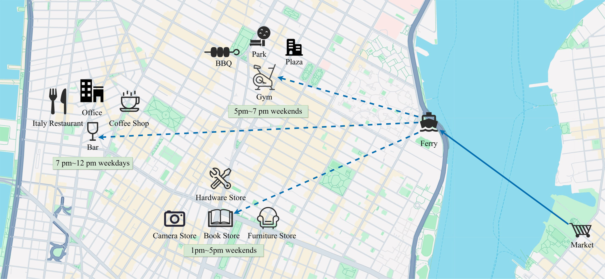
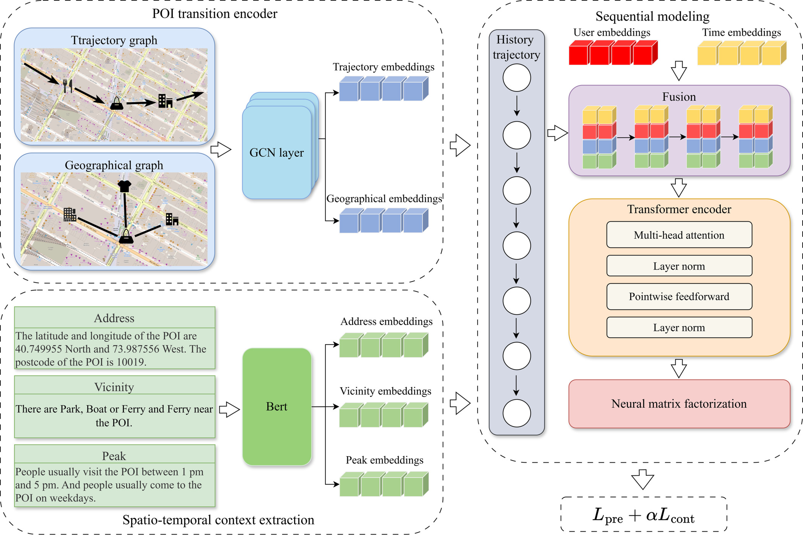
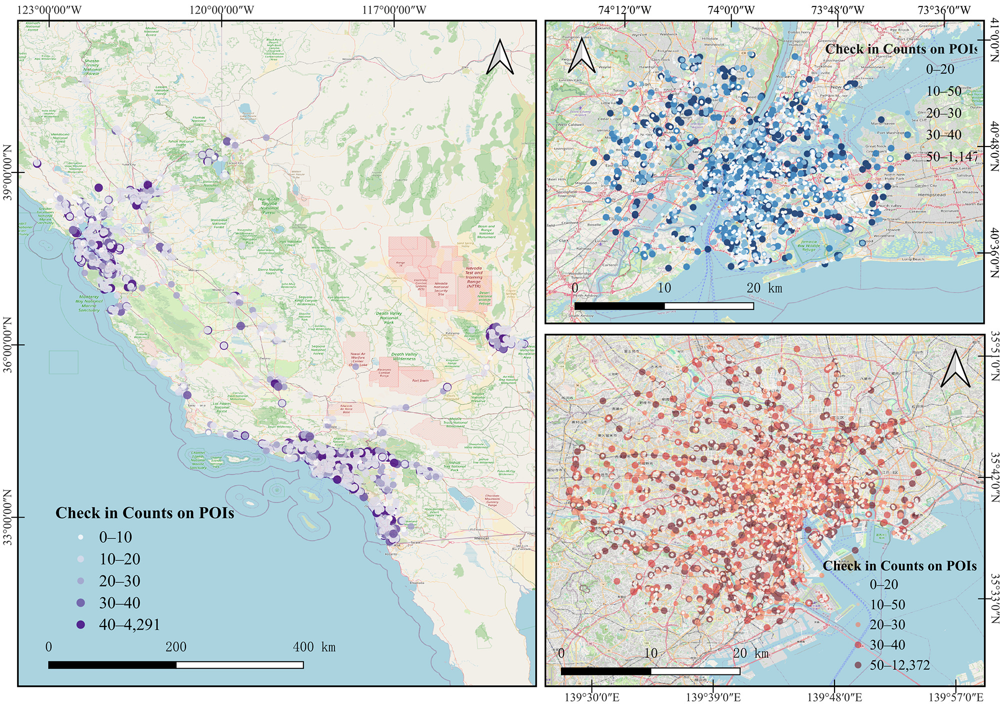
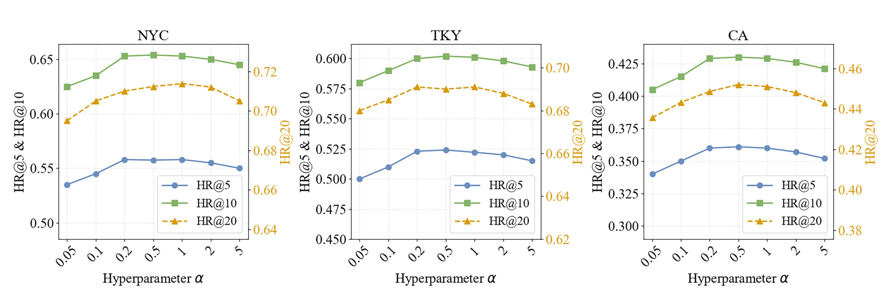
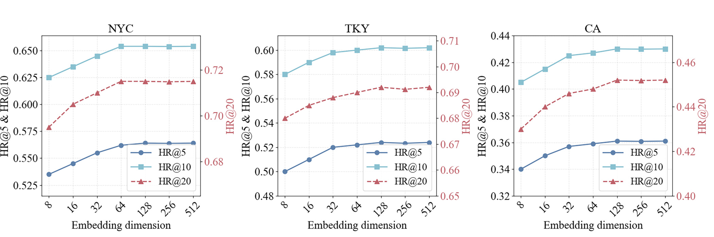
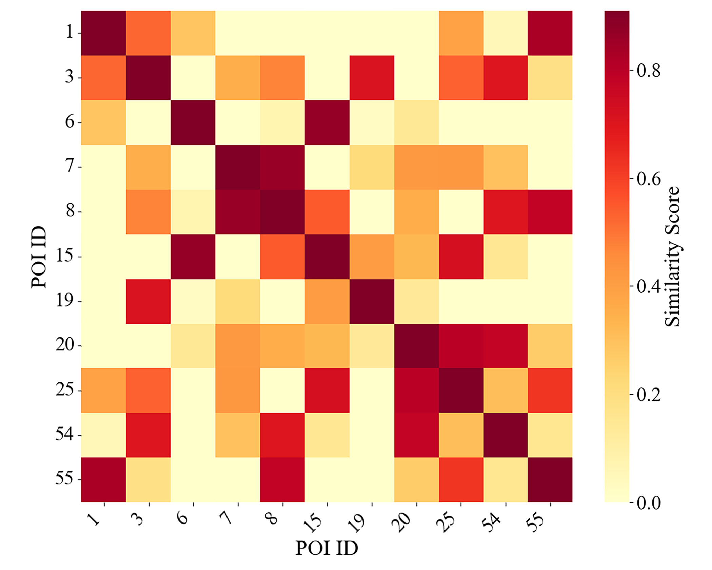
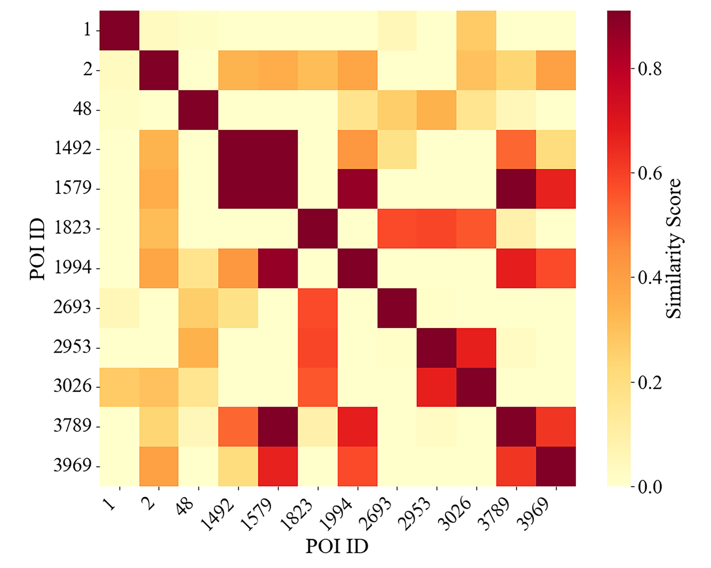
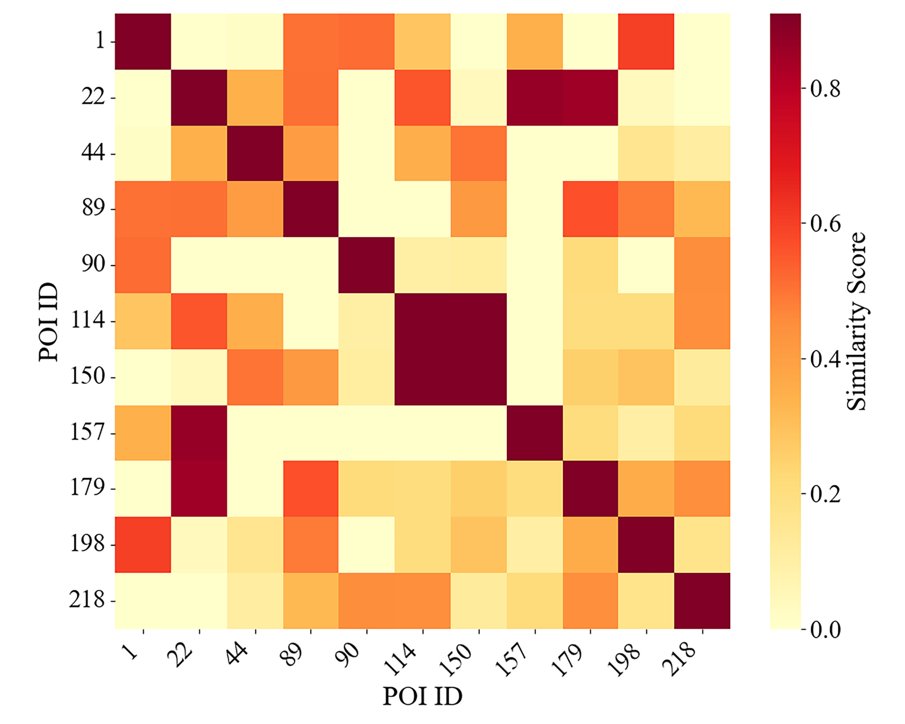
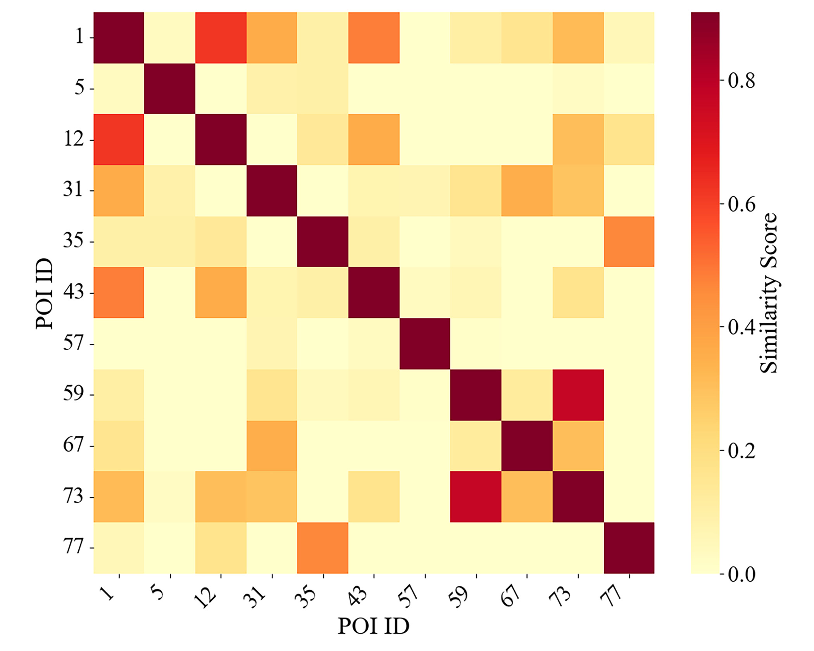

Chunyang Liu 1,2 and Chuxiao Fu 1,3,* 1 School of Geomatics, Anhui University of Science and Technology, Huainan 232001, China; chunyangliu@aust.edu.cn 2 Key Laboratory of Aviation-Aerospace-Ground Cooperative Monitoring and Early Warning of Coal Mining-Induced Disasters of Anhui Higher Education Institutes, Anhui University of Science and Technology, Huainan 232001, China 3 Coal Industry Engineering Research Center of Mining Area Environmental and Disaster Cooperative Monitoring, Anhui University of Science and Technology, Huainan 232001, China * Correspondence: 2023201555@aust.edu.cn; Tel.: +86-138-4036-4650

### Abstract

With the proliferation of mobile internet and location-based services, location-based social networks (LBSNs) have accumulated extensive user check-in data, driving the advancement of next Point-of-Interest (POI) recommendation systems. Although existing approaches can model sequential dependencies and spatio-temporal patterns, they often fail to fully capture users’ dynamic preferences under varying spatio-temporal contexts and lack effective integration of fine-grained semantic information. To address these limitations, this paper proposes Language-Guided Spatio-Temporal Context Learning for Next POI Recommendation (LSCNP). It employs a pre-trained BERT model to encode multidimensional spatio-temporal context—including geographic coordinates, visiting hours, and surrounding POI categories—into structured textual sequences for semantic understanding; constructs dual-graph structures to model spatial constraints and user transition patterns; and introduces a contrastive learning module to align spatio-temporal context with POI features, enhancing the discriminability of representations. A Transformer-based sequential encoder is adopted to capture long-range dependencies, while a neural matrix factorization decoder generates final recommendations. Experiments on three real-world LBSN datasets demonstrate that LSCNP consistently outperforms state-of-the-art baselines. Ablation studies and hyperparameter analyses further validate the contribution of each component to the overall performance.

Keywords: location-based social networks; next POI recommendation; spatio-temporal context; pre-trained language model; contrastive learning Academic Editors: Wolfgang Kainz and Hartwig H. Hochmair

## 1. Introduction

Understanding human mobility and activity patterns forms a critical foundation for developing intelligent location-based services and social applications [1]. Recent research has made significant strides in modeling human mobility through large-scale data, including characterizing urban commuting flows, the dynamics of ride-sharing networks, and the spatial-temporal patterns of activities such as outdoor jogging [2–4]. Against this backdrop, with the proliferation of mobile internet and smart devices, location-based social networks (LBSNs) such as Foursquare, Gowalla, Yelp, Instagram, Uber, and Google Maps have rapidly emerged as an integral part of daily life [5,6]. These platforms not only provide Copyright: © 2026 by the authors.

Published by MDPI on behalf of the International Society for Photogrammetry and Remote Sensing.

Licensee MDPI, Basel, Switzerland.

This article is an open access article distributed under the terms and conditions of the Creative Commons Attribution (CC BY) license.

ISPRS Int. J. Geo-Inf. 2026, 15, 28 https://doi.org/10.3390/ijgi15010028 users with channels for sharing location information and engaging in social interactions but also offer businesses opportunities for targeted marketing. However, as the number of users and the volume of location data grow exponentially, the problem of information overload has become increasingly prominent. Users struggle to quickly identify Points of Interest (POIs) that meet their needs amidst the vast sea of information [7]. Consequently, POI recommendation systems have been developed to address this challenge by mining users’ check-in data and behavioral patterns to provide personalized and precise POI recommendations [8].

In POI recommendation studies, traditional methods have progressed from collaborative filtering techniques that capture similarities in user-POI interactions while neglecting temporal sequences [9–11], to Markov chain models that account for local, consecutive transitions but remain limited by their first-order assumption [12–14]. Later approaches using RNNs model short-term dynamic dependencies, yet encounter challenges in efficiency and capturing long-range context due to their sequential nature [15–17]. Models based on the Transformer architecture tackle these problems by using self-attention to directly represent global, long-term dependencies between any positions in a sequence, processed in parallel [18–20]. Concurrently, graph-based methods apply GNNs on constructed interaction graphs to incorporate spatial relationships and complex transition patterns [21–24]. Despite these developments, current techniques frequently do not adequately combine spatio-temporal context—such as a user’s temporal zone and proximate environment—which restricts recommendation accuracy and personalization. We argue that pre-trained language models (PLMs) are well-suited for this task because their core strength lies in understanding context and relationships within sequences—capabilities directly transferable to interpreting the sequential and contextual nature of check-in data [25], where each POI visit gains meaning from its temporal and spatial surroundings. Specifically, next POI recommendation methods still face the following issues:

1. Past research, when exploring user behavior patterns, failed to fully capture users’ dynamic preferences under different time and space conditions. As illustrated in Figure 1, such preference differences depend not only on time factors but also on the specific locations users are in and their surrounding environment. For example, if users are in a business district, the rich catering choices around may affect their POI choices at lunchtime; if they are in a tourist area, the surrounding scenic spots and recreational facilities may influence their weekend activities. However, past research often failed to take this spatio-temporal context information into consideration, which prevented a comprehensive reflection of user behavior patterns and thus affected the accuracy and personalization of recommendation results. 2. It is difficult to effectively extract and utilize the transition attributes between POIs, and it is not possible to fully consider users’ path preferences and geographical constraints in the actual movement process. For example, when users travel from one scenic spot to another, they may choose a route with beautiful scenery or avoid areas with traffic congestion. Traditional recommendation systems often ignore these path preferences and geographical constraints, resulting in unreasonable recommended routes. 3. The integration of spatio-temporal context information and POI features is not close enough, and the model is unable to learn deep spatio-temporal association features. For example, when users choose a POI at a certain time, it may not only be because of the POI’s own attributes, but also because of the spatio-temporal association between the POI and the surrounding environment. Traditional recommendation systems often deal with spatio-temporal context information and POI features separately, which prevents the model from learning deep spatio-temporal association features.

*Figure 1. User preferences are influenced by specific location, time and surrounding environment.*

To address these challenges, we propose Language-Guided Spatio-Temporal Context Learning for Next POI Recommendation. To address the first challenge, we employ a pretrained NLP model, BERT, to extract users’ dynamic preferences by encoding comprehensive spatio-temporal information, including geographical coordinates, visiting hours, and nearby POI types, into text sequences. This approach enables the model to capture rich contextual details and learn complex relationships between elements, thereby accurately reflecting users’ dynamic preferences in different scenarios. Second, we construct trajectory and geographical graphs to extract transition properties and geographical associations between POIs. By performing Graph Neural Network (GNN) operations on these graphs, we capture users’ path preferences and geographical constraints, addressing the challenge of effectively utilizing POI transition attributes. Finally, we integrate spatio-temporal context information with POI features through a contrastive learning module. By contrasting users’ spatio-temporal context with POI features in various scenarios, the model learns deep spatio-temporal association patterns, enhancing the accuracy and personalization of recommendations. This integrated approach ensures that the model comprehensively captures users’ spatio-temporal behavior, leading to more precise and personalized POI recommendations.

The contributions of this study are threefold and as follows:

1. We propose a novel spatio-temporal context-aware framework for next POI recommendation. Addressing the challenge of capturing users’ dynamic preferences under varying spatio-temporal contexts, our framework integrates pre-trained NLP models, graph neural networks, and contrastive learning. By encoding comprehensive spatiotemporal information, including geographical coordinates, visiting hours, and nearby POI types, the framework effectively captures users’ dynamic preferences in different scenarios. This integration opens a new avenue for leveraging advanced techniques in the domain of POI recommendation. 2. We enhance POI transition property extraction and geographical association modeling while tightly integrating spatio-temporal context with POI features. To address the challenges of effectively extracting transition properties between POIs and ensuring a tight integration of spatio-temporal context information, we construct trajectory and geographical graphs. By performing Graph Neural Network (GNN) operations on these graphs, we capture users’ path preferences and geographical constraints, enabling the model to learn the complex spatial relationships between POIs. Additionally, we employ a contrastive learning module to contrast users’ spatio-temporal context with POI features in various scenarios, allowing the model to learn deep spatio-temporal association patterns. This dual approach ensures that the model comprehensively captures users’ spatio-temporal behavior, thereby enhancing the accuracy and personalization of POI recommendations. 3. We provide comprehensive experimental validation. Experiments conducted on three real-world LBSN datasets demonstrate that our proposed framework outperforms baseline methods across all performance metrics. Ablation studies, hyperparameter sensitivity analysis, case studies, and visualization analysis collectively validate the effectiveness of each module and their synergistic role in enhancing POI recommendation performance.

## 2. Related Work

2.1. MLM in Spatial-Temporal Tasks Masked Language Modeling (MLM) was first formulated as a self-supervised pretraining objective in natural language processing. Devlin et al. introduced BERT in 2018, establishing bidirectional masked language modeling as the dominant NLP pre-training paradigm [26]. Bao et al. proposed BEiT, extending MLM to computer vision by masking discrete visual tokens in Vision Transformers [27]. He et al. presented MAE, demonstrating that direct pixel reconstruction with a 75% masking ratio produces highly transferable visual representations [28].

Subsequent work transposed MLM to spatio-temporal data. Shao et al. introduced STEP, pioneering temporal masking and reconstruction on traffic time series to pre-train spatio-temporal graph networks [29]. Liu et al. presented SimMTM, generalizing MLM to arbitrary spatio-temporal sequences via multi-sequence aggregation reconstruction [30]. Chen et al. introduced LLM4DyG, leveraging MLM-style prompts for zero-shot spatiotemporal reasoning over dynamic graphs [31]. Luo et al. proposed LLaVA-ST, integrating visual MAE and linguistic MLM to enable natural-language reference to arbitrary spatiotemporal regions and to perform frame prediction and question answering [32].

In contrast to existing spatio-temporal MLM approaches, we propose the first BERTstyle semantic masking scheme that embeds fine-grained semantic tokens that jointly encode geocoordinate, temporal slot, and surrounding business category. A dual-graph GNN explicitly models path preferences and geographic constraints, while contrastive learning aligns user context with POI features, yielding more accurate and personalized next-stop recommendations.

2.2. Next POI Recommendation The next POI recommendation seeks to predict a user’s subsequent movement by analyzing her historical check-in sequence, utilizing spatio–temporal and semantic information—such as time intervals, geographic distances, and POI categories—to uncover latent user mobility patterns. Early approaches often build on Markov chains and matrix factorization. For example, Cheng et al. [15] combined personalized Markov chains with matrix decomposition in the FPMC model. Ye et al. [9] adopted collaborative filtering, positing that users with similar histories exhibit analogous POI preferences. Feng et al. [33] introduced PRME, which embeds POIs in Euclidean space and assesses transition likelihood via Euclidean distance. Subsequently, Feng et al. [34] developed HME, mapping check-in data into hyperbolic space to jointly model sequential transitions, user preferences, categorical semantics, and geographical context. However, such methods are often limited in capturing long-range temporal dependencies.

To address this, Recurrent Neural Networks (RNNs) have been employed to encode temporal dynamics in user trajectories. Their recurrent nature enables the retention of historical POI information, thereby learning long-term preference patterns. Liu et al. [16] proposed ST-RNN, integrating spatial and temporal contexts through continuous modeling of geographic and time intervals. Zhao et al. [35] designed STGN, which applies timeand distance-gated mechanisms to capture both long- and short-term preferences. Wu et al. [36] introduced PLSPL, combining an attention-based long-term preference module with dual LSTMs that separately process location and category sequences to fuse multi-scale user interests.

More recently, Transformer-based models have gained traction due to their parallelization capacity and self-attention mechanisms, which dynamically weigh interactions among POIs in a sequence for richer pattern extraction. Luo et al. [37] proposed STAN, incorporating spatio-temporal intervals and personalized POI frequencies to improve recommendation accuracy. Huang et al. [38] developed MTNet, which constructs mobility trees to represent user behaviors across time periods and employs node interaction and multi-task learning. Several studies further augment Transformers with Graph Neural Networks (GNNs) for improved relational reasoning. Wang et al. [24] designed a disentangled representation-enhanced attention model that leverages graph structures to encode complex POI relationships, while Yang et al. [39] introduced a graph-augmented Transformer that integrates trajectory flow graphs and spatio-temporal embeddings.

Apart from RNNs, Transformers, and GNNs, other techniques such as autoencoders [40], meta-learning [41], reinforcement learning [42], and contrastive learning [43,44] have also been explored for next-POI recommendation.

## 3. Problem Formulation

In this section, we first introduce the fundamental concepts and notations, followed by a formal definition of the research problem.

Let U = {u1, u2, . . . , u|U|} denote the set of users, P = {p1, p2, . . . , p|P|} the set of Points-of-Interest (POIs, such as restaurants or hotels), and T = {t1, t2, . . . , t|T|} the set of timestamps. Each POI p ∈ P is characterized by a tuple < lat, lon, cat >, representing its latitude, longitude, and category information.

A check-in record γ captures an instance where user u ∈ U visits POI p ∈ P at timestamp t ∈ T.

The complete set of check-in activities across all users constitutes a global check-in sequence T = {γ1, γ2, . . . , γn}, where each γi corresponds to an individual check-in record.

Through preprocessing, each user u’s check-in sequence is divided into consecutive trajectories Tru = {Tr1 u, . . . , Trk u, . . .}, where Trk u, Tr2 u represents the k-th trajectory. These trajectories, potentially varying in length, comprise sequential check-ins occurring within a constrained time period (e.g., 24 h).

Problem Formulation (Next POI Recommendation): For an ongoing trajectory Trk 1, γk 2, . . . , γk n−1} of user u, the objective is to produce a ranked list of POIs that u is most likely to visit at the subsequent timestamp.

u = {γk

## 4. Methods

This section delineates the comprehensive architecture of our proposed model, which comprises three principal components as illustrated in Figure 2: (A) a spatio-temporal context extraction module that leverages a pre-trained BERT model to encode multi-source heterogeneous POI information into structured semantic representations, (B) a POI transition encoder that employs a dual-graph convolutional network to capture both geographical constraints and user movement patterns, and (C) a sequential modeling module that integrates multi-view embeddings via a hierarchical fusion mechanism and employs a Transformer encoder with a neural matrix factorization decoder for final recommendation generation.

*Figure 2. Architecture of the proposed methodology.*

The overall workflow unfolds in three stages: First, the spatio-temporal context extraction module transforms raw POI attributes—including address details, peak visiting hours, and vicinity information—into natural language descriptions, which are subsequently processed by BERT to generate contextual embeddings that encapsulate complex urban dynamics. Simultaneously, the POI transition encoder constructs dual graphs representing geographical proximity and historical user trajectories, applying multi-layer graph convolutional operations to learn POI representations that reflect both spatial feasibility and behavioral preferences. Finally, the sequential modeling module fuses these diverse embeddings—user, spatio-temporal, geographical, trajectory, and temporal—through a gated fusion mechanism, enhances representation discriminability via a contrastive learning objective, processes the fused sequence through a Transformer encoder to capture long-range dependencies, and ultimately employs a neural matrix factorization decoder to compute preference scores and produce the final ranked recommendation list.

4.1. Spatio-Temporal Context Extraction To capture users’ dynamic preferences in complex urban environments, we employ a pre-trained BERT model to extract and integrate multi-dimensional spatio-temporal contextual information. This approach transforms unstructured spatio-temporal and semantic data into structured textual sequences, leveraging the powerful linguistic understanding capabilities of pre-trained models to discover complex user behavior patterns.

4.1.1. Context Symbolization For each Point-of-Interest p, its multi-source heterogeneous information is defined through the following components. The Address Information Xaddress includes geographic coordinates such as latitude latp and longitude lonp, detailed address addrp, and zip code zipp. The Peak Hours Information Xpeak covers typical visiting patterns, including a visit time window τp (for example, “1 pm to 5 pm”), and a visit day preference δp (for example, “weekdays”). The Vicinity Information Xvicinity describes the surrounding environment, characterized by nearby POI categories {c1, c2, ..., ck}.

An information fusion template is designed to synthesize these symbolic elements into three independent, grammatically natural text descriptions saddress p , speak p , and svicinity p . For instance, saddress p may read, “The latitude and longitude of the POI are latp North and lonp West. It is located at addrp, with the postcode zipp”. The peak hours description speak p could be “People usually visit between τp, and typically come on δp”. The vicinity description svicinity p takes the form: “There are c1, c2, ..., ck near the POI”.

4.1.2. Context-Aware Semantic Encoding The constructed textual sequences are processed through the pre-trained BERT model to generate contextual embeddings. Let BERT(·) represent the model function with parameters Θ. For each textual sequence s∗ p, where ∗∈{address, peak, vicinity}, the tokenizer T converts it into token IDs with special markers [CLS] and [SEP], producing input IDs I∗ p and attention mask M∗ p:

I∗ p, M∗ p = T (s∗

- (1)

The model processes these inputs and outputs contextual embeddings for all tokens. We extract the final hidden state corresponding to the [CLS] token as the aggregated representation, e∗ p = BERT(I∗ p, M∗ p)[CLS] (2)

p ∈ RH with H = 768 denotes the embedding for address, peak hours, or vicinity information. This embedding captures lexical, syntactic, and semantic relationships within the original text, effectively encoding the specific contextual information.

where e∗ 4.1.3. Multi-View Feature Fusion To form a unified contextual representation for POI p, we integrate the embeddings from different perspectives through concatenation and linear projection, p ⊕ epeak p ⊕ evicinity est p = W · (eaddress p ) + b (3)

where ⊕ denotes vector concatenation, W ∈ Rd×3H and b ∈ Rd are learnable parameters, and est p ∈ Rd represents the final spatio-temporal context-aware representation. The pre-trained language model encodes semantic relationships rather than directly interpreting numerical values. For instance, it captures associations between “weekdays” and “office”, or patterns linking “afternoon” and “restaurant”. This language-mediated approach flexibly models complex spatio-temporal dependencies and user behavior patterns that are challenging to learn with conventional numerical methods. The attention mechanisms in BERT enable the model to dynamically weigh the importance of different contextual elements—such as prioritizing peak hours over vicinity in certain preference predictions—providing nuanced understanding of how contextual factors influence user behavior.

4.2. POI Transition Encoder To comprehensively capture both geographical constraints and user transition patterns between Points of Interest (POIs), we construct a dual-graph structure and employ a multi-layer Graph Convolutional Network (GCN) architecture. The underlying mechanism of this encoder is based on the fundamental principle that user mobility patterns are governed by both spatial constraints and behavioral preferences, where geographical proximity determines accessibility while historical trajectories reflect practical movement preferences.

4.2.1. Dual-Graph Construction   Ageo[i][j] =  4.2.2. Graph Convolutional Architecture The graph Laplacian matrix is computed as 4.2.3. Dual-View Feature Fusion Geographical Graph models spatial relationships between POIs. For each POI i, let (lati, loni) represent its geographical coordinates. The geographical adjacency matrix Ageo ∈ RN×N is defined using a distance threshold θ, 1, if distance((lati, loni), (latj, lonj)) ≤ θ and i̸ = j (4)

0, otherwise Trajectory Graph captures sequential transition patterns from user trajectories. Let U be the set of users and Tu = [p1, p2, . . . , pn] represent the trajectory of user u ∈ U. The trajectory adjacency matrix Atraj ∈ RN×N is constructed as |Tu|−1 Atraj[i][j] = ∑ I(pt = i ∧ pt+1 = j) (5)

∑ t=1 u∈U where I(·) is the indicator function. The final graph representation combines both geographical and trajectory information through a unified adjacency matrix.

The graph convolutional architecture operates through a neighborhood aggregation mechanism that propagates information across connected POIs. At each layer l, the graph convolutional operation is defined as H(l+1) = σ LHˆ (l)W(l) + b(l)  (6)

where H(l) ∈ RN×dl represents the node embeddings at layer l, W(l) ∈ Rdl×dl+1 and b(l) ∈ Rdl+1 are learnable parameters, σ(·) denotes the LeakyReLU activation function with negative slope 0.2.

Lˆ = D−1 2 (A + I)D−1 2 (7)

where D is the diagonal degree matrix of A + I, and I is the identity matrix.

The feature fusion mechanism employs a multi-scale strategy that preserves information from different graph convolutional depths. By concatenating intermediate representations from multiple GCN layers, Hfused = H(1) ⊕ H(2) ⊕· · · ⊕ H(L) (8)

the model captures both local neighborhood structures and global graph patterns. The fused representation is then projected back to the original embedding space with a residual connection, e∗ = W f Hfused + b f + e∗ p (9)

where e∗ ∈ Rd denotes the final geographical or trajectory embedding, W f ∈ Rd×Ld are learnable projection matrices, and b f ∈ Rd are bias terms. This fusion mechanism ensures that the final POI representations embody a balanced integration of spatial feasibility from the geographical graph and behavioral patterns from the trajectory graph, enabling recommendations that are both geographically accessible and aligned with observed user transition patterns.

4.3. Sequential Modeling 4.3.1. Multi-View Embedding Fusion To effectively integrate information from diverse representations, we design a hierarchical fusion mechanism that combines spatial, behavioral, and semantic features.

Transition Embedding Fusion integrates trajectory-based and geographical graph embeddings through a gated fusion mechanism, etrans = Dropout(LeakyReLU(Wt · LayerNorm([etraj ⊕ egeo]) + bt)) (10)

where etraj ∈ RB×T×d and egeo ∈ RB×T×d represent trajectory and geographical graph embeddings, respectively, and ⊕ denotes concatenation along the feature dimension.

The temporal embedding et ∈ RB×T×dt is generated using the Time2Vec method to capture periodic features such as time intervals and absolute timestamps within the sequence. Time2Vec maps a scalar time value t to a dt-dimensional vector, where the k-th component is defined as   ωkt + φk, k = 0 et[k] = sin(ωkt + φk), 1 ≤ k ≤ dt − 1 (11)

 Here, ωk and φk are learnable parameters, with the sinusoidal components designed to capture periodic temporal patterns. The temporal embeddings are concatenated along the sequence dimension to form et.

Multi-Modal Sequence Fusion comprehensively combines user preferences, transition patterns, semantic context, and temporal information, efused = Dropout(LeakyReLU(W f · LayerNorm([eu ⊕ etrans ⊕ est p ⊕ et]) + bf )) (12)

where eu ∈ RB×du is the user embedding, repeated along the sequence dimension, p ∈ RB×T×d represents spatio-temporal context embeddings, et ∈ RB×T×dt encodes temporal information.

est 4.3.2. Contrastive Learning To enhance the discriminative capability of our multi-view representations, we design a contrastive learning objective that explicitly models the relationships between different embedding spaces. We assume that the transition embedding etrans should be more closely aligned with both trajectory embeddings etraj and geographical embeddings egeo than with the spatio-temporal embeddings est p , while the spatio-temporal embeddings serve as negative samples for the transition space.

Based on this assumption, we introduce the following contrastive loss, Lcont = f (etrans, etraj, est p ) + f (etrans, egeo, est p ) (13)

where f (·) denotes the Bayesian Personalized Ranking loss. Formally, we define f (a, p, q) = Softplus(⟨a, q⟩−⟨a, p⟩) (14)

where ⟨·, ·⟩ denotes the inner product of two given representations.

In the context of personalized POI recommendation, the transition property of a POI inherently reflects evolving user preferences. As such, in later stages of the learning process, the transition embedding progressively captures and emphasizes these preference dynamics, thereby gaining increased influence in the representation space. The first term f (etrans, etraj, est p ) encourages the transition embedding to exhibit higher similarity with trajectory embeddings compared to spatio-temporal embeddings, while the second term f (etrans, egeo, est p ) enforces the same alignment for geographical embeddings. Through this dual constraint, the transition embedding not only bridges the trajectory and geographical spaces but also maintains a discernible separation from the spatio-temporal context.

4.3.3. Transformer-Based Sequential Modeling We employ a transformer encoder with enhanced positional encoding for sequential pattern capture.

Sinusoidal Positional Encoding provides explicit position information,  pos 100002i/d  pos 100002i/d   PE(pos, 2i) = sin , PE(pos, 2i + 1) = cos (15)

Multi-Head Self-Attention mechanism captures long-range dependencies,  QKT  √dk Attention(Q, K, V) = softmax V (16)

where Q, K, V are all derived from linear projections of efused.

The transformer layer incorporates pre-normalization and residual connections, e′ = LayerNorm(e + Attention(e)) (17)

e′′ = LayerNorm(e′ + PositionwiseFFN(e′)) (18)

Position-wise Feed-Forward Network employs GELU activation for non-linear transformation, FFN(x) = W2 · GELU(W1x + b1) + b2 (19)

where W1 ∈ Rd×d, b1 ∈ Rd, W2 ∈ Rd×d, and b2 ∈ Rd are learnable parameters.

4.3.4. Neural Matrix Factorization Decoder The final prediction is obtained through a neural matrix factorization approach that computes the compatibility score between the final sequence representation and each candidate POI. Formally, for each position in the sequence, the predicted score for POI p is calculated as yˆp = efinal · eT p (20)

where efinal ∈ RB×T×d represents the final output embeddings from the transformer encoder, and ep ∈ RN×d denotes the POI embedding matrix. The resulting prediction tensor yˆp represents the predicted score distribution over all POIs for each position in the sequence.

The recommendation loss Lpre is defined as the cross-entropy between the predicted scores yˆp and the ground truth yp, |P| ∑ i=1 Lpoi = − yp log yˆp (21)

The total loss function combines both the recommendation loss and the contrastive loss with a balancing parameter α,

## 5. Experiments

5.1. Evaluation Metrics 5.2. Datasets and Experimental Setup Ltotal = Lpre + αLcont (22)

To comprehensively evaluate the performance of our proposed model and baseline methods, we employ two widely adopted metrics in next POI recommendation: Hit Rate (HR) and Mean Reciprocal Rank (MRR).

Hit Rate@K measures the proportion of test cases where the ground-truth next POI appears in the top-K recommended items. Formally, for each test sequence with groundtruth POI p∗, the Hit Rate@K is defined as N ∑ i=1 HR@K = 1 I(rank(p∗) ≤ K) (23)

N where I(·) is the indicator function, rank(p∗) denotes the rank position of the ground-truth POI in the recommendation list, and N is the total number of test sequences. We report HR@5, HR@10, and HR@20 to assess the model’s performance at different recommendation list lengths.

Mean Reciprocal Rank (MRR) evaluates the ranking quality by considering the reciprocal of the rank at which the first relevant item appears, N ∑ i=1 MRR = 1 1 rank(p∗) (24)

N MRR provides a balanced assessment of the recommendation accuracy, giving higher weight to correct predictions that appear earlier in the recommendation list.

These metrics collectively provide a comprehensive evaluation framework: HR@K measures the recommendation recall at different thresholds, while MRR assesses the overall ranking quality of the recommendations.

To validate the effectiveness of the proposed framework, as illustrated in Figure 3, we conducted experimental evaluations on three real-world location-based social network datasets. The FourSquare-New York City (NYC) and FourSquare-Tokyo (TKY) datasets were collected in New York City, USA, and Tokyo, Japan, respectively, spanning from April 2012 to February 2013 [45]. Another dataset, Gowalla-CA, contains check-in records gathered from California and Nevada between February 2009 and October 2010 [46]. All datasets include essential fields such as user identifiers, POI information, geographical coordinates, and timestamps.

To ensure data quality, we first performed data preprocessing by removing POIs with fewer than 10 check-ins and users with fewer than 10 historical check-in records. Subsequently, each user’s check-in sequence was divided into multiple trajectory segments using a 24 h time window, and trajectories containing only a single check-in record were filtered out. For dataset partitioning, we chronologically split each dataset into training (80%), validation (10%), and test (10%) sets. To prevent data leakage, users and POIs that appeared exclusively in the test set were excluded during evaluation to ensure the reliability of experimental results.

*Figure 3. Spatial distributions of POI check-in data for three datasets.*

5.3. Implementation Details All embedding representations—including those for POIs, temporal information, user profiles, address details, vicinity characteristics, and peak hour patterns—were configured with a uniform dimensionality of 64. The graph convolutional network architecture incorporates three sequential hidden layers, each maintaining 64 feature channels. The attention mechanism transforms node representations into 64-dimensional vectors through linear projection. The Transformer component employs a two-layer encoder stack, where the feed-forward sub-layer expands dimensions to 1024 before projecting back to the latent space, while the multi-head attention mechanism utilizes two parallel attention heads. Model optimization was conducted using the Adam algorithm with an initial learning rate of 1 × 10−3. Regularization was implemented through dropout layers (p = 0.5) applied to both GCN and Transformer components. Each model is trained for 200 epochs with batch size 64.

The computational complexity of the proposed model is characterized by three principal components. The spatio-temporal context extraction module, which leverages a pre-trained BERT model, operates with a complexity of O(L · n · H2), where L denotes the number of BERT layers, n the length of the textual description sequence, and H (768) the hidden dimension. The POI transition encoder, employing a dual-graph convolutional network (GCN), has a complexity of O(Lg · |E| · d2), where Lg is the number of GCN layers, |E| the number of edges in the aggregated adjacency matrix, and d the embedding dimension. The sequential modeling module, based on a Transformer encoder, exhibits a complexity of O(B · T2 · d + B · T · d2), dominated by the multi-head self-attention mechanism’s quadratic term in sequence length T, with B representing the batch size. While the T2 factor in attention is the primary computational bottleneck, the model’s feasibility is maintained through sparsification of the geographical graph (|E| ≪ N2), pre-computation of static BERT embeddings for POIs, and efficient batching. For a single inference on a user sequence, the complexity reduces to O(T2 · d + |Ei| · d2 + L · n · H2), where |Ei| is the average node degree, enabling practical deployment in real-time recommendation scenarios.

5.4. Comparison with Baselines To provide a robust and comprehensive evaluation, these eight baselines were selected because they represent key technical milestones in poi recommendation, spanning fundamental Markov chains, advanced embedding techniques, and cutting-edge deep learning architectures that model sequential patterns, spatio-temporal dynamics, and user preferences. These baselines are as follows:

- FPMC [15]: combines matrix factorization with first-order Markov chains. • PRME [33]: introduces pairwise metric embedding. • ST-RNN [16]: extends RNNs with time- and distance-aware transition matrices. • STGCN [35]: an updated variant of STGN that couples input and forget gates. • PLSPL [36]: learns long-term preferences via attention and short-term preferences with LSTM, then fuses them via personalized linear layers. • STAN [37]: leverages spatio-temporal information along trajectories and employs self-attention to capture point-to-point interactions among non-adjacent check-ins. • GETNext [39]: integrates global transition patterns, user general preferences, spatiotemporal contexts, and time-aware category embeddings into a Transformer for futuremove prediction. • MTNet [38]: contains a mobility-tree network constructor, node initializer, nodeinteraction module, and multi-task learning module to capture user-specific behavioral patterns within different time periods.

As shown in the Table 1, the overall performance on the NYC and TKY datasets is significantly better than that on the CA dataset. This is mainly because the CA dataset covers the larger states of California and Nevada, while the NYC and TKY datasets are concentrated in the densely populated metropolitan areas of New York City and Tokyo, respectively, resulting in a sparser data distribution in the CA dataset. Across all datasets, our proposed LSCNP model demonstrates superior performance compared to all baseline methods.

*Table 1. The comparison of the performance of LSCNP against eight recent baselines across three datasets: NYC, TKY, and CA.*

NYC TKY CA Models HR@5 HR@10 HR@20 MRR HR@5 HR@10 HR@20 MRR HR@5 HR@10 HR@20 MRR FPMC 0.2126 0.2970 0.3323 0.1701 0.2045 0.2746 0.3450 0.1344 0.0702 0.1159 0.1682 0.0911 PRME 0.2236 0.3105 0.3643 0.1712 0.2278 0.2944 0.3560 0.1786 0.1034 0.1425 0.1954 0.1002 ST-RNN 0.2923 0.3622 0.4502 0.2198 0.3022 0.3577 0.4753 0.2212 0.1423 0.1940 0.2477 0.1429 STGCN 0.3425 0.4279 0.5214 0.2788 0.3453 0.3927 0.4763 0.2504 0.2097 0.2613 0.3245 0.1712 PLSPL 0.3678 0.4523 0.5370 0.2806 0.3523 0.4150 0.4880 0.2542 0.2278 0.2995 0.3401 0.1847 STAN 0.4582 0.5734 0.6328 0.3253 0.3798 0.4464 0.5119 0.2852 0.2348 0.3018 0.3502 0.1869 GETNext 0.5809 0.6143 0.6880 0.3621 0.4417 0.5287 0.5829 0.3262 0.2852 0.3590 0.4241 0.2103 MTNet 0.5381 0.6321 0.6986 0.3855 0.4977 0.5848 0.6612 0.3659 0.3419 0.4163 0.4321 0.2367 LSCNP 0.5593 0.6545 0.7156 0.3982 0.5236 0.6024 0.6923 0.3864 0.3613 0.4302 0.4523 0.2513 Specifically, on the NYC dataset, LSCNP achieves 0.5593 in HR@5, representing a 3.9% improvement over the best baseline method, MTNet, at 0.5381. In MRR, it reaches 0.3982, a 3.3% improvement over MTNet’s 0.3855. On the TKY dataset, LSCNP delivers outstanding performance with 0.6024 in HR@10, exceeding MTNet’s 0.5848 by 3.0%. Even on the most challenging CA dataset, LSCNP maintains strong performance, achieving 0.3613 in HR@5 for a 5.7% improvement over MTNet’s 0.3419, and reaching 0.2513 in MRR, which surpasses MTNet’s 0.2367 by 6.2%.

Compared to the Transformer-based GETNext, LSCNP innovatively introduces a pre-trained language model to encode fine-grained spatio-temporal contextual information, enabling more effective capture of users’ dynamic preferences across different spatiotemporal scenarios. While MTNet employs a mobility tree to characterize periodic behaviors, LSCNP utilizes a multi-view fusion mechanism to uniformly model trajectory patterns, geographical constraints, and semantic contexts. It converts multi-source information including address details, peak hours, and surrounding environment into structured textual descriptions, leveraging BERT’s semantic understanding capability to mine complex spatiotemporal dependencies without relying on period segmentation or complex tree structures. Furthermore, unlike STAN which only uses spatio-temporal interval self-attention to encode local-global dependencies, LSCNP explicitly models users’ path preferences and geographical constraints by constructing a dual-graph structure of trajectory and geographical graphs combined with a contrastive learning objective, thereby gaining a clear advantage in tracking users’ real-time interest drift. These innovative designs collectively contribute to making the model more accurate and robust.

5.5. Ablation Studies To systematically evaluate the contribution of each component in our proposed LSCNP framework, as shown in Table 2, we conducted comprehensive ablation studies by examining four model variants: (1) w/o Contrastive Loss: Removing the contrastive learning objective that aligns transition embeddings with trajectory and geographical information. (2) w/o Spatio-Temporal Context: Eliminating the spatio-temporal context extraction module that encodes address information, peak hours, and vicinity characteristics. (3) w/o User and Time: Removing user embeddings and temporal information from the multi-view fusion process. (4) w/o GCN: Replacing the graph convolutional network module that captures geographical constraints and transition patterns. (5) w/o BERT: Replacing the BERT-based spatio-temporal context encoder with a standard MLP layer.

*Table 2. The results of ablation studies conducted to assess the impact of different components of the LSCNP model on its performance across three datasets: NYC, TKY, and CA.*

NYC TKY CA HR@5 HR@10 HR@20 MRR HR@5 HR@10 HR@20 MRR HR@5 HR@10 HR@20 MRR LSCNP 0.5593 0.6545 0.7156 0.3982 0.5236 0.6024 0.6923 0.3864 0.3613 0.4302 0.4523 0.2513 w/o Contrastive Loss 0.5417 0.6328 0.6984 0.3815 0.4973 0.5819 0.6458 0.3726 0.3374 0.4089 0.4392 0.2367 w/o Spatio-Temporal Context 0.5085 0.6145 0.6875 0.3624 0.4418 0.5281 0.5825 0.3263 0.2855 0.3591 0.4245 0.2106 w/o User and Time 0.5253 0.6236 0.6932 0.3718 0.4695 0.5553 0.6278 0.3460 0.3113 0.3840 0.4317 0.2235 w/o GCN 0.4812 0.5548 0.6702 0.3598 0.4215 0.4817 0.5723 0.3201 0.2729 0.3267 0.4146 0.2073 w/o BERT 0.5271 0.6250 0.6948 0.3731 0.4712 0.5578 0.6214 0.3489 0.3130 0.3875 0.4336 0.2251 The experimental results demonstrate that each component contributes significantly to the overall performance. The removal of the contrastive learning objective leads to noticeable performance degradation across all datasets, with HR@5 decreasing by 3.1%, 5.0%, and 6.6% on the NYC, TKY, and CA datasets, respectively. This confirms that contrastive learning effectively enhances the discriminative capability of the learned representations.

Eliminating the spatio-temporal context module causes a substantial performance deterioration, particularly on the NYC dataset, where HR@5 drops by 9.1% from 0.5593 to 0.5085. This highlights the importance of spatio-temporal context in capturing users’ dynamic preferences under varying geographical and temporal conditions.

The ablation of user and time embeddings also results in considerable performance erosion, with MRR on the CA dataset falling by 11.1% from 0.2513 to 0.2235. This demonstrates the importance of incorporating personalized user preferences and temporal dynamics. Similarly, replacing the BERT-based encoder with an MLP layer leads to performance degradation comparable to removing user and time information, especially on the TKY dataset where MRR decreases by 9.7%. This validates the advantage of using a pre-trained language model to capture complex semantic and sequential patterns in spatio-temporal contexts.

Furthermore, removing the GCN module substantially impairs the model’s capability, with HR@20 on the NYC dataset decreasing from 0.7156 to 0.6702. This verifies that the dual-graph structure effectively models spatial relationships and user movement patterns essential for generating geographically feasible recommendations.

The progressive performance decline across all ablation variants confirms the synergistic effectiveness of each component in LSCNP, working collectively to achieve superior next POI recommendation performance.

5.6. Effects of Balancing Parameter α As shown in Figure 4, the balancing parameter α critically regulates the interplay between the recommendation loss and contrastive learning objective. The performance peaks at α = 1.0 because this value optimally balances two learning signals: the primary recommendation objective captures sequential POI transitions, while the contrastive component enhances representation discriminability by aligning transition patterns with geographical and trajectory contexts. When α is too small, the model fails to leverage multi-view alignment; when too large, the contrastive loss overwhelms the main task, disrupting the learning equilibrium. This demonstrates that appropriate contrastive weighting is essential for integrating multi-view information while maintaining task focus.

*Figure 4. The impact of balancing parameter on recommendation accuracy.*

5.7. Effects of Embedding Dimension The results demonstrate that embedding size significantly influences the model’s capacity to capture complex spatio-temporal patterns. As shown in Figure 5, the optimal embedding dimension varies across datasets due to differences in data complexity and sparsity. For the NYC dataset, an embedding dimension of 64 proves sufficient to achieve optimal performance, as the dense urban environment and rich check-in patterns in New York City allow effective feature compression without significant information loss. However, for the TKY and CA datasets, higher dimensions of 128 are required to reach comparable performance levels. This discrepancy can be attributed to the more complex and diverse mobility patterns in Tokyo’s metropolitan area and the broader geographical coverage of California and Nevada, which necessitate larger embedding spaces to adequately capture the intricate spatio-temporal relationships. The mechanistic analysis reveals that denser urban environments like NYC exhibit more regular and compact movement patterns, enabling efficient representation in lower-dimensional spaces, whereas more dispersed or complex regions require higher-dimensional embeddings to model their varied transitional behaviors and geographical constraints effectively. This dimensional adaptability ensures that our model maintains optimal performance across different urban contexts without underfitting or overparameterization.

*Figure 5. The impact of embedding dimension on recommendation accuracy.*

## 6. Discussion

6.1. Analysis of Capabilities in Capturing Spatio-Temporal Relationships To gain deeper insights into the characteristics of the learned POI representations, we employed cosine similarity and heatmap visualizations to analyze different types of POI relationships, with all similarity scores constrained within the range of [0, 1]. Through systematic comparisons of similarity patterns across different POI categories and detailed examination of spatio-temporal influences, we draw the following conclusions:

The comparative analysis reveals that our model effectively distinguishes relationship strengths under varying spatio-temporal conditions. As shown in Figure 6a, POIs with both temporal proximity and geographical closeness exhibit the strongest associations, confirming that our model successfully captures the synergistic effect of spatial and temporal factors. Figure 6b demonstrates that while geographically proximate POIs with distant visit times still show identifiable similarity patterns, their association strength is noticeably weaker than temporally aligned POIs. Interestingly, Figure 6c reveals that POIs with temporal proximity but geographical distance maintain moderate relationships, suggesting that temporal patterns create meaningful connections even across spatial boundaries. Finally, Figure 6d clearly shows that POIs with both geographical distance and temporal disparity exhibit the weakest associations, properly separated in the embedding space.

Notably, the visualization results suggest that geographical relationships tend to create more finely grained distinctions in the embedding space compared to temporal patterns. This granularity reflects the inherent characteristics of spatial data, where physical distance creates continuous and measurable relationships, while temporal patterns often involve more categorical distinctions. However, the most distinctive representations emerge from the combination of both factors, demonstrating that our multi-view fusion mechanism effectively leverages the complementary strengths of spatial and temporal information.

These findings demonstrate that LSCNP learns semantically rich representations reflecting the complex interplay between spatial accessibility and temporal preferences in human mobility patterns. The model captures explicit relationships while maintaining proper separation between unrelated POIs, ensuring recommendations are both contextually relevant and geographically feasible. This nuanced understanding of spatio-temporal relationships enables more accurate and explainable next POI recommendations.

(a)

(c)

6.2. Improvement and Limitations

(b)

(d)

*Figure 6. Comparative analysis of POI relationships under different spatio-temporal conditions: (a) POIs with both temporal proximity and geographical closeness; (b) POIs with geographical proximity but temporal distance; (c) POIs with temporal proximity but geographical distance; (d) POIs with both geographical distance and temporal disparity.*

Through the presented study, we have demonstrated that explicitly modeling finegrained spatio-temporal contexts using a pre-trained language model, coupled with dual-graph structures for capturing spatial constraints and user transition patterns, significantly improves the accuracy and personalization of next POI recommendations. The proposed LSCNP framework outperforms state-of-the-art baselines across multiple datasets—including transformer-based next-POI models such as GETNext [39] and STAN [37], as well as period-aware methods like MTNet [38]. These baselines represent key recent advances in mobility modeling: GETNext introduces a geographical encoder with transformer architecture, STAN designs spatio-temporal self-attention for local-global dependency capture, and MTNet leverages mobility trees to model periodic patterns. And this work confirms the synergistic value of integrating semantic, geographical, and behavioral signals through contrastive learning and multi-view fusion. These improvements highlight the importance of contextual understanding and structured representation learning in mobility-aware recommendation systems.

Despite its promising results, this study has several limitations. First, the reliance on pre-trained BERT for context encoding introduces computational overhead and may not fully adapt to domain-specific spatio-temporal semantics without further fine-tuning. Second, the graph construction process depends on static thresholds (e.g., distance cutoffs for geographical graphs), which may not reflect dynamic urban changes or individual mobility variances. Third, the model primarily operates on historical check-in data and does not incorporate real-time contextual signals such as weather, events, or traffic conditions, which could further refine recommendation relevance. Finally, the evaluation is confined to three LBSN datasets, and generalization to other geographical or cultural contexts remains to be validated.

## 7. Conclusions

This paper proposes Language-Guided Spatio-Temporal Context Learning, a novel next Point-of-Interest (POI) recommendation framework designed to address the key challenges of capturing users’ dynamic preferences under varying spatio-temporal contexts and effectively modeling POI transition attributes. While existing approaches can model sequential dependencies and spatio-temporal patterns, they often fail to fully capture users’ dynamic preferences under varying spatio-temporal contexts and lack effective integration of fine-grained semantic information. The framework employs a pre-trained BERT model to encode multi-source spatio-temporal information—including geographical coordinates, visiting hours, and surrounding POI categories—into semantically rich textual representations; constructs dual-graph structures to explicitly model spatial constraints and user transition patterns; and introduces a contrastive learning module to align spatio-temporal context with POI features, enhancing the discriminability of the learned representations. A Transformer-based sequential encoder captures long-range dependencies, while a neural matrix factorization decoder generates the final recommendations. Extensive experiments on three real-world LBSN datasets validate the effectiveness of our framework, demonstrating superior performance across multiple evaluation metrics compared to various baseline and state-of-the-art methods. Future work will explore the integration of large language models for more nuanced semantic understanding of user behavior, investigate adaptive graph construction methods that dynamically reflect user mobility patterns, and extend the contrastive learning framework to incorporate multi-granularity spatiotemporal contexts for further performance improvement. Additionally, future work will explicitly explore indoor POI recommendation, which requires scenario-specific design, domain-aware data, and integration of architectural semantics, and will establish a unified LLM-based evaluation framework to enable comprehensive and fair comparisons across recommendation methods.

Author Contributions: Conceptualization, Chunyang Liu and Chuxiao Fu; methodology, Chuxiao Fu; software, Chunyang Liu; validation, Chunyang Liu and Chuxiao Fu; formal analysis, Chunyang Liu; investigation, Chunyang Liu; resources, Chuxiao Fu; data curation, Chunyang Liu; writing— original draft preparation, Chunyang Liu; writing—review and editing, Chunyang Liu and Chuxiao Fu; visualization, Chunyang Liu; supervision, Chuxiao Fu; project administration, Chunyang Liu; funding acquisition, Chunyang Liu. All authors have read and agreed to the published version of the manuscript.

Funding: The project was supported by the Fundamental Research Funds of the AUST (No. 2024JBQN0019). The Key Laboratory of Aviation-Aerospace-Ground Cooperative Monitoring and Early Warning of Coal Mining-Induced Disasters of Anhui Higher Education Institutes (Anhui University of Science and Technology) (No. KLAHEI202203). The National Natural Science Foundation of China (No. 42371478).

Data Availability Statement: The original data presented in the study are openly available at https://sites.google.com/site/yangdingqi/home/foursquare-dataset and https://snap.stanford. edu/data/loc-gowalla.html (accessed on 31 December 2025).

Conflicts of Interest: The authors declare no conflicts of interest.

## References

1. Barbosa, H.; Barthelemy, M.; Ghoshal, G.; James, C.R.; Lenormand, M.; Louail, T.; Menezes, R.; Ramasco, J.J.; Simini, F.; Tomasini, M. Human mobility: Models and applications. Phys. Rep. 2018, 734, 1–74. [CrossRef] 2. Zhao, K.; Tarkoma, S.; Liu, S.; Vo, H. Urban human mobility data mining: An overview. In Proceedings of the 2016 IEEE International Conference on Big Data (Big Data), Washington, DC, USA, 5–8 December 2016; pp. 1911–1920. 3. Yang, W.; Wu, C.; Zhang, Y.; Pan, Y.; Xie, X.; Tian, Z. Deciphering spatiotemporal patterns and mobility network of outdoor jogging utilizing large-scale GPS trajectory data. Cities 2025, 165, 106185. [CrossRef] 4. Tian, Z.; Yang, W.; Zhang, T.; Ai, T.; Wang, Y. Characterizing the activity patterns of outdoor jogging using massive multi-aspect trajectory data. Comput. Environ. Urban Syst. 2022, 95, 101804. [CrossRef] 5. Bothorel, C.; Lathia, N.; Picot-Clemente, R.; Noulas, A. Location Recommendation with Social Media Data. In Social Information Access: Systems and Technologies; Brusilovsky, P., He, D., Eds.; Springer International Publishing: Cham, Switzerland, 2018; pp. 624–653. [CrossRef] 6. D’Ulizia, A.; Grifoni, P.; Ferri, F. Query Processing of Geosocial Data in Location-Based Social Networks. ISPRS Int. J. Geo-Inf. 2022, 11, 19. [CrossRef] 7. Bao, J.; Zheng, Y.; Wilkie, D.; Mokbel, M. Recommendations in location-based social networks: A survey. GeoInformatica 2015, 19, 525–565. [CrossRef] 8. Huang, H.; Gartner, G.; Krisp, J.M.; Raubal, M.; Van de Weghe, N. Location based services: Ongoing evolution and research agenda. J. Locat. Based Serv. 2018, 12, 63–93. [CrossRef] 9. Ye, M.; Yin, P.; Lee, W.C.; Lee, D.L. Exploiting geographical influence for collaborative point-of-interest recommendation. In Proceedings of the 34th International ACM SIGIR Conference on Research and Development in Information Retrieval, Beijing, China, 24–28 July 2011; pp. 325–334. 10. Lian, D.; Zhao, C.; Xie, X.; Sun, G.; Chen, E.; Rui, Y. GeoMF: Joint geographical modeling and matrix factorization for point-ofinterest recommendation. In Proceedings of the 20th ACM SIGKDD International Conference on Knowledge Discovery and Data Mining, New York, NY, USA, 24–27 August 2014; pp. 831–840. 11. Wang, H.; Shen, H.; Ouyang, W.; Cheng, X. Exploiting POI-Specific Geographical Influence for Point-of-Interest Recommendation. In Proceedings of the Twenty-Seventh International Joint Conference on Artificial Intelligence, Stockholm, Sweden, 13–19 July 2018; pp. 3877–3883. 12. Cheng, C.; Yang, H.; Lyu, M.R.; King, I. Where you like to go next: Successive point-of-interest recommendation. In Proceedings of the Twenty-Third International Joint Conference on Artificial Intelligence, IJCAI ’13 , Beijing, China, 3–9 August 2013 ; AAAI Press: Menlo Park, CA, USA , 2013; pp. 2605–2611. 13. Mathew, W.; Raposo, R.; Martins, B. Predicting future locations with hidden Markov models. In Proceedings of the 2012 ACM Conference on Ubiquitous Computing, UbiComp ’12 , New York, NY, USA, 5–8 September 2012; pp. 911–918. 14. Ye, J.; Zhu, Z.; Cheng, H. What’s your next move: User activity prediction in location-based social networks. In Proceedings of the 2013 SIAM International Conference on Data Mining, Austin, TX, USA, 2–4 May 2013; pp. 171–179. 15. Sun, K.; Qian, T.; Chen, T.; Liang, Y.; Nguyen, Q.V.H.; Yin, H. Where to Go Next: Modeling Long- and Short-Term User Preferences for Point-of-Interest Recommendation. In Proceedings of the AAAI Conference on Artificial Intelligence, New York, NY, USA, 7–12 February 2020; Volume 34, pp. 214–221. 16. Liu, Q.; Wu, S.; Wang, L.; Tan, T. Predicting the Next Location: A Recurrent Model with Spatial and Temporal Contexts. In Proceedings of the AAAI Conference on Artificial Intelligence, Phoenix, AZ, USA, 12–17 February 2016; Volume 30. 17. Yang, D.; Fankhauser, B.; Rosso, P.; Cudré-Mauroux, P. Location Prediction over Sparse User Mobility Traces Using RNNs. In Proceedings of the Twenty-Ninth International Joint Conference on Artificial Intelligence, Yokohama, Japan, 11–17 July 2020; pp. 2184–2190. 18. Lian, D.; Wu, Y.; Ge, Y.; Xie, X.; Chen, E. Geography-Aware Sequential Location Recommendation. In Proceedings of the 26th ACM SIGKDD International Conference on Knowledge Discovery & Data Mining, KDD ’20 , New York, NY, USA, 6–10 July 2020; pp. 2009–2019. 19. Guo, Q.; Qi, J. SANST: A Self-Attentive Network for Next Point-of-Interest Recommendation. arXiv 2020, arXiv:2001.10379. 20. Qin, Y.; Fang, Y.; Luo, H.; Zhao, F.; Wang, C. Next Point-of-Interest Recommendation with Auto-Correlation Enhanced Multi- Modal Transformer Network. In Proceedings of the 45th International ACM SIGIR Conference on Research and Development in Information Retrieval, SIGIR ’22 , New York, NY, USA, 11–15 July 2022; pp. 2612–2616. 21. Rao, X.; Chen, L.; Liu, Y.; Shang, S.; Yao, B.; Han, P. Graph-Flashback Network for Next Location Recommendation. In Proceedings of the 28th ACM SIGKDD Conference on Knowledge Discovery and Data Mining, KDD ’22 , New York, NY, USA, 14–18 August 2022; pp. 1463–1471. 22. Lim, N.; Hooi, B.; Ng, S.K.; Wang, X.; Goh, Y.L.; Weng, R.; Varadarajan, J. STP-UDGAT: Spatial-Temporal-Preference User Dimensional Graph Attention Network for Next POI Recommendation. In Proceedings of the 29th ACM International Conference on Information & Knowledge Management, CIKM ’20 , New York, NY, USA, 19–23 October 2020; pp. 845–854.

23. Wang, Z.; Zhu, Y.; Zhang, Q.; Liu, H.; Wang, C.; Liu, T. Graph-Enhanced Spatial-Temporal Network for Next POI Recommendation. ACM Trans. Knowl. Discov. Data 2022, 16, 104:1–104:21. [CrossRef] 24. Wang, Z.; Zhu, Y.; Liu, H.; Wang, C. Learning Graph-based Disentangled Representations for Next POI Recommendation. In Proceedings of the 45th International ACM SIGIR Conference on Research and Development in Information Retrieval, Madrid, Spain, 11–15 July 2022; pp. 1154–1163. 25. Han, X.; Zhang, Z.; Ding, N.; Gu, Y.; Liu, X.; Huo, Y.; Qiu, J.; Yao, Y.; Zhang, A.; Zhang, L.; et al. Pre-trained models: Past, present and future. AI Open 2021, 2, 225–250. [CrossRef] 26. Devlin, J.; Chang, M.W.; Lee, K.; Toutanova, K. Bert: Pre-training of deep bidirectional transformers for language understanding. In Proceedings of the 2019 Conference of the North American Chapter of the Association for Computational Linguistics: Human Language Technologies, Volume 1 (Long and Short Papers), Minneapolis, MN, USA, 2–7 June 2019; pp. 4171–4186. 27. Bao, H.; Dong, L.; Piao, S.; Wei, F. BEiT: BERT Pre-Training of Image Transformers. arXiv 2021, arXiv:2106.08254. 28. He, K.; Chen, X.; Xie, S.; Li, Y.; Dollár, P.; Girshick, R. Masked autoencoders are scalable vision learners. In Proceedings of the IEEE/CVF Conference on Computer Vision and Pattern Recognition, New Orleans, LA, USA, 18–24 June 2022; pp. 16000–16009. 29. Shao, Z.; Zhang, Z.; Wang, F.; Xu, Y. Pre-training enhanced spatial-temporal graph neural network for multivariate time series forecasting. In Proceedings of the 28th ACM SIGKDD Conference on Knowledge Discovery and Data Mining, Washington, DC, USA, 14–18 August 2022; pp. 1567–1577. 30. Dong, J.; Wu, H.; Zhang, H.; Zhang, L.; Wang, J.; Long, M. Simmtm: A simple pre-training framework for masked time-series modeling. Adv. Neural Inf. Process. Syst. 2023, 36, 29996–30025. 31. Zhang, Z.; Wang, X.; Zhang, Z.; Li, H.; Qin, Y.; Zhu, W. LLM4DyG: Can Large Language Models Solve Spatial-Temporal Problems on Dynamic Graphs? In Proceedings of the 30th ACM SIGKDD Conference on Knowledge Discovery and Data Mining, KDD ’24, New York, NY, USA, 25–29 August 2024; pp. 4350–4361. 32. Li, H.; Chen, J.; Wei, Z.; Huang, S.; Hui, T.; Gao, J.; Wei, X.; Liu, S. Llava-st: A multimodal large language model for fine-grained spatial-temporal understanding. In Proceedings of the Computer Vision and Pattern Recognition Conference, Las Vegas, NV, USA, 21–24 July 2025; pp. 8592–8603. 33. Feng, S.; Li, X.; Zeng, Y.; Cong, G.; Chee, Y.M. Personalized ranking metric embedding for next new poi recommendation. In Proceedings of the 24th International Conference on Artificial Intelligence, Buenos Aires, Argentina, 25–31 July 2015; ACM: New York, NY, USA, 2015; pp. 2069–2075. 34. Feng, S.; Tran, L.V.; Cong, G.; Chen, L.; Li, J.; Li, F. HME: A Hyperbolic Metric Embedding Approach for Next-POI Recommendation. In Proceedings of the 43rd International ACM SIGIR Conference on Research and Development in Information Retrieval, Virtual Event, China, 25–30 July 2020; pp. 1429–1438. 35. Zhao, P.; Luo, A.; Liu, Y.; Xu, J.; Li, Z.; Zhuang, F.; Sheng, V.S.; Zhou, X. Where to Go Next: A Spatio-Temporal Gated Network for Next POI Recommendation. IEEE Trans. Knowl. Data Eng. 2022, 34, 2512–2524. [CrossRef] 36. Wu, Y.; Li, K.; Zhao, G.; Qian, X. Personalized Long- and Short-term Preference Learning for Next POI Recommendation. IEEE Trans. Knowl. Data Eng. 2022, 34, 1944–1957. [CrossRef] 37. Luo, Y.; Liu, Q.; Liu, Z. STAN: Spatio-Temporal Attention Network for Next Location Recommendation. In Proceedings of the Web Conference 2021, Ljubljana, Slovenia, 19–23 April 2021; pp. 2177–2185. 38. Huang, T.; Pan, X.; Cai, X.; Zhang, Y.; Yuan, X. Learning time slot preferences via mobility tree for next poi recommendation. In Proceedings of the AAAI Conference on Artificial Intelligence, Vancouver, BC, Canada, 26–27 February 2024; Volume 38, pp. 8535–8543. 39. Yang, S.; Liu, J.; Zhao, K. GETNext: Trajectory flow map enhanced transformer for next POI recommendation. In Proceedings of the 45th International ACM SIGIR Conference on Research and Development in Information Retrieval, Madrid, Spain, 11–15 July 2022; pp. 1144–1153. 40. Ma, C.; Zhang, Y.; Wang, Q.; Liu, X. Point-of-Interest Recommendation: Exploiting Self-Attentive Autoencoders with Neighbor- Aware Influence. In Proceedings of the 27th ACM International Conference on Information and Knowledge Management, Torino, Italy, 22–26 October 2018; pp. 697–706. 41. Chen, Y.; Wang, X.; Fan, M.; Huang, J.; Yang, S.; Zhu, W. Curriculum Meta-Learning for Next POI Recommendation. In Proceedings of the 27th ACM SIGKDD Conference on Knowledge Discovery & Data Mining, Virtual Event Singapore, 14–18 August 2021; pp. 2692–2702. 42. Massimo, D.; Ricci, F. Harnessing a generalised user behaviour model for next-POI recommendation. In Proceedings of the 12th ACM Conference on Recommender Systems, Vancouver, BC, Canada, 2–7 October 2018; pp. 402–406. 43. Yang, K.; Yang, Y.; Gao, Q.; Zhong, T.; Wang, Y.; Zhou, F. Self-Explainable Next POI Recommendation. In Proceedings of the 47th International ACM SIGIR Conference on Research and Development in Information Retrieval, Washington, DC, USA, 14–18 July 2024; pp. 2619–2623.

44. Ju, W.; Qin, Y.; Qiao, Z.; Luo, X.; Wang, Y.; Fu, Y.; Zhang, M. Kernel-based Substructure Exploration for Next POI Recommendation. In Proceedings of the 2022 IEEE International Conference on Data Mining (ICDM), Orlando, FL, USA, 28 November–1 December 2022; pp. 221–230. 45. Yang, D.; Zhang, D.; Zheng, V.W.; Yu, Z. Modeling user activity preference by leveraging user spatial temporal characteristics in LBSNs. IEEE Trans. Syst. Man, Cybern. Syst. 2014, 45, 129–142. [CrossRef] 46. Yuan, Q.; Cong, G.; Ma, Z.; Sun, A.; Thalmann, N.M. Time-aware point-of-interest recommendation. In Proceedings of the 36th International ACM SIGIR Conference on Research and Development in Information Retrieval, SIGIR ’13, New York, NY, USA, 28 July–1 August 2013; pp. 363–372.

Disclaimer/Publisher’s Note: The statements, opinions and data contained in all publications are solely those of the individual author(s) and contributor(s) and not of MDPI and/or the editor(s). MDPI and/or the editor(s) disclaim responsibility for any injury to people or property resulting from any ideas, methods, instructions or products referred to in the content.
