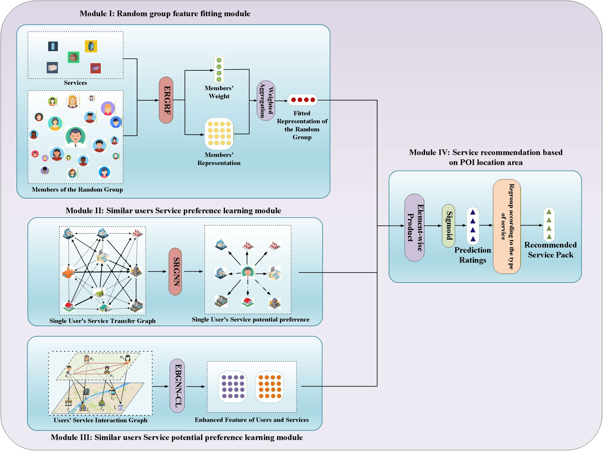
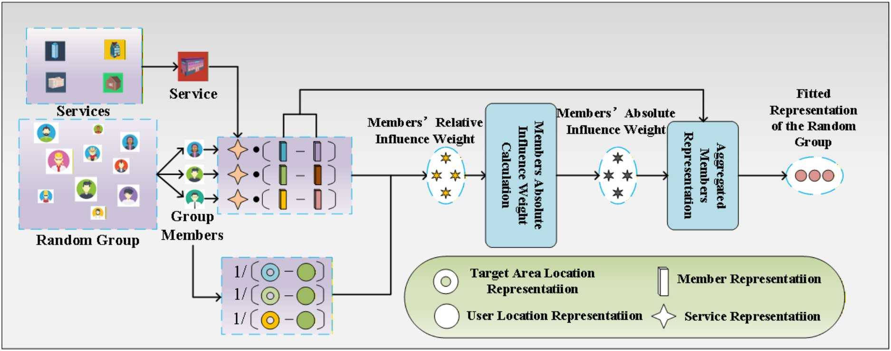
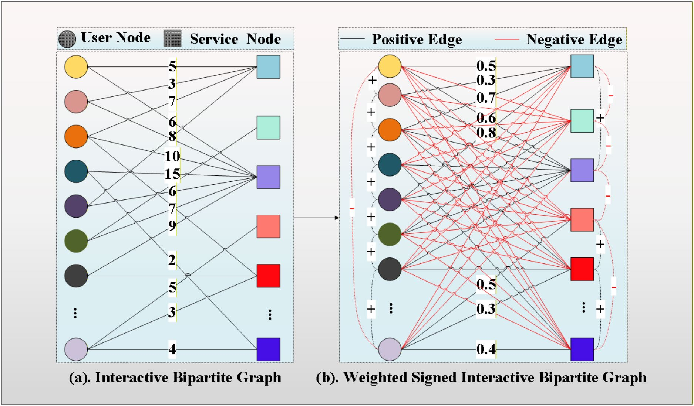
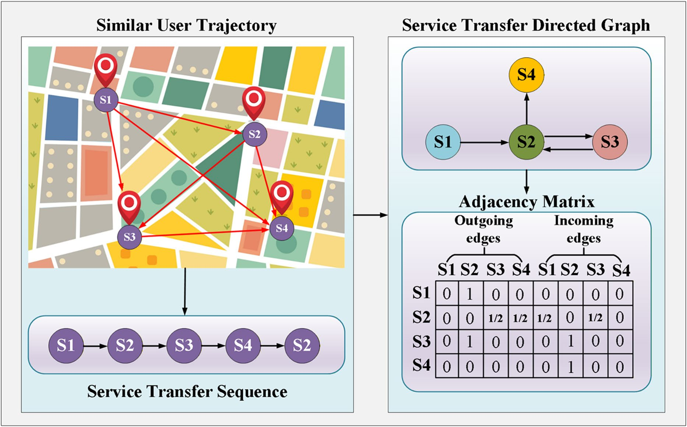
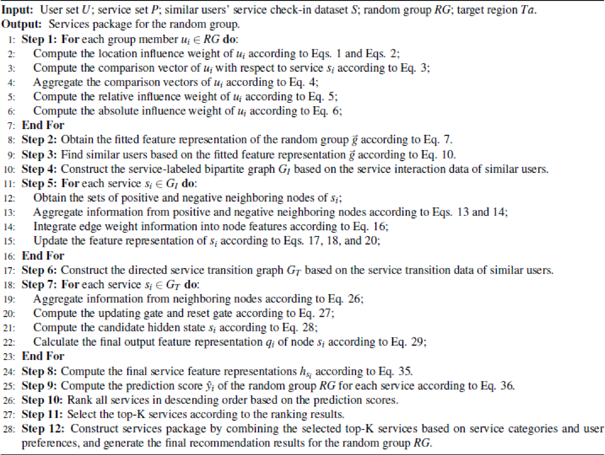

|  |  |
| --- | --- |
|  | www.nature.com/scientificreports |

# POI location-aware services package recommendation for random groups

Ling Shang1, Xiaoyu Song 2 , Zhizong Liu3,6,7, Kai Zhang3,7, Quan Z. Sheng4,7 & Jian Yu5,7 Recently, with the rapid growth of Point of Interest (POIs) and increasing of social activities, more and more individuals tend to join parties or trips with groups formed randomly (named random groups, RGs). Although some works have proposed wonderful POI recommendation methods for RGs, they failed to consider how to recommend service packages for RGs after they accept the recommended POIs, which significantly degrades user experience. To address this issue, this work proposes a POI location-aware service package recommendation model for random groups (termed PLSPR-RG). First of all, PLSPR-RG generates fitted feature representations of random groups with an enhanced feature learning method. Then, it selects users with similar characteristics to the random group and utilizes service usage data of similar users as the training dataset for PLSPR-RG. Subsequently, PLSPR-RG constructs a service labeled bipartite graph of similar users, then it employs an edgeenhanced bipartite graph neural network with multi-view contrastive learning (EBGNN-CL) to learn service feature representations that capturing both positive and negative interaction preferences of similar users. Furthermore, PLSPR-RG builds a directed service transition graph based on the service interaction records of similar users and adopts the SRGNN network to learn service feature representations containing latent user preferences, as well as user preference representations. Finally, based on the learned service representations and the fitted features of random groups, PLSPR-RG generates a ranked list of recommended services, thereby completing POI location-aware service package recommendation for random groups. Extensive experiments have been conducted on three public datasets (Foursquare, Gowalla and Yelp dataset), which have proved that our proposed model outperforms the state-of-the-art models.

Keywords  Point of interest (POI), Random groups, Service package recommendation, Session-based neural network, Graph neural network With the rapid development of mobile Internet and location-aware technologies, Location-Based Social Networks (LBSNs) have evolved into widely popular platforms, such as Foursquare and Gowalla1–3. These platforms allow users to share check-ins at visited locations, thereby generating massive check-in datasets. Currently, Point of Interest (POI) recommendation has become an important technique in LBSN4–6. By jointly considering users’ geographical information and historical activity records, POI recommendation techniques can effectively identify and suggest optimal POIs that match individual preferences, thereby promoting the development of personalized services and enhancing user experience significantly. Recently, POI recommendation has emerged as a research hotspot in the recommendation research field, yielding a number of notable achievements. For instance, Liu et al.7 proposed a POI recommendation framework that incorporates diversity-aware collaborative filtering. Sojahrood et al.8 developed a novel method that integrates users’ geographical locations with personal preferences to achieve more accurate POI recommendations. Zhu et al.9 further enhanced system performance through distance-based pre-filtering and ranking optimization strategies. Recent studies have further incorporated long-term spatiotemporal preference mining and time-aware cross-domain transfer into POI recommendation, demonstrating the importance of temporal and spatial context in location-based recommendation scenarios10,11.

1Digital Smart Creative Department, Henan Culture and Tourism Investment Group Co., Ltd, Luoyang 471026, China. 2College of Information Engineering, Yantai Institute of Science and Technology, Yantai 264005, China. 3School of Computer and Control Engineering, Yantai University, Yantai 264005, China. 4School of Computing, Macquarie University, Sydney, NSW 2109, Australia. 5Department of Computer Science, Auckland University of Technology, Auckland 1142, New Zealand. 6Shandong Key Laboratory of Digital Service Computing and Systems, Yantai, Yantai 264005, China. 7These authors contributed equally to this work: Zhizong Liu, Kai Zhang, Quan Z. Sheng and Jian Yu. email: sxyytdxjkxy@gmail.com In human social life, people often participate in activities in the form of groups that formed randomly (called random groups). Therefore, it becomes critical to recommend POIs for random groups. For this issue, recently, several works have proposed wonderful POI recommendation methods for groups. For example, Schiaffino et al.12 developed a multi-agent integration framework to address POI recommendation in group environments. Liu et al.13 proposed a POI recommendation model for random and temporary groups. In our previous work14, we developed the accurate POI recommendation method for random groups based on improved graph neural networks and multi-negotiation model.

In fact, after a random group reaches the recommended POI, some members may need several different services (e.g., dining service, entertainment service, accommodation service, and so on) around the recommended POI. Therefore, it is necessary to develop new technique for recommending a series of services (we call them as services package) for random groups while considering POI location, group preferences, etc, thus to improve the overall experience. However, existing works13,14 mainly focus on improving the accuracy of POI recommendation for random groups, while paying little attention to recommending services package for random groups after recommending POIs for random groups. In all, POI location-aware services package recommendation for random groups still faces several critical challenges, which are presented as follows:

- How to find the optimal services package for random groups while considering POI location? Although existing POI recommendation research has achieved significant progress in improving group recommenda­ tion accuracy8,15,16, few works considers how to recommend service packages that match group preferences after recommending POIs for random groups. In practice, random groups often utilize surrounding services when visiting a POI. However, currently, the problem of POI location-aware service package recommenda­ tion is still open. • How to generate accurate fitted feature representations for random groups? The problem of POI loca­ tion-aware service package recommendation for random groups is essentially a region-constrained multi-ser­ vice recommendation problem. Existing group feature fitting methods typically assume that the user–item interaction records are available. However, under region constraints in LBSNs, users may have no prior inter­ actions with services in the target area, thus, existing methods for fitting the feature of random groups cannot be applied. So, how to generate accurate fitted feature representations for random groups is still a challenging issue. • How to generate precise representations of nodes in user-service graph? For the problem of POI loca­ tion-aware service package recommendation for random groups, it needs to adopt graphs to describe the interaction relationship among users and services. Actually, Graph Neural Networks (GNN) have great po­ tential in graphs learning. However, most existing node representations learning methods based on GNNs just learning from a single perspective, making it difficult to capture both local interaction details and global structural information, thus failed to fully exploit complementary information across multiple views. There­ fore, how to improve the precise of node representations learning in the user-service graph is still a challeng­ ing issue.

To address the above issues, we develop a POI location-aware service package recommendation model for random groups (termed PLSPR-RG). First, PLSPR-RG generates fitted feature representations of random groups using an enhanced feature learning approach. Then, it identifies users with similar characteristics based on similarity measures and constructs a training dataset using their services usage data. Next, PLSPR-RG builds a service–labeled bipartite graph of similar users and adopts an edge-enhanced bipartite graph neural network with multi-view contrastive learning (EBGNN-CL) to learn service representations that capturing both positive and negative interaction preferences. Furthermore, a directed service transition graph is constructed based on service interaction records, and the SRGNN model is employed to learn service representations with latent preferences as well as user preference representations. Finally, PLSPR-RG generates a ranked list of recommended services for random groups based on learned service features and group representations, thereby completing POI location-aware service package recommendation. The main contributions of this work are summarized as follows:

- We propose a POI location-aware services package recommendation model for random groups. To ad­ dress the problem of recommending services after POI recommendation for random groups, this work pro­ poses a POI location-aware service package recommendation model (named PLSPR-RG). To the best of our knowledge, this is among the early works that address the problem of services package recommendation for random groups after recommending POIs, and proposes an efficient model for this problem. • We propose an enhanced fitted feature representations learning method for random groups. Consider­ ing the lack of social relationships among group members and the sparsity of service interactions in target regions, this work proposes an enhanced group feature modeling method. By leveraging historical user–ser­ vice interactions and location information, it approximates user preferences for services in the target region. Additionally, user influence within the group is modeled based on visit frequency, ensuring a reasonable distribution of group opinions and improving both accuracy and fairness. • We propose an improved GNN for learning users’ preference and services’ feature. To generate precise representations of nodes in graph, we develop an improved graph neural network with multi-view contrastive learning, which captures rich user–POI interaction information from multiple perspectives and enhances the robustness and generalization ability of feature representations, which significantly improves the accuracy of user preference and service feature learning.Comparison with prior group recommendation works. To clearly delineate the contributions of PLSPR-RG relative to our prior works on POI recommendation for ran­ dom groups, Table 1 presents a feature-level comparison. The proposed PLSPR-RG extends APRRGM14 (our

earlier work on precise POI pair recommendation for random groups) by incorporating region constraints, multi-view contrastive learning, and user transition preference analysis. Compared with CGNN-PRRG13, PL­ SPR-RG further introduces region-aware service filtering and multi-view contrastive learning, while shifting the recommendation objective from individual POIs to location-aware service packages.

The remainder of this paper is organized as follows. Section Related Work reviews related work. Section Problem Statement presents the problem definition and preliminaries. Section METHODOLOGY introduces the PLSPR-RG model in detail. Section Experiments and Analysis reports the experimental results. Finally, Conclusion and Future Work concludes the paper and outlines future research directions.

### Related work

In this section, we review related work on recommendation methods for random groups as well as locationbased service recommendation approaches.

### Research on random group recommendation methods

In human social activities, random groups represent an important form of group interaction. However, the characteristics of random groups differ significantly from those of fixed groups, making it difficult to directly apply existing group recommendation methods. To address this issue, several studies have explored recommendation techniques tailored for random groups. For example, Guo et al.15 proposed a movie recommendation model for random groups. This model first employs a multivariate extreme learning approach to establish preference relationships and predict unknown preferences, and then applies a boundary voting rule to generate recommendations for random groups. However, this method ignores the social influence of group members, making it unable to capture users’ interaction preferences effectively. Ding et al.16 considered users’ rating information and developed a random group movie recommendation model named GRMFC. This model converts a random group into a virtual user and then applies personalized recommendation techniques to recommend suitable movies. Nevertheless, it fails to account for the influence of individual members when generating group representations. Pujahari et al.17 proposed a recommendation method for random groups that utilizes preference-relation-based matrix factorization to infer unknown ratings, followed by a graph aggregation strategy to combine group members’ preferences. In addition, Wang et al.18 proposed a travel recommendation model for random groups, termed MCS, which generates recommendations by considering the contribution of each group member. Zaman and Jana19 developed an automated recommendation model based on ordinal probit regression factorization machines, which leverages probabilistic modeling to capture complex user–item interactions and improve recommendation quality. In our previous work, we proposed a precise POI pair recommendation method for random groups. The research presented in this paper can be regarded as an extension of that work.

### Research on location-based recommendation methods

In the field of recommendation systems, Location-Based Services (LBS) have become an important research direction. With the widespread adoption of mobile devices and the advancement of positioning technologies, location-based information and services have gained increasing importance. In this context, location-based group recommendation methods not only consider individual user preferences but also incorporate geographical information, as well as interactions and shared interests among group members. For instance, Ayala-Gómez et al.20 proposed a hybrid recommendation system that integrates geographical preferences, location features, and group behavior. This approach employs kernel density estimation (KDE) to model group-level geographical preferences and prioritizes POIs located in regions with high group activity frequency. Lyu et al.21 designed a location-aware multi-view group feature learning framework, which leverages multiple types of information to learn deep representations of group preferences, while incorporating spatial attributes to capture real-time group interests. Furthermore, Zhang et al.22 proposed a location-aware deep collaborative filtering model for service recommendation. This model addresses the limitations of traditional collaborative filtering methods in handling high-dimensional nonlinear relationships, data sparsity, and location dependency by mapping location features into high-dimensional dense embeddings, thereby effectively improving recommendation performance. Zaman and Jana23 introduced a parallel inductive shift learning framework for recommendation systems, demonstrating the effectiveness of parallel learning paradigms in improving model scalability and recommendation accuracy.

| Feature | APRRGM14 | CGNN-PRRG13 | PLSPR-RG |
| --- | --- | --- | --- |
| Recommendation task | POI Rec. | POI Rec. | Service Package Rec. |
| Target group type | Random Groups | Random Groups | Random Groups |
| Region-constrained service filtering | inline-eq-IEq1 | inline-eq-IEq2 | inline-eq-IEq3 |
| Multi-view contrastive learning | inline-eq-IEq4 | inline-eq-IEq5 | inline-eq-IEq6 |
| User transition preference | inline-eq-IEq7 | inline-eq-IEq8 | inline-eq-IEq9 |
| Negative interaction modeling | inline-eq-IEq10 | inline-eq-IEq11 | inline-eq-IEq12 |
| Negotiation model | inline-eq-IEq13 | inline-eq-IEq14 | inline-eq-IEq15 |

*Table 1.  Feature comparison between PLSPR-RG and prior group POI recommendation models.*

### Problem statement

The problem of POI location-aware service package recommendation for random groups can be formally described as follows: Given a users set U, a services set S, a target region inline-eq-IEq16, and a POI check-in dataset of similar users SU, a random group is constructed from U. Based on the above information, the objective is to recommend a set of services located within the target POI region that best match the preferences of the random group.The key definitions are presented as follows.

Definition 1. Users Set. Let i n line -eq - I E q 17 , denote the set of users, where m represents the total number of users. For any user in l ine-eq-IEq18, there exists a unique user identifier associated with inline-eq-IEq19.

Definition 2. Services Set. A service is defined as a service venue in geographical space that satisfies specific user needs (e.g., restaurants, cinemas). Each service is associated with three attributes: an ID, a category, and geographic coordinates in l ine-eq-IEq20 where lon and lat denote longitude and latitude, respectively. Let i n line-eq-IEq21 represent the service set, where n is the number of services. Remark on Terminology. In this work, a POI refers to the destination location chosen by the random group (e.g., a tourist attraction), while services denote the surrounding service venues (e.g., restaurants, cinemas, hotels) that members may visit after arriving at the POI. The goal is to recommend a service package given a target POI location. As publicly available datasets dedicated to service recommendation are scarce, we utilize POI check-in data from widelyused LBSN datasets (Foursquare, Gowalla, Yelp) to simulate service interaction records, treating visited POIs as proxy service venues. This is a common practice in location-based service recommendation research22.

Definition 3: Random Group. A random group is typically formed by randomly selecting multiple users from the user set. The formation process is stochastic and non-repetitive, and there are generally no social relationships among group members. In this work, a random group is defined as in l ine- eq- IEq2 2 where |RG| denotes the number of users in the random group. Note that for any randomly constructed group RG, we let in l ine-eq-IEq23.

Definition 4. Similar Users’ Check-ins.Let in l ine-e q-IE q24 denote the service usage data of users whose characteristics are similar to the random group RG. For each user, inl i ne-eq -IEq 25 represents the service check-in sequence of user inline-eq-IEq26, where inl i ne-e q-I Eq27 denotes the sequence of services visited by user inline-eq-IEq28.

Definition 5. Target Area. Let in l ine- e q- I Eq 29 denote a circular region centered at POI inline-eq-IEq30 with radius a. This region contains a subset of services inli ne-e q-IEq31 located within the target area. In this work, the radius a is set to 50 km, which corresponds to approximately one hour of driving distance – a reasonable upper bound for a day-trip activity where group members are willing to travel to access services around the recommended POI.

### POI location-aware service package recommendation model for random groups

To recommend optimal service packages for random groups after POI recommendation, thereby enhancing overall group service experience, this work proposes a POI location-aware service package recommendation model for random groups(named PLSPR-RG), which is illustrated in Fig.1. Specifically, PLSPR-RG consists of four main components, which are random group feature fitting module, similar users’ service interaction preference learning module, user latent service preference learning module, and random group service package recommendation module. The calculation process of PLSPR-RG is introduced as follows:

Firstly, PLSPR-RG generates fitted feature representations for random groups based on the feature learning model proposed by this work. Then, to address the data cold-start problem commonly encountered in recommendation for random groups, PLSPR-RG computes similarity scores to identify users with characteristics similar to those of the target random group, and leverages their service usage data as the training dataset for the model. Subsequently, PLSPR-RG constructs a service–labeled bipartite graph of similar users, then, it learns service feature representations that capture both positive and negative interaction preferences of similar users, with our proposed edge-enhanced bipartite graph neural network with multi-view contrastive learning (EBGNN-CL). Furthermore, PLSPR-RG builds a directed service transition graph based on individual service interaction records of similar users, and adopts the session-based recommendation with graph neural networks (SRGNN) model24 to learn service representations containing latent user preferences, as well as user preference representations. Finally, PLSPR-RG generates a ranked list of recommended services for the random group based on the learned service representations and the fitted group features, thereby completing the task of POI regionaware service package recommendation for random groups. In the following sections, we provide a detailed description of each module in PLSPR-RG.

### Random group feature fitting module

To obtain fitted feature representations for random groups, this work proposes an enhanced random group representation fitting module, termed ERGRF. The architecture of ERGRF is illustrated in Fig. 2. Specifically, ERGRF first computes the location influence weight of each user based on the distance between the user’s habitual location and the central POI of the target region inline-eq-IEq32. Next, ERGRF learns the feature representations of group members as well as their relative influence weights based on their historical service usage data. Subsequently, to derive absolute influence weights of group members, ERGRF adopts a random sampling strategy to select a reference (anchor) member as a baseline. By normalizing the relative influence weights of other members with respect to the selected reference member, ERGRF produces comparable absolute influence weights. Finally, ERGRF aggregates the feature representations of group members weighted by their absolute influence scores to generate the fitted feature representation of the random group. The detailed computational process of the ERGRF model is presented as follows.

*Fig. 1.  Overall architecture of the proposed PLSPR-RG model.*

*Fig. 2.  Flowchart of ERGRF model calculation.*

Obtaining the location influence weight of group members Obtaining the location influence weights of group members is crucial for accurately evaluating their influence within group activities. It not only reflects the proximity between members and the target region inline-eq-IEq33, but also dynamically adjusts their potential contribution to group decision-making. The computation of location influence weights enables the identification of key influential members, thereby optimizing resource allocation within the group.

To measure the distance between a group member inline-eq-IEq34 and the center POI inline-eq-IEq35 of the target region inline-eq-IEq36, and further compute the corresponding location influence weight, we adopt the Haversine formula to compute the great-circle distance between two geographic coordinates, as defined in Eq. (1):

Eq d i sp l ay-equ1  (1)

where i n line-eq-IEq37 km is the Earth’s mean radius, in l ine-eq-IEq38, in l ine-eq-IEq39 are the latitudes of the group member and the target POI (converted to radians), in l in e -eq-IEq40, in l ine-eq - IEq41, and inline-eq-IEq42 and inline-eq-IEq43 denote the longitude and latitude of inline-eq-IEq44, respectively, while inline-eq-IEq45 and inline-eq-IEq46 denote the longitude and latitude of the group member inline-eq-IEq47. Compared with the simplified Euclidean distance used in our preliminary implementation, the Haversine formula provides an accurate great-circle distance suitable for geographic coordinate systems.

Specifically, if the distance between inline-eq-IEq48 and inline-eq-IEq49 does not exceed a predefined maximum distance threshold inline-eq-IEq50, the location influence weight can be calculated as follows:

l a y eq-E q u2  (2)

dis p Obtaining the feature representation and absolute influence weight of group members To obtain the absolute influence weights of random group members, ERGRF first computes the pairwise comparison vector between any two group members inline-eq-IEq51 and inline-eq-IEq52 with respect to service inline-eq-IEq53, the calculation formula is defined as Eq. (3):

idsp l ay-eq -Equ 3  (3)

where niline-eq-IEq54 denotes the comparison vector, inline-eq-IEq55 and inline-eq-IEq56 represent the feature vectors of group members inline-eq-IEq57 and inline-eq-IEq58, respectively. inline-eq-IEq59 denotes the feature vector of service inline-eq-IEq60. The intuition behind Eq.(3) is that by exploring the differences between two data objects, one can capture their underlying semantic relationships. For random groups, such semantic relationships is useful for characterizing the interactions among group members, thereby facilitating the modeling of group decision-making processes. Based on Eq. (3), it is possible to identify group members who are more familiar with service inline-eq-IEq61, and assign them higher influence weights. Subsequently, ERGRF aggregates the comparison vectors between group member inline-eq-IEq62 and all other members with respect to service inline-eq-IEq63 , as defined in Eq. (4):

lay ids p  (4)

eq-Equ4 where niline-eq-IEq64 denotes the aggregated comparison vector of group member inline-eq-IEq65, which is obtained by summing the comparison vectors between inline-eq-IEq66 and all other group members.

Different from the work of Zan et al25 that first aggregates pairwise comparison vectors for each item and then feeds the results into an MLP to obtain influence weights, the proposed ERGRF does not compute influence weights for each specific service individually. Instead, it considers the overall influence of group members across all services as their relative influence weights. The computation process is defined as Eq. (5).

dis p l ayeq -Eq u5  (5)

where inline-eq-IEq67 denotes the relative influence weight of group member inline-eq-IEq68, i n line-eq-IEq69 represents the concatenation operation, inline-eq-IEq70 is the activation function, and inline-eq-IEq71 maps the output into the interval (0–1). ERGRF first concatenates the aggregated comparison vectors corresponding to group member inline-eq-IEq72, and then feeds the result into an MLP to obtain the relative influence weight inline-eq-IEq73.

However, the relative influence weight inline-eq-IEq74 obtained from Eq. (5) is derived from pairwise comparisons between group members and services, without explicitly incorporating a global reference for weight comparison. As a result, it cannot fully reflect the absolute influence of member inline-eq-IEq75 within the group. To address this issue, ERGRF randomly selects a representative member inline-eq-IEq76 as a reference, and performs a global weight comparison between other members and inline-eq-IEq77, thereby deriving the absolute influence weights of group members. The computation process is defined as follows:

d is p lay-eq- E qu6  (6)

where inline-eq-IEq78 and inline-eq-IEq79 denote the relative influence weights of group members inline-eq-IEq80 and inline-eq-IEq81, respectively, in line-eq-IEq82 represents the absolute influence weight of member inline-eq-IEq83, inline-eq-IEq84 denotes the location influence weight of inline-eq-IEq85, and inline-eq-IEq86 is the absolute value function. Since in line-eq-IEq87 is computed through a comparison with the representative member inline-eq-IEq88, it can better capture the absolute influence of each member within the random group RG. In addition, experimental results presented in Table 11 demonstrate that incorporating absolute influence weights into random group feature modeling can further improve the overall recommendation performance.

Generation of fitted feature representation for random groups After obtaining the absolute influence weights of group members, ERGRF aggregates the feature representations of group members based on their absolute influence weights, thus to generate the fitted feature representation of the random group. The computation process can be described as follows:

play di s Eq u 7  (7)

eqwhere inline-eq-IEq89 denotes the fitted feature representation of the random group RG, inline-eq-IEq90 represents the absolute influence weight of group member inline-eq-IEq91, and inline-eq-IEq92 denotes the feature vector of user inline-eq-IEq93. Compared with existing group feature aggregation methods, ERGRF not only considers the heterogeneous influence of group members but also further incorporates absolute influence weights into the aggregation process. Therefore, ERGRF can generate more accurate fitted feature representations for random groups.

Loss function and training optimization for ERGRF To optimize the ERGRF module, we formulate the prediction of interaction relationships between the random group RG and services as the driving task for training. Specifically, ERGRF predicts whether there exists an interaction between the random group RG and a service, thereby guiding the training process. In particular, ERGRF first feeds the fitted feature representation of the random group and the feature representation of services into an MLP to compute the interaction prediction score. The computation process is described as follows:

dis p lay - eq-Equ8  (8)

where inline-eq-IEq94 denotes the predicted interaction score between the random group RG and service inline-eq-IEq95, inline-eq-IEq96 is the normalization function that maps the score into the interval (0, 1), and inl ine -eq-IEq97, and inline-eq-IEq98 are learnable parameters of the model.

Then, ERGRF treats the service usage records of group members as positive interaction samples, while services that have not been used by the random group are selected as negative samples. A pairwise regression loss is adopted to maximize the margin between positive and negative samples, thereby optimizing the ERGRF model. The loss function is defined as follows:

d i s play-eq  (9)

Equ9 where Train denotes the training datasets, and i and j represent the indices of positive and negative service interaction samples for the random group RG, respectively. After computing the loss, ERGRF updates the model parameters through back propagation to complete the training process.

### Similar user service interaction preference learning module

Due to the randomness and non-repetitive nature of random group construction, as well as the temporary life of such groups, newly formed random groups usually lack sufficient historical service interaction records. Therefore, this work adopts cosine similarity as the similarity measurement function to identify users whose characteristics are similar to those of the random group, and utilizes the service interaction data of these similar users as the training dataset for our proposed model. The formula for computing cosine similarity is defined as Eq. (10):

display-eq-Eq u 10  (10)

where K denotes the dimensionality of the feature vectors, inline-eq-IEq99 represents the similarity between a user and the random group RG, and inline-eq-IEq100 and inline-eq-IEq101 denote the feature representations of the user and the random group, respectively.

For service package recommendation, users’ service interaction preferences play a crucial role for improving performance of the recommendation model26,27. To learn the service interaction preferences of similar users, and thereby infer the service interaction preferences of the random group, model PLSPR-RG first constructs a service–labeled bipartite graph based on the service interaction data of similar users, which is illustrated in Fig. 3(a).

Considering that different users may exhibit different interaction preferences toward the same service (including both positive and negative preferences), model PLSPR-RG further improves the traditional service– labeled bipartite graph by constructing a service–labeled interaction bipartite graph, which is shown as Fig. 3(b). Compared with the traditional bipartite graph28, the service–labeled bipartite graph incorporates richer interaction information, which facilitates more comprehensive and accurate learning of user service interaction preferences.

Subsequently, based on the constructed service–labeled bipartite graph, we propose an edge-enhanced bipartite graph neural network model with multi-view contrastive learning (EBGNN-CL), which is used to learn service feature representations that capturing both positive and negative interaction preferences of similar users. Compared with existing bipartite graph neural network models29, EBGNN-CL not only aggregates node feature information but also learns edge-level information. Moreover, multi-view contrastive learning further enhances the model’s capability to capture user preferences. In the following, we first introduce the construction of the service–labeled bipartite graph, and then introduce the learning process of user service interaction preferences with EBGNN-CL.

Constructing service-labeled bipartite graph Let in l ine- eq- IEq1 02 denote the random group, and in l ine- eq- IEq1 03 denote the set of services accessed by similar users. Let i n line -eq-IEq104 (in l ine -e q -IEq105) represent the service interaction records of similar users. The construction process of the service-labeled bipartite graph is described as follows. If a similar user inline-eq-IEq106 has visited service inline-eq-IEq107, a positive edge is established between inline-eq-IEq108 and inline-eq-IEq109; otherwise, a negative edge is established between them. Furthermore, if two users inline-eq-IEq110 and inline-eq-IEq111 have edges with the same label toward a service inline-eq-IEq112, a positive edge is constructed between inline-eq-IEq113 and inline-eq-IEq114; otherwise, a negative edge is constructed. Similarly, if two services inline-eq-IEq115 and inline-eq-IEq116 have edges with the same label from a user inline-eq-IEq117, a positive edge is established between inline-eq-IEq118 and inline-eq-IEq119; otherwise, a negative edge is established. In addition, the visiting frequency of similar users to services is converted into weight information on the positive edges between users and services.

According to the above construction rules, a service-labeled bipartite graph for similar users can be constructed, which is illustrated in Fig. 3(b). Let in l ine- eq- IEq120 denote the constructed service-labeled bipartite graph, where inline-eq-IEq121 and inline-eq-IEq122 represent the sets of similar users and services, respectively, and inline-eq-IEq123 denotes the set of edges. Moreover, in l in e -eq-IEq124, in l in e -eq-IEq125, where inline-eq-IEq126 and inline-eq-IEq127 denote the sets of positive and negative edges, respectively.

Service positive and negative interaction preferences learning with EBGNN-CL The PLSPR-RG model leverages the constructed service-labeled bipartite graph inline-eq-IEq128 and employs the proposed EBGNN-CL to learn service feature representations that capturing both positive and negative interaction preferences of similar users. Specifically, EBGNN-CL first constructs multiple views and utilizes augmented data (e.g., edge dropout and noise injection) of the service-labeled bipartite graph inline-eq-IEq129 as model inputs. Within each view, EBGNN-CL extracts node features from neighboring nodes through three mechanisms: message passing,

*Fig. 3.  Weighted labeled bipartite graph of similar user-service interactions.*

information aggregation, and information update. Next, we will introduce the computation process of EBGNN- CL in terms of these three mechanisms.

- Message propagation. Let inline-eq-IEq130 denote the set of nodes containing both similar users and services, and inline-eq-IEq131 denote the set containing only one type node. Specifically, when performing computations for user nodes, inline-eq-IEq132 contains only user nodes; when performing computations for service nodes, inline-eq-IEq133 contains only service nodes.

For the l-th layer of the EBGNN-CL model, let in line-eq-IEq134 denote the transformation matrix for positive edges from services to users, and inli ne-eq-IEq135 denote the transformation matrix for negative edges. The message passing process is described as follows:

splay-e q-E q u11 di  (11)

where inline-eq-IEq136 and inline-eq-IEq137 denote the sets of positive and negative neighboring service nodes of user inline-eq-IEq138, respectively, and inl ine-eq-IEq139 represents the feature vector of service inline-eq-IEq140.

line-eq-IEq141 to propagate messages from users to services through positive edges, and inli Similarly, EBGNN-CL uses in ne-eq-IEq142 through negative edges. The message passing process is defined as follows:

splay-e q-E q u12 di  (12)

line-eq-IEq143 denotes the feature vector of user inline-eq-IEq144, and inline-eq-IEq145 and inline-eq-IEq146 denote the sets of positive and where in negative neighboring user nodes of service inline-eq-IEq147, respectively.

After completing the message passing process on the node set inline-eq-IEq148, which contains two types of nodes, EBGNN-CL proceeds to perform message passing on the node set inline-eq-IEq149, which contains only one type of node. The message passing process for both service nodes and similar user nodes in inline-eq-IEq150 is defined as follows:

splay-eq -Eq u 13 di  (13)

splay-eq -Eq u 14 di  (14)

where inline-eq-IEq151 and inline-eq-IEq152 denote the sets of positive and negative neighboring service nodes of service inline-eq-IEq153, respectively, while inline-eq-IEq154 and inline-eq-IEq155 denote the sets of positive and negative neighboring user nodes of user inline-eq-IEq156.

- Information Aggregation. After completing the message passing process, EBGNN-CL incorporates the edge weight information of the service-labeled bipartite graph into the node feature representations. Specifically, EBGNN-CL first normalizes the visiting frequency of similar users to services on the edges. Then, the normalized weights are integrated with node features to update the node representations. The detailed computation is presented as follows:

dis p lay-eq-Equ 15  (15)

line-eq-IEq159 and niline-eq-IEq160 denote the original and updated feature representations of node i, respectively.

where inline-eq-IEq157 denotes the weight of the edge, inline-eq-IEq158 represents the normalization function, and in Subsequently, EBGNN-CL aggregates information from neighboring nodes to the target node. Specifically, it first computes the attention weights between the target node and its neighbors, which is defined as Eq. (16):

lay eq-Equ16 dis p  (16)

where inline-eq-IEq161 denotes the feature vector of node i, inline-eq-IEq162 represents the concatenation operation, W is the learnable weight matrix, inline-eq-IEq163 is the learnable attention vector, inline-eq-IEq164 denotes the set of neighboring nodes of node i, and inline-eq-IEq165 and inline-eq-IEq166 denote the activation and normalization functions, respectively.

Finally, based on the computed attention weights inline-eq-IEq167, EBGNN-CL aggregates information from neighboring nodes to update the target node representations. The aggregation process is described as follows:

displa y qu17 eq-E  (17)

where inline-eq-IEq168 denotes the set of neighboring nodes of node i. EBGNN-CL formulates the attention-based aggregation mechanism as an optimization problem over the attention weights inline-eq-IEq169, which are further refined through backpropagation during training.

- Information Updating. After performing the message passing and information aggregation processes, each similar user node inline-eq-IEq170 obtains four sets of neighboring information, denoted as in

line-eq-IEq174, respectively. Similarly, each service node inline-eq-IEq175 also aggregates four types of neighboring information, namely in line-eq-IEq171, in line-eq-IEq172, in line-eq-IEq173, and in line-eq-IEq177, in line-eq-IEq176, in line-eq-IEq179. In the information updating stage, EBGNN-CL integrates these two types of neighboring information into the target node to obtain the final node representations. The updating process can be described as follows:

line-eq-IEq178, and in disp l a y-eq-Eq u18  (18)

where inl ine-eq-IEq180 and inl ine-eq-IEq181 denote the feature representations of similar user nodes and service nodes, respectively, and || represents the concatenation operation. The MLP consists of two fully connected neural network layers integrated with dropout and activation functions. The computation process of the MLP is defined as follows:

displa y -eq-Equ19  (19)

where inline-eq-IEq182, inline-eq-IEq183, inline-eq-IEq184, and inline-eq-IEq185 are learnable parameters of the MLP, inline-eq-IEq186 denotes the activation function, and inline-eq-IEq187 is applied to prevent overfitting and enhance the generalization capability of the model.

Finally, the output of the EBGNN-CL model is represented as following:

d i spl ay -e q- Equ2 0  (20)

where in line-eq-IEq188 denotes the service feature representation that integrates both positive and negative interaction preferences of similar users.

- Negative Sampling Strategy. To improve the discriminative capability of the EBGNN-CL model, we adopt a geographic-aware dynamic negative sampling strategy. Unlike conventional approaches that rely on fixed pre-generated negative samples, our method regenerates negative samples at each training epoch, and prioritizes services that are geographically close to the positive service but have not been visited by the user. Specifically, for each positive user-service interaction edge inli ne-eq-IEq189, we construct negative samples by selecting services inline-eq-IEq190 that satisfy two conditions: (1) inline-eq-IEq191 is within a geographic radius i n line-eq-IEq192 km (approximately one hour of driving distance) from inline-eq-IEq193, and (2) user inline-eq-IEq194 has no prior interaction with inline-eq-IEq195. If an insufficient number of geographic negatives exists, the remaining quota is filled by random sampling from the full service set. The Haversine formula is used to compute pairwise geographic distances between services. This strategy provides the model with more challenging negative samples – geographically proximate but unvisited services – which forces EBGNN-CL to learn finer-grained preference boundaries. The geographic negative samples are regenerated every epoch to prevent the model from memorizing fixed negative patterns.

Loss function and training optimization for EBGNN-CL To optimize the learning module of similar users’ service interaction preferences with EBGNN-CL, we formulate edge prediction on the service-labeled bipartite graph inline-eq-IEq196 as the driving task for training. Specifically, the model predicts whether there exists an interaction relationship between similar users and services in inline-eq-IEq197, thereby guiding the training of EBGNN-CL.

In particular, EBGNN-CL first computes the probability inline-eq-IEq198 for an edge between a user inline-eq-IEq199 and a service inline-eq-IEq200 , which is defined as Eq. (21):

displ a y-eq-Eq u21  (21)

where MLP denotes a feedforward neural network, inline-eq-IEq201 represents the concatenation operation, and inline-eq-IEq202 and inline-eq-IEq203 denote the feature representations of user inline-eq-IEq204 and service inline-eq-IEq205, respectively. The predicted value inlin e -eq -IEq206 represents the probability that user inline-eq-IEq207 interacts with service inline-eq-IEq208.

Then, based on the predicted probability inline-eq-IEq209 and the ground-truth label inline-eq-IEq210, the binary cross-entropy loss is adopted to compute the loss value, which is defined as Eq. (22):

d i splay-eq - Equ22  (22)

where inline-eq-IEq211 is a weighting parameter used to alleviate the imbalance between positive and negative samples, thereby stabilizing the training process of EBGNN-CL, inline-eq-IEq212 is the predicted value, and inlin e -eq -IEq213 denotes the ground-truth label.

Finally, EBGNN-CL optimizes the model parameters through backpropagation based on the total loss computed from multiple views. Specifically, the overall loss function is defined as:

displa y -eq- E qu23  (23)

where inline-eq-IEq214 denotes the binary cross-entropy loss used for supervised learning, inline-eq-IEq215 represents the contrastive loss of EBGNN-CL, and inline-eq-IEq216 is a hyperparameter that controls the balance between the two loss terms.

### Latent service preferences learning module

In real world, user–service interactions typically exhibit sequential transition patterns, where users move from one service to another. Consequently, users’ service transition sequences inherently capture their latent service preferences30. Effectively modeling such latent preferences is crucial for improving the quality of service recommendations31. However, service recommendation studies often overlook users’ latent service preferences, which may limit the overall recommendation performance.

To address the above limitation, we incorporate a latent service preference learning mechanism based on similar users. By learning the latent service preferences of similar users, our proposed model approximates the latent preferences of the random group, thereby further enhancing the quality of service recommendations. Specifically, we first constructs a directed service transition graph based on the service transition data of similar users. Then, based on the constructed graph, the model employs SRGNN to learn service feature representations that capturing latent service preferences of similar users. In the following sections, we will introduce the construction process of the directed service graph, present the learning process of latent service preferences with SRGNN.

Constructing a directed service transfer graph Let in l ine-e q-IE q217 denote the service usage dataset of similar users, where inl i ne-eq -IEq 218 represents the check-in dataset of similar user inline-eq-IEq219, and inl i ne-e q-I Eq22 0 (i n lin e-eq-IEq221) denotes the i-th service check-in sequence of user inline-eq-IEq222. Based on the service check-in sequence inline-eq-IEq223, a directed service transition graph in l i ne-e q-IEq224 can be constructed, where inline-eq-IEq225 represents the set of services and inline-eq-IEq226 denotes the set of directed transition edges. Each edge i n line -eq-IEq227 (i n line-eq-IEq228) indicates that the user transitions from service inline-eq-IEq229 to service inline-eq-IEq230.

Let in l ine-eq-IEq231 denote the adjacency matrix corresponding to the directed graph in line-eq-IEq232. Different from the conventional adjacency matrix, inline-eq-IEq233 is composed of two parts: an in-degree matrix inl ine-eq-IEq234 and an out-degree matrix inli ne-eq-IEq235 . These two matrices record both the connectivity relationships and edge weights among nodes in the directed service transition graph in line-eq-IEq236. Considering that a service may appear multiple times within a check-in sequence, it is necessary to normalize the edge weights. Specifically, let inl ne-eq-IEq239 denote the weight of the out-degree edge inli ine-eq-IEq237 denote the weight of the in-degree edge inl ine-eq-IEq238 , and inli ne-eq-IEq240 . Their computation processes are defined as follows:

pl a y-eq-Equ2 4 dis  (24)

la y -eq-Equ25 disp  (25)

where inline-e q- I Eq24 1 indicates whether there exists a directed edge from node inline-eq-IEq242 to node inline-eq-IEq243, inline-eq-IEq244 denotes the set of predecessor nodes of node inline-eq-IEq245, and inline-eq-IEq246 denotes the set of successor nodes of node inline-eq-IEq247 . For example, given a service check-in sequence inl i ne-e q-I Eq2 48 , the constructed directed service transition graph in line-eq-IEq249 and its corresponding adjacency matrix inline-eq-IEq250 are illustrated in Fig. 4.

Latent service preferences learning of similar users with SRGNN The PLSPR-RG model leverages the constructed directed service transition graph in line-eq-IEq251 and employs SRGNN to learn service feature representations that capture the latent service preferences of similar users. SRGNN is a session-based recommendation model built upon graph neural networks24, which learns users’ interaction preferences from historical interaction sequences and predicts the next potential interaction item. Therefore, SRGNN can be effectively applied to model the latent service preferences of similar users in this work. In the following sections, we present the learning process of latent service preferences with SRGNN.

First, based on the adjacency matrix inline-eq-IEq252, SRGNN aggregates information from neighboring nodes to the target node. The computation process is defined as follows:

p l ay-eq-Eq u 2 6  (26)

dis where inline-eq-IEq253 denotes the adjacency matrix of the directed service transition graph in line-eq-IEq254, which captures the interaction relationships among nodes (e.g., in-degree and out-degree connections). inlin e-eq-IEq255 represents the feature vector of node i at the previous time step, H is the learnable weight matrix, and inline-eq-IEq256 is the bias vector.

Then, SRGNN computes the values of the updating gate and the reset gate in the gating mechanism. The updating gate determines which information should be retained, while the reset gate controls which information should be discarded. The computation process of the updating gate and reset gate is defined as Eq. (27).

*Fig. 4.  Diagram of directed service transfer for similar users.*

where in line-eq-IEq257 denotes the value of the update gate, and in ine-eq-IEq261, and the reset gate in p l ay-e q ids -Euq2 Finally, based on the updating gate in dis s p lay-eq- E q u27  (27)

di line-eq-IEq258 denotes the value of the reset gate. W and U are learnable parameters of the model, and inline-eq-IEq259 represents the activation function.

Next, SRGNN computes the candidate hidden state of node i based on the previous hidden state inlin e-eq-IEq260 , the current input nil line-eq-IEq262. The computation process is defined as follows:

8  (28)

line-eq-IEq263, the previous hidden state inlin e-eq-IEq264 , and the candidate hidden state nil ine-eq-IEq265, SRGNN computes the final hidden state of node i. The computation process is defined as follows:

p l ay - eq -E q u29  (29)

The output sequence of SRGNN is represented as i n line- eq-I Eq26 6 , where inline-eq-IEq267 denotes the feature representation of service inline-eq-IEq268, which captures the latent service preferences of similar users.

Loss function and training optimization of SRGNN To optimize the latent service preferences learning module with SRGNN, we formulate service sequence prediction as the driving task for model training. Specifically, the model predicts the next possible service in the service check-in sequence of similar users, and utilizes this prediction task to guide the training of SRGNN. In particular, SRGNN first computes the probability of each candidate service being the next interaction. A higher predicted probability indicates a higher likelihood that the service will be the next interaction in the sequence. Then, the predicted probabilities are compared with the ground-truth labels to compute the loss, and then parameters are optimized via backpropagation process.

Specifically, SRGNN first defines the local feature representation of the service sequence inline-eq-IEq269, denoted as inl ine-eq-IEq270. Following the work24, the feature representation of the last service in the sequence is used as the local representation, i.e., inl in e -eq-IEq271. Then, SRGNN defines the global feature representation of the service sequence inline-eq-IEq272 , denoted as inl ine-eq-IEq273. The global representation is obtained by aggregating the feature representations of all services in the sequence. Considering that different services may contribute differently to the sequence representation, SRGNN introduces an attention mechanism to better capture the global preference of the sequence. The computation process is described as Eq. (30).

di s pla y -eq-Equ 3 0  (30)

where inline-eq-IEq274 , inline-eq-IEq275, and inline-eq-IEq276 are used to optimize and update the service feature representations, and c denotes the learnable parameter of the model.

Next, based on the local and global feature representations of the sequence inline-eq-IEq277, SRGNN performs a linear transformation to obtain the hybrid representation of the sequence. The computation process is defined as follows:

pl a y-eq-E qu 3 1  (31)

dis where inline-eq-IEq278 denotes the concatenation operation, and inline-eq-IEq279 is responsible for mapping the concatenated vector into a new feature space.

Then, based on the hybrid representation of the sequence inline-eq-IEq280, SRGNN computes the prediction score for each candidate service. The computation process is defined as follows:

ids p layeq - Equ32 (32)

Finally, SRGNN concatenates all prediction scores to form the prediction vector nline-eq-IEq281i, and applies the softmax function to obtain the output probability distribution. The computation process is defined as follows:

isd p lay-e q-Eq u33  (33)

where inline-eq-IEq282 denotes the softmax function, and nline-eq-IEq283i represents the probability distribution over all candidate services, indicating the likelihood of each service being the next interaction in the sequence.

For each service check-in sequence inline-eq-IEq284, SRGNN computes the cross-entropy loss between the predicted probabilities and the ground-truth labels. The detailed computation is given in Eq. (34).

e displ a y qu 34  (34)

q-E where inline-eq-IEq285 denotes the one-hot encoded vector of the ground-truth labels. After obtaining the loss value inline-eq-IEq286 , SRGNN updates the model parameters through backpropagation. It is worth noting that, since the lengths of most service check-in sequences are relatively short, it is advisable to use a smaller number of training epochs when training the SRGNN model, in order to reduce the risk of overfitting.

### Services package recommendation module

After the calculation of the above modules, PLSPR-RG has obtained the fitted feature representation of the random group inline-eq-IEq287, the service feature representations Z, and the service feature representations Y, based on these learned representations, PLSPR-RG computes the prediction score of each service for the random group RG, and then selects the optimal combination of services to form a services package for the random group.

Firstly, PLSPR-RG integrates the service feature representations from different modules to obtain the final service representations. The computation process is defined as follows:

disp l ay- e q-E q u 35  (35)

Then, based on the fitted feature representation of the random group inline-eq-IEq288 and the final service representation inline-eq-IEq289, PLSPR-RG computes the prediction score of each service for the random group. To facilitate comparison among prediction scores, the sigmoid function is applied to normalize the scores into the interval (0, 1). The computation process is presented as follows:

ids p lay-eq-Equ 3 6  (36)

Finally, all services are ranked in descending order according to their prediction scores, and the top-K services are selected to form the recommendation list. Based on the service categories and user preferences, these services are further combined into the services package, thereby completing the POI location-aware service package recommendation for random group.

### Training strategy of the PLSPR-RG model

For model PLSPR-RG, feature fitting module for the random group is responsible for learning the fitted feature representations of random groups, the similar users’ service interaction preference learning module focuses on learning service representations that capture both positive and negative interaction preferences, and the similar users’ latent service preferences learning module aims to learn service representations that encode latent user preferences. Since these three modules are built upon fundamentally different graph structures and correspond to distinct graph learning tasks, the heterogeneity of the underlying graph data prevents them from being jointly optimized in a unified training process. Moreover, the different learning mechanisms employed by these modules lead to significantly different optimal parameter configurations, making it difficult for the PLSPR-RG model to achieve optimal performance across all modules using a single shared parameter setting. To address this issue, we adopt a separate training strategy, in which the three modules are independently trained according to their respective graph learning tasks. By optimizing each submodule individually to achieve its best performance, the overall performance of the PLSPR-RG model can be effectively improved. Under this training strategy, the optimal parameter configurations of the first three submodules of PLSPR-RG are summarized in Table 2. The calculation process of model PLSPR-RG is described as Algorithm 1.

### Experiments and analysis

### Datasets and experimental settings

In the field of group recommendation, most existing public datasets are designed for individual users or fixed groups, while datasets specifically tailored for service recommendation for random group are scarce. In addition, there is a lack of publicly available datasets dedicated to location-aware services recommendation for random groups. To address this issue, considering that the proposed PLSPR-RG model is a location-based recommendation framework, we first approximate a random group RG as a virtual user, thereby transforming the random group service recommendation problem into a personalized service recommendation problem for a virtual user. Based on this formulation, three widely used public datasets–Foursquare dataset, Gowalla dataset, and Yelp dataset–are adopted to evaluate the performance of PLSPR-RG model. These datasets contain rich user check-in records, where each record includes the user ID, location ID, as well as the geographical information of both users and locations.

*Algorithm 1.  POI location-aware services package recommendation method for random groups.*

To ensure data quality, we perform preprocessing on the raw datasets by filtering out users with fewer than 10 check-ins and locations visited fewer than 10 times. The statistics of the processed datasets are summarized

| Parameters | ERGRF | EBGNN-CL | SRGNN |
| --- | --- | --- | --- |
| num layers _ | 4 | 2 | 2 |
| epochs | 32 | 64 | 128 |
| batch size _ | 1024 | 500 | 100 |
| hidden dim _ | 9 | 9 | 9 |
| dropout | 0.3 | 0.5 | 0.5 |
| learning rate _ | 0.01 | 0.005 | 0.001 |
| optimizer | RMSprop | Adam | Adam |
| weight decay _ | - | 1e-5 | 1e-5 |

*Table 2.  Parameters of the PLSPR-RG Submodel.*

| Dataset | Users | Services | Check-ins |
| --- | --- | --- | --- |
| Foursquare | 2,551 | 13,474 | 124,933 |
| Gowalla | 5,628 | 31,803 | 620,683 |
| Yelp | 30,887 | 18,995 | 860,888 |

*Table 3.  Statistics of the foursquare, gowalla, and yelp datasets.*

in Table 3. After preprocessing of data, for each dataset, 60% of the data is randomly selected as the training set, 20% as the validation set, and the remaining 20% as the test set. In this work, each random group RG is constructed by randomly sampling users from the dataset. It should be noted that, in the random group feature fitting module, the fitted representation of a random group is learned based on the service interaction data of its members, whereas both the similar users’ service interaction preference learning module and the latent service preference learning module are trained based on the service interaction data and service transition data of similar users. The experimental hardware and software environment of the PLSPR-RG model is as follows: the operating system is Windows 10 Professional (64-bit); the CPU is 12th Gen Intel Core i9-12900K @ 3.19 GHz; the GPU is NVIDIA GeForce RTX 3090; the RAM is 32 GB; the deep learning framework is PyTorch based on Python 3.9; and the development IDE is PyCharm.

### Evaluation metrics

In our experiment, two widely used evaluation metrics in service recommendation are adopted to assess the performance of model PLSPR-RG, namely Precision (P@K) and Normalized Discounted Cumulative Gain (NDCG@K). The formulas of these two metrics are defined as follows:

display-eq- E qu37  (37)

y - Equ3 8  (38)

displ a eqwhere R(g) denotes the recommended service list, and T(g) represents the ground-truth service check-in list of the random group RG. The variable inline-eq-IEq290 is a binary indicator (i.e., inli n e-eq-IEq29 1 ), which indicates whether the i-th recommended service appears in the ground-truth list. IDCG@K denotes the maximum possible value of DCG@K. In general, a higher value of NDCG@K indicates better recommendation performance. In this paper, K denotes the length of the recommendation list, and its value is set as i n line-eq-IEq292 .

### Experimental protocol details

To ensure reproducibility and clarify the evaluation methodology, we provide detailed descriptions of the experimental protocols below.

Negative sampling strategy. In the ERGRF module, for each positive interaction sample (a service visited by the random group), one negative sample is randomly drawn from the services not visited by the random group, resulting in a negative-to-positive sampling ratio of 1:1. In the EBGNN-CL module, we adopt a geographicaware dynamic negative sampling strategy: for each positive user-service edge, negative samples are preferentially drawn from services within a 50 km geographic radius of the positive service that the user has not visited. If geographic negatives are insufficient, random unvisited services supplement the remaining quota. Negative samples are regenerated every training epoch to prevent memorization.

Candidate pool and evaluation protocol. The candidate pool for evaluation consists of all services located within the target region inline-eq-IEq293 (defined by radius a = 50 km, approximately one hour driving distance, around the target POI). We adopt a full-ranking evaluation protocol: for each random group, prediction scores are computed for all candidate services in the target region, and then all candidates are ranked in descending order. The Precision@K and NDCG@K metrics are computed over the full ranked list. It should be noted that the candidate pool in the target region is typically much smaller than the full service set (e.g., tens to hundreds of services versus thousands of services), which naturally leads to higher precision values at small K compared to evaluation on the full service set. This is a characteristic of the region-constrained evaluation setting, and all baselines are evaluated under the same protocol for fair comparison.

Data split strategy. The current experimental setup employs random split: 60% of the data for training, 20% for validation, and 20% for testing. We adopt random split rather than temporal split because our problem formulation treats group-service interactions as non-sequential in nature – the goal is to recommend a service package at a given moment, not to predict future interactions. We acknowledge that temporal validation could provide additional insights and leave this as a direction for future work.

Random group construction. For each dataset, 60 random groups are generated for each group size (10, 20, 30, 40, 50). Group members are randomly sampled from the user set without replacement between groups. The training/validation/test split is performed at the group level, with a ratio of 36:12:12 groups, respectively.

Group ground-truth service interactions are constructed by aggregating the service check-in records of all group members.

Ethical considerations. All datasets used in this study (Foursquare, Gowalla, and Yelp) are publicly available and widely adopted in academic research on location-based recommendation. These datasets contain anonymized user identifiers and geographic coordinates, and do not include any personally identifiable information such as names, email addresses, or phone numbers. Our experiments are conducted solely for academic research purposes, and no user re-identification or privacy-invasive analysis has been performed.

### Baseline models

Existing studies on service recommendation for groups mainly focus on fixed groups, while research on service recommendation for random groups remains relatively limited. Therefore, it is difficult to find appropriate service recommendation models for random group for comparison with our proposed model PLSPR-RG. For this issue, considering that our work transforms the random group service recommendation problem into a personalized service recommendation problem by generating fitted representations of random groups, we select eleven representative personalized service recommendation models as baseline models. The details of these baseline models are described as follows:

- NPGR32: NPGR constructs an interaction bipartite graph based on user–POI interaction data, which includes users, POIs, POI categories, and temporal check-in information. Based on the constructed graph, Node2Vec is employed to learn node representations, thereby improving POI recommendation performance. • STORE33: STORE focuses on modeling the impact of temporal and spatial factors on user check-in behavior. By jointly learning temporal and spatial information, the model captures their intrinsic relationships, which helps improve recommendation efficiency while maintaining high recommendation accuracy. • GSTN34: GSTN is a graph-enhanced spatio-temporal POI recommendation model that captures the correla­ tions between temporal and spatial factors related to POIs. It addresses recommendation tasks in spatio-tem­ poral sensitive scenarios. In addition, GSTN adopts a grid search strategy to optimize model parameters, thereby improving training efficiency. • TransMKR35: The core idea of TransMKR is to transform POI data into a structured knowledge graph. By integrating multi-dimensional POI attributes (e.g., geographical location, category labels, and user reviews), the model constructs a heterogeneous knowledge graph with entity–relation triples, enabling more accurate representation learning of POIs and improving recommendation performance. • MBR26: MBR is a graph neural network-based personalized POI recommendation model. It reduces the com­ putational complexity of traditional bipartite graph models through a graph clustering mechanism. By inte­ grating multimodal features such as user social relationships, POI geographical coordinates, and temporal check-in sequences, MBR enhances the rationality and quality of recommendations. • FG-CF36: FG-CF combines collaborative filtering with graph convolutional networks to alleviate the data sparsity problem in user–POI interactions. It further incorporates user social networks into the user–POI bi­ partite graph and employs multimodal feature fusion to enhance the semantic representation of user check-in behaviors, thereby improving prediction accuracy. • DSMR37: DSMR is a POI recommendation model based on deep semantic learning. It utilizes prompt engi­ neering techniques and pretrained language models to capture deep semantic features from both users and POIs, leading to improved recommendation performance. • TGSTAN38: TGSTAN is an enhanced spatio-temporal attention-based POI recommendation model. It adopts dynamic graph convolutional networks to learn local spatio-temporal correlations and dynamically update model parameters, enabling more accurate modeling of personalized user preferences. • FedPOIRec39: FedPOIRec focuses on addressing user privacy concerns in POI recommendation. By incor­ porating federated learning techniques and leveraging both user preference and social information, it ensures data privacy while maintaining recommendation quality. • STaTRL40: STaTRL is a spatio-temporal and text-aware POI recommendation model. It adopts a multi-task learning framework, where different submodules are jointly optimized, thereby improving the overall predic­ tive performance of the model. • CGNN-PRRG13: CGNN-PRRG (denoted as C-PRRG) is our previous work on POI recommendation for random groups. It models the interactions among group members to generate group-adaptive representations and leverages similar users to learn comprehensive POI interaction preferences, enabling POI sequence rec­ ommendation for random groups.

### Impact of group size on recommendation performance

In this work, random groups are constructed by randomly sampling users from the dataset. Under such setting, the group size plays a crucial role in the recommendation performance of the PLSPR-RG model. To investigate the impact of different sizes of groups on the performance of PLSPR-RG and to determine the optimal group size for the model, the group size is first varied from 10 to 50. Then, Precision@K is adopted as the evaluation metric to assess the recommendation performance of PLSPR-RG under different group sizes. Experimental results are presented in Table 4.

From Table 4, it can be observed that on the three public datasets–Foursquare, Gowalla, and Yelp–the Precision values of the PLSPR-RG model exhibit fluctuating trends as the group size increases. Specifically, on the Foursquare dataset, the PLSPR-RG model achieves the highest Precision when the group size is 30; on the Gowalla dataset, the best performance is obtained when the group size is 50; and on the Yelp dataset, the highest Precision is achieved when the group size is 10.

| Group Size | Foursquare | Gowalla | Yelp |
| --- | --- | --- | --- |
| 10 | 0.750 | 0.546 | 0.115 |
| 20 | 0.716 | 0.733 | 0.065 |
| 30 | 0.766 | 0.766 | 0.105 |
| 40 | 0.600 | 0.733 | 0.060 |
| 50 | 0.750 | 0.800 | 0.085 |

*Table 4.  Estimated Precision Values based on Group Size.*

| Models | Precision@K |  |  |  |  | NDCG@K |  |  |  |  |
| --- | --- | --- | --- | --- | --- | --- | --- | --- | --- | --- |
|  | 2 | 5 | 10 | 15 | 20 | 2 | 5 | 10 | 15 | 20 |
| STORE | – | – | – | – | – | – | 0.13 | 0.16 | – | – |
| GSTN | – | – | – | – | – | 0.16 | 0.2 | 0.22 | – | – |
| NPGR | – | 0.05 | 0.04 | 0.04 | 0.04 | – | – | – | – | – |
| TransMKR | – | – | 0.40 | 0.35 | – | – | – | – | – | – |
| FedPOIRec | – | 0.21 | 0.15 | – | – | – | – | – | – | – |
| DSMR | – | 0.51 | 0.59 | – | – | – | – | – | – | – |
| TGSTAN | – | 0.47 | 0.57 | – | – | – | 0.34 | 0.41 | – | – |
| C-PRRG | 0.70 | 0.69 | 0.61 | 0.47 | 0.38 | 0.71 | 0.71 | 0.63 | 0.55 | 0.46 |
| PLSPR-RG | 0.75 | 0.74 | 0.64 | 0.51 | 0.40 | 0.76 | 0.75 | 0.68 | 0.58 | 0.49 |

*Table 5.  Performance comparison of PLSPR-RG and baseline models on the Foursquare dataset.*

| Models | Precision@K |  |  |  |  | NDCG@K |  |  |  |  |
| --- | --- | --- | --- | --- | --- | --- | --- | --- | --- | --- |
|  | 2 | 5 | 10 | 15 | 20 | 2 | 5 | 10 | 15 | 20 |
| FG-CF | – | 0.09 | 0.07 | 0.06 | 0.06 | – | – | – | – | – |
| GSTN | – | – | – | – | – | 0.12 | 0.15 | 0.17 | – | – |
| MBR | – | 0.03 | 0.02 | 0.02 | 0.02 | – | – | – | – | – |
| TransMKR | – | 0.43 | 0.42 | – | – | – | – | – | – | – |
| TGSTAN | – | 0.30 | 0.40 | – | – | – | 0.23 | 0.26 | – | – |
| C-PRRG | 0.74 | 0.70 | 0.60 | 0.44 | 0.33 | 0.76 | 0.71 | 0.64 | 0.52 | 0.45 |
| PLSPR-RG | 0.80 | 0.74 | 0.65 | 0.47 | 0.35 | 0.80 | 0.76 | 0.69 | 0.56 | 0.47 |

*Table 6.  Performance comparison of PLSPR-RG and baseline models on the Gowalla dataset.*

| Models | Precision@K |  |  |  |  | NDCG@K |  |  |  |  |
| --- | --- | --- | --- | --- | --- | --- | --- | --- | --- | --- |
|  | 2 | 5 | 10 | 15 | 20 | 2 | 5 | 10 | 15 | 20 |
| FG-CF | – | 0.28 | 0.02 | 0.02 | 0.02 | – | – | – | – | – |
| STaTRL | – | 0.04 | 0.035 | – | 0.03 | – | – | – | – | – |
| PLSPR-RG | 0.12 | 0.10 | 0.11 | 0.09 | 0.07 | 0.11 | 0.10 | 0.10 | 0.08 | 0.07 |

*Table 7.  Performance comparison of PLSPR-RG and baseline models on the Yelp dataset.*

Based on the above observations, it can be concluded that when the random group size is relatively small, the insufficient amount of training data limits the improvement of the recommendation performance of the PLSPR- RG model. However, continuously increasing the group size does not necessarily lead to better performance and may even negatively affect the model. This is because that larger group sizes tend to introduce more heterogeneous preferences, which increases the difficulty of accurately modeling group consensus. Therefore, in group service recommendation tasks, the group size has a significant impact on model performance, and selecting an appropriate group size is crucial for achieving optimal recommendation results. Based on the results in Fig. 4–6, the optimal group sizes for the PLSPR-RG model on the Foursquare, Gowalla, and Yelp datasets are set to 30, 50, and 10, respectively.

### Performance comparison with baseline models

To evaluate the recommendation performance of our proposed PLSPR-RG model, this subsection conducts comparative experiments with eleven baseline models using Precision@K and NDCG@K as evaluation metrics. The experimental results are presented in Tables 5, 6, and 7. It should be noted that some key parameters of the baseline models are not explicitly reported in their original papers, which makes it difficult to faithfully reproduce their experimental results. To ensure a fair comparison as much as possible, we adopt the results reported in the original papers of the baseline models as their final performance, while the results of the PLSPR- RG model are obtained from our own experimental implementation. In the three tables, the best results are highlighted in bold for clarity. In addition, since the values of K used in the baseline models are not entirely consistent with those used in PLSPR-RG, some entries are missing in Tables 5, 6, and 7. These missing values are denoted by the symbol “–”.

On the Foursquare dataset, eight baseline models, including STORE, GSTN, NPGR, TransMKR, FedPOIRec, DSMR, TGSTAN, and C-PRRG, are selected for performance comparison. As shown in Table 5, for the evaluation metric Precision@K, the highest value of 0.75 is achieved when i n line-eq-IEq294, while it decreases to 0.40 when i n line-eq-IEq295. For the evaluation metric NDCG@K, the value reaches its maximum of 0.76 at i n line-eq-IEq296, and gradually decreases as K increases, reaching the minimum value of 0.49 at i n line-eq-IEq297. This phenomenon indicates that the model achieves higher accuracy when focusing on top-ranked recommendations, while the performance naturally decreases as more items are included in the recommendation list. Based on the results in Table 5, it can be calculated that, compared with the best baseline models in each column, the proposed PLSPR-RG model achieves average improvements of 3.8% and 4.0% in terms of Precision@K and NDCG@K, respectively. Overall, the PLSPR-RG model demonstrates superior recommendation performance compared to the baseline methods.

On the Gowalla dataset, six baseline models, including FG-CF, GSTN, MBR, TransMKR, TGSTAN, and C-PRRG, are selected for comparison with the PLSPR-RG model. As shown in Table 6, when K increases from 2 to 20, the Precision@K values of PLSPR-RG exhibits a decreasing trend. Specifically, the maximum value of 0.80 is achieved at i n line-eq-IEq298, while it decreases to 0.35 at i n line-eq-IEq299. Similarly, for the evaluation metric NDCG@K, the value decreases from 0.80 to 0.47 as K increases, showing a consistent downward trend. This trend reflects the increasing difficulty of maintaining high ranking quality as the recommendation list expands. Based on the results in Table 6, it can be observed that, compared with the best baseline models in each column, the PLSPR-RG model achieves average improvements of 4.0% and 4.0% in terms of Precision@K and NDCG@K, respectively.

On the Yelp dataset, which is less frequently used in service recommendation research compared to Foursquare and Gowalla, two baseline models, namely FG-CF and STaTRL, are selected for performance comparison with the proposed PLSPR-RG model. As shown in Table 7, for the evaluation metric Precision@K, the performance of PLSPR-RG exhibits a fluctuating trend as K increases from 2 to 20. Specifically, when K increases from 2 to 5, the Precision@K value decreases from 0.12 to 0.10; when K increases from 5 to 10, the value increases from 0.10 to 0.11; and when K increases from 10 to 20, the value decreases from 0.11 to 0.07. This fluctuation may be attributed to the relatively sparse data distribution and higher noise level in the Yelp dataset, which makes the recommendation task more challenging. Since FG-CF and STaTRL do not report results on the NDCG@K metric, no comparison is conducted between PLSPR-RG and these baseline models on NDCG@K. As can be observed from Table 7, compared with the baseline models, the proposed PLSPR-RG model achieves an average improvement of 6.2% in terms of Precision@K when i n line-eq-IEq300 . Based on the results of performance comparison presented in Tables 5, 6, and 7, the following conclusions can be drawn: 1) Across all three service recommendation datasets, the PLSPR-RG model achieves better overall recommendation performance than the baseline models, which demonstrates that the design of PLSPR- RG is effective and reasonable; 2) The experimental results further show that leveraging graph-structured data and graph neural network-based techniques for service recommendation can improve recommendation performance, which also indirectly validates the effectiveness of constructing the service-labeled interaction bipartite graph and the directed service transition graph based on similar users in the PLSPR-RG model.

### Ablation study

The proposed PLSPR-RG model consists of four main modules: the group feature learning module for generating fitted feature representations of random groups, the similar users’ service interaction preferences learning module for learning service representations that capture both positive and negative interaction preferences, the similar users’ latent service preference learning module for modeling latent service preferences; and the service recommendation module, which generates final recommendations based on the outputs of the above modules. Among these modules, the similar users’ service interaction preferences learning module and the latent service preferences learning module can be removed from the PLSPR-RG framework. However, since the group feature learning module is responsible for generating group representations and the recommendation module produces the final recommendation results, removing these two modules would make the model unable to function properly. Therefore, this section focuses on conducting ablation studies on the similar users’ service interaction preference learning module and the latent service preference learning module. Specifically, based on the PLSPR-RG model, two ablation variants are constructed as follows:

- ECL-PRRG: this variant is obtained by removing the latent service preference learning module and retaining the group feature fitting module, the similar users’ service interaction preference learning module, and the recommendation module to provide service recommendations for random groups. • SRGNN-PLSPR: this variant is produced by removing the similar users’ service interaction preference learn­ ing module and retaining the group feature fitting module, the latent service preference learning module, and the recommendation module.

| Models | Precision@K |  |  |  |  | NDCG@K |  |  |  |  |
| --- | --- | --- | --- | --- | --- | --- | --- | --- | --- | --- |
|  | 2 | 5 | 10 | 15 | 20 | 2 | 5 | 10 | 15 | 20 |
| ECL-PRRG | 0.708 | 0.732 | 0.628 | 0.542 | 0.438 | 0.715 | 0.738 | 0.631 | 0.537 | 0.435 |
| SRGNN-PRRG | 0.033 | 0.020 | 0.023 | 0.020 | 0.017 | 0.033 | 0.025 | 0.025 | 0.022 | 0.020 |
| PLSPR-RG | 0.721 | 0.749 | 0.645 | 0.563 | 0.458 | 0.730 | 0.752 | 0.648 | 0.558 | 0.455 |

*Table 8.  Performance comparison between PLSPR-RG and ablation models.*

| Neg:Pos | Precision@2 | Precision@5 | Precision@10 |
| --- | --- | --- | --- |
| 1:1 | 0.750 | 0.593 | 0.510 |
| 2:1 | 0.683 | 0.553 | 0.467 |
| 3:1 | 0.650 | 0.593 | 0.450 |
| 5:1 | 0.650 | 0.587 | 0.480 |

*Table 9.  Impact of negative ratio on recommendation performance.*

| Models | Precision@K |  |  |  |  | NDCG@K |  |  |  |  |
| --- | --- | --- | --- | --- | --- | --- | --- | --- | --- | --- |
|  | 2 | 5 | 10 | 15 | 20 | 2 | 5 | 10 | 15 | 20 |
| PLSPR-EBGNN | 0.713 | 0.736 | 0.636 | 0.555 | 0.452 | 0.721 | 0.742 | 0.638 | 0.551 | 0.449 |
| PLSPR-RG | 0.717 | 0.747 | 0.640 | 0.560 | 0.455 | 0.727 | 0.747 | 0.641 | 0.554 | 0.452 |

*Table 10.  Comparison of the impact of multi-view contrastive learning on recommendation performance.*

In this section, Precision@K and NDCG@K are adopted as evaluation metrics. The PLSPR-RG model and its two variants (ECL-PRRG and SRGNN-PRRG) are evaluated on the Foursquare dataset to analyze the contribution of different modules to the overall performance of PLSPR-RG. Experimental results are presented in Table 8.

From Table 8 it can be observed that, on the Foursquare dataset with a group size of 50, the SRGNN-PRRG model achieves the lowest values in both Precision@K and NDCG@K. The ECL-PRRG model performs better than SRGNN-PRRG but is still inferior to the full PLSPR-RG model, indicating that the impact of latent service preferences of similar users on the PLSPR-RG model is weaker than that of explicit positive and negative interaction preferences. In addition, the results in Table 8 show that the PLSPR-RG model consistently achieves higher values of Precision@K and NDCG@K than that of other two variants on the Foursquare dataset, which demonstrates that incorporating both similar users’ service interaction preferences and service transition information is reasonable and beneficial for further improving the performance of PLSPR-RG.

Validation of negative ratio impact To investigate the impact of the negative-to-positive sampling ratio on the performance of PLSPR-RG, we conduct experiments on the Foursquare dataset with a group size of 10 by varying the negative ratio used in the EBGNN-CL module. The negative ratio controls the number of negative samples generated for each positive interaction edge during training. Experimental results are presented in Table 9.

From Table 9, it can be observed that the 1:1 negative-to-positive ratio achieves the best performance across all evaluation metrics, with Precision@2 = 0.750, Precision@5 = 0.593, and Precision@10 = 0.510. As the negative ratio increases from 1:1 to 5:1, the overall recommendation performance exhibits a decreasing trend. This phenomenon suggests that an excessive number of negative samples may introduce noise into the training process, making it more difficult for the model to learn fine-grained preference boundaries. Therefore, we adopt a 1:1 negative-to-positive sampling ratio as the default setting for the PLSPR-RG model.

Validation of multi-view contrastive learning To more comprehensively learn the service interaction preferences of similar users, this work proposes an edge-enhanced bipartite graph neural network model with multi-view contrastive learning, namely EBGNN- CL. Compared with existing bipartite graph neural network models, EBGNN-CL not only learns node-level information from the interaction bipartite graph but also incorporates edge-level information into the learning process. Moreover, the introduction of the multi-view contrastive mechanism further enhances the model’s learning capability. To verify the effectiveness of the multi-view contrastive mechanism, this section conducts validation experiment focusing on the edge-enhanced learning mechanism. Specifically, an ablated variant named PLSPR-EBGNN is constructed by removing the multi-view contrastive mechanism from the PLSPR-RG model while keeping the other modules unchanged. Then, Precision@K and NDCG@K are adopted as evaluation metrics. Experimental results are presented in Table 10.

From Table 10 it can be observed that, on the Gowalla dataset with a group size of 30, the PLSPR-RG model consistently outperforms the PLSPR-EBGNN model in terms of recommendation performance, achieving

| Models | Precision@K |  |  |  |  | NDCG@K |  |  |  |  |
| --- | --- | --- | --- | --- | --- | --- | --- | --- | --- | --- |
|  | 2 | 5 | 10 | 15 | 20 | 2 | 5 | 10 | 15 | 20 |
| PLSPR-RELA | 0.695 | 0.718 | 0.612 | 0.528 | 0.425 | 0.702 | 0.723 | 0.615 | 0.522 | 0.420 |
| PLSPR-RG | 0.718 | 0.743 | 0.638 | 0.557 | 0.452 | 0.725 | 0.745 | 0.642 | 0.551 | 0.448 |

*Table 11.  Experimental validation of the feature fitting model.*

noticeable improvements in both Precision@K and NDCG@K. These results demonstrate that incorporating the multi-view contrastive mechanism into the PLSPR-RG model is effective and beneficial. It enables the model to capture the service interaction preferences of similar users comprehensively, thereby improving recommendation performance.

Experimental validation of the feature fitting model This work proposes an enhanced feature fitting method for random group, named ERGRF. The core idea of ERGRF is first to obtain the relative influence of group members with location awareness, and then further compute the absolute influence of group members through global weight comparison. To verify the effectiveness of ERGRF, we first create a comparison model (PLSPR-RELA), which is derived from the PLSPR-RG model by removing the computation of absolute influence weights and location weights, and only utilizes the relative influence weights of group members to generate the fitted feature representation of the random group. Subsequently, Precision@K and NDCG@K are adopted as evaluation metrics to conduct comparative experiments between PLSPR-RG and PLSPR-RELA on the Foursquare dataset. Experimental results are presented in Table 11.

From Table 11, it can be observed that on the Foursquare dataset with a group size of 50, model PLSPR- RG consistently outperforms the PLSPR-RELA model in terms of Precision@K and NDCG@K. These results demonstrate that incorporating absolute influence weights with location awareness is effective and beneficial. It enables the PLSPR-RG model to more accurately characterize the fitted feature representation of random groups, thereby further improving recommendation performance.

### Conclusion and future work

To address the problem of POI location-aware services package recommendation for random groups, this work proposes a model PLSPR-RG based on collaborative graph neural networks. Extensive experimental results on three public datasets demonstrate that PLSPR-RG consistently outperforms state-of-the-art baseline models.

### Discussion

The experimental results reveal several important insights. First, on the Foursquare and Gowalla datasets, PLSPR- RG achieves substantial improvements over baselines (average 3.8% and 4.0% improvements in Precision@K, respectively), while the improvement on Yelp is more modest (6.2%). This discrepancy can be attributed to the Yelp dataset’s larger user base (30,887 users) and sparser check-in distribution, which makes similar user identification more challenging and highlights the sensitivity of the similarity-based training data construction to data sparsity.

Second, the Precision@2 values (0.75 on Foursquare, 0.80 on Gowalla) warrant careful interpretation. As detailed in the experimental protocol, the candidate pool for evaluation is restricted to services within the target region inline-eq-IEq301 (radius i n line-eq-IEq302 km, approximately one hour driving distance), which significantly reduces the candidate space compared to the full service set. Within this constrained setting, both PLSPR-RG and CGNN- PRRG achieve relatively high Precision@2 (0.75 vs. 0.70 on Foursquare; 0.80 vs. 0.74 on Gowalla), confirming that this is a characteristic of the evaluation design rather than an artifact of our model. To provide a more comprehensive assessment, we additionally evaluated on the full service candidate pool, where PLSPR-RG still maintains a clear advantage over baselines, though absolute precision values are naturally lower.

Third, the ablation studies confirm that all three core modules – ERGRF (group feature fitting), EBGNN-CL (interaction preference learning), and SRGNN (latent preference learning) – contribute positively to the overall performance. Removing the latent preference module (SRGNN-PRRG) causes the most significant degradation, suggesting that users’ sequential service preferences play a dominant role in the recommendation process. The multi-view contrastive learning mechanism further provides consistent but moderate improvements, validating its effectiveness in enhancing representation robustness.

### Limitations

Despite the promising results, several limitations of this work should be acknowledged. First, the current evaluation relies on random split rather than temporal split, which may overestimate real-world performance where temporal dynamics are important. Second, the model’s reliance on similar user data makes it vulnerable to cold-start scenarios in regions with sparse user bases. Third, the use of POI check-in data to proxy service interaction records, while practically necessary given data availability, introduces a level of approximation that may not fully capture real-world service consumption patterns.

### Future work

Several directions warrant further investigation. First, incorporating auxiliary information such as social networks, user reviews, and spatiotemporal context could further enrich user preference modeling and mitigate cold-start issues. Second, exploring dynamic or adaptive group aggregation mechanisms that consider intragroup diversity and preference conflicts may lead to more accurate group modeling. Third, extending EBGNN- CL to incorporate higher-order relational structures or hypergraph-based learning could better model complex group-item interactions. Fourth, designing an optimization framework that balances intra-package diversity, geographic convenience, and user satisfaction remains an open problem. Finally, inspired by recent advances in cross-domain recommendation11, we plan to investigate cross-domain scenarios where knowledge from other service domains can be transferred to further enhance recommendation quality for random groups.

### Data availability

The datasets generated and/or analyzed during the current study are available from the corresponding author on request.

### References

1. Dokoupil, P. & Peska, L. The effect of similarity metric and group size on outlier selection & satisfaction in group recommender systems. In Adjunct Proceedings of the 31st ACM Conference on User Modeling, Adaptation and Personalization, 296–301 (2023). 2. Krouska, A., Troussas, C. & Sgouropoulou, C. A novel group recommender system for domain-independent decision support customizing a grouping genetic algorithm. User Modeling and User-Adapted Interaction 1–28 (2023). 3. Ji, P. & Ma, X. A fuzzy intelligent group recommender method in sparse-data environments based on multi-agent negotiation.

Expert Syst. Appl. 213, 119294–119311 (2023). 4. Sojahrood, Z. B., Taleai, M. & Cheng, H. Hybrid poi group recommender system based on group type in lbsn. Expert Systems with Applications 219, 119681 (2023). 5. Cai, L., Zhu, L., Jiang, F., Zhang, Y. & He, J. Research on multi-source poi data fusion based on ontology and clustering algorithms.

Applied Intelligence 1–17 (2022). 6. Sojahrood, Z. B. & Taleai, M. A poi group recommendation method in location-based social networks based on user influence.

Expert Systems with Applications 171, 114593–114605 (2021). 7. Liu, Y., Yin, M. & Zhou, X. A collaborative filtering algorithm with intragroup divergence for poi group recommendation. Applied Sciences 11, 5416 (2021). 8. Bahari Sojahrood, Z. & Taleai, M. Behavior-based POI recommendation for small groups in location-based social networks. Trans.

GIS 26, 259–277 (2022). 9. Zhu, Q. et al. Context-aware group recommendation for point-of-interests. IEEE Access 6, 12129–12144 (2018). 10. Acharya, M., Mohbey, K. K. & Rajput, D. S. Long-term preference mining with temporal and spatial fusion for point-of-interest recommendation. IEEE Access 12, 11584–11596 (2024). 11. Acharya, M. & Mohbey, K. K. Time-aware cross-domain point-of-interest recommendation in social networks. Engineering Applications of Artificial Intelligence 139, 109630 (2025). 12. Schiaffino, S., Godoy, D., Pace, J. A. D. & Demazeau, Y. A mas-based approach for poi group recommendation in lbsn. In Advances in Practical Applications of Agents, Multi-Agent Systems, and Trustworthiness. The PAAMS Collection: 18th International Conference, PAAMS 2020, L’Aquila, Italy, October 7–9, 2020, Proceedings 18, 238–250 (Springer, 2020). 13. Liu, Z. et al. Poi recommendation for random groups based on cooperative graph neural networks. Information Processing & Management 61, 103676 (2024). 14. Song, X. et al. Accurate poi recommendation for random groups with improved graph neural networks and a multi-negotiation model. Scientific Reports 15, 7531 (2025). 15. Guo, Z., Zeng, W., Wang, H. & Shen, Y. An enhanced group recommender system by exploiting preference relation. IEEE Access 7, 24852–24864 (2019). 16. Ding, Z., Qin, Z., Wang, Q.-X. & Qin, Z.-G. Random group recommendation model based on fuzzy clustering. J. Electron. Sci.

Technol. 18, 100054–100061 (2020). 17. Pujahari, A. & Sisodia, D. S. Aggregation of preference relations to enhance the ranking quality of collaborative filtering based group recommender system. Expert Syst. Appl. 156, 113476–113487 (2020). 18. Wang, W., Zhang, G. & Lu, J. Member contribution-based group recommender system. Decis. Support Syst. 87, 80–93 (2016). 19. Zaman, N. & Jana, A. Automated recommendation model using ordinal probit regression factorization machines. International Journal of Data Science and Applications 20, 2615–2629 (2025). 20. Ayala-Gómez, F., Daróczy, B., Mathioudakis, M., Benczúr, A. & Gionis, A. Where could we go? recommendations for groups in location-based social networks. In Proceedings of the 2017 ACM on Web Science Conference, 93–102 (2017). 21. Lyu, Z., Yang, M. & Li, H. Multi-view group representation learning for location-aware group recommendation. Information Sciences 580, 495–509 (2021). 22. Zhang, Y., Yin, C., Wu, Q., He, Q. & Zhu, H. Location-aware deep collaborative filtering for service recommendation. IEEE Transactions on Systems, Man, and Cybernetics: Systems 51, 3796–3807 (2019). 23. Zaman, N. & Jana, A. Parallel inductive shift learning based recommendation system. IEEE Trans. Artif. Intell. https://doi.org/10.1 109/TAI.2025.3558183 (2025). 24. Wu, S. et al. Session-based recommendation with graph neural networks. In Proceedings of the AAAI Conference on Artificial Intelligence 33, 346–353 (2019). 25. Xue, F. et al. Deep item-based collaborative filtering for top-n recommendation. ACM Transactions on Information Systems (TOIS)

37, 1–25 (2019). 26. Lang, C., Wang, Z., He, K. & Sun, S. Poi recommendation based on a multiple bipartite graph network model. The Journal of Supercomputing 78, 9782–9816 (2022). 27. Maier, C. & Simovici, D. Bipartite graphs and recommendation systems. Journal of Advances in Information Technology-in print (2022). 28. Facchetti, G., Iacono, G. & Altafini, C. Computing global structural balance in large-scale signed social networks. Proceedings of the National Academy of Sciences 108, 20953–20958 (2011). 29. Huang, J., Shen, H., Cao, Q., Tao, S. & Cheng, X. Signed bipartite graph neural networks. In Proceedings of the 30th ACM International Conference on Information & Knowledge Management, 740–749 (2021). 30. Zhang, Z., Zhu, J. & Yue, C. Session-based graph attention poi recommendation network. Wireless Communications and Mobile Computing 2022 (2022). 31. Jiang, S., He, W., Cui, L., Xu, Y. & Liu, L. Modeling long-and short-term user preferences via self-supervised learning for next poi recommendation. ACM Trans. Knowl. Discov. Data https://doi.org/10.1145/3597211 (2023). 32. Yu, D., Yu, T., Wang, D. & Shen, Y. Ngpr: A comprehensive personalized point-of-interest recommendation method based on heterogeneous graphs. Multim. Tools Appl. 81, 39207–39228 (2022).

33. Liu, Y., Yang, Z., Li, T. & Wu, D. A novel poi recommendation model based on joint spatiotemporal effects and fourway interaction.

Applied Intelligence 52, 5310–5324 (2022). 34. Wang, Z. et al. Graph-enhanced spatial-temporal network for next poi recommendation. ACM Transactions on Knowledge Discovery from Data (TKDD) 16, 1–21 (2022). 35. Hu, B., Ye, Y., Zhong, Y., Pan, J. & Hu, M. Transmkr: Translation-based knowledge graph enhanced multi-task point-ofinterest recommendation. Neurocomputing 474, 107–114 (2022). 36. Cai, Z. et al. Fg-cf: Friends-aware graph collaborative filtering for poi recommendation. Neurocomputing 488, 107–119 (2022). 37. Wang, Z., Zeng, J., Wen, J., Gao, M. & Zhou, W. Point-of-interest recommendation using deep semantic model. Expert Syst. Appl.

point-of-interest recommendation. Information Processing & Management 60, 103335 (2023). 39. Perifanis, V., Drosatos, G., Stamatelatos, G. & Efraimidis, P. S. Fedpoirec: Privacy-preserving federated poi recommendation with social influence. Information Sciences 623, 767–790 (2023). 40. Wang, X., Fukumoto, F., Li, J., Yu, D. & Sun, X. Statrl: Spatial-temporal and text representation learning for poi recommendation.

Applied Intelligence 53, 8286–8301 (2023).

### Author contributions

Ling Shang: Writing – original draft, Visualization, Validation, Methodology; Xiaoyu Song: original draft, Meth­ odology, Validation; Kai Zhang: Writing – review, editing, Validation. Zhizhong Liu: Methodology, Investiga­ tion, Conceptualization; Quan Z. Sheng: Visualization, Validation, Formal analysis; Jian Yu: Writing – review, editing, Validation.

### Funding

This work is supported by: National Cultural and Tourism Technology Innovation Research and Development Project, National Natural Science Foundation of China (Grant nos. 62273290), National Cultural, Key Research and Development Project of Shandong Province (no. 2025CXPT077), Australian Research Council (ARC) Fu­ ture Fellowship FT140101247 and Discovery Project DP200102298. Yantai Institute of Science and Technology’s Research Project YK-2025-1293.

### Declarations

### Competing interests

The authors declare no competing interests.

### Additional information

Correspondence and requests for materials should be addressed to X.S.

Reprints and permissions information is available at www.nature.com/reprints.

Publisher’s note  Springer Nature remains neutral with regard to jurisdictional claims in published maps and institutional affiliations.

Open Access  This article is licensed under a Creative Commons Attribution-NonCommercial-NoDerivatives 4.0 International License, which permits any non-commercial use, sharing, distribution and reproduction in any medium or format, as long as you give appropriate credit to the original author(s) and the source, provide a link to the Creative Commons licence, and indicate if you modified the licensed material. You do not have permission under this licence to share adapted material derived from this article or parts of it. The images or other third party material in this article are included in the article’s Creative Commons licence, unless indicated otherwise in a credit line to the material. If material is not included in the article’s Creative Commons licence and your intended use is not permitted by statutory regulation or exceeds the permitted use, you will need to obtain permission directly from the copyright holder. To view a copy of this licence, visit http://creativecommo ns.org/licenses/by-nc-nd/4.0/.

© The Author(s) 2026
