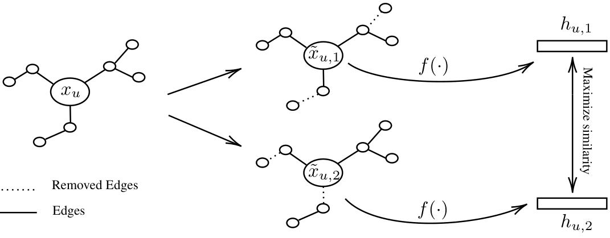

# GraphCL: Contrastive Self-Supervised Learning of Graph Representations

Hakim Hafidi1,2, Mounir Ghogho1, Philippe Ciblat2, and Ananthram Swami3 1TICLab, College of Engineering and Architecture, Université Internationale de Rabat, Morocco {hakim.hafidi, mounir.ghogho}@uir.ac.ma 2LTCI, Communications and Electronics Department, Telecom ParisTech, Institut Polytechnique de Paris, France philippe.ciblat@telecom-paris.fr 3United States Army Research Laboratory, Adelphi, Maryland, USA ananthram.swami.civ@mail.mil

## Abstract

We propose Graph Contrastive Learning (GraphCL), a general framework for learning node representations in a self supervised manner. GraphCL learns node embeddings by maximizing the similarity between the representations of two randomly perturbed versions of the intrinsic features and link structure of the same node’s local subgraph. We use graph neural networks to produce two representations of the same node and leverage a contrastive learning loss to maximize agreement between them. In both transductive and inductive learning setups, we demonstrate that our approach significantly outperforms the state-of-the-art in unsupervised learning on a number of node classification benchmarks.

## 1 Introduction

In many fields, the rapidly increasing volume and complexity of data hinders actionable insights. Graphs offer an unifying framework for aligning structured and unstructured data. However, graphs have long been poorly exploited because of their complexity, and limited approaches in dealing with content associated with nodes and links. Recently, graph representation learning has attracted the attention of the scientific community as a way of analysing graphs and helping to leverage the richness of information that resides in unstructured data. Graphs are characterized by a set of nodes, which represent the entities, and a set of links connecting them. Nodes may be of different types, and may further be associated with several features. And links may represent different relationships and may also be associated with different attributes or semantic content. One of the major challenges facing graph representation learning is learning node embeddings which capture both node features and the graph structure. These representations can then be fed into downstream machine learning models.

Most successful approaches for graph representation have been great efforts to generalize neural networks to graph data and fall under the umbrella of Graph Neural Networks (GNNs) or Deep Geometric Learning [Atwood and Towsley, 2016, Kipf and Welling, 2016a, Bronstein et al., 2017, Xu et al., 2018]. These approaches have achieved remarkable results in a number of important tasks such as node classification [Hamilton et al., 2017, Chami et al., 2019, Luan et al., 2019] and link prediction [Kipf and Welling, 2016b, Zhang and Chen, 2018]. However, these methods are very reliant on human intervention and suffer from the necessity of some form of supervision. This requires a high cost, expert knowledge in the domain and the use of annotated data, which is not often available. Thus, the need to develop methods capable of learning representations in an unsupervised manner is essential.

In order to compensate for the absence of labels or predefined tasks, some unsupervised methods have adopted the homophily hypothesis, which states that linked nodes should be adjacent in the embedding space [Hoff et al., 2002]. Inspired by the Skipgram algorithm for embedding words into a latent space, where adjacent vectors correspond to co-occurring words in a sentence [Mikolov et al., 2013], a majority of these methods use random walks to generate sentence-like sequences where co-occurring nodes are close in the embedding space [Perozzi et al., 2014, Grover and Leskovec, 2016]. Other methods such as autoencoders, also employ the homophily hypothesis by reconstructing either the adjacency matrix or the neighborhood of a node [Wang et al., 2016, Kipf and Welling, 2016b]. Despite their success in learning relatively powerful representations, relying on the homophily hypothesis biases these methods towards emphasizing the direct proximity of nodes over topological information [Wang et al., 2016]. More recently, [Veliˇckovi´c et al., 2018] proposed Deep Graph Infomax (DGI) that learns representations by training a discriminator to distinguish between representations of nodes that belong to the graph from nodes coming from a corrupted graph. Leveraging recent advances in unsupervised visual representations [Hjelm et al., 2018], the success of DGI has been attributed to the maximization of mutual information between global and local parts of the input. This requires learning global representations of the entire graph which can be very costly and even intractable when dealing with large graphs.

In this work, we introduce GraphCL, a general contrastive learning framework that learns node embeddings by maximizing agreement/similarity between the representations of two randomly perturbed versions of the same node’s local subgraph. In addition to learning node representations that are robust to random perturbations of the graph, GraphCL allows for an efficient self-supervised learning of node representations.

GraphCL is inspired by the success of a recent approach which leverages contrastive learning losses to learn visual representations that capture shared information across multiple views of the same image. These methods are based on the assumption that important information is shared between different views of the world. The authors of Chen et al. [2020] use data augmentation techniques to generate multiple views of the same image, while Tian et al. [2019] consider different channels of an image as different views.

In GraphCL, for each node, random perturbations are applied to its L-hop subgraph. The perturbation consists of randomly dropping a subset of edges and nodes’ intrinsic features of its L-hop subraph. The dropout probabilities are hyperparameters in the learning process.

We show that GraphCL achieves a new state-of-the-art in unsupervised node representation by demonstrating how it consistently outperforms previous state-of-the-art methods on both transductive and inductive setups.

## 2 Related work

Most unsupervised graph representation learning methods can be described as contrastive approaches. Their main objective is to train an encoder to be contrastive between pairs of samples that follow observations in the data and thus capture statistical dependencies of interest (a.k.a positive examples) and those that are not (a.k.a negative examples). Contrastive approaches have had great success for learning words representations [Mikolov et al., 2013, Collobert and Weston, 2008]. They have also been used for learning visual representations dating back to [Hadsell et al., 2006], and have started to show promising results in recent works [Misra and van der Maaten, 2019, Zhuang et al., 2019], achieving competitive results when compared to strong supervised baselines [Chen et al., 2020]. Researchers have extended many of these methods to learn representations of graph structured data. DeepWalk [Perozzi et al., 2014] and Node2vec [Grover and Leskovec, 2016] are inspired by language models such as Word2vec [Mikolov et al., 2013]. DGI [Veliˇckovi´c et al., 2018] adapted ideas from Deep InfoMax [Hjelm et al., 2018] method that learns representations of high-dimensional data. GraphCL is also contrastive in this sense, as we learn a classifier to distinguish between positive examples (i.e., pairs of augmented views of the same node) and representations of the other nodes.

Contrastive methods differ in the choice of different components such as a sampling strategy to select positive and negative examples and an encoder to embed a data sample into a destination space. The above mentioned methods on graph representation learning often take into account the structure of the graph; positive and negative examples correspond to adjacent and distant nodes respectively.

DeepWalk and Node2vec, for example, use different policies to generate fixed length random walks to find positive examples whereas random nodes correspond to negative examples. Both methods use a lookup table as an encoder. Graph Autoencoder encourages the use of first order neighbors as positive examples and use Graph Convolutional Networks as encoders [Kipf and Welling, 2016b], while [Bojchevski and Günnemann, 2017] use higher order neighbors as positive examples and use a Multi-Layer Perceptron to encode node features. DGI employs a different strategy: node representations obtained from the graph correspond to positive examples, while negative examples correspond to embeddings of a corrupted graph. DGI also uses different architectures of Graph Convolutional Networks as encoders [Kipf and Welling, 2016a, Hamilton et al., 2017].

Graph convolution Networks enforce an inductive bias that adjacent nodes have similar representations. Instead of explicitly injecting the graph structure information to sample positive and negative examples, we leverage the latest insights about GCN encoders and employ a strategy that is completely different from the methods discussed above. We get two different representations of each node by randomly sampling two subgraphs around the node. These two representations will correspond to a pair of positive examples.

## 3 Methodology

In this section, we define some needed notation, formulate the learning problem of interest, and then provide details of the proposed solution.

3.1 Background Problem formulation. Let G = (V, E) be an undirected graph where V is a set of nodes and E ⊆V × V is a set of edges. Each node u ∈V is represented by a feature vector xu ∈ RP . An adjacency matrix A ∈ RN×N represents the topological structure of the graph where N = |V| is the number of nodes in the graph. Without loss of generality we assume the graphs to be unweighted i.e Au,v = 1 if (u, v) ∈E and Au,v = 0 otherwise. We are also provided with X = {x1, x2, . . . , xN}, a set of nodes’ features.

Let Gu = (Vu, Eu) be the L−hop subgraph centred at node u and Xu = {xj}j∈Vu be the set of feature vectors corresponding to the nodes in u’s neighborhoodsubgraph. The relational information within u’s subgraph is represented by its corresponding adjacency matrix Au. Our objective is to learn an effective representation of nodes without human intervention. This will be done through the learning of a graph neural network encoder f that maps both node level information and the graph structure to a higher level representation i.e f(Xu, Au) = h(L)

u ∈ RP ′ for each u ∈V, where P ′ is the embedding size. It is worth pointing out that the embedding h(L)

u corresponds to the output of the L−th layer of the GNN, which involves the nodes of node v’s L-hop subgraph. In the remainder of the paper, hu refers to the output of the GNN’s last layer, i.e. hu = h(L)

u .

Graph Neural Networks (GNNs). GNNs are a class of graph embedding architectures which use the graph structure in addition to node and edge features to generate a representation vector (i.e., embedding) for each each node. Recent GNNs learn node representations by aggregating the features of neighboring nodes and edges. The output of the l-th layer of these GNNs is generally expressed as h(l)

u = COMBINE(l)(h(l−1)

u , AGGREGAT E(l)({(h(l−1)

u , h(l−1)

v ) : v ∈N (u)})), (1)

where h(l)

u is the feature vector of node u at the l-th layer initialized by h(0)

u = xu and N (u) is the set of first-order neighbors of node u. Different GNNs use different formulations of the COMBINE and AGGREGATE functions; the ones used in this work are described in the next section.

3.2 GraphCL GraphCL’s objective is to learn node representations by maximizing the similarity between the embeddings of two randomly perturbed versions of the same node’s neighborhood subgraph using a contrastive loss in the embedding space. This framework has three main components: a stochastic perturbation, a GNN based encoder and a contrastive loss function. We first introduce each of these components, and then give a high-level overview of the proposed method.

- Stochastic perturbation. We apply a stochastic perturbation to the L-hop subgraph centered at each node, that results in two neighborhood subgraphs that allow us to obtain two representations of the same node which we consider as positive examples. In this work we consider simultaneous transformation of both node features and the connectivity of the subgraph. The subgraph structure is transformed by randomly dropping edges with probability p using samples from a Bernoulli distribution. For the node’s intrinsic features, we apply a similar strategy by simply applying dropout to the input features; see illustration in Figure 1. • Graph neural network encoder. We apply a GNN based encoder that learns representations of the two transformed L-hop subgraphs associated with each node u. Our framework supports several choices of GNN architectures. We choose the simple mean-pooling propagation rule as introduced by [Hamilton et al., 2017] as the main building block, and adopt different choices for the inductive and transductive setups. Details about the choices of architectures are given in section 4.3. • Contrastive loss function. We define a pretext prediction task that aims at identifying the corresponding positive example hu,2 of a representation hu,1 given a set of generated examples, with hu,1 and hu,2 being a positive pair of examples (i.e. obtained from the GNN representation of two transformations of the L-hop subgraph around the same node).

We randomly sample a minibatch B containing M nodes and define their corresponding L-hop subgraphs. We apply two transformations to each of the node’s subgraphs resulting in 2M subgraphs enabling us to get positive pairs of representations for the contrastive prediction task. Instead of explicitly sampling negative examples, we consider the other (2M −2) examples within the minibatch as negative examples following the sampling strategy in [Chen et al., 2017].

For each node u in the minibatch, we compute the following loss function, which is based on a normalized temperature-scaled cross entropy:

l(u) = l1,2(u) + l2,1(u), (2)

where li,j(u) is defined as li,j(u) = − log exp(s(hu,i, hu,j)/τ)

P v∈B 1[v̸=u] exp(s(hu,i, hv,i)/τ) + P v∈B exp(s(hu,i, hv,j)/τ), (3)

where s(hu,i, hu,j) = h⊤ u,ihu,j/∥hu,i∥∥hu,j∥ is the cosine similarity between the two representations hu,i and hu,j, 1[u≠ v] is an indicator function equals to 1 iff u̸ = v and τ a temperature parameter.

3.3 Overview of GraphCL For each sampled minibatch B, we apply the following steps:

1. For each node u in the minibatch we define (Xu, Au) as the subgraph containing all nodes and edges that are at most L-hops from u in the graph and their corresponding features; 2. Draw two stochastic perturbations t1 and t2 as defined in section 3.2 and apply them to u’s L-hop neighborhood subgraph:

- ( e Xu,1, Aeu,1) ∼ t1(Xu, Au)
- ( e Xu,2, Aeu,2) ∼ t2(Xu, Au) 3. Apply the encoder to the two representations of node u:
- hu,1 = f( e Xu,1, Aeu,1)
- hu,2 = f( e Xu,2, Aeu,2) 4. Update parameters of the encode, f using the following loss function

X L = 1 l(u), (4)

|B| u∈B where l(·) is defined in equation Eq. (2)

*Figure 1: A high-level overview of our method for a subgraph around node u. Refer to section 3.3 for details*

*Table 1: Description of the datasets*

Dataset Task Nodes Edges Features Classes Train/Val/Test Nodes Cora Transductive 2,708 5,429 1,433 7 140/500/1,000 Citeseer Transductive 3,327 4,732 3,707 6 120/500/1,000 Pubmed Transductive 19,717 44,338 500 3 60/500/1,000 Reddit Inductive 231,443 11,606,919 602 41 151,708/23,699/55,334 PPI Inductive 56,944 818,716 50 121 44,906/6,154/5,524 (24 graphs) (multilabel) (20/2/2 graphs)

## 4 Experiments

We evaluate the effectiveness of GraphCL representations on both tranductive and inductive learning setups. The transductive learning setup consists of embedding nodes from a fixed graph (i.e. All nodes’ features and the entire graph structure are known during the training time). On the other hand, the inductive learning setup consists of generating representation of unseen nodes or new graphs. Following common practice, we opt for a linear evaluation of the learned node representations. Specifically, we use these representations to train a logistic regression model to solve multiclass node classification tasks on five well-know benchmark datasets, three for the transductive learning setup and two for the inductive setup. We summarize the datasets and the baselines respectively in sections 4.1 and 4.2, provide model configuration and implementation details in section 4.3, and discuss the results in section 4.4.

4.1 Datasets For the transductive setting, we utilize Cora, Citeseer and Pubmed [Sen et al., 2008], three citation networks where nodes are bag of words representations of documents and edges correspond to (undirected) citations. Each node belongs to one class. On the other hand, a protein-protein interaction dataset (PPI) is used for the the inductive setting on multiple graphs [Zitnik and Leskovec, 2017]. It consists of multiple graphs corresponding to different human tissues where node features are the positional gene sets, motif gene sets and immunological signatures. Each node has several labels among 121 labels from the gene ontology. For the inductive setting on large graphs, we use a Reddit dataset [Hamilton et al., 2017]. It represents a large social network where nodes correspond to Reddit posts (i.e. represented by their GloVe embedding [Pennington et al., 2014]) and edges connecting two posts mean that the same user commented on them. Labels are the posts’ subreddit and the objective is to predict the community structure of the social network. Statistics of the datasets are given in table 1.

4.2 Baselines For the transductive learning tasks, we use four state-of-the-art unsupervised methods for comparison: Label Propagation (LP) [Zhu et al., 2003], DeepWalk [Perozzi et al., 2014], Embedding Propagation (EP-B) [Duran and Niepert, 2017], and Deep Graph Infomax (DGI) [Veliˇckovi´c et al., 2018]. We also report the results of training logistic regression on the intrinsic input features only, and also on the concatenation of DeepWalk embeddings and the nodes’ intrinsic features. Aside from unsupervised methods, we also compare our approach to strong supervised baselines, Graph Convolution Networks (GCN) [Kipf and Welling, 2016a] and Graph Attention Networks (GAT) [Veliˇckovi´c et al., 2017].

For the inductive learning tasks, in addition to DeepWalk and DGI, we compare GraphCL with the unsupervised GraphSAGE methods [Hamilton et al., 2017]. We also provide results of two supervised approaches, FastGCN [Chen et al., 2018] and Gated Attention Networks (GaAN) [Zhang et al., 2018].

4.3 Model configurations Equation Eq. (1) provides a general formulation of graph neural networks. Several architectures have been proposed for the choice of AGGREGAT E and COMBINE. In all our experiments the basic update rule is the mean pooling variant from [Hamilton et al., 2017].

 W(l−1)⊤ h(l)

- MEAN({h(l−1) u } ∪{h(l−1)

u ← v , ∀v ∈N (u)}), (5)

where the MEAN operator is the element-wise mean of all vectors in ({h(l−1)

u } ∪{h(l−1)

v , ∀v ∈ N (u)}), and W(0) ∈ RP ×P ′ and W(l−1) ∈ RP ′×P ′, for l > 1, are learnable linear transformations.

All GNN aggregation operations are computed in parallel resulting in a matrix representation as follows:

H(l) = AHˆ (l−1)W(l−1) (6)

where H(l) = [h(l)

1 , h(l) 2 , . . . , h(l) N ]⊤ is the matrix of nodes’ hidden feature vectors at the l−th layer and Aˆ = Dˇ−1Aˇ is the normalized version of the adjacency matrix with added self-loop Aˇ = A+IN with D˜ being its diagonal degree matrix, i.e. Dˇii = P j Aˇij.

Transductive learning For Citeseer and pubmed, we use a one layer GNN as defined in 6, to which we apply an exponential linear unit (ELU) as an activation function [Clevert et al., 2015]. For Cora, our encoder is a two-layer GNN:

f(X, A) = Aσˆ ( AXWˆ (0))W(1) (7)

where σ is an exponential linear unit, and f(X, A) is the concatenation of all nodes’ embeddings. In each layer, we compute P ′ = 512 features resulting in a node embedding size of 512.

The normalized temperature-scaled cross entropy loss benefits from training on large batches [Chen et al., 2020]. For the three citation datasets, we compute the contrastive loss function across all the nodes of the graph (i.e. the size of the minibatch is equal to the number of nodes of the graph).

Inductive learning For both inductive learning setups on large graphs and on multiple graphs , we use a three-layer mean-pooling encoder with residual units as follows:

H(1) = σ( AXWˆ (0)

1 + XW(0)

2 ) (8)

H(2) = σ( AHˆ (1)W(1)

1 + H(1)W(1)

2 ) (9)

f(X, A) = AHˆ (2)W(2)

1 + H(2)W(2)

2 (10) We set the hidden layers and the embedding size to P ′ = 512 and apply ELU as an activation function.

For the multiple-graph setting, we sample one graph at a time from the training set and consider all nodes in the graph as a minibatch to train the contrastive loss function. For the inductive learning

*Table 2: Classification accuracy on transductive tasks and micro-averaged F1 score on inductive tasks*

Transductive Method Cora Citeseer Pubmed Unsupervised Raw features 47.9 ± 0.4% 49.3 ± 0.2% 69.1 ± 0.3% DeepWalk [Perozzi et al., 2014] 67.2% 43.2% 65.3% DeepWalk + features 70.7 ± 0.6% 51.4 ± 0.5% 74.3 ± 0.9% EP-B [Duran and Niepert, 2017] 78.1 ± 1.5% 71.0 ± 1.4% 79.6 ± 2.1% DGI [Veliˇckovi´c et al., 2018] 82.3 ± 0.6% 71.8 ± 0.7% 76.8 ± 0.6% GraphCL 83.6 ± 0.5% 72.5 ± 0.7% 79.8 ± 0.5% Supervised GCN [Kipf and Welling, 2016a] 81.5 70.3 79.0 GAT [Veliˇckovi´c et al., 2017] 83.0 ± 0.3% 72.5 ± 0.7% 79.0 ± 0.3% Inductive Method Reddit PPI Unsupervised Raw features 0.585 0.422 GraphSage-GCN [Hamilton et al., 2017] 0.908 0.465 GraphSage-mean [Hamilton et al., 2017] 0.897 0.486 GraphSage-LSTM [Hamilton et al., 2017] 0.907 0.482 GraphSage-pool [Hamilton et al., 2017] 0.892 0.502 DGI [Veliˇckovi´c et al., 2018] 0.940 ± 0.001 0.638 ± 0.002 GraphCL 0.951 ± 0.01 0.659 ± 0.006 Supervised FastGCN [Chen et al., 2018] 0.937 − GaAN [Zhang et al., 2018] 0.958 ± 0.001 0.969 ± 0.002 on large graphs, the scale of the dataset makes it impossible to fit into GPU memory. We therefore adopt the sub-sampling strategy of [Hamilton et al., 2017]. We first select a minibatch of nodes and construct a L-hop neighborhood subgraph centered at each of them by sampling a fixed size neighborhood. We sample 10 nodes in each of the three levels resulting in 1+10+100+1000 = 1111 neighboring nodes for each node in the minibatch. We further apply our stochastic transformation approach to each of the subgraphs and compute the contrastive loss to all pairs of the obtained positive examples.

We use Pytorch [Paszke et al., 2019] and the Pytorch Geometric [Fey and Lenssen, 2019] libraries to implement all our experiments. We initialize all models using Glorot initialization [Glorot and Bengio, 2010] and trained them to minimize the contrastive loss provided in equation Eq. (4) using the Adam optimizer [Kingma and Ba, 2014] with an initial learning rate of 0.001. We tune the weight decay in {0.001, 0.01, 0.05, 0.1, 0.15}. We further tune the temperature τ in the loss function in {0.1, 0.5, 0.8, 1.0} and the number of epochs in {20, 50, 100, 150, 200}.

To define the stochastic perturbation, we tune the probability of dropping an edge in [0.05, 0.75] and the probability of dropping node features in [0.2, 0.8]. GraphCL is found to be robust to different choices of the perturbation parameters. However, we found that applying high perturbations to node features (i.e. randomly dropping 50% to 70 % of input features) and small perturbations of the graph structure (i.e. randomly dropping 10% to 20% of edges) results in stronger representations.

4.4 Results We present the results of evaluating node representations using downstream node multiclass classification tasks in Table 2. We report average results over 50 runs of training followed by a logistic regression. Specifically, we use the mean classification accuracy on the test nodes for transductive tasks and the micro-averaged F1 score on the (unseen) test nodes for the inductive setting. We report the results of EP-B provided in [Duran and Niepert, 2017] and [Veliˇckovi´c et al., 2017], and also the results provided in [Veliˇckovi´c et al., 2018].

We show that the proposed GraphCL outperforms the previous state-of-the-art by achieving the best classification accuracy over the three transductive tasks and the best F1 score on inductive tasks. We note that, except for PPI dataset, GraphCL achieves competitive performance with strong supervised baselines without using label information. We assume that by maximizing agreement between representations that share the same information but have independent noise, GraphCL is able to learn representations that benefit from the richness of information in the graph which compensate for the information provided by the labels.

## 5 Formal Analysis

We now analyse the computational and model complexity of GraphCL and its connection to mutual information maximization.

5.1 Computational and model complexity Let G = (V, E) be a graph and N = |V| the total number of nodes in the graph. Moreover, let L be the number of layers, M be the minibatch size and R be the number of neighbors being sampled for each node in the inductive setting. We assume for simplicity that the dimension of the nodes’ hidden features is constant and denote it as P ′. The computational complexity and space complexity of GraphCL depend on the choice of the encoder. We use the same encoder for the two branches (i.e. each of the subgraphs). For the transductive learning setup, the computational and space complexity are linear with respect to the number of nodes and are respectively O(LNP ′2) and O(LNP ′ + KP ′2) . For the inductive learning, we use a sub-sampling strategy to load the graphs into memory, the computational complexity is then O(RLNP ′2) and the space complexity is O(MRLP ′ +LP ′2). The computational complexity is linear with respect to the number of nodes. Both the number of layers L and the number of sampled neighbors R are fixed and user-specified. The space complexity is linear with respect to the minibatch size M. The sampling strategy sacrifices time efficiency to save memory which is necessary for very large graphs.

5.2 Connection to mutual information The contrastive loss in equation Eq. (4) has been proposed as a lower bound estimator of mutual information. A formal proof given by [Oord et al., 2018] shows that:

I(hu,1, hu,2) ≥ log(k) −L, (11)

where k is the number of negative samples and I(hu,1, hu,2) is the mutual information between hu,1 andhu,2:

 p(hu,1, hu,2)

 I(hu,1, hu,2) = E (hu,1,hu,2)∼phu,1,hu,2 (·) log (12)

p(hu,1)p(hu,2)

where p(hu,1, hu,2) is the joint distribution of hu,1 and hu,2, and p(hu,1) and p(hu,2) are the corresponding marginals.

Therefore, given any k, minimizing the loss function L also maximizes the lower bound on the mutual information I(hu,1, hu,2). We note however that [McAllester and Stratos, 2018] show that the bound in equation 11 can be very weak and [Tschannen et al., 2019] suggest that contrastive methods’ success highly depends on the choice of the encoder, and cannot be solely attributed to the properties of mutual information.

## 6 Conclusion

We introduced GraphCL, a general framework for self-supervised learning of nodes’ representations. The key idea of our approach is to maximize agreement between two representations of the same node. The representations are generated by injecting random perturbations to the graph structure and nodes’ intrinsic features. We have conducted a number of experiments on both transductive and inductive learning tasks. Experimental results show that GraphCL outperforms state-of-the-art unsupervised baselines on nodes’ classification tasks and is competitive with supervised baselines. In the future, we will investigate the potential of our approach in learning graphs’ representations that are robust to adversarial attacks on the graph data.

## Broader Impact

With the increasing proliferation of data sources, supervised labeling becomes intractable, as it must rely on both domain knowledge and investment of human time. Representation learning has had many recent successes, first transforming the problem of interest to a graph structure, where nodes and edges may be heterogeneous and may be associated with unstructured content. A challenge with representation learning is the proper definition and use of negative samples. A second challenge is that current approaches are good either at transductive or inductive tasks, not both. We present a novel approach that relies on perturbed representations of neighborhood graphs. The perturbation offers two advantages: first it generates the desired positive examples. Second, it offers some robustness to corruptions in the data (missing or spurious links, missing feature data). We demonstrate that our methods work well on a variety of datasets: citation networks, social networks, and protein-protein interaction networks. Our proposed approach will make machine learning models more robust and, thus, have positive impact on society.

## Acknowledgments

and Disclosure of Funding

## References

J. Atwood and D. Towsley. Diffusion-convolutional neural networks. In Advances in Neural Information Processing Systems, pages 1993–2001, 2016.

A. Bojchevski and S. Günnemann. Deep gaussian embedding of graphs: Unsupervised inductive learning via ranking. arXiv preprint arXiv:1707.03815, 2017.

M. M. Bronstein, J. Bruna, Y. LeCun, A. Szlam, and P. Vandergheynst. Geometric deep learning: going beyond euclidean data. IEEE Signal Processing Magazine, 34(4):18–42, 2017.

I. Chami, Z. Ying, C. Ré, and J. Leskovec. Hyperbolic graph convolutional neural networks. In Advances in Neural Information Processing Systems, pages 4869–4880, 2019.

J. Chen, T. Ma, and C. Xiao. Fastgcn: fast learning with graph convolutional networks via importance sampling.

arXiv preprint arXiv:1801.10247, 2018.

T. Chen, Y. Sun, Y. Shi, and L. Hong. On sampling strategies for neural network-based collaborative filtering.

In International Conference on Knowledge Discovery and Data Mining, pages 767–776, 2017.

T. Chen, S. Kornblith, M. Norouzi, and G. Hinton. A simple framework for contrastive learning of visual representations. arXiv preprint arXiv:2002.05709, 2020.

D.-A. Clevert, T. Unterthiner, and S. Hochreiter. Fast and accurate deep network learning by exponential linear units (elus). arXiv preprint arXiv:1511.07289, 2015.

R. Collobert and J. Weston. A unified architecture for natural language processing: Deep neural networks with multitask learning. In International Conference on Machine Learning, pages 160–167, 2008.

A. G. Duran and M. Niepert. Learning graph representations with embedding propagation. In Advances in Neural information Processing Systems, pages 5119–5130, 2017.

M. Fey and J. E. Lenssen. Fast graph representation learning with pytorch geometric. arXiv preprint arXiv:1903.02428, 2019.

X. Glorot and Y. Bengio. Understanding the difficulty of training deep feedforward neural networks. In International Conference on Artificial Intelligence and Statistics, pages 249–256, 2010.

A. Grover and J. Leskovec. node2vec: Scalable feature learning for networks. In International Conference on Knowledge Discovery and Data Mining, pages 855–864, 2016.

R. Hadsell, S. Chopra, and Y. LeCun. Dimensionality reduction by learning an invariant mapping. In IEEE Computer Society Conference on Computer Vision and Pattern Recognition, pages 1735–1742, 2006.

W. Hamilton, Z. Ying, and J. Leskovec. Inductive representation learning on large graphs. In Advances in Neural Information Processing Systems, pages 1024–1034, 2017.

R. D. Hjelm, A. Fedorov, S. Lavoie-Marchildon, K. Grewal, P. Bachman, A. Trischler, and Y. Bengio. Learning deep representations by mutual information estimation and maximization. arXiv preprint arXiv:1808.06670, 2018.

P. D. Hoff, A. E. Raftery, and M. S. Handcock. Latent space approaches to social network analysis. Journal of the American Statistical Association, 97(460):1090–1098, 2002.

D. P. Kingma and J. Ba. Adam: A method for stochastic optimization. arXiv preprint arXiv:1412.6980, 2014.

T. N. Kipf and M. Welling. Semi-supervised classification with graph convolutional networks. arXiv preprint T. N. Kipf and M. Welling. Variational graph auto-encoders. arXiv preprint arXiv:1611.07308, 2016b.

S. Luan, M. Zhao, X.-W. Chang, and D. Precup. Break the ceiling: Stronger multi-scale deep graph convolutional networks. In Advances in Neural Information Processing Systems, pages 10943–10953, 2019.

D. McAllester and K. Stratos. Formal limitations on the measurement of mutual information. arXiv preprint T. Mikolov, K. Chen, G. Corrado, and J. Dean. Efficient estimation of word representations in vector space.

arXiv preprint arXiv:1301.3781, 2013.

I. Misra and L. van der Maaten. Self-supervised learning of pretext-invariant representations. arXiv preprint A. v. d. Oord, Y. Li, and O. Vinyals. Representation learning with contrastive predictive coding. arXiv preprint A. Paszke, S. Gross, F. Massa, A. Lerer, J. Bradbury, G. Chanan, T. Killeen, Z. Lin, N. Gimelshein, L. Antiga, A. Desmaison, A. Kopf, E. Yang, Z. DeVito, M. Raison, A. Tejani, S. Chilamkurthy, B. Steiner, L. Fang, J. Bai, and S. Chintala. Pytorch: An imperative style, high-performance deep learning library. In Advances in Neural Information Processing Systems, pages 8024–8035. Curran Associates, Inc., 2019.

J. Pennington, R. Socher, and C. D. Manning. Glove: Global vectors for word representation. In Conference on Empirical Methods in Natural Language Processing, pages 1532–1543, 2014.

B. Perozzi, R. Al-Rfou, and S. Skiena. Deepwalk: Online learning of social representations. In International Conference on Knowledge Discovery and Data Mining, pages 701–710, 2014.

P. Sen, G. Namata, M. Bilgic, L. Getoor, B. Galligher, and T. Eliassi-Rad. Collective classification in network data. AI magazine, 29(3):93–93, 2008.

Y. Tian, D. Krishnan, and P. Isola. Contrastive multiview coding. arXiv preprint arXiv:1906.05849, 2019.

M. Tschannen, J. Djolonga, P. K. Rubenstein, S. Gelly, and M. Lucic. On mutual information maximization for representation learning. arXiv preprint arXiv:1907.13625, 2019.

P. Veliˇckovi´c, G. Cucurull, A. Casanova, A. Romero, P. Lio, and Y. Bengio. Graph attention networks. arXiv preprint arXiv:1710.10903, 2017.

P. Veliˇckovi´c, W. Fedus, W. L. Hamilton, P. Liò, Y. Bengio, and R. D. Hjelm. Deep graph infomax. arXiv preprint arXiv:1809.10341, 2018.

D. Wang, P. Cui, and W. Zhu. Structural deep network embedding. In International Conference on Knowledge Discovery and Data mining, pages 1225–1234, 2016.

K. Xu, W. Hu, J. Leskovec, and S. Jegelka. How powerful are graph neural networks? arXiv preprint arXiv:1810.00826, 2018.

J. Zhang, X. Shi, J. Xie, H. Ma, I. King, and D.-Y. Yeung. Gaan: Gated attention networks for learning on large and spatiotemporal graphs. arXiv preprint arXiv:1803.07294, 2018.

M. Zhang and Y. Chen. Link prediction based on graph neural networks. In Advances in Neural Information Processing Systems, pages 5165–5175, 2018.

X. Zhu, Z. Ghahramani, and J. D. Lafferty. Semi-supervised learning using gaussian fields and harmonic functions. In International Conference on Machine Learning, pages 912–919, 2003.

C. Zhuang, A. L. Zhai, and D. Yamins. Local aggregation for unsupervised learning of visual embeddings. In IEEE International Conference on Computer Vision, pages 6002–6012, 2019.

M. Zitnik and J. Leskovec. Predicting multicellular function through multi-layer tissue networks. Bioinformatics, 33(14):i190–i198, 2017.
