# Next-POI Recommendation via Spatial-Temporal Knowledge Graph Contrastive Learning and Trajectory Prompt

Wei Chen , Haoyu Huang, Zhiyu Zhang, Tianyi Wang, Youfang Lin , Senior Member, IEEE, Liang Chang , and Huaiyu Wan , Member, IEEE Abstract—Next POI (Point-of-Interest) recommendation aims to forecast users’ future movements based on their historical check-in trajectories, holding significant value in location-based services. Existing methods address trajectory data sparsity by integrating rich auxiliary information or using spatial-temporal knowledge graphs (STKGs), showing promising results. Yet, they face two main challenges: i) Due to the difficulty of transforming structured trajectory data into trajectory text describing users’ spatialtemporal mobility, the powerful reasoning ability of pre-trained language models is rarely explored to enhance recommendation performance. ii) Methods based on STKG can introduce external knowledge inconsistent with user preferences, leading to the knowledge noise generated hampering the accuracy of recommendations. To this end, we propose a novel approach called STKG-PLM that integrates STKG contrastive learning and prompt pre-trained language model (PLM) to enhance the next POI recommendation. Specifically, we design a spatial-temporal trajectory prompt template that transforms structured trajectories into text corpus based on STKG, serving as the input of PLM to understand the movement pattern of users from coarse-grained and fine-grained perspectives. Additionally, we propose an STKG contrastive learning framework to mitigate the introduced knowledge noise. Extensive experiments on three real-world datasets demonstrate that STKG-PLM exhibits notable performance improvements over the state-of-the-art baseline methods.

Index Terms—Next-POI recommendation, spatial-temporal knowledge graph, pre-trained language model, contrastive learning.

Wei Chen is with the Guangxi Key Lab of Trusted Software, Guilin University of Electronic Technology, Guilin, Guangxi 541004, China, and also with the School of Computer Science and Technology, Beijing Jiaotong University, Beijing 100044, China (e-mail: w_chen@bjtu.edu.cn).

Haoyu Huang is with the Department of Computer Science and Engineering, Chinese University of Hong Kong, Ma Liu Shui, Hong Kong (e-mail: haoyuhuang@bjtu.edu.cn).

Zhiyu Zhang, Tianyi Wang, Youfang Lin, and Huaiyu Wan are with the School of Computer Science and Technology, Beijing Jiaotong University, Beijing 100044, China, and also with the Beijing Key Laboratory of Traffic Data Mining and Embodied Intelligence, Beijing Jiaotong University, Beijing 100044, China (e-mail: zyuzhang@bjtu.edu.cn; wangtianyi@bjtu.edu.cn; yflin@bjtu.edu.cn; hywan@bjtu.edu.cn).

Liang Chang is with the Guangxi Key Lab of Trusted Software, Guilin University of Electronic Technology, Guilin, Guangxi 541004, China (e-mail: changl@guet.edu.cn).

Digital Object Identifier 10.1109/TKDE.2025.3545958

## I. INTRODUCTION

T HE rise of location-based social networks (LBSNs) like Foursquare and Meituan, has significantly facilitated the sharing of location information among individuals. This advancement has promoted the study of the next POI (Point-of- Interest) recommendation service as central to location-based services. [1], [2], [3], [4]. Next POI recommendation focuses on predicting users’ future movements based on his/her historical trajectories, which has become a fundamental functionality in smart city applications [5], [6], [7], [8]. Next POI recommendation helps to provide users with more personalized route planning, reduce travel time and improve convenience. By accurately anticipating where users are likely to go next, businesses can optimize resource allocation, improve targeting for precision advertising, and increase operational efficiency in sectors like transportation and food delivery. As a result, enhancing the quality of next POI recommendation services is highly beneficial for both users and businesses [9], [10], [11], [12], [13].

Most efforts for next POI recommendation have been extensively explored. Traditional next POI recommendation methods model the mobile behavior of users using Markov chains [14]. With the development of deep learning, deep neural network techniques like recurrent neural networks (RNNs) and their variants, along with attention networks [15], [16], [17], [18], are designed to delve into the complex mobility patterns within individual check-ins and harness their personalized preferences to infer future movement. Among them, some studies usually incorporate contextual information, such as temporal and geospatial information, into trajectories to address the issue of trajectory data sparsity.

However, these methods focus on historical sequential behavior over trajectories and ignore the graph structural features of users’ movement among POIs. To address this limitation, some graph-based methods [8], [19], [20], [21], [22] are proposed to build the global transition graph or spatial-temporal knowledge graph (STKG) to better discover users’ spatial or temporal mobility patterns within a graph structure. Especially, the exploration of STKG in next-POI recommendation has shown great potential, as it can flexibly provide rich spatial-temporal knowledge to alleviate the sparsity of trajectory data, enhancing the model’s understanding of users’ movement patterns over time.Moreover,STKGoffersexplanationsfortherecommended 1041-4347 © 2025 IEEE. All rights reserved, including rights for text and data mining, and training of artificial intelligence and similar technologies. Personal use is permitted, but republication/redistribution requires IEEE permission. See https://www.ieee.org/publications/rights/index.html for more information.

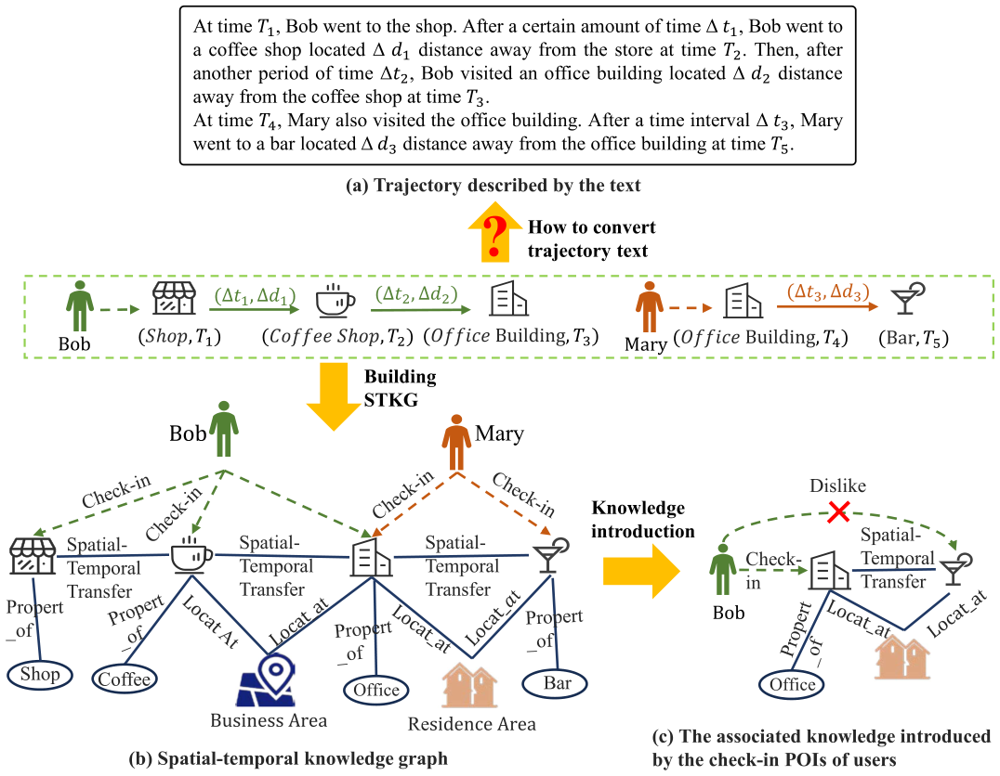

*Fig. 1. (a) illustrates the challenge of transforming structured trajectory data into trajectory text; (b) and (c) illustrate the issue of introducing external knowledge noise from STKG.*

results [9], [23]. Although these methods have achieved notable success in the next POI recommendation task, they still suffer from two major challenges.

- Accurately modeling the semantics of user mobility patterns from unstructured trajectory data: The discrete structured historical check-in trajectories provide limited semantic features of user movements, making it difficult to accurately understand the intention of users’ spatial-temporal mobility patterns as effectively as the trajectory text corpus. Recently, pre-trained language models (PLMs) that learn generic knowledge from extensive corpora through self-supervised tasks, have demonstrated powerful text understanding and reasoning capabilities in various natural language tasks [24], [25]. Many studies have successfully applied PLMs to solve general recommendation tasks and achieve favorable results [26], [27], [28]. However, in the next POI recommendation field, few investigations have delved into harnessing the powerful text understanding and reasoning capabilities of PLMs to capture the spatial-temporal relatedness of trajectories precisely. The primary challenge is how to convert the structured trajectory data into unstructured trajectory text and adequately model the semantics of user spatial-temporal mobility patterns embedded in the trajectory text.
- Methods based on STKG may introduce noise knowledge to affect user preference modeling: STKG-based methods typically introduce knowledge directly related to check-in POIs from STKG. However, some introduced knowledge may be inconsistent with users’ preferences, forming noise that negatively impacts recommendation performance. An example is shown

in Fig. 1(b) and (c), Bob does not like to go to bars and drink, but the location of Office in Bob’s trajectory is directly or indirectly associated with the location of Bar. Bar may be introduced as external knowledge of the check-in POI of Bob’s trajectory and become noise affecting the presentation of the introduced knowledge. Therefore, how to effectively suppress the influence of noisy knowledge is crucial for user preference modeling.

To this end, we propose a novel method called STKG-PLM that combines STKG contrastive learning with the prompt pre-trained language model to improve the effectiveness of the next POI recommendation. To address the first limitation, a spatial-temporal trajectory prompt template is proposed to transform structured users’ trajectory data into the trajectory text corpus, serving as input to pre-trained language models and effectively capturing the spatial-temporal movement patterns of users. To overcome the second challenge, we propose an STKG contrastive learning strategy, which adopts a learning objective to maximize the consistency between augmented STKG’s subgraphs generated by sampling in STKG, thus suppressing the introduced knowledge noise. In addition, we present a spatialtemporal transformer to capture the spatial-temporal correlations of users’ continuous movement from the perspective of structured sequences.

In summary, the main contributions made in this work are as follows. r We propose a novel next POI recommendation method that integrates structured trajectory data and unstructured trajectory text corpus, which can capture users ’preferences and infer their future mobility patterns. r We design a spatial-temporal trajectory prompt template to transform the structured trajectory data into trajectory text. This template captures the semantics of users’ spatialtemporal movement patterns from coarse-grained and finegrained aspects. To the best of our knowledge, we are the first to model the spatial-temporal movement patterns of users through text semantics in the POI recommendation field. r We design an STKG contrastive learning schema to mitigatetheeffectofintroducedknowledgenoiseintrajectories and improve the robustness for the next POI recommendation. r Extensive experiments on three real-world datasets demonstrate that STKG-PLM consistently achieves better performance than state-of-the-art baseline methods. The remaining sections of this paper are organized as follows. Section II provides an extensive review of related work on next POI recommendation, contrastive learning, and KG-enhanced pre-trained language model methods. In Section III, we outline the definitions and problem statement. Section IV elaborates on our proposed STKG-PLM approach. We present the experimental results in Section V. Finally, Section VI concludes the paper.

## II. RELATED WORK

In this section, we first review the related work about next POI recommendation, then introduce the contrastive learning methods and KG-enhanced pre-trained language models.

A. Next POI Recommendation Next POI recommendation aims to explore the transition patterns among POIs based on users’ check-in trajectories. Pioneering methods for the next POI recommendation are mainly developed based on traditional Markov Chains (MC) techniques. For example, FPMC [14] learns a personalized transition matrix by integrating the Markov chain into matrix factorization model. Subsequently, RNNs and their variants (e.g., GRU and LSTM), along with attention mechanisms, gained significant traction in modeling sequence data. These deep learning techniques in the field of the next POI recommendation effectively integrate diverse types of contextual information to enhance recommendation accuracy. For instance, DeepMove [15] learns periodicity sequential patterns long- and short-term by combining an attention layer with gated recurrent units. STAN [29] proposes two attention layers to model relative spatial-temporal information between consecutive and non-consecutive POIs. CLSPRec [30] leverages contrastive learning to capture both long-term and short-term user preferences by employing a shared trajectory encoder and a masking strategy to enhance model robustness and representation accuracy.

Recently, some methods based on graph or KG have been proposed to explore higher-order graph structural features of user movements or higher-order semantic features of POIs. For example, DRAN [21] employs a disentangled representationenhanced attention network to explicitly model different aspects and their corresponding influence for more precise POI representation. STHGCN [31] utilizes a spatial-temporal hypergraph convolutional network to integrate complex high-order information and global collaborative relations among trajectories. DCHL [32] enhances the next POI recommendation by decoupling multi-view user preferences and capturing cooperative associations between collaborative, transitional, and geographical views through self-supervision. STEP [22] integrates grid-cell spatial encoding and visiting time encoding to capture itemspecific spatiotemporal characteristics for successive POI recommendation. STKGRec [9] and Graph-Flashback [23] regard spatial-temporal information as the specific relation in STKG to learn user transfer patterns.

B. Contrastive Learning Contrastive learning [33], [34], [35] is an emerging selfsupervised learning paradigm, which aims to learn discriminative representations by contrasting positive and negative samples from different views. Contrastive learning has been successfully applied in various domains, such as NLP, computer vision, and recommendation systems. For example, GCL4SR [36] focuses on maximizing the agreement between the subgraph views sampled from the same interaction sequence. KGCL [37] explores the KG semantics and alleviates the data noise issue for recommendation under a knowledge-guided contrastive learning. CLLP [38] adoptscontrastivelearningtocaptureanddisentangle users’ multifaceted latent preferences dynamically. Motivated by these existing contrastive learning frameworks, our work develops STKG contrastive learning strategies to suppress the noise effects in the next POI recommendation.

C. KG-Enhanced Pre-Trained Language Models Pre-trained Language methods on behalf of BERT [39] are trained in open-domain corpora and show effectiveness in learning general language representations. Due to the ability to capture context information in a text corpus, PLM-based models have been considered to enhance the knowledge representation of KG in recent years. KG-BERT [40] first introduces the language model into the knowledge representation in the KG completion task. PPT [41] and SST-Bert [42] consider transforming dynamic knowledge into text corpora to improve temporal knowledge representation. Recently, prompt learning [43], [44], [45] has further facilitated the combination of KGs and PLMs by providing efficient prompt templates. Inspired by the combination of KGs and PLMs, we attempt to employ the STKGtotransformthestructuredtrajectoriesintocorresponding trajectory text corpus and design the trajectory prompt to learn the semantics of user spatial-temporal transfer patterns.

## III. PRELIMINARIES

This section presents our formulation of the next POI recommendation task and relevant preliminary concepts.

Let U = {u1, u2, . . . , u|U|} be a set of users and P = {p1, p2, . . . , p|P|} be a set of POIs (or locations), |U| and |P| are the number of users and POIs, respectively. Each POI pi

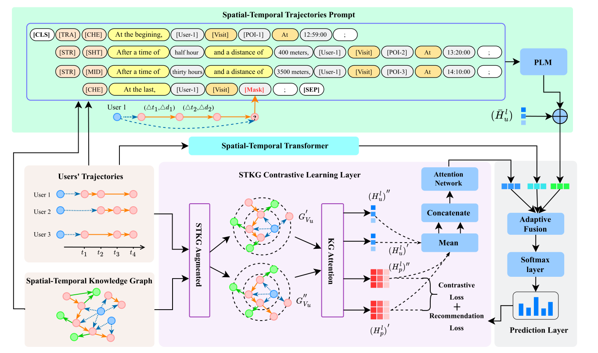

*Fig. 2. Overall framework diagram of STKG-PLM. In the STKG, blue, orange and green nodes represent user entities, POI entities, and attribute entities, respectively. Blue dashed arrow check-in relations, the orange and green solid arrows represent the spatial-temporal transfer relations and the attribute relations, respectively.*

has unique identification geographical coordinates (lat, lon) denoting its latitude and longitude, respectively.

Definition 1. (Check-in): A check-in is denoted by v = (u, t, p) where user u visits location p at time t.

Definition 2. (User trajectory): A user trajectory is represented by Vui = {v1, v2, . . . vm}, which is denoted as a sequence of temporally ordered check-in records for a specific user.

Definition 3. (Spatial-temporal knowledge graph): A STKG G = (E, R, F) is a directed graph formed by the triplets that are constructed by entity-relation-entity, where E, R and F denote the sets of entities, relations and triplets, respectively.

An example of STKG is shown in Fig. 1. The STKG G integrates the traditional user-POI check-in graph with spatialtemporal correlations among POIs and the properties of POIs. The entities in STKG are the union of the user set, the POI set, and the set of POI properties. The STKG contains three different types of relations: check-in relation, spatial-temporal transfer relation and property relation, which forms three different types of triples: check-in triplet (u, t, p); spatial-temporal transfer triplet (p1, [△t, △d], p2), and property triplet (e.g., (p, locat_at, function), (p, property_of, property_values), where △t and △d denote time interval and geographical distance interval among POIs in users’ trajectories, respectively. Following the definition of the work SKTGRec [9], the basic units of △t and △d are set for half an hour and 100 meters, respectively.

Definition 4. (Problem statement): Given the user u’s historical check-in trajectories Vu, the goal of the next POI recommendation is to recommend the top-k POIs that the user u will be most likely to visit next.

## IV. METHODOLOGY

*Fig. 2 illustrates the overall framework of STKG-PLM. The STKG-PLM has the following main components: (i) Spatial- Temporal Trajectory Prompt (STTP) module, which converts the user trajectory into trajectory text corpus and models the spatial-temporal patterns of users by a spatial-temporal prompt template; (ii) STKG Contrastive Learning (STKG-CL) module, which is used to weaken the introduced knowledge noise by trajectory augmented subgraph of the STKG (Sub-STKG) con- trast; (iii) Spatial-Temporal Transformer (STT) module, which captures the spatial-temporal correlations of continuous move- ment of users from the perspective of structured sequences; (iv) Prediction Layer, which recommends next POI that user most likely to visit by combining the output of three modules. Next, we introduce the details of each component in STKG-PLM.*

A. Spatial-Temporal Knowledge Graph Contrastive Learning The target of the STKG-CL module is to mitigate the effect of spatial-temporal knowledge noise introduced in users’ trajectories. For each trajectory of users, we initially construct two augmented Sub-STKG based on the STKG and the corresponding trajectories.Themotivationistoenhancethecomprehensiveness and realism of the generated data by incorporating external knowledge that is relevant to original trajectories. As a result, we adopt an efficient neighborhood sampling method used to generate augmented Sub-STKG views from STKG according to given trajectories. Specifically, we consider users and their check-in POI in the trajectory as central nodes, and uniformly and iteratively sample their neighbor entities from STKG. The check-in POI trajectory of the user and the sampled neighbor entities are integrated into a Sub-STKG. For this purpose, we sample z layers in STKG and randomly sample m neighbor entities in each layer. After performing the above sampling operations, we can obtain two augmented Sub-STKG views G′ Vu and G′′ Vu. A graph encoder is utilized to learn spatial-temporal knowledge associated with the trajectory by encoding the augmented Sub-STKG. Following the work [37], we employ KG attention networks (KGAT) [46], [47] with shared parameters to encode G′ Vu and G′′ Vu. Taking G′ Vu as an example, the information propagation and aggregation at the l-th layer of the KGAT are as follows,  hl p = hl−1 αhl−1 i , (1)

p + i∈Np     p ∥hl−1 hl−1 σ r⊤ α = exp p,iW1 i , (2)

    hl−1 p ∥hl−1 σ r⊤ i∈Np exp p,iW1 i where ∥ denotes the concatenation operation, Np denotes the neighbors of POI entity p based on different types of relations rp,i in G′ Vu. Here, H ∈ R|E|×d and R ∈ R|R|×d are the initial entity embedding and relation embedding matrices, respectively. hp ∈ H is the embedding of the POI entity and rp,i ∈ R. α denotes the specific entity-relation attention during the spatialtemporal knowledge aggregation process, which distinct semantics of relations among entities in G′ Vu. W1 ∈ R2×d is the weight matrix, and σ is the LeakyReLU activation function. In this way, we can obtain the presentation of two augmented Sub-STKGs: (Hl)′ and (Hl)′′ ∈ R|Vu|×d.

To suppress the effect of knowledge noise introduced in users’ trajectories, we apply a contrastive objective to distinguish whether the two Sub-STKG views are derived from the same user check-in trajectory. Here, the views of the different trajectories of the same user can be viewed as positive pairs, i.e., (G′ Vu, G′′ Vu), the views of the trajectory of different users can be seen as negative pairs, i.e., (G′ Vu, G′′ Vu′ ). The contrastive objective is defined based on the InfoNCE [33] loss as follows:

 LST KGCL = Vu∈D   cos(x′ Vu, x′′ Vu)/τ − log exp , (3)

  cos(x′ Vu, x′′ Vu′ )/τ Vu∈D,Vu̸=Vu′ exp where D denotes the set of trajectories in each minibatch, x′ Vu ∈ R1×d are obtained by mean pooling operation on the representation of POI entities in G′ Vu and x′′ Vu and G′′ Vu, respectively, cos(·) is the consine similarity function, and τ is a hyper-parameter. By minimizing the contrastive objective loss LST KGCL, we can obtain that positive pairs exhibit higher agreement compared to negative pairs.

After that, we integrate two augmented Sub-STKGs containing spatial-temporal knowledge to assist the subsequent recommendation. We first apply average pooling to fuse the entity features of the augmented Sub-STKGs. The operations are as follows:

H¯ l = mean_pool((Hl)′, (Hl)′′), (4)

 ¯Hl  u∥H¯ l Q = W2, (5)

p where H¯ l denotes the fusion representation of two augmented Sub-STKGs, H¯ l u and H¯ l p are the fusion representation of user entityandPOIentities, W2 ∈ R2 d×d istheweightmatrixrespectively, and Q is the representation of users’ trajectory consisting of the user and the corresponding check-in POIs. To learn the importance of different positions in the trajectory, a position attention network is utilized to calculate as follows:

β = σ1([Q∥Wpos]W3QT ), (6)

 y′ = βiQi, (7)

i∈|Vu| where |Vu| denotes the length of the user’s check-in trajectory sequence, y′ denotes the sequence presentation that contains spatial-temporal knowledge. Wpos ∈ R|Vu|×d is the learnable position matrix, W3 ∈ R2 d×d is the weight matrix, σ1 is the tanh activation function, and β is the attention of position in trajectory.

B. Spatial-Temporal Trajectory Prompt Gaining a comprehensive understanding of the semantics of spatial-temporal transitions within trajectories is crucial for accurately inferring the preferences of users. Nevertheless, the majority of existing methods focus on discrete structured trajectory data modeling, which makes it difficult to comprehend the real movement intention of individual users from the semantics as expected from the trajectory text corpus. Inspired by [41], [42], based on the relevant spatial-temporal knowledge of the trajectories in STKG, we propose the STTP module that innovatively transforms the structured trajectories into an accessible and comprehensible trajectory text corpus by a trajectory prompt template. The STTP module provides the trajectory text corpus as the input to PLMs and makes it more consistent with the scenario recommended by the next POI. Specifically, we add a soft prompt [TRA] before each user’s trajectories due to introducing soft prompts in the input sentences can improve the expressiveness of the sentences.

To enable PLMs to effectively identify users and POIs within a trajectory text, we adopt a strategy where each user and each POI entity is transformed into special tokens [User-i] and [POIi] based on their index. As shown in Fig. 3, we consider the spatial-temporal movement behavior of users between adjacent POIs in trajectories as spatial-temporal prompts. Each spatialtemporal prompt consists of time soft prompt and movement textual description. Time soft prompt aims to indicate coarsegrained time spans between adjacent POIs in trajectories, such as [SHT] for a short time (less than 24 hours), [MID] for a medium time (from 24 hours to 48 hours), and [LNG] for a long

*Fig. 3. Illusion of the spatial-temporal prompt.*

time (above 48 hours). Based on the front time soft prompt, the purpose of movement textual description is to further understand the spatial-temporal movement patterns of users from a finegrained perspective. To enhance the PLM’s understanding of the user’s spatial-temporal movement pattern in each trajectory text, a masking strategy (also known as a masked language model, MLM) [39] isadoptedtopredicttheuser’snextmovement.Thus, the representation of the [MASK] token in each trajectory text can be viewed as the predicted next POI, which aims to learn the representation of the masked parts based on their historical context. Formally, the modeling of trajectory textual semantic representation within trajectories is as follows, y∗ = PLM(Prompt(Tracktext)) + H¯ l

- (8)

Among them, PLM(·) denotes the input of a text sequence into the pre-trained language model (e.g., Bert), Prompt(Tracktext) represents users’ trajectories are transformed as the text sequences with the spatial-temporal prompt. In the text sequence, entity and relation tokens are initialized using distinct methods. Relation tokens are essentially natural language texts that can be pre-trained with PLMS, and their initialized representations benefit from the general semantic knowledge embedded in PLMs. However, the entity tokens represented by numerical values, such as User IDs or POI IDs, are introduced as new tokens to the PLM and lack the common semantics obtained from pre-training. To address this issue, the initial embedding of these new entity tokens is obtained using (4) after sub-STKG encoding, and then aligned into the semantic space of the pre-trained language model via a mapping matrix. This alignment operation assists the PLM in further comprehending the topological structure information of the sub-STKG.

It is worth noting that our STTP is generic and scalable. In our work, we focus solely on integrating the spatial-temporal information from the user’s mobility trajectory. Richer information on POI attributes, weather, etc. can be integrated, which is what we will explore in the future.

C. Spatial-Temporal Transformer The purpose of the STT module is to model the spatialtemporal correlations of users’ continuous movement from the structured sequence perspective. The workflow of the STT module is illustrated in Fig. 4. Inspired by PtransE and STKGRec [9], [48], the original user trajectory can be represented as an STKG path composed of entities and relations. The original user trajectory can be represented as an STKG path composed of entities and relations. The path can be split into two different sequences

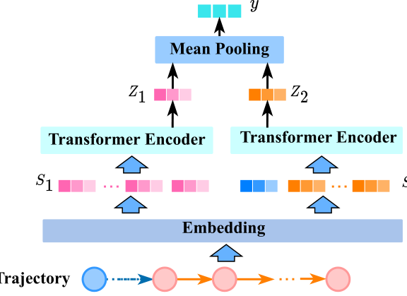

*Fig. 4. Workflow of the STT module.*

from two different perspectives of entities and relations to model the spatial-temporal association of structured trajectories. Therefore, we can adopt two different transformer encoders [49] to model the two types of sequences after passing through the embedding layer. The first check-in trajectory sequence contains only check-in POIs and is primarily used to model the sequential dependence between check-ins. The second sequence begins with the user entity as the first node, followed by the check-in relation and the spatial-temporal transfer relations. This second sequence primarily leverages spatial-temporal transfer relation to consider user mobility behavior from a knowledge-driven perspective. Taking the first sequence as an example, we combine the representations of check-in POI entities passing through the embedding layer into a sequence S1, which is then fed into the transformer for encoding. The encoding process is as follows:

Z = FFN ([head1; . . . ; headm]Wm) , (9)

 S1WQ i , S1WK i , S1WV headi = Attention , i (S1WQ i )(S1WK i )T √ S1WV = σ2 i , (10)

d where FFN(·) denotes the feed-forward network, m denotes the number of heads, WQ i ∈ Rd×d/m, σ2 is the softmax activation function, and i , WK i , WV √ d is the scaling factor. Note that, the Residual Network, Dropout, and Layer Normalization strategies in the transformer encoder are omitted in the formula for convenience. After the transformer encoder, we can obtain the two representations Z1 and Z2. Then we employ an average pooling operation to obtain the representation of the sequence as follows:

y¯ = mean_pool(Z1, Z2). (11)

D. Prediction and Optimization To adaptively integrate the output representations of the STTP module, the STKG-CL module, and the STT module into a unified representation, we adopt a learnable gating function to TABLE I STATISTICS OF DATASETS

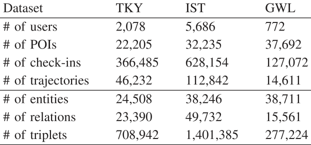

adaptively fuse these representations and compute the probability distribution yˆ of POIs for each user. Formally, yˆ = σ2(λ1y′ + λ2y∗ + λ3y¯), (12)

where λ1, λ2, λ3 represent learnable gate vector parameters to trade-off the information of the STTP module, the STKG-CL module, and the STT module. It is worth noting that these parameters aresubject totheconstraint λ1 + λ2 + λ3 = 1. Thus, the POI with the highest probability corresponds to the user’s intended destination at time t. To effectively optimize the parametersoftherecommendationmodel,weemploythelog-likelihood function as follows, N  log(ˆyk), (13)

LP OI = − k=1 where N denotes the total number of training samples, and yˆk represents the predicted probability of the ground truth POI obtained for the k-th training sample. Based on the obtained contrastive loss LST KGCL and recommendation loss LP OI, the integrative optimization loss of our STKG-PLM is as follows:

LLoss = LST KGCL + LP OI. (14)

The detailed training procedure for STKG-PLM is summarized in Algorithm 1.

## V. EXPERIMENT

In this section, we perform a large number of experiments on three datasets to evaluate the proposed STKG-PLM. We aim to address the following key research questions through experiments. r RQ1: Does STKG-PLM perform better than state-of-theart next POI recommendation baselines in public datasets? r RQ2: Does the spatial-temporal trajectory prompt module improve the performance of STKG-PLM? r RQ3: Does the STKG contrastive learning module effectively capture users’ trajectory sequence preferences?

A. Dataset We evaluate STKG-PLM on three real-world datasets: TKY, IST, and GWL. TKY and IST datasets [50]1 are collected from the public check-in data in the Foursquare platform, where TKY 1 https://sites.google.com/site/yangdingqi/home/foursquare-dataset

*Algorithm 1: Training Procedure of STKG-PLM. Input:Users’ historical check-in trajectories Vu Output:Users’ recommend rank list*

1: Build the temporal-spatial knowledge graph G 2: Initial the parameters Φ 3: while not converge do 4: Shuffle all the trajectories 5: for minibatch trajectories in Vu do 6: Construct two augmented Sub-STKG G′ Vu and G′′ Vu based on the STKG and the corresponding trajectories 7: Obtain the representation of Sub-STKG by (1)–(2) 8: Calculate Sub-STKG contrastive loss by (3) 9: Fuse the two Sub-STKG representations by (4)–(7) 10: Transform the structured trajectory data into trajectory text based on spatial-temporal trajectory prompt template 11: Adopt a pre-trained language model to encode trajectory text by (8) 12: Obtain the representation of users’ spatial-temporal correlations of continuous movement by (9)–(11) 13: Calculate recommendation loss by (13) 14: Update parameters by applying gradient descent 15: end for 16: end while (Tokyo) is extracted from April 2012 to February 2013 and IST (Istanbul) is generated from April 2012 to January 2014. GWL [51]2 is collected from the Gowalla dataset containing check-in data from November 2010 to December 2011. In our experiments, we eliminate POIs visited less than 10 times in the datasets. Each user’s check-in records are divided into multiple trajectories according to a 72-hour time window, and each session contains at least 3 check-ins. The users who have less than 10 trajectories are filtered out. For all datasets, the first 80% trajectories of each user are selected as the training set, and the most recent 10% trajectories are used as the test set. The remaining 10% trajectories are allocated to the validation set, which is utilized to fine-tune the hyperparameters of the model. The statistics of all datasets are summarized in Table I.

B. Baselines To validate the efficacy of our proposed STKG-PLM, we conduct a comparative analysis between STKG-PLM and 10 baselines that cover sequence-based and graph-based methods for the next POI recommendation. The sequence-based methods include: r GRU [52] is a variant of RNN and exhibits the capability to effectively capture the dependency of sequences. r DeepMove [15] is a competitive POI recommendation method that leverages the attention mechanism to capture 2 http://snap.stanford.edu/data/loc-gowalla.html TABLE II ADDITIONAL IMPLEMENTATION DETAIL OF STKG-PLM

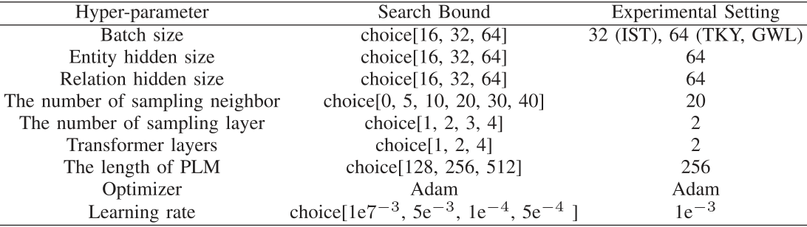

both the regularity of users’ movements and their long- and short-term preferences. r SERM [53] is designed to learn trajectory semantic information to identify user mobility patterns. r LSTPM [16] is a competitive POI recommendation method that learns the long- and short-term preferences of users and presents the geo-dilated LSTM to model geographical effect. r STAN [29] utilizes self-attention layers to capture the spatial-temporal information of check-ins along the trajectory, enabling the exploration of location-to-location interactions between non-adjacent check-ins. r CFPRec [54] learns the context information of the target POI, which uses the Transformer to represent future preferences by the historical trajectory and adopts LSTM to perform multi-step prediction by the current trajectory. r CACSR [55] employs self-supervised contrastive learning to capture the high-level spatial-temporal patterns of user’s trajectories. The graph-based methods include: r STKGRec [9] is a state-of-the-art location-based recommendation method that utilizes the STKG to capture longterm and short-term preferences from user mobility patterns. r GETNext [19] leverages both the user trajectory graph and the probability graph of POI transitions for generating the next recommendation POI. r Graph-Flashback [23] is a state-of-the-art method that leverages an STKG to enhance users’ graph structure association in geospace. r SNPM [20] explicitly exploits the dependency relationships between different timestamps for better capturing the transition patterns.

C. Implementation Details In the process of generating augmented Sub-STKGs, we choose 20 neighbors for each POI in trajectory, the number of layers in KGAT is 2. In the STTP module, we use bert-basedtiny3 as our pre-trained model. Bert-based-tiny has a parameter size of 59.84 M with 4 layers and 12 attention heads, and its hidden embedding size is 312. The input length of Bert is 256.

3 https://huggingface.co/huawei-noah/TinyBERT_4L_zh Following the work [9], [16], [23], we optimize all the parameters in STKG-PLM with the gradient descent optimization algorithm Adam. The batch size is set to 64 and the learning rate is set as 5e-5. When training, the predicted POI is masked. STKG-PLM4 is implemented using PyTorch [56] and PyG [57]. For all baselines, we employ the optimal parameters as reported in the respective publications for all baselines. All the results are obtained over five trials. We report the hyperparameter search bounds and the used configurations as shown in Table II.

Following the previous works [23], [55], we adopt Accuracy@k (Acc@k) and Mean Reciprocal Rank (MRR) as evaluation metrics to assess the performance of STKG-PLM. Acc@k represents the percentage of correctly recommended POIs found within the top-k recommendations, while MRR indicates the position of the correct POI in the ranked list of recommendations. The definitions of evaluation metrics Acc@k and MRR are as follows:

Dk u ∩ Dp  Acc@k = 1 u u| , (15)

|Dp |U| u∈U  MRR = 1 1 ranku , (16)

|U| u∈U where Dk u denotes the set of predicted top-k POIs for user u, Dk u denotes the ground truth label of user u, and ranku denotes the rank of Dp u in Dk

- For our experiments, we empirically set k to 1, 5, and 10.

D. Performance Comparison (RQ1)

The overall experimental results of STKG-PLM and baselines on three datasets are shown in Table III. From the experiment results, we have the following observations:

STKG-PLM consistently is better than the baseline methods in terms of evaluation metrics across all datasets. Compared to thesecond-bestresult,theperformanceofSTKG-PLMimproves by an average of 6.22% on TKY dataset, 8.98% on IST dataset, and 7.44% on GWL dataset. In addition, STKG-PLM exhibits a more substantial performance boost at the top-1 position compared to the top-5 and top-10 positions on three datasets. This finding indicates that STKG-PLM excels at generating high-quality ranked lists on TKY and IST datasets. However, 4 Code is available at https://github.com/WeiChen3690/STKG-PLM/ TABLE III OVERALL PERFORMANCE ON THREE DATASETS IN TERMS OF ACC@1,5,10 (% ), MRR (% )

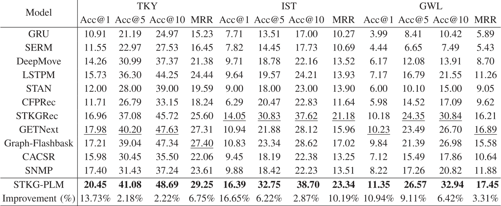

TABLE IV RESULTS OF ABLATION STUDY ON TKY AND GWL DATASETS

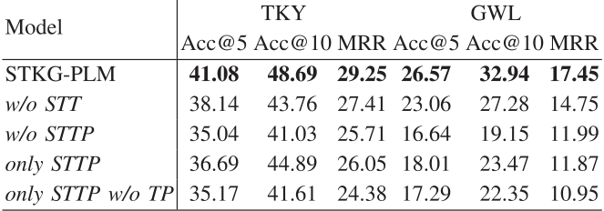

since the GWL dataset is sparser than the TKY and IST datasets, the improvement of our method in terms of top-1 accuracy on the GWL dataset is relatively modest.

Among the various baselines, graph-based methods GETNext and SNMP perform better than other sequence-based methods. This suggests that the graph structure more effectively captures the user’s transition patterns between geospatial POIs. STKGbased methods STKGRec and Graph-Flashbask, is similar to our STKG-PLM by introducing high-order attribute features of POIs in STKG, which is more conducive to the recommendation results. Our STKG-PLM uniquely integrates both the structural information of the sequence and the higher-order attribute features of POIs within the STKG, while also accounting for the user’stransitionsemanticsintrajectorytext.Thiscomprehensive approach is likely a contributing factor to the superior performance of STKG-PLM compared to other baseline methods.

E. Ablation Studies (RQ2)

In this section, we present the results of all ablation studies conducted on the test sets. The purpose of these studies is to showcase the contribution of each module in STKG-PLM towards the final performance. Specifically, we report the results of different variants of STKG-PLM on the TKY and GWL datasets in Table IV.

- Impact of the STTP: w/o STTP in Table IV denotes a variant of STKG-PLM without the STTP module. It can be

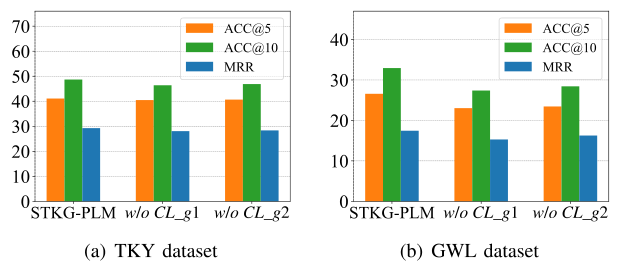

*Fig. 5. Study on the input length of the PLM on TKY and GWL datasets.*

seen that the results of w/o STTP exhibit a significant drop in performance when the STTP module is excluded. These observations highlight the importance of the proposed STTP module in learning the semantics of users’ trajectories.

In Table IV, the variant only STTP only considers the STTP module, and the variant only STTP w/o TP removes the spatialtemporal prompt in the STTP module and directing encoder origin trajectory text by the PLM. It can be observed the performance of only STTP w/o TP declines compared to only STTP. The decline in performance from only STTP to only STTP w/o TP suggests that the spatial-temporal prompt plays a crucial role in capturing spatial-temporal semantic associations of contexts within the trajectory text.

- Impact of the STT: The results denoted as w/o STT in Table IV is a variant of STKG-PLM without considering the spatial-temporal transformer module. It can be seen that w/o STT exhibits poorer performance compared to STKG-PLM on TKY and GWL datasets. This provides compelling evidence supporting the significance of the sequential nature of learned user trajectories in capturing successive patterns effectively.

F. The Effectiveness of STKG Contrastive Learning (RQ3)

In this section, we explore how the STKG contrastive learning contributes to the final results of STKG-PLM. We remove the STKG-CL modules and obtain variant w/o CL_g1 and variant w/oCL_g2. w/oCL_g1 eliminatesthecontrastivelossandretains

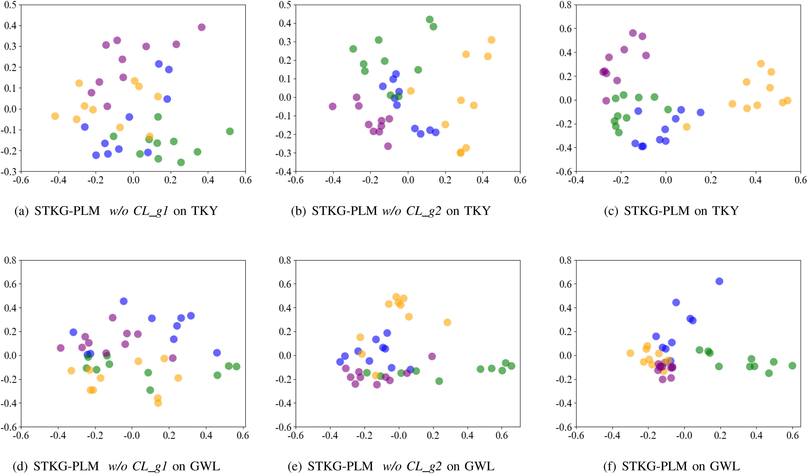

*Fig. 6. Visualizations of POIs distribution in the trajectory of users on TKY and GWL datasets. The nodes with different colors represent the POI sequence of different users’ check-ins.*

an augmented Sub-STKG, while w/o CL_g2 solely eliminates the contrastive loss and retains two augmented Sub-STKG. The results of two variants are shown in Fig. 5. It can be observed that both variant w/o CL_g1 and variant w/o CL_g2 exhibit inferior performance compared to STKG-PLM. This observation underscores the effectiveness of our proposed STKG contrastive learning. The result of w/o CL_g2 is slightly better than that of w/o CL_g1 since w/o CL_g2 considers one more augmented Sub-STKG to capture richer graph structure information.

To further investigate how the proposed STKG contrastive learning identifies the trajectory preferences of different users, we visualize the representations of users’ check-in sequences on the test set. The encodings of check-in POI sequences are transformed via the KPCA method [58]. The result is shown in Fig. 6. it can be seen that Fig. 6(c) exhibits a more distinct clustering of check-in POI sequence representations from different users, when compared with Fig. 6(a) and (b) in TKY dataset. The same phenomenon occurs in Fig. 6(d), (e), and (f) in GWL dataset This observation provides further evidence of the effectiveness of our proposed STKG contrastive learning in distinguishing the trajectory preferences of different users. In other words, STKG contrastivelearningeffectivelydiminishes theimpact of external knowledge that is unrelated to the user’s trajectory.

G. Sensitivity Analysis G. The Hyperparameter Study of PLMs: We conduct supplementary experiments to investigate the impact of diverse PLMs and varying input lengths on the performance of our approach. In our experiment, except for the bert-based-tiny, we attempt TABLE V STUDY ON DIFFERENT PLMS other different pre-trained language models: bert-base-cased5 and bert-base-uncased6. The experiments are conducted with a length of PLM setting 256 on TKY and GWL datasets and the results are shown in Table V. We find that three different PLMs have yielded promising results, indicating that the STKG-PLM approach is not reliant on a specific PLM and possesses a general capability.

Furthermore, we vary the input lengths of the PLM to investigate the influence of this parameter on performance. The lengths of input are evaluated as [128, 256, 512]. Due to constraints in GPU resources, longer sequences are not utilized in our experiments, and the results are presented in Fig. 7. We observe that the length of 256 yields the best outcome. A shorter input length setting would truncate significant semantic information in longer user trajectory sequences, resulting in PLM not being able to understand the complete trajectory text fully. On the other hand, an excessively long input length setting will increase a lot of invalid padding, resulting in sparse trajectory semantics, 5 https://huggingface.co/bert-base-cased 6 https://huggingface.co/bert-base-uncased

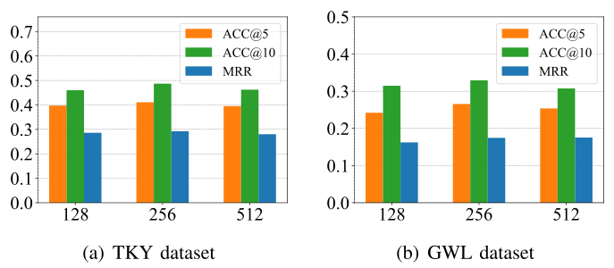

*Fig. 7. Study on the input length of the PLM on TKY and GWL datasets.*

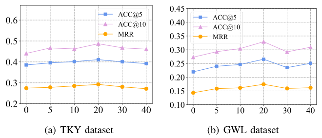

*Fig. 8. Study on the number of STKG sampling on TKY and GWL datasets.*

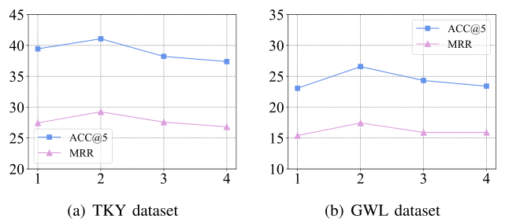

*Fig. 9. Study on the number of layers on TKY and GWL datasets.*

which is not conducive to the modeling of trajectory text for PLM users.

G. The Hyperparameter Study of STKG-CL Module: To study the effect of parameters in the STKG-CL module, we conduct additional experiments to evaluate the numbers of layers and neighbor sampling on the TKY and GWL datasets. The number of layers z is evaluated as [1, 2, 3, 4], and the number of sampling neighbors m is tested in quantities of [5, 10, 20, 30, 40]. The corresponding results are depicted in Figs. 8 and 9. We observe that setting the depth to 2 yields the best performance. Whenthedepthissetto1,theintroductionofexternalknowledge is insufficient, and increasing the depth beyond 2 leads to the inclusion of excessive knowledge that is irrelevant to the user trajectory, thereby resulting in a degradation of performance. It is evident from the results that the optimal performance is attained when both datasets are sampled for each POI neighbor data in the trajectory is 20.

H. Case Study We visualize two user trajectory case on the TKY dataset and provide the geographical distribution of the top-15 POIs recommended by the STKG-PLM and the variant w/o STTP, as

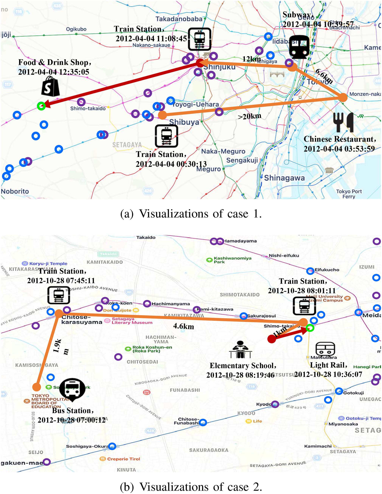

*Fig. 10. Visualizations of the geographical distribution of recommended POIs on TKY dataset. The blue and purple circles are the top-15 POIs predicted by STKG-PLM and the variant w/o STTP, respectively, the green circle is the ground truth, the orange route is the user history trajectory, and the red route is the trajectory to be predicted.*

shown in Fig. 10. It can be intuitively seen that the recommended POIs of the STKG-PLM (blue circles) are geographically close to the ground-truth (green circle) compared with the variant w/o STTP (purple circles).

In Fig. 10(a), the top-3 recommendation list of our STKG- PLM is [1.Government Building, 2.Train Station-Seijogakuenmae, 3.Food & Drink Shop], which contains the ground-truth. The top-15 recommendation list of the variant w/o STTP cannot predict the ground-truth. This observation further illustrates the effectiveness of the proposed STTP module. An accurate understanding of user trajectory semantic information is crucial to improve the accuracy of recommendation.

## VI. CONCLUSION

In this paper, we propose a novel POI recommendation method (STKG-PLM) that explores structured trajectory sequences and unstructured trajectory text data to improve recommendation accuracy. In STKG-PLM, we propose the STTP module that builds a spatial-temporal trajectory prompt template that innovatively converts trajectories into trajectory text corpus based on STKG. PLM is adopted to capture the spatial-temporal correlation of user mobility patterns in trajectory text from coarse-grained and fine-grained perspectives. In addition, we present the STKG-CL module that adopts a learning objective to maximize the consistency between augmented STKG’s subgraphs generated through sampling in STKG, reducing the introduced knowledge noise interference and improving the robustness of spatial-temporal knowledge representation. The experiments conducted on three real-world datasets demonstrate that STKG-PLM consistently outperforms state-of-the-art methods.

In the future, we will further explore POI comments and image features to alleviate the data sparsity problem from a multi-modal perspective, aiming to achieve more accurate recommendation results.

REFERENCES [1] P. Zhao et al., “Where to go next: A spatio-temporal gated network for next POI recommendation,” IEEE Trans. Knowl. Data Eng., vol. 34, no. 5, pp. 2512–2524, May 2022. [2] K. Shao, Y. Wang, Z. Zhou, X. Xie, and G. Wang, “TrajForesee: How limited detailed trajectories enhance large-scale sparse information to predict vehicle trajectories?,” in Proc. 37th IEEE Int. Conf. Data Eng., 2021, pp. 2189–2194. [3] K. Luo et al., “Towards robust trajectory representations: Isolating environmental confounders with causal learning,” in Proc. 33rd Int. Joint Conf. Artif. Intell., 2024, pp. 2243–2251. [4] T. Qian, Y. Chen, G. Cong, Y. Xu, and F. Wang, “AdapTraj: A multi-source domain generalization framework for multi-agent trajectory prediction,” in Proc. IEEE 40th Int. Conf. Data Eng., 2024, pp. 5048–5060. [5] L. Chang, W. Chen, J. Huang, C. Bin, and W. Wang, “Exploiting multiattention network with contextual influence for point-of-interest recommendation,” Appl. Intell., vol. 51, pp. 1904–1917, 2021. [6] Z. Zhou, K. Yang, Y. Liang, B. Wang, H. Chen, and Y. Wang, “Predicting collective human mobility via countering spatiotemporal heterogeneity,” IEEE Trans. Mobile Comput., vol. 23, no. 5, pp. 4723–4738, May 2024. [7] Z. Zhou, Y. Wang, X. Xie, L. Chen, and C. Zhu, “Foresee urban sparse traffic accidents: A spatiotemporal multi-granularity perspective,” IEEE Trans. Knowl. Data Eng., vol. 34, no. 8, pp. 3786–3799, Aug. 2022. [8] Z. Wang, Y. Zhu, C. Wang, W. Ma, B. Li, and J. Yu, “Adaptive graph representation learning for next POI recommendation,” in Proc. 46th Int. ACM SIGIR Conf. Res. Develop. Inf. Retrieval, 2023, pp. 393–402. [9] W. Chen et al., “Building and exploiting spatial-temporal knowledge graph for next POI recommendation,” Knowl. Based Syst., vol. 258, 2022, Art. no. 109951. [10] L. Wang et al., “Bi-level graph structure learning for next POI recommendation,” IEEE Trans. Knowl. Data Eng., vol. 36, no. 11, pp. 5695–5708, Nov. 2024. [11] Z. Ye, X. Zhang, X. Chen, H. Xiong, and D. Yu, “Adaptive clustering based personalized federated learning framework for next POI recommendation with location noise,” IEEE Trans. Knowl. Data Eng., vol. 36, no. 5, pp. 1843–1856, May 2024. [12] T. Qian, Y. Xu, Z. Zhang, and F. Wang, “Trajectory prediction from hierarchical perspective,” in Proc. 30th ACM Int. Conf. Multimedia, 2022, pp. 6822–6830. [13] T. Qian et al., “Context-enhanced multi-view trajectory representation learning: Bridging the gap through self-supervised models,” 2024, arXiv:2410.13196. [14] C. Cheng, H. Yang, M. R. Lyu, and I. King, “Where you like to go next:

Successive point-of-interest recommendation,” in Proc. 23rd Int. Joint Conf. Artif. Intell., F. Rossi, Ed., 2013, pp. 2605–2611. [15] J. Feng et al., “DeepMove: Predicting human mobility with attentional recurrent networks,” in Proc. World Wide Web Conf., 2018, pp. 1459–1468. [16] K. Sun, T. Qian, T. Chen, Y. Liang, Q. V. H. Nguyen, and H. Yin, “Where to go next: Modeling long- and short-term user preferences for point-ofinterest recommendation,” in Proc. 34th AAAI Conf. Artif. Intell., 2020, pp. 214–221. [17] Y. Wu, K. Li, G. Zhao, and X. Qian, “Personalized long- and short-term preference learning for next POI recommendation,” IEEE Trans. Knowl. Data Eng., vol. 34, no. 4, pp. 1944–1957, Apr. 2022.

[18] H. Zang, D. Han, X. Li, Z. Wan, and M. Wang, “CHA: Categorical hierarchy-based attention for next POI recommendation,” ACM Trans. Inf. Syst., vol. 40, no. 1, pp. 1–22, 2021. [19] S. Yang, J. Liu, and K. Zhao, “GETNext: Trajectory flow map enhanced transformer for next POI recommendation,” in Proc. 45th Int. ACM SIGIR Conf. Res. Develop. Inf. Retrieval, 2022, pp. 1144–1153. [20] F. Yin, Y. Liu, Z. Shen, L. Chen, S. Shang, and P. Han, “Next POI recommendation with dynamic graph and explicit dependency,” in Proc. 37th AAAI Conf. Artif. Intell., 2023, pp. 4827–4834. [21] Z.Wang,Y.Zhu,H.Liu,andC.Wang,“Learninggraph-baseddisentangled representations for next POI recommendation,” in Proc. 45th Int. ACM SIGIR Conf. Res. Develop. Inf. Retrieval, 2022, pp. 1154–1163. [22] G. Ma, H. Wang, J. Zhao, R. Yan, and H. Tang, “Successive POI recommendation via brain-inspired spatiotemporal aware representation,” in Proc. AAAI Conf. Artif. Intell., 2024, pp. 574–582. [23] X. Rao, L. Chen, Y. Liu, S. Shang, B. Yao, and P. Han, “Graph-flashback network for next location recommendation,” in Proc. 28th ACM SIGKDD Conf. Knowl. Discov. Data Mining, 2022, pp. 1463–1471. [24] D. S. Shah, H. A. Schwartz, and D. Hovy, “Predictive biases in natural language processing models: A conceptual framework and overview,” in Proc. 58th Annu. Meeting Assoc. Comput. Linguistics, 2020, pp. 5248–5264. [25] L. Choshen, G. Hacohen, D. Weinshall, and O. Abend, “The grammarlearning trajectories of neural language models,” in Proc. 60th Annu. Meeting Assoc. Comput. Linguistics, 2022, pp. 8281–8297. [26] S. Geng, S. Liu, Z. Fu, Y. Ge, and Y. Zhang, “Recommendation as language processing (RLP): A unified pretrain, personalized prompt & predict paradigm (P5),” in Proc. 16th ACM Conf. Recommender Syst., 2022, pp. 299–315. [27] P. Liu, L. Zhang, and J. A. Gulla, “Pre-train, prompt and recommendation:

A comprehensive survey of language modelling paradigm adaptations in recommender systems,” 2023, arXiv:2302.03735. [28] X. Wang, K. Zhou, J. Wen, and W. X. Zhao, “Towards unified conversational recommender systems via knowledge-enhanced prompt learning,” in Proc. 28th ACM SIGKDD Conf. Knowl. Discov. Data Mining, 2022, pp. 1929–1937. [29] Y. Luo, Q. Liu, and Z. Liu, “STAN: Spatio-temporal attention network for next location recommendation,” in Proc. Web Conf., 2021, pp. 2177–2185. [30] C. Duan, W. Fan, W. Zhou, H. Liu, and J. Wen, “CLSPRec: Contrastive learning of long and short-term preferences for next POI recommendation,” in Proc. 32nd ACM Int. Conf. Inf. Knowl. Manage., 2023, pp. 473–482. [31] X. Yan et al., “Spatio-temporal hypergraph learning for next POI recommendation,” in Proc. 46th Int. ACM SIGIR Conf. Res. Develop. Inf. Retrieval, 2023, pp. 403–412. [32] Y. Lai et al., “Disentangled contrastive hypergraph learning for next POI recommendation,” in Proc. 47th Int. ACM SIGIR Conf. Res. Develop. Inf. Retrieval, 2024, pp. 1452–1462. [33] T. Chen, S. Kornblith, M. Norouzi, and G. E. Hinton, “A simple framework for contrastive learning of visual representations,” in Proc. 37th Int. Conf. Mach. Learn., 2020, pp. 1597–1607. [34] P. Khosla et al., “Supervised contrastive learning,” in Proc. Int. Conf.

Neural Inf. Process. Syst., 2020, Art. no. 1567. [35] L. Shi et al., “Self-derived knowledge graph contrastive learning for recommendation,” in Proc. 32nd ACM Int. Conf. Multimedia, 2024, pp. 7571–7580. [36] Y. Zhang et al., “Enhancing sequential recommendation with graph contrastive learning,” in Proc. 31st Int. Joint Conf. Artif. Intell., 2022, pp. 2398–2405. [37] Y. Yang, C. Huang, L. Xia, and C. Li, “Knowledge graph contrastive learning for recommendation,” in Proc. 45th Int. ACM SIGIR Conf. Res. Develop. Inf. Retrieval, 2022, pp. 1434–1443. [38] H. Zhou, Z. Jia, H. Zhu, and Z. Zhang, “CLLP: Contrastive learning framework based on latent preferences for next POI recommendation,” in Proc. 47th Int. ACM SIGIR Conf. Res. Develop. Inf. Retrieval, 2024, pp. 1473–1482. [39] J. Devlin, M. Chang, K. Lee, and K. Toutanova, “BERT: Pre-training of deep bidirectional transformers for language understanding,” in Proc. Conf. North Amer. Chapter Assoc. Comput. Linguistics: Hum. Lang. Technol., 2019, pp. 4171–4186. [40] L. Yao, C. Mao, and Y. Luo, “KG-BERT: BERT for knowledge graph completion,” 2019, arXiv: 1909.03193. [41] W. Xu, B. Liu, M. Peng, X. Jia, and M. Peng, “Pre-trained language model with prompts for temporal knowledge graph completion,” in Proc. Int. Conf. Findings Assoc. Comput. Linguistics, 2023, pp. 7790–7803.

[42] Z. Chen, C. Xu, F. Su, Z. Huang, and Y. Dou, “Incorporating structured sentences with time-enhanced BERT for fully-inductive temporal relation prediction,” in Proc. 46th Int. ACM SIGIR Conf. Res. Develop. Inf. Retrieval, 2023, pp. 889–899. [43] H. Ye et al., “Ontology-enhanced prompt-tuning for few-shot learning,” in Proc. ACM Web Conf., 2022, pp. 778–787. [44] F. Petroni et al., “Language models as knowledge bases?,” in Proc. Conf.

Empirical Methods Natural Lang. Process. 9th Int. Joint Conf. Natural Lang. Process., 2019, pp. 2463–2473. [45] X. Lv et al., “Do pre-trained models benefit knowledge graph completion?

A reliable evaluation and a reasonable approach,” in Proc. Int. Conf. Findings Assoc. Comput. Linguistics, 2022, pp. 3570–3581. [46] P. Velickovic, G. Cucurull, A. Casanova, A. Romero, P. Liò, and Y. Bengio, “Graph attention networks,” in Proc. 6th Int. Conf. Learn. Representations, 2018. [47] X. Wang, X. He, Y. Cao, M. Liu, and T. Chua, “KGAT: Knowledge graph attention network for recommendation,” in Proc. 25th ACM SIGKDD Int. Conf. Knowl. Discov. Data Mining, 2019, pp. 950–958. [48] Y. Lin, Z. Liu, H. Luan, M. Sun, S. Rao, and S. Liu, “Modeling relation paths for representation learning of knowledge bases,” in Proc. Conf. Empirical Methods Natural Lang. Process., 2015, pp. 705–714. [49] A. Vaswani et al., “Attention is all you need,” in Proc. Int. Conf. Neural Inf. Process. Syst., 2017, pp. 5998–6008. [50] D. Yang, B. Qu, and P. Cudré-Mauroux, “Privacy-preserving social media data publishing for personalized ranking-based recommendation,” IEEE Trans. Knowl. Data Eng., vol. 31, no. 3, pp. 507–520, Mar. 2019. [51] X. Liu, Y. Liu, K. Aberer, and C. Miao, “Personalized point-of-interest recommendation by mining users’ preference transition,” in Proc. 22nd ACM Int. Conf. Inf. Knowl. Manage., 2013, pp. 733–738. [52] K. Cho et al., “Learning phrase representations using RNN encoderdecoder for statistical machine translation,” in Proc. Conf. Empirical Methods Natural Lang. Process., 2014, pp. 1724–1734. [53] D. Yao, C. Zhang, J. Huang, and J. Bi, “SERM: A recurrent model for next location prediction in semantic trajectories,” in Proc. ACM Conf. Inf. Knowl. Manage., 2017, pp. 2411–2414. [54] L. Zhang, Z. Sun, Z. Wu, J. Zhang, Y. S. Ong, and X. Qu, “Next point-ofinterest recommendation with inferring multi-step future preferences,” in Proc. 31st Int. Joint Conf. Artif. Intell., 2022, pp. 3751–3757. [55] L. Gong et al., “Contrastive pre-training with adversarial perturbations for check-in sequence representation learning,” in Proc. 37th AAAI Conf. Artif. Intell., 2023, pp. 4276–4283. [56] A. Paszke et al., “PyTorch: An imperative style, high-performance deep learning library,” in Proc. Int. Conf. Neural Inf. Process. Syst., 2019, pp. 8024–8035. [57] M.Fey and J.E.Lenssen,“Fast graph representation learning with PyTorch geometric,” 2019, arXiv: 1903.02428. [58] B. Scholkopf, A. Smola, and K.-R. Müller, “Kernel principal component analysis,” in Proc. Int. Conf. Artif. Neural Netw., 1997, pp. 583–588.

Wei Chen received the PhD degree from the School of Computer Science and Technology, Beijing Jiaotong University, Beijing, China, in 2025. His current research interests include knowledge graph reasoning and spatial-temporal data mining. He has published innovative papers in top-tier conferences such as AAAI, ICDE, ICLR, and EMNLP.

Haoyu Huang received the BS degree in computer science from Beijing Jiaotong University, Beijing, China, in 2019. He is currently working toward the master degree with the Department of Computer Science and Engineering, Chinese University of Hong Kong. His current research interests include knowledge graph reasoning and large language models.

Zhiyu Zhang is currently working toward the master degree with the School of Computer Science and Technology, Beijing Jiaotong University. Her current research interests include knowledge graph reasoning and graph neural networks.

Tianyi Wang received the BS degree in computer science from Beijing Jiaotong University, Beijing, China, in 2022. He is currently working toward the MS degree with the School of Computer Science and Technology, Beijing Jiaotong University. His interest falls in area of deep learning and data mining, especially their applications in spatial-temporal data mining.

Youfang Lin (Senior Member, IEEE) received the PhD degree in signal and information processing from Beijing Jiaotong University, Beijing, China, in 2003. He is currently a professor with the School of Computer Science and Technology, Beijing Jiaotong University. His main fields of expertise and current research interests include Big Data technology, intelligent systems, complex networks, and traffic data mining.

Liang Chang received the PhD degree in computer science from the Institute of Computing Technology, Chinese Academy of Sciences, in 2008. He is currently a professor with the School of Computer Science and Information Security, Guilin University of Electronic Technology, China. His research interests include data and knowledge engineering, formal methods, and trusted software.

Huaiyu Wan (Member, IEEE) received the PhD degreeincomputerscienceandtechnologyfromBeijing Jiaotong University, Beijing, China, in 2012. He is currently a professor with the School of Computer Science and Technology, Beijing Jiaotong University. His current research interests include spatialtemporal data mining, social network mining, information extraction, and knowledge graph.

